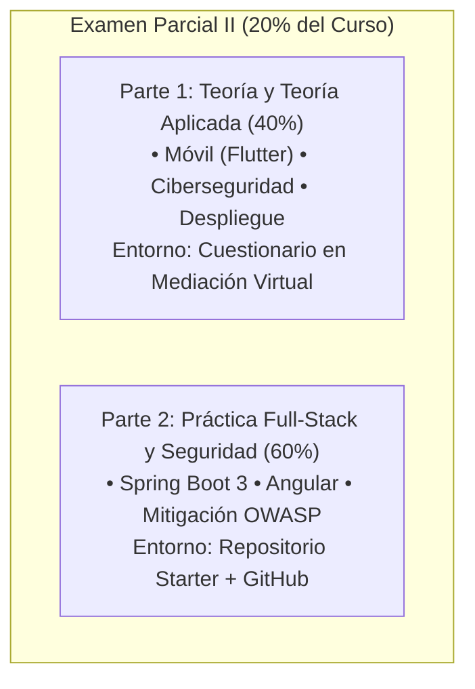

# Examen Parcial II (20%): Anuncio Oficial y Ficha Informativa

**Curso:** IF0009 - Desarrollo de Software IV  
**Docente:** Mag. Jonathan Granados Cortés  
**Grupo:** 022 | **Créditos:** 4 Créditos  
**Ciclo Lectivo:** II Ciclo 2026  
**Modalidad:** Presencial (Laboratorio de Cómputo 3 - Cuestionario Mediación Virtual + Codificación en Vivo)  

---

## 1. Información General del Examen

* **Fecha de Aplicación:** Miércoles 2 de Diciembre, 2026
* **Horario de Inicio:** 1:00 PM (13:00)
* **Horario de Cierre:** 4:30 PM (16:30)
* **Duración Total:** 3 horas y 30 minutos (210 minutos)
* **Ubicación:** Laboratorio de Cómputo 3 (Recinto Paraíso, UCR)
* **Ponderación:** 20% de la nota final del curso
* **Carácter:** Estrictamente Individual (Trabajo Autónomo)
* **Entornos de Entrega:** Cuestionario Moodle UCR (Mediación Virtual) + Repositorio GitHub

---

## 2. Estructura General del Examen

Con el propósito de evaluar de manera rigurosa, eficiente y equilibrada las competencias técnicas del curso, el **Examen Parcial II** se encuentra estructurado en dos bloques complementarios:

> **Nota sobre el componente móvil:**  
> Debido a que la inicialización y compilación de proyectos móviles completos con Flutter y emuladores Android/iOS demandan tiempos elevados y un consumo intensivo de recursos de hardware, **la evaluación del módulo móvil se realiza en la Parte 1 mediante análisis de arquitectura, ciclo de vida y casos de estudio con fragmentos de código**, garantizando una evaluación ágil y sin cuellos de botella de hardware en el laboratorio.

---

## 3. Contenidos Evaluados por Sección

### Parte 1: Teoría y Teoría Aplicada (40% de la Nota del Examen)
*Aplicada a través de Mediación Virtual (Moodle): preguntas conceptuales, emparejamiento, análisis de fragmentos de código y casos de estudio.*

1. **Tema 5.2: Desarrollo de Aplicaciones Móviles (Flutter / Dart):**
   - Arquitectura de Flutter: árbol de *Widgets*, *Element Tree* y *RenderObject Tree*.
   - Ciclo de vida y gestión de estado: componentes reactivos, `StatelessWidget` vs `StatefulWidget`, inmutabilidad y reconstrucción de UI.
   - Layouts y diseño responsivo: `LayoutBuilder`, `MediaQuery`, `BoxConstraints`, Slivers y sistemas de diseño (Material 3 vs Cupertino).
   - Integración con APIs REST y persistencia local: consumo asíncrono, DTOs, `sqflite` (arquitectura *Offline-First*) y almacenamiento seguro (`flutter_secure_storage`).
   - Testing en móvil: pruebas unitarias de lógica y *Widget Testing*.

2. **Tema 06: Seguridad Web y Móvil:**
   - Estándares internacionales **OWASP Top 10 (Web)** y **OWASP Mobile Top 10**.
   - Vectores de ataque críticos: Inyección SQL (SQLi), Cross-Site Scripting (XSS), Control de Acceso Roto (IDOR / BOLA), Fallas Criptográficas y Configuraciones Inseguras (*Security Misconfiguration*).
   - Seguridad en dispositivos móviles: almacenamiento inseguro de datos, comunicaciones no cifradas, permisos en tiempo de ejecución e ingeniería inversa.

3. **Tema 07: Despliegue y Publicación:**
   - Despliegue Web: generación de bundles optimizados de producción, hosting estático vs dinámico, servidores web y proxies inversos (Nginx / systemd), DNS y certificados SSL/TLS con HTTPS.
   - Publicación Móvil: llaves criptográficas y firma digital (`keytool`, `keystore`), formatos de empaquetado (APK vs AAB), ciclo de lanzamiento en Google Play Store y Apple App Store, y directrices de revisión de tiendas.

---

### Parte 2: Práctica de Desarrollo Full-Stack y Seguridad Web (60% de la Nota del Examen)
*Desarrollo práctico sobre un **repositorio starter provisto** (Spring Boot 3 + Angular) que el estudiante clonará al iniciar la prueba.*

1. **Tema 03: Desarrollo Back-End (Spring Boot 3 + JPA):**
   - Implementación y extensión de servicios de negocio y controladores RESTful.
   - Capa de persistencia relacional con Spring Data JPA y consultas seguras.
   - Validación declarativa de contratos DTO con Jakarta Bean Validation y manejo centralizado de excepciones bajo RFC 7807 (`ProblemDetail`).

2. **Tema 04: Desarrollo Front-End (Angular):**
   - Componentes Standalone interactivos y diseño UI responsivo.
   - Formularios reactivos / Data Binding y consumo asíncrono de APIs desacopladas.
   - Manejo de estado del cliente y retroalimentación visual al usuario.

3. **Tema 06: Seguridad Web Aplicada (Defensa en Profundidad):**
   - Mitigación activa contra **Broken Access Control (IDOR / BOLA)** validando la pertenencia del recurso frente al token JWT del usuario autenticado.
   - Prevención de **Inyección SQL (SQLi)** mediante el reemplazo de concatenaciones por consultas parametrizadas seguras (JPQL / Spring Data JPA).
   - Prevención de **XSS** mediante desinfección adecuada de datos y eliminación de bypasses en el cliente.
   - Hardening de configuración: supresión de stack traces técnicos en respuestas HTTP de error.

---

## 4. Tabla de Ponderación del Examen Parcial II

| Componente Evaluado | Formato / Entorno | Ponderación en Examen |
|---|---|:---:|
| **Parte 1: Teoría Aplicada (Móvil, Seguridad y Despliegue)** | Cuestionario Mediación Virtual | **40%** |
| **Parte 2A: Back-End Spring Boot & Persistencia JPA** | Código en Vivo / GitHub | **25%** |
| **Parte 2B: Front-End Angular UI & Consumo REST** | Código en Vivo / GitHub | **20%** |
| **Parte 2C: Remediación y Hardening de Seguridad OWASP** | Código en Vivo / GitHub | **15%** |
| **Total del Examen** | **Evaluación Sumativa (20% del Curso)** | **100%** |

---

## 5. Reglas e Instrucciones Obligatorias

**1. Prohibición Estricta de Herramientas de IA Generativa:**  
Queda terminantemente prohibido el uso de asistentes de IA generativa (ChatGPT, GitHub Copilot, Claude, Gemini, DeepSeek, etc.). Durante la prueba no habrá ninguna herramienta de IA permitida. La detección de código, patrones o respuestas generadas por IA conllevará la anulación inmediata de la evaluación de acuerdo con el Reglamento de Orden y Disciplina de la Universidad de Costa Rica.

**2. Sin Acceso a Documentación Externa ni Recursos Web Abiertos:**  
El examen evalúa el conocimiento práctico y la competencia acumulada por el estudiante a lo largo de las sesiones. No está permitida la consulta de documentación oficial en línea (MDN, Spring Docs, Angular Docs, Flutter Docs), repositorios de clases, apuntes personales ni páginas web de terceros.

**3. Repositorio Starter Provisto y Commits Semánticos en GitHub:**  
La Parte 2 se desarrollará a partir de un repositorio plantilla oficial provisto al iniciar la prueba. El estudiante deberá versionar su solución en su cuenta institucional de GitHub mediante *commits* semánticos periódicos (*Conventional Commits*). Se auditará el historial y marca de tiempo de cada commit para certificar la autoría legítima.

**4. Puntualidad Estricta en el Laboratorio:**  
La prueba iniciará puntualmente a la 1:00 PM en el Laboratorio de Cómputo 3. El cuestionario de Mediación Virtual y el enlace del repositorio se habilitarán a esa hora exacta. No se concederá tiempo adicional por llegadas tardías.

---

## 6. Checklist de Preparación para el Estudiante

* [ ] Verificar credenciales activas de acceso a **Mediación Virtual UCR**.
* [ ] Verificar acceso activo a la cuenta institucional de **GitHub** y llaves SSH / Personal Access Token configurados en su estación de trabajo.
* [ ] Confirmar el correcto funcionamiento local de **JDK 21 LTS**, **Node.js (v18/v20 LTS)** y herramientas de desarrollo en el entorno del laboratorio.
* [ ] Repasar los conceptos clave de arquitectura móvil (widgets, estado, layouts y offline-first con SQLite) y las directrices de empaquetado/despliegue.
* [ ] Repasar los patrones de desarrollo seguro en Spring Boot y Angular para mitigar vulnerabilidades OWASP (SQLi, IDOR, XSS).
* [ ] Practicar la convención de commits semánticos (*feat:*, *fix:*, *refactor:*, *test:*).
