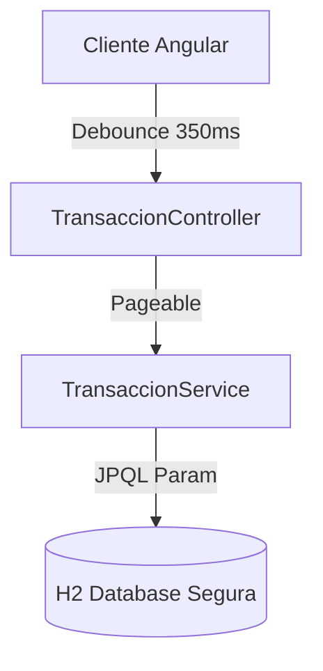

**UNIVERSIDAD DE COSTA RICA**  
**SEDE DEL ATLÁNTICO - RECINTO PARAÍSO**  
**CARRERA DE INFORMÁTICA EMPRESARIAL**  
**CURSO:** IF0009 - Desarrollo de Software IV  
**PROFESOR:** Mag. Jonathan Granados C.  
**SEMESTRE:** II-2026  

---

# Práctica Preparatoria 1: Simulacro Examen II - Arquitectura Reactiva Móvil, Mitigación de Inyección SQL y Paginación Segura

## Resumen Ejecutivo y Propósito

Esta práctica formativa constituye el **primer simulacro integral** 
preparatorio para el **Examen Parcial II**. Su objetivo es familiarizar 
al estudiantado con el formato bimodal de evaluación oficial:

1. **Parte 1 (40% - Teoría Aplicada):** Análisis conceptual y pericial 
   sobre fragmentos de código en Dart/Flutter (ciclo de vida y gestión 
   de memoria en widgets), taxonomía de vulnerabilidades OWASP Web/Móvil 
   y estrategias de empaquetado/despliegue web optimizado.
2. **Parte 2 (60% - Desarrollo Full-Stack y Seguridad Web):** Extensión 
   práctica y remediación defensiva sobre la plataforma bancaria 
   **InsecurePay** (`web_apps/unsecure_web_app_lab`), erradicando una 
   vulnerabilidad crítica de **Inyección SQL (OWASP A03:2021)** mediante 
   consultas JPQL parametrizadas y paginadas en Spring Boot 3, junto con 
   el consumo reactivo con *debouncing* en Angular 18.

Al final del documento se incluye el **Solucionario Analítico y 
Justificación Pedagógica** para permitir el estudio y la autoevaluación 
autónoma del estudiante.

---

## Metadatos de la Práctica

* **Tiempo sugerido de resolución:** 3 horas y 30 minutos (210 minutos).
* **Modalidad:** Trabajo autónomo individual.
* **Puntaje total:** 100 puntos (Escala formativa).
* **Herramientas requeridas:** JDK 21 LTS, Node.js (v18/v20 LTS), Maven, 
  Visual Studio Code, cliente cURL / navegador web y el repositorio 
  `unsecure_web_app_lab`.

---

## Parte 1: Teoría y Teoría Aplicada (40 Puntos)

### Eje Temático A: Desarrollo Móvil en Flutter y Dart (15 Puntos)

#### Pregunta 1.1: Ciclo de Vida y Gestión de Recursos en Widgets (8 Puntos)
Considere el siguiente fragmento de código de un widget en Flutter 
destinado a la captura y filtrado dinámico de movimientos bancarios:

```dart
class BuscadorTransaccionesWidget 
    extends StatefulWidget {
  final Function(String) onBusqueda;
  const BuscadorTransaccionesWidget({
    super.key, 
    required this.onBusqueda
  });

  @override
  State<BuscadorTransaccionesWidget> createState() => 
      _BuscadorTransaccionesWidgetState();
}

class _BuscadorTransaccionesWidgetState 
    extends State<BuscadorTransaccionesWidget> {
  late TextEditingController _controlador;
  late FocusNode _focoTexto;

  @override
  void initState() {
    super.initState();
    _controlador = TextEditingController();
    _focoTexto = FocusNode();
    _controlador.addListener(() {
      widget.onBusqueda(_controlador.text);
    });
  }

  @override
  Widget build(BuildContext context) {
    return TextField(
      controller: _controlador,
      focusNode: _focoTexto,
      decoration: const InputDecoration(
        labelText: 'Filtrar transaccion...',
        prefixIcon: Icon(Icons.search),
      ),
    );
  }
}
```

Con base en el código anterior, responda con precisión técnica:

1. **Defecto de ingeniería:** Identifique el error crítico de 
   gestión de memoria (*Resource / Memory Leak*) presente en la clase 
   `_BuscadorTransaccionesWidgetState` y señale qué método del ciclo de 
   vida de `State` fue omitido.
2. **Impacto en tiempo de ejecución:** Explique qué ocurre con el 
   `TextEditingController`, el listener registrado y el `FocusNode` 
   cuando el widget es removido del árbol de elementos (*Element Tree*) 
   durante la navegación entre pantallas.
3. **Código de corrección:** Escriba el bloque de código exacto que 
   debe incorporarse para liberar adecuadamente los recursos en el 
   sistema operativo móvil anfitrión.

---

#### Pregunta 1.2: Arquitectura del Motor Gráfico de Flutter (7 Puntos)
Flutter desacopla la representación declarativa de la interfaz del 
árbol de dibujado a bajo nivel mediante tres árboles coordinados:

1. **Widget Tree** (Árbol de Widgets).
2. **Element Tree** (Árbol de Elementos).
3. **RenderObject Tree** (Árbol de Objetos de Renderizado).

Complete el siguiente cuadro comparativo indicando la responsabilidad 
principal, la mutabilidad y el costo computacional de instanciación de 
cada estructura:

| Árbol de Flutter | Responsabilidad Arquitectónica | ¿Mutable o Inmutable? | Costo de Creación |
| :--- | :--- | :---: | :---: |
| **Widget Tree** | Configuración declarativa de la UI | *(Indicar)* | *(Alto / Muy Bajo)* |
| **Element Tree** | Vinculación y ciclo de vida (Context) | *(Indicar)* | *(Moderado)* |
| **RenderObject Tree** | Cálculo de layout, pintado y hit-test | *(Indicar)* | *(Costoso / Pesado)*|

---

### Eje Temático B: Seguridad Web y Móvil OWASP (15 Puntos)

#### Pregunta 1.3: Análisis de Vulnerabilidad OWASP A03:2021 (8 Puntos)
Analice la siguiente consulta implementada en un servicio RESTful de 
Java con Spring Data JPA:

```java
public List<Transaccion> buscarPorConcepto(
        String texto) {
    String sql = "SELECT * FROM TRANSACCIONES " +
                 "WHERE CONCEPTO = '" + texto + "'";
    return entityManager
        .createNativeQuery(sql, Transaccion.class)
        .getResultList();
}
```

1. **Vector de ataque:** Escriba un payload SQL que, inyectado en el 
   parámetro `texto`, logre omitir la condición de filtrado y retorne 
   la totalidad de los registros de la tabla.
2. **Impacto:** Clasifique la vulnerabilidad según el catálogo **OWASP 
   Top 10:2021** (indique código y nombre oficial) y explique el impacto 
   sobre la confidencialidad de datos financieros.
3. **Mecanismo de mitigación:** Explique por qué el uso de *Prepared 
   Statements* o parámetros nombrados en JPQL (`:param`) neutraliza 
   por completo este vector a nivel de compilación del plan de ejecución 
   del motor SQL.

---

#### Pregunta 1.4: OWASP Mobile Top 10 - Persistencia Insegura (7 Puntos)
Un desarrollador junior decide almacenar el token JWT del usuario y su 
código PIN de transferencias bancarias en la plataforma móvil utilizando 
el paquete `shared_preferences` de Flutter en Android.

1. **Clasificación de riesgo:** Indique qué categoría del **OWASP 
   Mobile Top 10** se está vulnerando directamente con esta práctica.
2. **Diagnóstico pericial:** Explique en qué ubicación física del 
   sistema de archivos de Android se almacena la información de 
   `SharedPreferences`, en qué formato se guarda y por qué un usuario 
   con acceso root o una aplicación maliciosa con permisos de respaldo 
   (`adb backup`) puede exfiltrar dichos secretos.
3. **Alternativa segura:** Nombre la biblioteca estándar de Flutter y 
   la tecnología nativa subyacente de Android (ej. Keystore/EncryptedSharedPreferences) 
   que debe emplearse para salvaguardar credenciales criptográficas.

---

### Eje Temático C: Despliegue y Publicación Web (10 Puntos)

#### Pregunta 1.5: Optimización de Bundles y Políticas de Caché HTTP (10 Puntos)
Al ejecutar el comando `ng build --configuration production` en una 
aplicación Angular:

1. **Técnicas de optimización:** Defina qué es el proceso de 
   *Tree-Shaking* y qué función cumple la *Minificación / Uglification* 
   en los archivos de salida generados en `dist/`.
2. **Cache Busting:** Angular genera nombres de archivo con hashes 
   criptográficos únicos (ejemplo: `main-CMPDLICE.js`). Explique cómo 
   esta convención técnica previene que los navegadores web de los 
   usuarios conserven versiones desactualizadas de la aplicación tras 
   un despliegue a producción.
3. **Cabecera HTTP:** Escriba la directiva exacta de la cabecera 
   `Cache-Control` que un servidor web (como Nginx) debe inyectar para 
   los archivos JS/CSS con hash, frente a la directiva que debe 
   asignar al archivo `index.html`.

---

## Parte 2: Práctica Full-Stack y Seguridad Web (60 Puntos)

### Contexto del Escenario Técnico: InsecurePay
Usted trabajará sobre el proyecto ubicado en:
`web_apps/unsecure_web_app_lab`

Actualmente, el buscador de transacciones financieras 
(`GET /api/transacciones/buscar?termino=...`) padece de una falla de 
**Inyección SQL por concatenación de cadenas** en `TransaccionService.java`. 
Además, la interfaz en Angular ejecuta peticiones HTTP directas con cada 
tecla que el usuario presiona, carece de límite de paginación y permite 
que un atacante extraiga miles de filas saturando el navegador y el 
servidor de base de datos H2.



---

### Tarea 2.1: Refactorización Defensiva Back-End en Spring Boot (30 Puntos)

#### Requerimiento 2.1.1: Repositorio Paginado y Consulta Parametrizada (15 Puntos)
Modifique la interfaz 
`backend/src/main/java/cr/ac/ucr/if0009/insecurepay/repository/TransaccionRepository.java` 
para definir un método de búsqueda que cumpla con los siguientes requisitos:

1. Utilizar una consulta declarativa **JPQL** con `@Query`.
2. Vincular el parámetro de búsqueda de manera segura con `@Param("termino")` 
   utilizando la función estándar `LOWER()` y `CONCAT('%', :termino, '%')`.
3. Admitir un parámetro de paginación estándar de Spring Data: 
   `org.springframework.data.domain.Pageable`.
4. Retornar una página tipada de entidades: `Page<Transaccion>`.

#### Requerimiento 2.1.2: Refactorización de la Capa de Servicio y Controlador (15 Puntos)
1. En `TransaccionService.java`, elimine el método vulnerable basado en 
   `entityManager.createNativeQuery` concatenado.
2. Implemente el método seguro:
   ```java
   public Page<TransaccionDto> 
       buscarTransaccionesPaginadas(
           String termino, int pagina, int tamano);
   ```
3. Si el término recibido es nulo o vacío, el servicio debe retornar la 
   página de transacciones ordenadas descendentemente por fecha sin 
   filtrar por concepto.
4. En `TransaccionController.java`, exponga el endpoint:
   `GET /api/transacciones/buscar-seguro?termino=...&page=0&size=10` 
   retornando código HTTP `200 OK` con la estructura de metadatos de 
   paginación de Spring Data (número de página, total de páginas y lista).

---

### Tarea 2.2: Implementación Reactiva Front-End en Angular (20 Puntos)

En el módulo de transacciones de Angular (`frontend/src/app/components/transacciones/`):

1. **Patrón Debounce:** En `transacciones.component.ts`, sustituya la 
   ejecución inmediata del evento `(input)` por un flujo reactivo basado 
   en `Subject<string>` de RxJS.
2. **Operadores RxJS:** Encadene los operadores `debounceTime(350)` y 
   `distinctUntilChanged()` para asegurar que únicamente se despache la 
   petición HTTP tras 350 milisegundos de inactividad del teclado y 
   solo si el texto ingresado ha cambiado.
3. **Soporte de Paginación:** Incorpore controles visuales sencillos en 
   la plantilla HTML (`Anterior` y `Siguiente`) para navegar entre 
   páginas de 10 elementos consumiendo el nuevo contrato paginado.

---

### Tarea 2.3: Validación y Pruebas Periciales de Seguridad (10 Puntos)

Ejecute las siguientes dos pruebas de verificación pericial documentando 
la evidencia técnica:

**Paso 1 (Prueba de Inyección Neutralizada):** Envíe a través de terminal 
o navegador el payload clásico de inyección SQL:
```bash
URL="http://localhost:8080"
curl -G -X GET \
  "$URL/api/transacciones/buscar-seguro" \
  --data-urlencode "termino=' OR 1=1 --" \
  --data-urlencode "page=0" \
  --data-urlencode "size=10"
```
*Criterio de aceptación:* La respuesta JSON debe retornar 0 resultados 
en el arreglo `content`, confirmando que el motor de base de datos 
trató el payload como una cadena literal y no como código SQL ejecutable.

**Paso 2 (Prueba de Búsqueda Legítima Paginada):** Envíe el término legítimo 
`pago`:
```bash
URL="http://localhost:8080"
curl -G -X GET \
  "$URL/api/transacciones/buscar-seguro" \
  --data-urlencode "termino=pago" \
  --data-urlencode "page=0" \
  --data-urlencode "size=5"
```
*Criterio de aceptación:* El servidor debe responder con HTTP 200 
conteniendo los registros coincidentes y los metadatos `totalElements`, 
`totalPages` y `size=5`.

---

## Solucionario Analítico y Justificación Pedagógica

### Solución Parte 1: Teoría y Teoría Aplicada

#### Respuesta 1.1: Ciclo de Vida y Gestión de Recursos en Flutter
1. **Falla identificada:** La clase `_BuscadorTransaccionesWidgetState` 
   omitió la sobreescritura del método `dispose()`.
2. **Impacto:** Tanto `TextEditingController` como `FocusNode` mantienen 
   oyentes de eventos enlazados a la ventana gráfica del sistema operativo. 
   Al destruirse el widget sin invocar `dispose()`, estos objetos quedan 
   huérfanos en memoria (*Leak*), provocando que cada nueva visita a la 
   pantalla incremente el consumo de memoria RAM y mantenga listeners 
   activos llamando a callbacks sobre estados inexistentes.
3. **Código de remediación exacto:**

```dart
@override
void dispose() {
  _controlador.dispose();
  _focoTexto.dispose();
  super.dispose();
}
```

---

#### Respuesta 1.2: Árboles del Motor Gráfico de Flutter

| Árbol de Flutter | Responsabilidad Arquitectónica | ¿Mutable o Inmutable? | Costo de Creación |
| :--- | :--- | :---: | :---: |
| **Widget Tree** | Configuración declarativa de la UI | Inmutable | Muy Bajo |
| **Element Tree** | Vinculación y ciclo de vida (Context) | Mutable | Moderado |
| **RenderObject Tree** | Cálculo de layout, pintado y hit-test | Mutable | Costoso / Pesado |

*Justificación pedagógica:* Los widgets son configuraciones livianas e 
inmutables que se descartan y recrean constantemente. Flutter solo 
recalcula el `RenderObjectTree` cuando la geometría o layout cambia, 
optimizando el rendimiento a 60/120 FPS.

---

#### Respuesta 1.3: Análisis de OWASP A03:2021 (Inyección SQL)
1. **Payload efectivo:** `' OR '1'='1` o también `' OR 1=1 --`.
2. **Clasificación:** **OWASP A03:2021 - Injection (CWE-89)**. Permite a 
   un usuario no autenticado o no autorizado acceder a la totalidad de 
   movimientos bancarios de clientes ajenos, violando la confidencialidad.
3. **Mecanismo de mitigación:** Las consultas parametrizadas envían la 
   plantilla SQL precompilada al motor relacional antes de enviar los 
   datos. El motor trata el valor del parámetro estrictamente como un 
   literal (*String value*), impidiendo que caracteres reservados como 
   comillas o guiones alteren la gramática del comando SQL.

---

#### Respuesta 1.4: OWASP Mobile Top 10 - Persistencia Insegura
1. **Clasificación:** **OWASP Mobile Top 10 - M2: Insecure Data Storage**.
2. **Diagnóstico:** En Android, `SharedPreferences` almacena los datos en 
   un archivo XML plano sin cifrar en `/data/data/<package_name>/shared_prefs/`. 
   Cualquier dispositivo con root o mediante respaldos ADB puede leer el 
   token y el PIN en texto claro.
3. **Alternativa segura:** Debe utilizarse el paquete **`flutter_secure_storage`**, 
   el cual utiliza internamente el **Android Keystore** y las preferencias 
   cifradas (**EncryptedSharedPreferences** con algoritmo AES-256 GCM) en 
   Android, y el **Keychain** en iOS.

---

#### Respuesta 1.5: Despliegue y Políticas de Caché HTTP
1. **Tree-Shaking y Minificación:**
   - *Tree-Shaking:* Proceso que elimina el código muerto o librerías 
     importadas que no se invocan en el proyecto.
   - *Minificación:* Proceso que acorta nombres de variables, remueve 
     espacios en blanco y comentarios para reducir drásticamente el 
     peso del bundle en kilobytes.
2. **Cache Busting:** Al cambiar el contenido del código fuente, el hash 
   en el nombre del archivo cambia (ej: `main-V2XYZ.js`). Esto obliga al 
   navegador a descargar el nuevo archivo en lugar de usar la copia en 
   caché local del cliente.
3. **Directivas HTTP seguras:**
   - Para activos estáticos con hash (JS/CSS/PNG):  
     `Cache-Control: public, max-age=31536000, immutable`
   - Para el archivo de entrada `index.html`:  
     `Cache-Control: no-cache, no-store, must-revalidate`

---

### Solución Parte 2: Práctica Full-Stack y Seguridad Web

#### Solución Código Back-End: `TransaccionRepository.java`

```java
package cr.ac.ucr.if0009.insecurepay.repository;

import cr.ac.ucr.if0009.insecurepay.model.Transaccion;
import org.springframework.data.domain.Page;
import org.springframework.data.domain.Pageable;
import org.springframework.data.jpa.repository
    .JpaRepository;
import org.springframework.data.jpa.repository.Query;
import org.springframework.data.repository.query.Param;

public interface TransaccionRepository 
        extends JpaRepository<Transaccion, Long> {

    @Query("SELECT t FROM Transaccion t " +
           "WHERE (:termino IS NULL OR " +
           "       LOWER(t.concepto) LIKE " +
           "       LOWER(CONCAT('%',:termino,'%')) " +
           "       OR LOWER(t.estado) LIKE " +
           "       LOWER(CONCAT('%',:termino,'%')))" +
           "ORDER BY t.fechaHora DESC")
    Page<Transaccion> buscarPorTerminoPaginado(
            @Param("termino") String termino, 
            Pageable pageable);
}
```

#### Solución Código Back-End: `TransaccionService.java`

```java
@Transactional(readOnly = true)
public Page<TransaccionDto> 
    buscarTransaccionesPaginadas(
        String termino, int pagina, int tamano) {
    Pageable pageable = PageRequest.of(
        Math.max(0, pagina), 
        Math.max(1, tamano), 
        Sort.by("fechaHora").descending()
    );
    
    String terminoLimpio = (termino != null && 
        !termino.trim().isEmpty()) ? 
        termino.trim() : null;

    return transaccionRepository
        .buscarPorTerminoPaginado(
            terminoLimpio, pageable)
        .map(this::mapearDto);
}
```

#### Solución Código Back-End: `TransaccionController.java`

```java
@GetMapping("/buscar-seguro")
public ResponseEntity<Page<TransaccionDto>> 
    buscarSeguro(
        @RequestParam(required = false) String termino,
        @RequestParam(defaultValue = "0") int page,
        @RequestParam(defaultValue = "10") int size) {
    return ResponseEntity.ok(
        transaccionService
            .buscarTransaccionesPaginadas(
                termino, page, size)
    );
}
```

---

#### Solución Código Front-End: `transacciones.component.ts`

```typescript
import { Component, OnInit, 
         OnDestroy } from '@angular/core';
import { Subject, Subscription } from 'rxjs';
import { debounceTime, 
         distinctUntilChanged } from 'rxjs/operators';
import { BancoService } from 
    '../../services/banco.service';

@Component({
  selector: 'app-transacciones',
  standalone: true,
  templateUrl: './transacciones.component.html'
})
export class TransaccionesComponent 
    implements OnInit, OnDestroy {
  terminoBusqueda = '';
  paginaActual = 0;
  totalPaginas = 1;
  private buscadorSubject = new Subject<string>();
  private subscripcion?: Subscription;

  constructor(private bancoService: BancoService) {}

  ngOnInit(): void {
    this.subscripcion = this.buscadorSubject.pipe(
      debounceTime(350),
      distinctUntilChanged()
    ).subscribe(texto => {
      this.paginaActual = 0;
      this.cargarTransacciones(
        texto, this.paginaActual);
    });
    this.cargarTransacciones('', 0);
  }

  onInputCambio(valor: string): void {
    this.buscadorSubject.next(valor);
  }

  cargarTransacciones(termino: string, 
                      pagina: number): void {
    this.bancoService.buscarTransaccionesPaginadas(
      termino, pagina, 10
    ).subscribe(res => {
      this.transacciones = res.content;
      this.totalPaginas = res.totalPages;
      this.paginaActual = res.number;
    });
  }

  ngOnDestroy(): void {
    this.subscripcion?.unsubscribe();
  }
}
```

---

## Criterios de Evaluación y Rúbrica Formativa

| Criterio Evaluado | Indicador de Logro | Puntaje |
| :--- | :--- | :---: |
| **Ciclo de Vida y Flutter** | Identificación de omisión de `dispose()`, mitigación de fugas de memoria y comparación de los 3 árboles de Flutter. | **15 pts** |
| **Seguridad OWASP Web/Móvil** | Análisis pericial de inyección SQL, payloads, CWE-89 y riesgos de almacenamiento plano en SharedPreferences móvil. | **15 pts** |
| **Optimización y Despliegue** | Tree-Shaking, minificación, hashing de cache-busting y cabeceras HTTP `Cache-Control` en servidores de producción. | **10 pts** |
| **Refactorización Back-End** | Consulta declarativa JPQL parametrizada en Spring Data JPA, paginación con `Pageable` y endpoint seguro en Spring Boot. | **30 pts** |
| **Consumo Reactivo Front-End** | Implementación de `Subject`, `debounceTime`, `distinctUntilChanged` y paginación en componente Angular 18. | **20 pts** |
| **Verificación Defensiva** | Demostración empírica de neutralización de SQLi y retorno correcto de metadatos de paginación. | **10 pts** |
| **Total** | **Evaluación Formativa Integral Simulacro 1** | **100 pts** |
