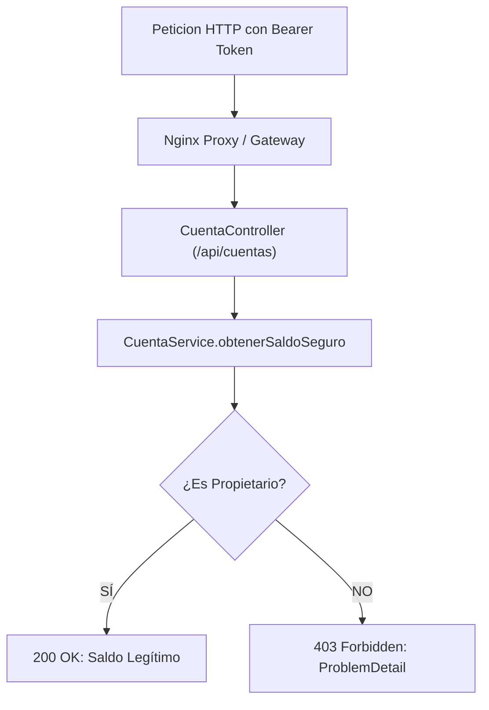

**UNIVERSIDAD DE COSTA RICA**  
**SEDE DEL ATLÁNTICO - RECINTO PARAÍSO**  
**CARRERA DE INFORMÁTICA EMPRESARIAL**  
**CURSO:** IF0009 - Desarrollo de Software IV  
**PROFESOR:** Mag. Jonathan Granados C.  
**SEMESTRE:** II-2026  

---

# Práctica Preparatoria 2: Simulacro Examen II - Diseño Adaptativo Móvil, Mitigación de IDOR/BOLA con JWT y Nginx Proxy

## Resumen Ejecutivo y Propósito

Esta práctica formativa constituye el **segundo simulacro integral** 
preparatorio para el **Examen Parcial II**. Aborda con rigurosidad 
técnica los principios de diseño adaptativo en dispositivos móviles, 
la neutralización del vector más prevalente del estándar internacional 
(**OWASP A01:2021 - Broken Access Control / IDOR / BOLA**) y el 
enrutamiento seguro en servidores de producción:

1. **Parte 1 (40% - Teoría Aplicada):** Diagnóstico y corrección de 
   bloqueos de renderizado en Flutter (`RenderFlex overflowed`), análisis 
   pericial de referencias directas inseguras a objetos (IDOR / BOLA) en 
   APIs bancarias y configuración técnica de Nginx como proxy inverso.
2. **Parte 2 (60% - Desarrollo Full-Stack y Seguridad Web):** Extensión 
   defensiva sobre **InsecurePay** (`web_apps/unsecure_web_app_lab`), 
   implementando la validación estricta de propiedad de recursos 
   (*Resource Ownership*) a partir de tokens JWT en Spring Boot 3 con 
   respuestas RFC 7807, e interceptores HTTP reactivos en Angular 18.

---

## Metadatos de la Práctica

* **Tiempo sugerido de resolución:** 3 horas y 30 minutos (210 minutos).
* **Modalidad:** Trabajo autónomo individual.
* **Puntaje total:** 100 puntos (Escala formativa).
* **Herramientas requeridas:** JDK 21 LTS, Node.js (v18/v20 LTS), Maven, 
  Visual Studio Code, cliente cURL y el proyecto `unsecure_web_app_lab`.

---

## Parte 1: Teoría y Teoría Aplicada (40 Puntos)

### Eje Temático A: Diseño Adaptativo y Layouts en Flutter (15 Puntos)

#### Pregunta 1.1: Diagnóstico de Error `RenderFlex overflowed` (8 Puntos)
Un estudiante implementa una tarjeta de resumen financiero en Flutter 
con el siguiente diseño:

```dart
Widget construirTarjetaBalance(
    String nombreCliente, 
    String iban, 
    double saldo) {
  return Card(
    child: Row(
      children: [
        const Icon(Icons.account_balance_wallet, 
                   size: 40),
        Column(
          crossAxisAlignment: 
              CrossAxisAlignment.start,
          children: [
            Text(nombreCliente, 
                 style: const TextStyle(fontSize: 18)),
            Text('IBAN: $iban', 
                 style: const TextStyle(fontSize: 13)),
          ],
        ),
        Text('CRC ${saldo.toStringAsFixed(2)}',
             style: const TextStyle(
               fontWeight: FontWeight.bold, 
               fontSize: 20)),
      ],
    ),
  );
}
```

Al probar la aplicación en un teléfono con pantalla pequeña o en modo 
horizontal con un nombre de cliente extenso (ej. 35 caracteres), la 
pantalla muestra el error gráfico característico de franjas amarillas y 
negras con el mensaje:
`A RenderFlex overflowed by 48.7 pixels on the right`.

1. **Causa raíz:** Explique matemáticamente por qué se produce el 
   desbordamiento en el widget `Row`.
2. **Corrección con widgets de flexión:** ¿Qué widget envolvente de 
   Flutter (`Expanded` o `Flexible`) debe utilizarse sobre el widget 
   `Column` para forzarlo a respetar las restricciones de ancho 
   restante sin desplazar el texto del saldo fuera de la pantalla?
3. **Manejo de elipsis:** Escriba la propiedad que debe agregarse al 
   `Text(nombreCliente)` para truncar con puntos suspensivos (`...`) si 
   el texto aún excede el espacio disponible.

---

#### Pregunta 1.2: Adaptabilidad y Restricciones con LayoutBuilder (7 Puntos)
Analice las siguientes dos herramientas de adaptación de pantalla en 
Flutter: `MediaQuery.of(context).size` y `LayoutBuilder`.

1. **Diferencia de alcance:** ¿Cuál es la diferencia fundamental entre 
   las dimensiones provistas por `MediaQuery` y los `BoxConstraints` 
   entregados por `LayoutBuilder`?
2. **Caso de uso:** En una interfaz dividida en paneles (*Master-Detail* 
   en tableta o web), ¿por qué es una mala práctica utilizar `MediaQuery` 
   para decidir el diseño de un componente secundario dentro de un panel 
   lateral?

---

### Eje Temático B: Seguridad Web y Móvil OWASP (15 Puntos)

#### Pregunta 1.3: Taxonomía y Anatomía de IDOR / BOLA (8 Puntos)
En la auditoría forense de una billetera digital, se detecta que el 
endpoint `GET /api/cuentas/{id}/saldo` retorna el saldo bancario 
asociado al identificador numérico `{id}`.

1. **Definición:** Defina qué es una falla de tipo **IDOR** (*Insecure 
   Direct Object Reference*) y por qué **OWASP Top 10:2021** la incluye 
   en la categoría número 1: **A01 - Broken Access Control**.
2. **Diferencia Autenticación vs Autorización:** El desarrollador 
   argumenta: *"El endpoint es seguro porque requiere un token JWT 
   válido en la cabecera `Authorization`"*. Refute técnicamente esta 
   afirmación explicando por qué la autenticación exitosa no previene 
   el vector IDOR si se omite la validación de propiedad (*Resource 
   Ownership*).
3. **Escalamiento horizontal vs vertical:** Explique si consultar el 
   saldo de otro usuario cliente constituye un escalamiento de privilegios 
   horizontal o vertical.

---

#### Pregunta 1.4: OWASP Mobile M3 - Comunicaciones Inseguras (7 Puntos)
Una aplicación móvil realiza peticiones HTTP a su API de backend mediante 
una URL con protocolo `http://api.bancocostarica.com`.

1. **Riesgo:** Explique qué es un ataque de hombre en el medio (*MitM*) 
   y cómo un atacante conectado a una red Wi-Fi pública puede capturar 
   los tokens JWT y números de cuenta en tránsito.
2. **Defensas nativas:** ¿Qué directiva de configuración en Android 
   (`network_security_config.xml`) y en iOS (`NSAppTransportSecurity`) 
   debe aplicarse para bloquear absolutamente el tráfico HTTP en texto 
   claro?
3. **Certificate Pinning:** ¿En qué consiste la técnica de *SSL/TLS 
   Pinning* en una aplicación móvil Flutter y contra qué escenario de 
   compromiso (ej. CA raíz maliciosa instalada en el dispositivo) 
   ofrece protección?

---

### Eje Temático C: Despliegue con Reverse Proxies (10 Puntos)

#### Pregunta 1.5: Configuración de Nginx como Proxy Inverso (10 Puntos)
Considere el siguiente bloque de configuración de Nginx:

```nginx
server {
    listen 80;
    server_name api.insecurepay.cr;

    location / {
        proxy_pass http://127.0.0.1:8080;
        proxy_set_header Host $host;
        proxy_set_header X-Real-IP $remote_addr;
        proxy_set_header X-Forwarded-For 
            $proxy_add_x_forwarded_for;
        proxy_set_header X-Forwarded-Proto $scheme;
    }
}
```

1. **Función de `proxy_pass`:** Explique qué acción realiza Nginx 
   cuando un cliente externo realiza una solicitud a `api.insecurepay.cr`.
2. **Importancia de `X-Forwarded-For`:** Si Nginx no inyectara la 
   cabecera `X-Forwarded-For`, ¿qué dirección IP registraría Spring 
   Boot en sus logs y sistemas de rate-limiting para todos los usuarios 
   remotos?
3. **Aislamiento de puertos:** ¿Por qué es una buena práctica de 
   seguridad en producción bloquear el puerto 8080 en el firewall del 
   sistema operativo (ej. `ufw`) y permitir acceso público únicamente a 
   través de Nginx (puertos 80 y 443)?

---

## Parte 2: Práctica Full-Stack y Seguridad Web (60 Puntos)

### Contexto del Escenario Técnico: InsecurePay
En el repositorio `web_apps/unsecure_web_app_lab`:
- El endpoint `GET /api/cuentas/{id}/saldo` es vulnerable a **IDOR**. 
  Cualquier cliente autenticado (ej. `carlos_mora`) puede consultar el 
  saldo confidencial de otros clientes (ej. `maria_rojas` o `juan_perez`) 
  simplemente modificando el `{id}` en la URL.
- En el frontend, las llamadas HTTP no cuentan con un interceptor 
  centralizado, obligando a cada servicio a inyectar tokens manualmente 
  y dejando las peticiones expuestas a fallos de sincronización.



---

### Tarea 2.1: Validación Estricta de Propiedad en Spring Boot (30 Puntos)

#### Requerimiento 2.1.1: Excepción Segura y Formato RFC 7807 (10 Puntos)
1. Cree la clase de excepción de negocio:
   `cr.ac.ucr.if0009.insecurepay.exception.AccesoDenegadoException` 
   heredando de `RuntimeException`.
2. En `GlobalExceptionHandler.java` (o controlador de excepciones 
   con `@RestControllerAdvice`), capture `AccesoDenegadoException` y 
   retorne un objeto estándar de Spring 6 `ProblemDetail` con:
   - Código de estado: HTTP `403 Forbidden`.
   - Título: `Acceso no autorizado a recurso ajeno`.
   - Detalle: Mensaje descriptivo de seguridad sin exponer nombres de 
     tablas ni identidades de otros clientes.

#### Requerimiento 2.1.2: Refactorización Defensiva en Capa de Servicio (20 Puntos)
En `CuentaService.java`:
1. Cree el método defensivo:
   ```java
   public CuentaDto obtenerCuentaSegura(
           Long cuentaId, String authHeader);
   ```
2. El método debe:
   - Extraer el token JWT de la cabecera `Authorization: Bearer <token>`.
   - Extraer el `username` del usuario emisor mediante `JwtUtil`.
   - Buscar la cuenta bancaria por su `id` (si no existe, retornar 404).
   - Validar que el `username` del propietario de la cuenta coincida 
     exactamente con el `username` del token JWT (o que el rol sea 
     `ADMIN`).
   - Si no coincide, lanzar `AccesoDenegadoException`.
3. Actualice `CuentaController.java` para que los endpoints `GET /{id}` 
   y `GET /{id}/saldo` reciban `@RequestHeader("Authorization") String authHeader` 
   e invoquen la lógica segura.

---

### Tarea 2.2: Interceptor HTTP Defensivo en Angular 18 (20 Puntos)

En el proyecto de Angular (`frontend/src/`):

1. **Creación del Interceptor:** Cree el interceptor funcional 
   `frontend/src/app/interceptors/auth.interceptor.ts` utilizando la 
   función estándar de Angular 18:
   ```typescript
   export const authInterceptor: HttpInterceptorFn = 
       (req, next) => { ... };
   ```
2. **Inyección de Cabecera:** Si existe un token JWT en `localStorage`, 
   el interceptor debe clonar la petición entrante e inyectar la 
   cabecera `Authorization: Bearer <token>`.
3. **Manejo de Errores 401/403:** Capture errores HTTP utilizando el 
   operador `catchError` de RxJS. Si el backend responde con código 
   `401 Unauthorized` o `403 Forbidden`, el interceptor debe limpiar 
   la sesión y redirigir al usuario automáticamente a la ruta `/login`.
4. **Registro en `app.config.ts`:** Registre el interceptor en la 
   configuración global mediante:
   ```typescript
   provideHttpClient(
     withInterceptors([authInterceptor]))
   ```

---

### Tarea 2.3: Verificación Pericial y Evidencias DAST (10 Puntos)

Ejecute las siguientes dos pruebas periciales:

**Paso 1 (Intento IDOR Bloqueado):** Inicie sesión como `carlos_mora` y 
obtenga su token JWT. Intente consultar la cuenta ID `3` (perteneciente 
a `maria_rojas`):
```bash
TOKEN="<TOKEN_DE_CARLOS>"
curl -i -X GET \
  http://localhost:8080/api/cuentas/3/saldo \
  -H "Authorization: Bearer $TOKEN"
```
*Criterio de aceptación:* El servidor debe responder con HTTP `403 Forbidden` 
y un payload JSON estructurado bajo RFC 7807 sin revelar el saldo de María.

**Paso 2 (Consulta Legítima Autorizada):** Consulte la cuenta ID `1` 
(propiedad de `carlos_mora`):
```bash
TOKEN="<TOKEN_DE_CARLOS>"
curl -i -X GET \
  http://localhost:8080/api/cuentas/1/saldo \
  -H "Authorization: Bearer $TOKEN"
```
*Criterio de aceptación:* El servidor debe responder con HTTP `200 OK` 
y retornar el saldo legítimo de Carlos Mora.

---

## Solucionario Analítico y Justificación Pedagógica

### Solución Parte 1: Teoría y Teoría Aplicada

#### Respuesta 1.1: Diagnóstico de Error `RenderFlex overflowed`
1. **Causa:** El widget `Row` asigna ancho ilimitado a sus hijos en el 
   eje horizontal. Dado que ni el `Icon`, ni el `Column`, ni el `Text` 
   del saldo tienen restricciones de compresión, la suma de sus anchos 
   superó el ancho total de la pantalla del dispositivo.
2. **Corrección con flexión:** Debe envolverse el widget `Column` 
   dentro de un widget **`Expanded`**. Esto restringe el ancho de la 
   columna al espacio remanente exacto entre el ícono y el saldo.
3. **Truncado con elipsis:**
   ```dart
   Text(
     nombreCliente,
     maxLines: 1,
     overflow: TextOverflow.ellipsis,
     style: const TextStyle(fontSize: 18),
   )
   ```

---

#### Respuesta 1.2: Restricciones con LayoutBuilder vs MediaQuery
1. **Diferencia de alcance:** `MediaQuery.of(context).size` retorna el 
   tamaño total de la ventana gráfica física del dispositivo (*Screen Viewport*). 
   En cambio, `LayoutBuilder` provee los `BoxConstraints` asignados por el 
   widget padre inmediato en ese nodo específico del árbol.
2. **Caso de uso:** En interfaces desacopladas o paneles divididos, el 
   ancho de un panel lateral no equivale al ancho de la pantalla completa. 
   Diseñar con `MediaQuery` provoca que los componentes internos asuman 
   falsamente que disponen de todo el ancho del monitor, generando 
   desbordamientos gráficos severos.

---

#### Respuesta 1.3: Análisis de IDOR / BOLA (OWASP A01:2021)
1. **Definición:** Ocurre cuando una aplicación utiliza entradas provistas 
   por el usuario para acceder directamente a objetos del modelo de datos 
   sin verificar si el usuario tiene permiso sobre dicho registro.
2. **Autenticación vs Autorización:** La autenticación únicamente verifica 
   la identidad del usuario (ej. *"Usted es Carlos Mora"*). La autorización 
   debe comprobar si Carlos Mora tiene derecho a operar sobre el objeto 
   solicitado (ej. *"¿La cuenta ID 3 le pertenece a Carlos Mora?"*). Sin 
   validación de propiedad, cualquier usuario autenticado puede atacar a 
   los demás clientes del sistema.
3. **Escalamiento horizontal:** Constituye un **escalamiento de privilegios 
   horizontal**, ya que un usuario accede a recursos pertenecientes a otro 
   usuario de su mismo nivel jerárquico.

---

#### Respuesta 1.4: Comunicaciones Inseguras (OWASP Mobile M3)
1. **Ataque MitM:** En redes abiertas, el atacante intercepta el tráfico 
   en texto plano entre el teléfono y el servidor, capturando tokens de 
   sesión y modificando datos en tránsito.
2. **Defensas nativas:**  
   - En Android: En `network_security_config.xml` configurar:  
     `<base-config cleartextTrafficPermitted="false" />`  
   - En iOS: En `Info.plist` configurar `NSAllowsArbitraryLoads = false`.
3. **SSL Pinning:** Consiste en incrustar la clave pública o huella del 
   certificado del servidor dentro del código de la app móvil. Esto 
   bloquea ataques donde un adversario instala una Autoridad Certificadora 
   (CA) raíz maliciosa en el dispositivo del usuario para descifrar el 
   tráfico TLS.

---

#### Respuesta 1.5: Configuración de Nginx como Reverse Proxy
1. **`proxy_pass`:** Reenvía de forma transparente la solicitud HTTP 
   recibida por Nginx al proceso local de Spring Boot en `127.0.0.1:8080` 
   y devuelve la respuesta generada al cliente remoto.
2. **`X-Forwarded-For`:** Sin esta cabecera, Spring Boot registraría 
   `127.0.0.1` (la IP interna de Nginx) como la IP de origen de todos los 
   clientes del mundo, arruinando los registros forenses de auditoría y 
   bloqueando a todos los usuarios a la vez en filtros de fuerza bruta.
3. **Aislamiento de puertos:** Ocultar el puerto 8080 asegura que ningún 
   cliente externo pueda saltarse las políticas de seguridad, filtros 
   de rate-limiting, compresión gzip ni certificados SSL configurados en 
   el proxy inverso Nginx.

---

### Solución Parte 2: Práctica Full-Stack y Seguridad Web

#### Solución Código Back-End: `AccesoDenegadoException.java`

```java
package cr.ac.ucr.if0009.insecurepay.exception;

public class AccesoDenegadoException 
        extends RuntimeException {
    public AccesoDenegadoException(String mensaje) {
        super(mensaje);
    }
}
```

#### Solución Código Back-End: `GlobalExceptionHandler.java`

```java
package cr.ac.ucr.if0009.insecurepay.controller;

import cr.ac.ucr.if0009.insecurepay.exception
    .AccesoDenegadoException;
import org.springframework.http.HttpStatus;
import org.springframework.http.ProblemDetail;
import org.springframework.http.ResponseEntity;
import org.springframework.web.bind.annotation
    .ExceptionHandler;
import org.springframework.web.bind.annotation
    .RestControllerAdvice;
import java.net.URI;
import java.time.Instant;

@RestControllerAdvice
public class GlobalExceptionHandler {

    @ExceptionHandler(AccesoDenegadoException.class)
    public ResponseEntity<ProblemDetail> 
        manejarAccesoDenegado(
            AccesoDenegadoException ex) {
        ProblemDetail pd = 
            ProblemDetail.forStatusAndDetail(
                HttpStatus.FORBIDDEN, ex.getMessage());
        pd.setTitle(
            "Violacion de Control de Acceso IDOR");
        pd.setType(URI.create(
            "https://insecurepay.cr/errors/403"));
        pd.setProperty("timestamp", Instant.now());
        return ResponseEntity
            .status(HttpStatus.FORBIDDEN)
            .body(pd);
    }
}
```

#### Solución Código Back-End: `CuentaService.java`

```java
@Transactional(readOnly = true)
public CuentaDto obtenerCuentaSegura(
        Long cuentaId, String authHeader) {
    String token = extraerBearerToken(authHeader);
    String usernameAutenticado = 
        jwtUtil.extraerUsername(token);

    CuentaBancaria cuenta = cuentaRepository
        .findById(cuentaId)
        .orElseThrow(() -> 
            new RecursoNoEncontradoException(
                "La cuenta solicitada no existe."));

    boolean esDuenio = cuenta.getUsuario()
        .getUsername()
        .equalsIgnoreCase(usernameAutenticado);
        
    boolean esAdmin = "admin"
        .equalsIgnoreCase(usernameAutenticado);

    if (!esDuenio && !esAdmin) {
        throw new AccesoDenegadoException(
            "Acceso no autorizado: la cuenta " +
            "bancaria pertenece a otro cliente.");
    }

    return mapearDto(cuenta);
}

private String extraerBearerToken(String authHeader) {
    if (authHeader != null && 
            authHeader.startsWith("Bearer ")) {
        return authHeader.substring(7);
    }
    throw new AccesoDenegadoException(
        "Token de autorizacion ausente o invalido.");
}
```

---

#### Solución Código Front-End: `auth.interceptor.ts`

```typescript
import { HttpInterceptorFn, 
         HttpErrorResponse } from 
    '@angular/common/http';
import { inject } from '@angular/core';
import { Router } from '@angular/router';
import { catchError, throwError } from 'rxjs';

export const authInterceptor: HttpInterceptorFn = 
    (req, next) => {
  const router = inject(Router);
  const token = localStorage.getItem('token');

  let peticion = req;
  if (token) {
    peticion = req.clone({
      setHeaders: {
        Authorization: `Bearer ${token}`
      }
    });
  }

  return next(peticion).pipe(
    catchError((error: HttpErrorResponse) => {
      if (error.status === 401 || 
          error.status === 403) {
        localStorage.removeItem('token');
        localStorage.removeItem('usuario');
        router.navigate(['/login']);
      }
      return throwError(() => error);
    })
  );
};
```

---

## Criterios de Evaluación y Rúbrica Formativa

| Criterio Evaluado | Indicador de Logro | Puntaje |
| :--- | :--- | :---: |
| **Diseño Adaptativo Móvil** | Corrección de `RenderFlex overflowed` con `Expanded`, manejo de elipsis y distinción `LayoutBuilder` vs `MediaQuery`. | **15 pts** |
| **Seguridad OWASP Web/Móvil** | Análisis pericial de IDOR/BOLA (A01), distinción autenticación vs autorización, MitM y SSL Pinning. | **15 pts** |
| **Reverse Proxy Nginx** | Rol de `proxy_pass`, cabecera `X-Forwarded-For` para auditoría y aislamiento perimetral de puertos en hosting. | **10 pts** |
| **Mitigación IDOR Back-End** | Validación estricta de identidad JWT en `CuentaService`, bloqueo 403 y contrato RFC 7807 `ProblemDetail`. | **30 pts** |
| **Interceptor HTTP Front-End** | Implementación funcional de `HttpInterceptorFn` en Angular 18, inyección Bearer y redirección ante 401/403. | **20 pts** |
| **Verificación DAST** | Demostración empírica de rechazo HTTP 403 ante intento IDOR y retorno 200 ante consulta legítima. | **10 pts** |
| **Total** | **Evaluación Formativa Integral Simulacro 2** | **100 pts** |
