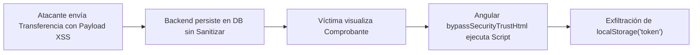

**UNIVERSIDAD DE COSTA RICA**  
**SEDE DEL ATLÁNTICO - RECINTO PARAÍSO**  
**CARRERA DE INFORMÁTICA EMPRESARIAL**  
**CURSO:** IF0009 - Desarrollo de Software IV  
**PROFESOR:** Mag. Jonathan Granados C.  
**SEMESTRE:** II-2026  

---

# Práctica Preparatoria 3: Simulacro Examen II - Persistencia Offline Móvil (SQLite), Mitigación de Stored XSS y Certificados SSL/TLS

## Resumen Ejecutivo y Propósito

Esta práctica formativa constituye el **tercer simulacro integral** 
preparatorio para el **Examen Parcial II**. Desarrolla la resiliencia en 
dispositivos móviles mediante persistencia local, neutraliza la brecha 
de **Cross-Site Scripting Almacenado (OWASP A03:2021 - Stored XSS)** 
y cubre la securización del canal web mediante HTTPS y HSTS:

1. **Parte 1 (40% - Teoría Aplicada):** Análisis de código de bases de 
   datos locales con `sqflite` en Flutter (transacciones atómicas y 
   estrategia Offline-First), anatomía pericial del secuestro de sesión 
   por XSS en navegadores web y configuración de certificados SSL/TLS 
   con renovación automatizada.
2. **Parte 2 (60% - Desarrollo Full-Stack y Seguridad Web):** Refactorización 
   defensiva sobre **InsecurePay** (`web_apps/unsecure_web_app_lab`), 
   eliminando la directiva insegura `bypassSecurityTrustHtml` en Angular 18 
   y sanitizando en profundidad los conceptos de transferencias bancarias 
   en el backend Spring Boot 3.

---

## Metadatos de la Práctica

* **Tiempo sugerido de resolución:** 3 horas y 30 minutos (210 minutos).
* **Modalidad:** Trabajo autónomo individual.
* **Puntaje total:** 100 puntos (Escala formativa).
* **Herramientas requeridas:** JDK 21 LTS, Node.js (v18/v20 LTS), Maven, 
  Visual Studio Code, cliente cURL y el proyecto `unsecure_web_app_lab`.

---

## Parte 1: Teoría y Teoría Aplicada (40 Puntos)

### Eje Temático A: Persistencia Local y Offline-First en Flutter (15 Puntos)

#### Pregunta 1.1: Transacciones Atómicas con `sqflite` (8 Puntos)
Considere el siguiente fragmento de código de un repositorio local en 
Flutter que registra un pago sin conexión a internet:

```dart
class TransaccionLocalDb {
  final Database db;
  TransaccionLocalDb(this.db);

  Future<void> registrarPagoOffline(
      int cuentaId, 
      double monto, 
      String concepto) async {
    // INSEGURO / NO ATOMICO
    await db.rawUpdate(
      'UPDATE CUENTAS SET saldo = saldo - ? '
      'WHERE id = ?', [monto, cuentaId]);
      
    // Si la app se cierra o ocurre un fallo aqui:
    await db.rawInsert(
      'INSERT INTO TRANSACCIONES '
      '(cuenta_id, monto, concepto, sincronizado) '
      'VALUES (?, ?, ?, 0)', 
      [cuentaId, monto, concepto]);
  }
}
```

1. **Defecto de concurrencia:** Explique qué problema de consistencia de 
   datos (*Inconsistent State / Data Corruption*) ocurre si el dispositivo 
   móvil agota su batería o el usuario fuerza el cierre de la app 
   inmediatamente después de ejecutarse el `rawUpdate`.
2. **Propiedades ACID:** Indique qué propiedad del estándar ACID 
   se está violentando y cómo el método `db.transaction(...)` garantiza 
   la atomicidad de ambas operaciones.
3. **Código de remediación:** Escriba la refactorización del método 
   utilizando un bloque `db.transaction(...)` que ejecute rollback 
   automático en caso de cualquier excepción.

---

#### Pregunta 1.2: Migraciones y Esquemas con `onUpgrade` (7 Puntos)
Al lanzar una actualización de una app móvil en Google Play Store, se 
agrega una nueva columna `categoria` a la tabla local `TRANSACCIONES`.

1. **Rol de `version` y `onUpgrade`:** Explique la función del parámetro 
   `version` en `openDatabase` y por qué es una pésima práctica borrar y 
   recrear la base de datos (`DROP TABLE`) en dispositivos de clientes.
2. **Manejo de versiones incrementales:** Escriba un bloque `switch` en 
   Dart que aplique la sentencia `ALTER TABLE` únicamente a los usuarios 
   que actualizan desde la versión 1 a la versión 2 sin afectar a futuros 
   cambios.

---

### Eje Temático B: Seguridad Web y Móvil OWASP (15 Puntos)

#### Pregunta 1.3: Anatomía de Stored XSS y Exfiltración de JWT (8 Puntos)
Un atacante detecta que el campo `concepto` de una transferencia bancaria 
acepta código HTML y lo almacena sin escapar en la base de datos.

1. **Payload malicioso:** Analice el siguiente vector de ataque:
   ```html
   Pago 
   ```
   Explique paso a paso cómo se ejecuta este script cuando un auditor o 
   usuario víctima abre su comprobante digital en el navegador.
2. **Impacto:** Clasifique la vulnerabilidad según **OWASP Top 10:2021** 
   y detalle el impacto del robo de credenciales en arquitecturas 
   desacopladas sin estado (*Stateless JWT*).
3. **Mitigación en frontend y backend:** ¿Por qué la desinfección debe 
   existir tanto en el cliente (codificación de entidades HTML) como en 
   el servidor (*Defense in Depth*)?

---

#### Pregunta 1.4: Cabecera Content Security Policy (CSP Nivel 3) (7 Puntos)
Para neutralizar la inyección de scripts externos, el equipo de seguridad 
decide configurar una cabecera defensiva HTTP **Content Security Policy**.

Considere la siguiente política:
```http
Content-Security-Policy: default-src 'self'; 
  script-src 'self'; object-src 'none';
```

1. **Protección:** Explique por qué esta política bloquea la carga de 
   scripts provenientes de dominios de terceros (ej. `https://evil.cr/payload.js`).
2. **Scripts en línea (*Inline Scripts*):** ¿Por qué la ausencia de la 
   directiva `'unsafe-inline'` neutraliza la ejecución de manejadores de 
   eventos maliciosos como `onerror=` o `<script>alert(1)</script>`?
3. **Mitigación contra Clickjacking:** ¿Qué directiva estándar de CSP 
   reemplaza a la cabecera legada `X-Frame-Options: DENY`?

---

### Eje Temático C: Despliegue con Certificados SSL/TLS (10 Puntos)

#### Pregunta 1.5: Configuración de HTTPS y Renovación con Certbot (10 Puntos)
En la puesta en marcha de un servidor de producción para una fintech:

1. **Handshake TLS:** Explique el rol de la clave pública y la clave 
   privada durante el establecimiento de la sesión cifrada entre el 
   navegador y el servidor web.
2. **Redirección permanente:** Escriba el bloque de servidor Nginx en el 
   puerto 80 que redirige obligatoriamente todo el tráfico no seguro hacia 
   HTTPS mediante el código de respuesta HTTP `301 Moved Permanently`.
3. **Cabecera HSTS:** Explique qué función cumple la cabecera 
   `Strict-Transport-Security: max-age=31536000; includeSubDomains` y 
   cómo previene ataques de degradación de protocolo (*SSL Stripping*).

---

## Parte 2: Práctica Full-Stack y Seguridad Web (60 Puntos)

### Contexto del Escenario Técnico: InsecurePay
En `web_apps/unsecure_web_app_lab`:
- Al transferir dinero (`POST /api/transacciones/transferir`), el campo 
  `concepto` no es sanitizado y se persiste directamente en la columna 
  `CONCEPTO_HTML` de la tabla `TRANSACCIONES`.
- En el frontend de Angular, el componente `transacciones.component.html` 
  renderiza el comprobante utilizando la directiva `[innerHTML]` combinada 
  con `sanitizer.bypassSecurityTrustHtml(...)`, evadiendo deliberadamente 
  la protección integrada de Angular contra XSS.



---

### Tarea 2.1: Sanitización Defensiva Back-End en Spring Boot (25 Puntos)

#### Requerimiento 2.1.1: Función de Escape HTML en Capa de Negocio (15 Puntos)
En `TransaccionService.java`:
1. Implemente un método privado de saneamiento:
   ```java
   private String sanitizarHtml(String entrada);
   ```
2. La rutina debe reemplazar rigurosamente los siguientes caracteres 
   reservados por sus entidades HTML seguras:
   - `&` por `&amp;`
   - `<` por `&lt;`
   - `>` por `&gt;`
   - `"` por `&quot;`
   - `'` por `&#x27;`
   - `/` por `&#x2F;`
3. Aplique esta función sobre el concepto recibido en el DTO antes de 
   asignarlo a la entidad `Transaccion`:
   ```java
   tx.setConcepto(dto.getConcepto().trim());
   tx.setConceptoHtml(
       sanitizarHtml(dto.getConcepto()));
   ```

#### Requerimiento 2.1.2: Validación de Longitud de Entrada (10 Puntos)
Asegure que ningún concepto de transferencia exceda los 150 caracteres 
ni esté en blanco, lanzando una excepción de validación si no se cumple.

---

### Tarea 2.2: Remediación Front-End en Angular 18 (25 Puntos)

En el componente de transacciones (`frontend/src/app/components/transacciones/`):

1. **Eliminación del Bypass Inseguro:** En `transacciones.component.ts`, 
   elimine por completo el método `sanitizarHtml` y remueva la 
   inyección de `DomSanitizer` que invocaba `bypassSecurityTrustHtml`.
2. **Interpolación Segura en la Plantilla:** En `transacciones.component.html`, 
   sustituya la directiva `[innerHTML]` por la interpolación de texto 
   nativa de Angular:
   ```html
   <div class="comprobante-concepto">
     {{ txSeleccionada.conceptoHtml }}
   </div>
   ```
   *Efecto defensivo:* Angular codificará automáticamente cualquier 
   etiqueta restante en el DOM del navegador, impidiendo la inyección 
   de elementos `<script>`, `` o manejadores de eventos.

---

### Tarea 2.3: Verificación Pericial y Evidencias DAST (10 Puntos)

Realice la siguiente prueba de concepto defensiva:

**Paso 1 (Inyección del Payload):** Inicie sesión como `carlos_mora` y 
realice una transferencia de `CRC 5000` a la cuenta `CTA-CR-2001` con el 
siguiente concepto malicioso:
```text
Pago Bono 
```

**Paso 2 (Inspección del Comprobante):**
1. Vaya a **Movimientos** y haga clic en **Ver Comprobante**.
2. **Criterio de aceptación:**
   - La ventana modal **NO** debe desplegar ninguna alerta emergente 
     JavaScript en el navegador.
   - En el cuerpo del comprobante debe leerse el texto literal:  
     `Pago Bono `  
     sin que el navegador interprete la etiqueta ``.
   - Inspeccione el elemento con las herramientas de desarrollador 
     (`F12`) y confirme que el DOM contiene texto plano sanitizado.

---

## Solucionario Analítico y Justificación Pedagógica

### Solución Parte 1: Teoría y Teoría Aplicada

#### Respuesta 1.1: Atomicidad en `sqflite`
1. **Defecto:** Si la aplicación falla entre el `rawUpdate` y el 
   `rawInsert`, el saldo de la cuenta se habrá debitado localmente pero 
   el registro de la transacción no existirá. La base de datos queda en 
   un estado corrupto e inconsistente.
2. **Atomicidad ACID:** La propiedad de **Atomicidad** exige que un 
   conjunto de operaciones se ejecute como una unidad indivisible: 
   o se completan todas (*Commit*), o no se aplica ninguna (*Rollback*).
3. **Código corregido con transacción:**

```dart
Future<void> registrarPagoOffline(
    int cuentaId, 
    double monto, 
    String concepto) async {
  await db.transaction((txn) async {
    await txn.rawUpdate(
      'UPDATE CUENTAS SET saldo = saldo - ? '
      'WHERE id = ?', 
      [monto, cuentaId]);

    await txn.rawInsert(
      'INSERT INTO TRANSACCIONES '
      '(cuenta_id, monto, concepto, sincronizado) '
      'VALUES (?, ?, ?, 0)', 
      [cuentaId, monto, concepto]);
  });
}
```

---

#### Respuesta 1.2: Migraciones de Esquema en Flutter
1. **Rol de `onUpgrade`:** Permite aplicar sentencias `ALTER TABLE` 
   únicamente a los usuarios que ya tienen una versión previa instalada, 
   preservando intactos sus registros locales. Usar `DROP TABLE` borra 
   todos los datos del cliente, destruyendo transacciones no sincronizadas.
2. **Manejo incremental con `switch`:**

```dart
onUpgrade: (db, oldVersion, newVersion) async {
  switch (oldVersion) {
    case 1:
      await db.execute(
        'ALTER TABLE TRANSACCIONES '
        'ADD COLUMN categoria TEXT DEFAULT "GENERAL"');
      break;
  }
}
```

---

#### Respuesta 1.3: Análisis de Stored XSS (OWASP A03:2021)
1. **Ejecución del vector:** Al cargar el comprobante, el navegador 
   encuentra la etiqueta ``. Como el origen `"err"` no es 
   una imagen válida, el navegador dispara inmediatamente el evento 
   `onerror`, ejecutando el código JavaScript inyectado. Este extrae el 
   token JWT de `localStorage` y lo envía a un servidor bajo control del 
   atacante.
2. **Impacto:** Robo total de sesión (*Account Takeover*). En sistemas 
   desacoplados, un atacante con el token JWT puede firmar transferencias 
   bancarias en nombre de la víctima sin conocer su contraseña.
3. **Defensa en Profundidad:** El backend debe escapar caracteres antes de 
   guardar en BD para proteger a otros clientes (apps móviles, reportes PDF). 
   El frontend debe codificar caracteres en el DOM para impedir que un 
   dato corrupto heredado se ejecute.

---

#### Respuesta 1.4: Content Security Policy (CSP Nivel 3)
1. **Bloqueo externo:** `script-src 'self'` instruye al motor del navegador 
   a rechazar cualquier archivo `.js` cuyo origen no coincida exactamente 
   con el mismo esquema, host y puerto del sitio web.
2. **Neutralización inline:** Por defecto, CSP prohíbe scripts dentro del 
   HTML (`<script>`, `onerror=`, `onclick=`). Si no se incluye 
   `'unsafe-inline'`, el navegador bloquea la ejecución de estas directivas 
   aunque se encuentren dentro del documento.
3. **Mitigación Clickjacking:** La directiva `frame-ancestors 'none'` de 
   CSP reemplaza a `X-Frame-Options: DENY`, impidiendo que el portal sea 
   embebido en un iframe malicioso.

---

#### Respuesta 1.5: Configuración de HTTPS y HSTS
1. **Handshake TLS:** El servidor envía su certificado y clave pública al 
   navegador. El navegador valida la firma del certificado mediante una CA 
   raíz confiable y genera una clave simétrica de sesión (*Pre-Master Secret*) 
   cifrada con la clave pública del servidor. Solo el servidor con su clave 
   privada puede descifrarla, estableciendo un túnel simétrico AES-GCM.
2. **Redirección Nginx:**
   ```nginx
   server {
       listen 80;
       server_name api.insecurepay.cr;
       return 301 https://$host$request_uri;
   }
   ```
3. **HSTS:** Ordena al navegador que, durante el período especificado 
   (`max-age=31536000`, 1 año), convierta automáticamente cualquier 
   enlace `http://` en `https://` antes de enviar la petición a la red, 
   neutralizando ataques Man-in-the-Middle de tipo *SSL Stripping*.

---

### Solución Parte 2: Práctica Full-Stack y Seguridad Web

#### Solución Código Back-End: `TransaccionService.java`

```java
private String sanitizarHtml(String entrada) {
    if (entrada == null) {
        return "";
    }
    return entrada
        .replace("&", "&amp;")
        .replace("<", "&lt;")
        .replace(">", "&gt;")
        .replace("\"", "&quot;")
        .replace("'", "&#x27;")
        .replace("/", "&#x2F;");
}

@Transactional
public TransaccionDto transferirSeguro(
        TransferenciaDto dto, String authHeader) {
    if (dto.getConcepto() == null || 
            dto.getConcepto().trim().isEmpty()) {
        throw new IllegalArgumentException(
            "Concepto obligatorio.");
    }
    if (dto.getConcepto().trim().length() > 150) {
        throw new IllegalArgumentException(
            "Maximo 150 caracteres.");
    }

    String conceptoSanitizado = 
        sanitizarHtml(dto.getConcepto().trim());

    // Asignar concepto limpio
    Transaccion tx = new Transaccion();
    tx.setConcepto(dto.getConcepto().trim());
    tx.setConceptoHtml(conceptoSanitizado);
    // ... resto de logica de débito y crédito ...
    return mapearDto(transaccionRepository.save(tx));
}
```

---

#### Solución Código Front-End: `transacciones.component.ts`

```typescript
// Eliminacion definitiva del bypass inseguro
export class TransaccionesComponent {
  txSeleccionada?: TransaccionDto;

  abrirComprobante(tx: TransaccionDto): void {
    this.txSeleccionada = tx;
  }

  cerrarComprobante(): void {
    this.txSeleccionada = undefined;
  }
}
```

#### Solución Código Front-End: `transacciones.component.html`

```html
<!-- RENDERIZADO DEFENSIVO SEGURO CON INTERPOLACION -->
<div *ngIf="txSeleccionada" class="modal-backdrop">
  <div class="modal-card">
    <h3>Comprobante Digital de Transferencia</h3>
    <div class="comprobante-detalle">
      <span class="label">Concepto Bancario:</span>
      <p class="comprobante-concepto">
        {{ txSeleccionada.conceptoHtml }}
      </p>
    </div>
    <button class="btn btn-secondary" 
            (click)="cerrarComprobante()">
      Cerrar
    </button>
  </div>
</div>
```

---

## Criterios de Evaluación y Rúbrica Formativa

| Criterio Evaluado | Indicador de Logro | Puntaje |
| :--- | :--- | :---: |
| **Persistencia Móvil SQLite** | Implementación de transacciones atómicas `db.transaction`, prevención de inconsistencias y migraciones con `onUpgrade`. | **15 pts** |
| **Seguridad OWASP Web/Móvil** | Análisis pericial de Stored XSS, robo de JWT en localStorage y políticas CSP Nivel 3 sin `unsafe-inline`. | **15 pts** |
| **Despliegue y Certificados** | Redirección 301 forzada a HTTPS en Nginx, Handshake TLS y cabecera de seguridad HSTS. | **10 pts** |
| **Sanitización Back-End** | Codificación de entidades HTML y validación de contratos en `TransaccionService` en Spring Boot. | **25 pts** |
| **Remediación Front-End** | Eliminación de `bypassSecurityTrustHtml` y renderizado seguro por interpolación nativa en Angular 18. | **25 pts** |
| **Verificación Defensiva** | Demostración de neutralización de scripts emergentes en comprobante digital y texto seguro en el DOM. | **10 pts** |
| **Total** | **Evaluación Formativa Integral Simulacro 3** | **100 pts** |
