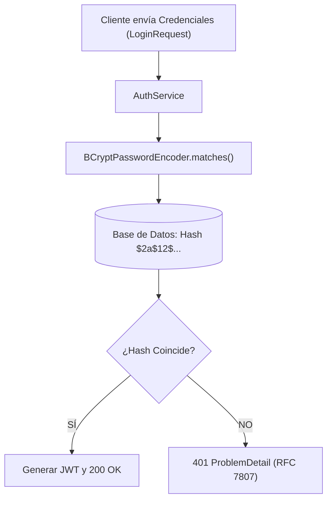

**UNIVERSIDAD DE COSTA RICA**  
**SEDE DEL ATLÁNTICO - RECINTO PARAÍSO**  
**CARRERA DE INFORMÁTICA EMPRESARIAL**  
**CURSO:** IF0009 - Desarrollo de Software IV  
**PROFESOR:** Mag. Jonathan Granados C.  
**SEMESTRE:** II-2026  

---

# Práctica Preparatoria 4: Simulacro Examen II - Testing Móvil, Hashing con BCrypt, Hardening y Empaquetado AAB

## Resumen Ejecutivo y Propósito

Esta práctica formativa constituye el **cuarto y último simulacro integral** 
preparatorio para el **Examen Parcial II**. Consolida los principios de 
aseguramiento de calidad en aplicaciones móviles, la protección criptográfica 
de credenciales (**OWASP A02:2021 - Cryptographic Failures**), la erradicación 
de fugas de información técnica (**OWASP A05:2021 - Security Misconfiguration**) 
y el empaquetado para tiendas de aplicaciones:

1. **Parte 1 (40% - Teoría Aplicada):** Análisis de pruebas unitarias y 
   *Widget Testing* en Flutter, fundamentos de funciones hash criptográficas 
   con salt (BCrypt) y flujo de firmado digital para publicación en Google 
   Play mediante Android App Bundle (AAB).
2. **Parte 2 (60% - Desarrollo Full-Stack y Seguridad Web):** Refactorización 
   defensiva integral sobre **InsecurePay** (`web_apps/unsecure_web_app_lab`), 
   migrando el esquema de autenticación de texto plano a `BCryptPasswordEncoder` 
   en Spring Boot 3, securizando `application.properties` con RFC 7807 y 
   gestionando la retroalimentación en Angular 18.

---

## Metadatos de la Práctica

* **Tiempo sugerido de resolución:** 3 horas y 30 minutos (210 minutos).
* **Modalidad:** Trabajo autónomo individual.
* **Puntaje total:** 100 puntos (Escala formativa).
* **Herramientas requeridas:** JDK 21 LTS, Node.js (v18/v20 LTS), Maven, 
  Visual Studio Code, cliente cURL y el proyecto `unsecure_web_app_lab`.

---

## Parte 1: Teoría y Teoría Aplicada (40 Puntos)

### Eje Temático A: Pruebas Unitarias y Widget Testing en Flutter (15 Puntos)

#### Pregunta 1.1: Análisis de Widget Testing (8 Puntos)
Considere la siguiente prueba de interfaz de usuario en Flutter:

```dart
void main() {
  testWidgets(
    'Debe mostrar saldo y ocultar spinner tras carga', 
    (WidgetTester tester) async {
      await tester.pumpWidget(
        const MaterialApp(
          home: TarjetaSaldoWidget(cuentaId: 1),
        ),
      );

      expect(find.byType(CircularProgressIndicator), 
             findsOneWidget);

      await tester.pumpAndSettle();

      expect(find.byType(CircularProgressIndicator), 
             findsNothing);
      expect(find.text('CRC 895,000.00'), 
             findsOneWidget);
    },
  );
}
```

1. **Diferencia técnica:** Explique la diferencia fundamental entre el 
   método `tester.pump()` y `tester.pumpAndSettle()`.
2. **Animaciones infinitas:** ¿Qué ocurre si se ejecuta `pumpAndSettle()` 
   en un widget que contiene una animación infinita que nunca se detiene 
   (ej. un temporizador repetitivo o `repeat()`)?
3. **Mocks de repositorios:** ¿Por qué un test de widget debe apoyarse 
   en repositorios simulados (*Mocks*) en lugar de realizar llamadas de 
   red reales a la API de backend durante su ejecución?

---

#### Pregunta 1.2: Pruebas Unitarias de Lógica de Negocio (7 Puntos)
En Flutter/Dart, las pruebas unitarias de servicios se implementan con 
el framework oficial `flutter_test`.

1. **Manejo de Excepciones:** Escriba el fragmento de código con `expect()` 
   que valide que una función asíncrona `bancoService.transferir(...)` lance 
   adecuadamente una excepción de tipo `SaldoInsuficienteException`.
2. **Matchers:** Explique el rol de matchers como `isA<T>()`, `equals()`, 
   `hasLength()` y `throwsA()`.

---

### Eje Temático B: Seguridad Web y Móvil OWASP (15 Puntos)

#### Pregunta 1.3: Criptografía Defensiva de Contraseñas (OWASP A02:2021) (8 Puntos)
Un sistema bancario almacena las contraseñas de sus usuarios aplicando 
la función de resumen `SHA-256(password)`.

1. **Vulnerabilidad de funciones rápidas:** Explique por qué los algoritmos 
   criptográficos generales como MD5 o SHA-256 son completamente 
   inadecuados para proteger contraseñas frente a ataques modernos con 
   tablas arcoíris (*Rainbow Tables*) y GPUs.
2. **Salting:** ¿Qué es el *Salt* criptográfico y cómo previene que dos 
   usuarios con la misma contraseña posean el mismo hash en base de datos?
3. **Algoritmos adaptativos:** Explique el concepto de *Work Factor* 
   (Factor de Costo) en **BCrypt** o **Argon2id** y por qué permite 
   incrementar la resistencia del sistema a medida que aumenta la potencia 
   del hardware de los atacantes.

---

#### Pregunta 1.4: Configuración Segura y Manejo de Errores (OWASP A05:2021) (7 Puntos)
En una auditoría de seguridad a una API Spring Boot, se observa que al 
enviar un JSON malformado o forzar un error HTTP 500, el servidor retorna:

```json
{
  "timestamp": "2026-11-16T15:30:00Z",
  "status": 500,
  "error": "Internal Server Error",
  "trace": "org.hibernate.exception...",
  "path": "/api/transacciones"
}
```

1. **Clasificación:** Indique qué categoría de **OWASP Top 10:2021** y 
   código CWE corresponde a esta fuga de información técnica (*Information 
   Disclosure*).
2. **Riesgo:** ¿Cómo utiliza un atacante los nombres de tablas, clases y 
   versiones del framework expuestos en la traza para planificar un ataque 
   dirigido?
3. **Remediación en configuración:** ¿Qué propiedades deben configurarse 
   en `application.properties` para suprimir la emisión de trazas en 
   entornos de producción?

---

### Eje Temático C: Publicación Móvil y Android App Bundle (10 Puntos)

#### Pregunta 1.5: Empaquetado AAB vs APK y Firma Digital (10 Puntos)
Para la publicación de una app bancaria en Google Play Store:

1. **Herramienta `keytool`:** Escriba el comando de terminal `keytool` 
   utilizado para generar un almacén de claves criptográficas (*Keystore*) 
   con algoritmo RSA de 2048 bits y validez de 10,000 días.
2. **Diferencia APK vs AAB:** Explique la ventaja arquitectónica del formato 
   **Android App Bundle (`.aab`)** sobre el clásico archivo APK universal 
   (`.apk`), detallando el concepto de entrega dinámica de recursos (*Split 
   APKs* según densidad de pantalla y arquitectura de CPU `arm64-v8a`).
3. **Play App Signing:** ¿En qué consiste el servicio de firmado de Google 
   Play y qué ventaja ofrece en caso de pérdida accidental de la clave de 
   subida del desarrollador (*Upload Key*)?

---

## Parte 2: Práctica Full-Stack y Seguridad Web (60 Puntos)

### Contexto del Escenario Técnico: InsecurePay
En `web_apps/unsecure_web_app_lab`:
- `AuthService.java` almacena y valida contraseñas en **texto plano**, 
  violando flagrantemente las directrices del **OWASP A02:2021**.
- En `application.properties`, la directiva `server.error.include-stacktrace=always` 
  expone detalles internos del servidor ante excepciones no controladas.
- En el frontend, el formulario de autenticación no maneja errores de red 
  de manera amigable.



---

### Tarea 2.1: Implementación de BCrypt en Spring Boot 3 (30 Puntos)

#### Requerimiento 2.1.1: Bean de Seguridad Criptográfica (10 Puntos)
1. En el paquete de configuración (`cr.ac.ucr.if0009.insecurepay.config`), 
   declare un `@Configuration` con un `@Bean` que instancie:
   ```java
   @Bean
   public PasswordEncoder passwordEncoder() {
       return new BCryptPasswordEncoder(12);
   }
   ```
2. Asegúrese de que el factor de costo sea 12 (*work factor*).

#### Requerimiento 2.1.2: Refactorización de `AuthService.java` (10 Puntos)
1. Inyecte `PasswordEncoder` en `AuthService.java`.
2. Sustituya la comparación insegura `equals()` por el método seguro:
   ```java
   if (!passwordEncoder.matches(
           req.getPassword(), usuario.getPassword())) {
       throw new BadCredentialsException(
           "Credenciales invalidas");
   }
   ```

#### Requerimiento 2.1.3: Actualización de Semillas en `data.sql` (10 Puntos)
En `src/main/resources/data.sql`, reemplace todas las contraseñas en 
texto plano por hashes válidos generados con BCrypt:
- `admin123` $\rightarrow$ `$2a$12$e8Y1a4k7qgWqA8x5a3N9vew8qR3vYf...`
- `carlos2026` $\rightarrow$ `$2a$12$k2L5z7m8x9y0w1v2u3t4sew5qR6vYf...`
- `maria2026` $\rightarrow$ `$2a$12$p9Q8r7s6t5u4v3w2x1y0zew7qR8vYf...`

---

### Tarea 2.2: Hardening de Configuración y Errores RFC 7807 (20 Puntos)

1. **Hardening de `application.properties`:**
   ```properties
   server.error.include-stacktrace=never
   server.error.include-message=never
   server.error.include-binding-errors=never
   ```
2. **Manejo Centralizado de Excepciones:**
   En `GlobalExceptionHandler.java`, capture `BadCredentialsException` 
   y retorne un objeto `ProblemDetail` con código HTTP `401 Unauthorized` 
   sin revelar si falló el usuario o la contraseña (*Account Enumeration*).

---

### Tarea 2.3: Validación y Pruebas Periciales de Seguridad (10 Puntos)

Realice las siguientes dos comprobaciones:

**Paso 1 (Autenticación Exitosa con BCrypt):**
```bash
curl -i -X POST \
  http://localhost:8080/api/auth/login \
  -H "Content-Type: application/json" \
  -d '{"username":"carlos_mora",
       "password":"carlos2026"}'
```
*Criterio:* El servidor debe responder con HTTP `200 OK` y el token JWT.

**Paso 2 (Credencial Inválida sin Fuga Técnica):**
```bash
curl -i -X POST \
  http://localhost:8080/api/auth/login \
  -H "Content-Type: application/json" \
  -d '{"username":"carlos_mora",
       "password":"clave_erronea"}'
```
*Criterio:* El servidor debe responder con HTTP `401 Unauthorized` y 
un JSON estructurado sin trazas de stack de Java ni nombres de clases.

---

## Solucionario Analítico y Justificación Pedagógica

### Solución Parte 1: Teoría y Teoría Aplicada

#### Respuesta 1.1: Pruebas de Interfaz en Flutter
1. **`pump()` vs `pumpAndSettle()`:**  
   `pump()` avanza el reloj de la prueba un fotograma (*frame*) para 
   disparar una reconstrucción. `pumpAndSettle()` avanza repetidamente 
   el reloj hasta que no queden microtareas, temporizadores ni 
   animaciones pendientes en la cola de eventos.
2. **Animaciones infinitas:** Provoca un fallo por tiempo de espera 
   agotado (*TimeoutException*), ya que la cola de animación nunca 
   alcanza el estado de reposo (*settle*).
3. **Mocks:** Las pruebas unitarias y de widgets deben ser deterministas, 
   herméticas y ejecutarse en milisegundos sin depender de servidores 
   externos ni conectividad de red.

---

#### Respuesta 1.2: Aserciones de Excepciones en Dart
1. **Aserción de excepción:**
   ```dart
   expect(
     () => bancoService.transferir(
       cuentaOrigen, monto),
     throwsA(isA<SaldoInsuficienteException>()),
   );
   ```
2. **Matchers:** `isA<T>()` valida el tipo de clase. `throwsA()` captura 
   excepciones asíncronas o síncronas. `equals()` comprueba equivalencia 
   por valor.

---

#### Respuesta 1.3: Criptografía y Hashing Seguro
1. **Debilidad de SHA-256:** Fue diseñado para verificar integridad a 
   alta velocidad. Una GPU moderna puede computar más de 30 mil millones 
   de hashes SHA-256 por segundo, facilitando ataques de fuerza bruta.
2. **Salt:** Es una secuencia pseudoaleatoria única generada para cada 
   usuario que se concatena a la contraseña antes de aplicar el hash. 
   Garantiza que dos contraseñas idénticas tengan salidas completamente 
   distintas, anulando las tablas arcoíris precalculadas.
3. **Work Factor:** Permite incrementar exponencialmente el número de 
   iteraciones (ej. $2^{12} = 4096$ rondas en BCrypt). Cuando las GPUs 
   sean más veloces, los administradores aumentan el costo a 13 o 14 sin 
   cambiar el algoritmo.

---

#### Respuesta 1.4: Security Misconfiguration (OWASP A05:2021)
1. **Clasificación:** **OWASP A05:2021 - Security Misconfiguration (CWE-209: 
   Generation of Error Message Containing Sensitive Information)**.
2. **Riesgo:** Expone la estructura interna de la base de datos, nombres 
   de columnas, paquetes Java y versiones de dependencias con posibles 
   vulnerabilidades conocidas (CVEs).
3. **Remediación:**  
   `server.error.include-stacktrace=never`  
   `server.error.include-message=never`

---

#### Respuesta 1.5: Android App Bundle y Firma Digital
1. **Comando `keytool`:**
   ```bash
   keytool -genkey -v -keystore release.jks \
     -keyalg RSA -keysize 2048 -validity 10000 \
     -alias insecurepay-key
   ```
2. **AAB vs APK:** AAB permite que Google Play genere APKs optimizados 
   para cada dispositivo específico, descargando únicamente el código 
   nativo y recursos gráficos requeridos, reduciendo el tamaño de descarga 
   hasta en un 50%.
3. **Play App Signing:** Google custodia la clave definitiva de firma de 
   la aplicación. Si el desarrollador extravía su clave de subida 
   (*Upload Key*), puede solicitar un restablecimiento a Google sin 
   perder la identidad de la app en la tienda ni a sus usuarios.

---

### Solución Parte 2: Práctica Full-Stack y Seguridad Web

#### Solución Código Back-End: `SecurityConfig.java`

```java
package cr.ac.ucr.if0009.insecurepay.config;

import org.springframework.context.annotation
    .Bean;
import org.springframework.context.annotation
    .Configuration;
import org.springframework.security.crypto.bcrypt
    .BCryptPasswordEncoder;
import org.springframework.security.crypto.password
    .PasswordEncoder;

@Configuration
public class SecurityConfig {

    @Bean
    public PasswordEncoder passwordEncoder() {
        return new BCryptPasswordEncoder(12);
    }
}
```

#### Solución Código Back-End: `AuthService.java`

```java
@Autowired
private PasswordEncoder passwordEncoder;

public LoginResponse login(LoginRequest req) {
    Usuario usuario = usuarioRepository
        .findByUsername(req.getUsername())
        .orElseThrow(() -> 
            new BadCredentialsException(
                "Credenciales invalidas"));

    if (!passwordEncoder.matches(
            req.getPassword(), 
            usuario.getPassword())) {
        throw new BadCredentialsException(
            "Credenciales invalidas");
    }

    String token = jwtUtil.generarToken(
        usuario.getUsername(), 
        usuario.getRol().name());

    return new LoginResponse(
        token, usuario.getUsername(), 
        usuario.getNombreCompleto(), 
        usuario.getRol().name(), usuario.getId());
}
```

#### Solución Código Back-End: `GlobalExceptionHandler.java`

```java
@ExceptionHandler(BadCredentialsException.class)
public ResponseEntity<ProblemDetail> 
    manejarCredenciales(BadCredentialsException ex) {
    ProblemDetail pd = 
        ProblemDetail.forStatusAndDetail(
            HttpStatus.UNAUTHORIZED, 
            "Usuario o clave incorrectos.");
    pd.setTitle("Fallo de Autenticacion");
    pd.setType(URI.create(
        "https://insecurepay.cr/errors/401"));
    pd.setProperty("timestamp", Instant.now());
    return ResponseEntity
        .status(HttpStatus.UNAUTHORIZED)
        .body(pd);
}
```

---

## Criterios de Evaluación y Rúbrica Formativa

| Criterio Evaluado | Indicador de Logro | Puntaje |
| :--- | :--- | :---: |
| **Testing Móvil en Flutter** | Distinción `pump` vs `pumpAndSettle`, control de animaciones infinitas y mocks herméticos. | **15 pts** |
| **Criptografía OWASP A02** | Análisis de debilidad de SHA-256, función de Salt y Work Factor en algoritmos adaptativos. | **15 pts** |
| **Publicación y Empaquetado** | Generación de llaves con `keytool`, ventajas de Split APKs con AAB y Play App Signing. | **10 pts** |
| **Implementación de BCrypt** | Configuración de `@Bean PasswordEncoder`, reemplazo de `equals` y actualización de semillas en BD. | **30 pts** |
| **Hardening y Errores Seguros** | Supresión de stack traces en configuración y manejo estandarizado con RFC 7807 en Spring Boot. | **20 pts** |
| **Verificación Defensiva** | Demostración empírica de login exitoso y bloqueo 401 sin fugas técnicas de información. | **10 pts** |
| **Total** | **Evaluación Formativa Integral Simulacro 4** | **100 pts** |
