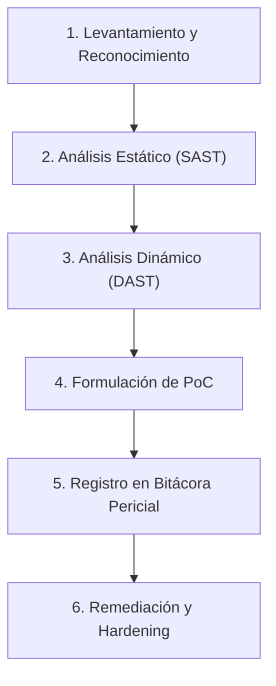

**UNIVERSIDAD DE COSTA RICA**  
**SEDE DEL ATLÁNTICO - RECINTO PARAÍSO**  
**CARRERA DE INFORMÁTICA EMPRESARIAL**  
**CURSO:** IF0009 - Desarrollo de Software IV  
**PROFESOR:** Mag. Jonathan Granados C.  
**SEMESTRE:** II-2026  

---

# Laboratorio 17: Auditoría Forense de Software, Detección OWASP Top 10 y Remediación Defensiva en InsecurePay

## Resumen

En este laboratorio semi-guiado, usted asumirá el rol 
de **Auditor(a) Forense de Software y Especialista en 
Seguridad Ofensiva/Defensiva**. Su objetivo consiste en 
realizar una evaluación pericial integral sobre la 
plataforma bancaria y billetera digital **InsecurePay**, 
una solución desarrollada con arquitectura desacoplada: 
backend en **Spring Boot 3.3+ (Java 21 LTS)** con 
**Spring Data JPA** y frontend en **Angular 18**.

A través de un enfoque estructurado de análisis 
estático (SAST), pruebas dinámicas de penetración (DAST) 
y revisión de código fuente, usted documentará la 
evidencia pericial de las brechas de seguridad 
presentes en el aplicativo, reproducirá las pruebas de 
concepto (PoC) que demuestran el impacto en el negocio 
financiero y procederá con la **refactorización y 
remediación defensiva** de cada vulnerabilidad 
siguiendo las directrices internacionales del 
**OWASP Top 10**.

---

## Metadatos del Laboratorio

* **Tiempo estimado de desarrollo:** 3.5 a 4.0 horas.
* **Puntaje total:** 100 puntos (Escala formativa y 
  sumativa).
* **Modalidad:** Semi-guiada (fase formativa demostrativa 
  y reto autónomo de remediación).
* **Herramientas requeridas:**
  - JDK 21 LTS o superior.
  - Node.js (v18.x o v20.x LTS) y NPM.
  - Visual Studio Code con el Workspace de InsecurePay.
  - Navegador web moderno (Chrome DevTools o Firefox).
  - Terminal de comandos con cliente `curl` o Postman.
* **Metas de Aprendizaje:**
  1. Aplicar una metodología formal de auditoría 
     forense de software sobre aplicaciones web 
     desacopladas (Spring Boot + Angular).
  2. Identificar y categorizar vulnerabilidades críticas 
     bajo el estándar **OWASP Top 10:2021** (IDOR/BOLA, 
     SQL Injection, Stored XSS, Credenciales Inseguras y 
     Fuga de Trazas Técnicas).
  3. Formular Pruebas de Concepto (PoC) reproducibles y 
     documentar la cadena de custodia en una bitácora 
     pericial forense.
  4. Implementar soluciones defensivas robustas a nivel de 
     capa de persistencia (JPQL parametrizado), capa de 
     servicio (validación estricta de propiedad de 
     recursos con JWT) y frontend (desinfección DOM).

---

## Estructura de la Plataforma InsecurePay

La solución se ubica en el directorio:
`web_apps/unsecure_web_app_lab`

El ecosistema está compuesto por los siguientes 
módulos:

```
unsecure_web_app_lab/
|-- backend/
|   |-- src/main/java/cr/ac/ucr/insecurepay/
|   |   |-- config/CorsConfig.java
|   |   |-- controller/ (Auth, Cuentas, Transacciones)
|   |   |-- dto/ (Login, Transferencia, Cuentas)
|   |   |-- model/ (Usuario, CuentaBancaria, ...)
|   |   |-- repository/ (JPA Repositories)
|   |   |-- service/ (Lógica bancaria y autenticación)
|   |   `-- util/JwtUtil.java
|   `-- src/main/resources/
|       |-- application.properties
|       |-- schema.sql
|       `-- data.sql
|-- frontend/
|   `-- src/app/
|       |-- components/ (login, dashboard, transac...)
|       |-- services/ (auth.service, banco.service)
|       `-- models/ (usuario.model, banco.model)
`-- unsecure_web_app_lab.code-workspace
```

---

## Parte 1: Metodología Forense de Software y Estándares OWASP

Una auditoría forense de software no consiste únicamente 
en encontrar fallas de manera caótica; requiere un método 
riguroso que garantice la integridad de los hallazgos.



### 1.1 Fases del Ciclo Pericial

1. **Reconocimiento Arquitectural:** Identificación 
   de componentes, contratos de entrada/salida (APIs 
   REST) y mecanismos de persistencia.
2. **Análisis Estático (SAST):** Inspección del código 
   fuente en busca de malas prácticas, tales como 
   concatenación de sentencias SQL, almacenamiento de 
   secretos en texto plano o elución de validaciones de 
   acceso.
3. **Análisis Dinámico (DAST):** Envío de cargas útiles 
   (*payloads*) mediante herramientas como `curl`, 
   inspección de tráfico HTTP con DevTools y validación 
   de respuestas anómalas del servidor.
4. **Prueba de Concepto (PoC):** Demostración empírica, 
   controlada y no destructiva del impacto financiero o 
   de confidencialidad que causaría un atacante.
5. **Cadena de Custodia y Bitácora Pericial:** Registro 
   estandarizado con código CWE, vector OWASP, 
   gravedad CVSS v3.1, pasos de reproducción y código 
   remediado.

### 1.2 Plantilla Obligatoria de Bitácora Pericial

Para cada vulnerabilidad identificada durante este 
laboratorio, usted deberá completar una ficha técnica con 
la siguiente estructura en su informe final:

| Campo Pericial | Especificación Técnica |
| :--- | :--- |
| **Identificador** | HALLAZGO-01, HALLAZGO-02, ... |
| **Nombre de Vulnerabilidad** | Ej: Inyección SQL en búsqueda de transacciones |
| **Clasificación OWASP** | Ej: A03:2021 - Injection (CWE-89) |
| **Severidad CVSS v3.1** | Crítica / Alta / Media / Baja (Puntaje base) |
| **Archivo y Línea Afectada**| Ruta relativa y número de línea de código |
| **Descripción del Vector** | Explicación técnica de la falla de diseño |
| **Prueba de Concepto (PoC)**| Comando cURL o secuencia HTTP de explotación |
| **Impacto de Negocio** | Consecuencias sobre confidencialidad o saldo |
| **Estrategia de Remediación**| Código corregido y buenas prácticas aplicadas |

---

## Parte 2: Auditoría Forense y Explotación Ética Guiada

A continuación, se presentan las tres auditorías 
principales guiadas paso a paso.

### Caso 1: Inyección SQL (A03:2021 - Injection) en Búsqueda

#### Diagnóstico Forense (SAST)
Inspeccione el archivo 
`backend/src/main/java/cr/ac/ucr/insecurepay/service/TransaccionService.java`. 
Observe el método de búsqueda de transacciones:

```java
// VULNERABLE: Concatenacion directa de strings
@SuppressWarnings("unchecked")
public List<TransaccionDto> buscarPorTermino(
        String termino) {
    String sql = 
        "SELECT * FROM TRANSACCIONES " +
        "WHERE CONCEPTO LIKE '%" + termino + "%' " +
        "OR ESTADO LIKE '%" + termino + "%' " +
        "ORDER BY FECHA_HORA DESC";

    Query query = 
        entityManager.createNativeQuery(
            sql, Transaccion.class);
    List<Transaccion> res = query.getResultList();
    return res.stream()
        .map(this::mapearDto)
        .toList();
}
```

**Análisis pericial:** El parámetro `termino` proviene 
directamente de la solicitud HTTP del cliente y se 
concatena sin ningún tipo de saneamiento ni vinculación 
posicional (`parameter binding`). Esto permite alterar la 
semántica del motor relacional H2.

#### Explotación y Prueba de Concepto (DAST)

**Paso 1:** Inicie sesión en la interfaz web de InsecurePay con las credenciales del usuario `carlos_mora` (contraseña: `carlos2026`).

**Paso 2:** Diríjase a la sección **Movimientos** (`http://localhost:4200/transacciones`).

**Paso 3:** En la barra de búsqueda ingrese el siguiente payload diseñado para forzar una condición booleana siempre verdadera:

```sql
' OR 1=1 --
```

**Paso 4 (Resultado pericial observado):** La consulta retorna transacciones de todos los clientes de la base de datos (incluidas transacciones de `maria_rojas` y pagos corporativos privados), violando la confidencialidad de la información bancaria.

**Paso 5:** Ejecute la verificación forense mediante terminal con el siguiente comando `curl`:

```bash
curl -G -X GET \
  http://localhost:8080/api/transacciones/buscar \
  --data-urlencode "termino=' OR 1=1 --" \
  -H "Accept: application/json"
```

---

### Caso 2: Referencia Directa Insegura a Objetos (A01:2021 - IDOR / BOLA)

#### Diagnóstico Forense (SAST)
Examine el controlador 
`backend/src/main/java/cr/ac/ucr/insecurepay/controller/CuentaController.java` 
y su servicio `CuentaService.java`:

```java
// VULNERABLE: No valida si la cuenta pertenece
// al usuario del token JWT
@GetMapping("/{id}")
public ResponseEntity<CuentaDto> obtenerPorId(
        @PathVariable Long id) {
    return ResponseEntity.ok(
        cuentaService.obtenerPorId(id));
}

@GetMapping("/{id}/saldo")
public ResponseEntity<Map<String, Object>> 
        obtenerSaldo(@PathVariable Long id) {
    CuentaDto cuenta = cuentaService.obtenerPorId(id);
    return ResponseEntity.ok(Map.of(
        "cuentaId", cuenta.getId(),
        "numeroCuenta", cuenta.getNumeroCuenta(),
        "saldo", cuenta.getSaldo(),
        "moneda", cuenta.getMoneda()
    ));
}
```

**Análisis pericial:** Aunque el cliente envía un token 
JWT en la cabecera `Authorization: Bearer <token>`, el 
servicio utiliza el `id` recibido en la URL de manera 
ciega sin cotejar si la cuenta bancaria pertenece al 
usuario emisor de la petición.

#### Explotación y Prueba de Concepto (DAST)

**Paso 1:** Como usuario `carlos_mora` (cuyas cuentas son ID `1` y ID `2`), abra las herramientas de desarrollador de su navegador (pestaña Red / Network).

**Paso 2:** Obtenga el token JWT tras iniciar sesión.

**Paso 3:** Desde una terminal, consulte la cuenta con ID `3` (perteneciente a `maria_rojas`):

```bash
# Reemplace <TOKEN_CARLOS> con el token real
curl -X GET \
  http://localhost:8080/api/cuentas/3/saldo \
  -H "Authorization: Bearer <TOKEN_CARLOS>"
```

**Paso 4 (Resultado pericial):** El servidor responde con HTTP `200 OK` revelando el saldo privado de María Rojas (`CRC 895,000.00`).

**Paso 5 (Impacto agravado en transferencias):** El endpoint `POST /api/transacciones/transferir` tampoco valida que la cuenta de origen (`cuentaOrigenId`) pertenezca al cliente que realiza la solicitud, permitiendo que Carlos transfiera fondos **desde la cuenta de María hacia su propia cuenta**.

---

### Caso 3: Cross-Site Scripting Almacenado (A03:2021 - Stored XSS)

#### Diagnóstico Forense (SAST)
Inspeccione los dos extremos de la funcionalidad de 
transferencia:

1. **Backend:** En `TransaccionService.java`, el campo 
   `concepto` se asigna directamente a la columna 
   `CONCEPTO_HTML` sin aplicar desinfección ni filtrado 
   de etiquetas HTML:

```java
tx.setConceptoHtml(dto.getConcepto());
```

2. **Frontend:** En 
   `frontend/src/app/components/transacciones/transacciones.component.ts`:

```typescript
// VULNERABLE: Evasion explicita del motor de
// saneamiento de Angular
sanitizarHtml(html: string): SafeHtml {
  return this.sanitizer
    .bypassSecurityTrustHtml(html);
}
```

Y en la plantilla HTML 
(`transacciones.component.html`):

```html
<div class="comprobante-concepto" 
     [innerHTML]="sanitizarHtml(
       txSeleccionada.conceptoHtml)">
</div>
```

**Análisis pericial:** La directiva `bypassSecurityTrustHtml` 
ordena a Angular desactivar deliberadamente su filtro 
antivirus DOM incorporado. Cuando un usuario introduce un 
concepto malicioso en una transferencia, el código se 
almacena en base de datos de manera persistente 
(*Stored XSS*) y se ejecuta en el navegador de cualquier 
auditor o cliente que visualice el comprobante digital.

#### Explotación y Prueba de Concepto (DAST)

**Paso 1:** Ingrese al módulo **Transferir Dinero** (`http://localhost:4200/transferir`).

**Paso 2:** Seleccione una cuenta destino (ej. `CTA-CR-2001`).

**Paso 3:** En el campo **Concepto / Detalle**, introduzca el siguiente vector de ataque:

```html
Pago de Servicios 
```

**Paso 4:** Envíe la transferencia bancaria.

**Paso 5:** Ingrese a **Movimientos**, localice la transacción y haga clic en **Ver Comprobante**.

**Paso 6 (Resultado pericial):** La ventana modal renderiza el código malicioso y el navegador ejecuta la instrucción JavaScript emergente, exponiendo el token JWT almacenado en `localStorage`.

---

## Parte 3: Remediación Defensiva Guiada

En esta etapa, usted aplicará la refactorización técnica 
para erradicar definitivamente las tres vulnerabilidades 
analizadas.

### 3.1 Remediación Caso 1: Consultas Parametrizadas Seguras

En `TransaccionRepository.java`, declare una consulta 
declarativa JPQL utilizando parámetros con nombre 
(`Named Parameters`) gestionados de forma segura por 
Hibernate/JPA:

```java
package cr.ac.ucr.insecurepay.repository;

import cr.ac.ucr.insecurepay.model.Transaccion;
import org.springframework.data.jpa
    .repository.JpaRepository;
import org.springframework.data.jpa
    .repository.Query;
import org.springframework.data.repository
    .query.Param;
import java.util.List;

public interface TransaccionRepository 
        extends JpaRepository<Transaccion, Long> {

    @Query("SELECT t FROM Transaccion t " +
           "WHERE LOWER(t.concepto) LIKE " +
           "      LOWER(CONCAT('%', :termino, '%')) " +
           "   OR LOWER(t.estado) LIKE " +
           "      LOWER(CONCAT('%', :termino, '%')) " +
           "ORDER BY t.fechaHora DESC")
    List<Transaccion> buscarPorTerminoSeguro(
            @Param("termino") String termino);
}
```

Refactorice `TransaccionService.java` para utilizar el 
nuevo repositorio:

```java
public List<TransaccionDto> buscarPorTermino(
        String termino) {
    if (termino == null || termino.trim().isEmpty()) {
        return List.of();
    }
    // Proteccion nativa contra SQL Injection
    return transaccionRepository
        .buscarPorTerminoSeguro(termino.trim())
        .stream()
        .map(this::mapearDto)
        .toList();
}
```

> **Verificación defensiva:** Reenvíe el payload 
> `' OR 1=1 --`. La consulta buscará el texto literal 
> sin interpretar las comillas y retornará 0 registros o 
> únicamente aquellos que contengan exactamente esa 
> cadena literal.

---

### 3.2 Remediación Caso 2: Control Estricto de Propiedad de Recursos (Anti-IDOR)

Para neutralizar IDOR, la capa de servicio debe extraer 
la identidad verificada desde el token JWT (o del 
contexto de seguridad) y validar que el recurso 
solicitado pertenezca a dicho usuario.

En `CuentaService.java`:

```java
@Autowired
private JwtUtil jwtUtil;

public CuentaDto obtenerCuentaSegura(
        Long cuentaId, String authHeader) {
    // 1. Extraer nombre de usuario desde cabecera
    String token = extraerToken(authHeader);
    String usernameAutenticado = 
        jwtUtil.extraerUsername(token);

    // 2. Buscar la cuenta
    CuentaBancaria cuenta = cuentaRepository
        .findById(cuentaId)
        .orElseThrow(() -> 
            new RecursoNoEncontradoException(
                "Cuenta bancaria no existe"));

    // 3. Validar propiedad estricta
    boolean esPropietario = cuenta.getUsuario()
        .getUsername()
        .equalsIgnoreCase(usernameAutenticado);

    boolean esAuditor = "auditor_seguridad"
        .equalsIgnoreCase(usernameAutenticado) ||
        "admin".equalsIgnoreCase(usernameAutenticado);

    if (!esPropietario && !esAuditor) {
        throw new AccesoDenegadoException(
            "Acceso no autorizado a cuenta ajena.");
    }

    return mapearDto(cuenta);
}

private String extraerToken(String authHeader) {
    if (authHeader != null && 
            authHeader.startsWith("Bearer ")) {
        return authHeader.substring(7);
    }
    throw new AccesoDenegadoException(
        "Cabecera de autorizacion invalida.");
}
```

En `TransaccionService.java`, aplique la misma 
validación antes de debitar cualquier transferencia:

```java
// Validar que la cuenta de origen pertenece al usuario
if (!cuentaOrigen.getUsuario().getUsername()
        .equalsIgnoreCase(usernameAutenticado)) {
    throw new AccesoDenegadoException(
        "Fraude detectado: no puede debitar " +
        "fondos de cuentas ajenas.");
}
```

---

### 3.3 Remediación Caso 3: Eliminación del Bypass y Sanitización XSS

1. **Frontend:** Elimine el uso de 
   `bypassSecurityTrustHtml` en 
   `transacciones.component.ts` y utilice la 
   interpolación segura estándar de Angular (`{{ }}`) o 
   la directiva de texto plano:

```html
<!-- En transacciones.component.html: SEGURO -->
<div class="comprobante-concepto">
  {{ txSeleccionada.conceptoHtml }}
</div>
```

Al utilizar `{{ }}`, Angular codifica automáticamente 
caracteres peligrosos (`<` se transforma en `&lt;`, 
`>` en `&gt;`, `"` en `&quot;`), impidiendo la inyección 
de scripts en el DOM.

2. **Backend (Defensa en Profundidad):** En 
   `TransaccionService.java`, escape etiquetas HTML antes 
   de persistir en la base de datos:

```java
private String sanitizarTexto(String entrada) {
    if (entrada == null) return "";
    return entrada
        .replace("&", "&amp;")
        .replace("<", "&lt;")
        .replace(">", "&gt;")
        .replace("\"", "&quot;")
        .replace("'", "&#x27;");
}
```

---

## Parte 4: Reto Autónomo Evaluado

Para obtener la totalidad del puntaje del laboratorio, 
usted debe resolver de manera autónoma las siguientes dos 
brechas de seguridad en InsecurePay y documentar el 
proceso completo:

### Requerimiento 4.1: Almacenamiento Seguro de Credenciales con BCrypt (25 Puntos)

#### Diagnóstico del Problema:
Actualmente, `AuthService.java` almacena y valida 
contraseñas en texto plano:

```java
// INSEGURO: Texto plano
if (!usuario.getPassword().equals(req.getPassword())) {
    throw new BadCredentialsException(...);
}
```

#### Tareas a Desarrollar:
1. Integre `BCryptPasswordEncoder` en la configuración 
   de Spring Boot (`SecurityConfig` o como `@Bean`).
2. Genere los hashes seguros para los usuarios de prueba 
   en `data.sql` con un factor de trabajo (*work factor*) 
   de 10 o superior (ejemplo: `$2a$10$...`).
3. Modifique `AuthService.java` para que la validación se 
   realice exclusivamente mediante el método 
   `passwordEncoder.matches(claveEnviada, hashAlmacenado)`.
4. Asegúrese de que ninguna contraseña viaje o se persista 
   en texto plano.

---

### Requerimiento 4.2: Hardening de Configuración y Fuga de Información (20 Puntos)

#### Diagnóstico del Problema:
Revise el archivo 
`backend/src/main/resources/application.properties`:

- La directiva `server.error.include-stacktrace=always` 
  filtra trazas internas del framework, nombres de 
  clases y consultas SQL cuando ocurre una excepción.
- La consola H2 (`spring.h2.console.enabled=true`) está 
  expuesta sin restricciones de red.
- La clave secreta de JWT 
  (`app.jwt.secret=ClaveSuperSecretaInsecurePayLaboratorio2026UCRKeyLong123456`) 
  es predecible y está acoplada al repositorio de código.

#### Tareas a Desarrollar:
1. Configure `server.error.include-stacktrace=never` y 
   `server.error.include-message=never` para evitar fuga 
   de información técnica (*CWE-209*).
2. Configure un manejador global de excepciones con 
   `@RestControllerAdvice` que retorne respuestas de error 
   estandarizadas bajo el estándar **RFC 7807** 
   (`ProblemDetail`), ocultando detalles de base de datos.
3. Externalice la firma secreta de JWT mediante variables 
   de entorno con una longitud mínima de 256 bits (HMAC-SHA256).

---

### Requerimiento 4.3: Bitácora Pericial Forense Completa (15 Puntos)

Elabore la **Bitácora Pericial Forense** en formato 
técnico conteniendo los 5 hallazgos analizados 
(SQLi, IDOR saldos/transferencias, Stored XSS, Contraseñas 
en texto plano y Fuga de trazas técnicas).

Cada hallazgo debe incluir:
- Capturas de pantalla o salidas de terminal del **Antes 
  (Explotación exitosa)**.
- Capturas de pantalla o salidas de terminal del **Después 
  (Bloqueo defensivo confirmado)**.
- Código fuente del parche aplicado con justificación.

---

## Lista de Verificación de Entrega (Checklist)

Antes de realizar la entrega final en Mediación Virtual, 
verifique que su repositorio cumpla con lo siguiente:

- [ ] Backend compila sin errores (`mvn clean test`).
- [ ] Búsqueda de transacciones utiliza JPQL 
      parametrizado y es invulnerable a `' OR 1=1 --`.
- [ ] Endpoints de cuentas y transferencias bloquean 
      solicitudes IDOR con HTTP 403 Forbidden.
- [ ] El concepto de transferencia no ejecuta scripts 
      maliciosos en la vista de comprobantes.
- [ ] Las contraseñas en `data.sql` están codificadas 
      con BCrypt y el login funciona correctamente.
- [ ] `application.properties` no expone trazas de stack 
      ni detalles internos ante errores HTTP 500.
- [ ] El documento de entrega incluye la Bitácora 
      Pericial de los 5 hallazgos debidamente documentada.

---

## Criterios de Evaluación y Rúbrica

| Criterio de Evaluación | Indicadores de Logro | Puntaje |
| :--- | :--- | :---: |
| **1. Auditoría Forense y PoC (Guiada)** | Ejecución rigurosa de pruebas estáticas y dinámicas para SQLi, IDOR y XSS con evidencias de explotación reproducibles. | **20 pts** |
| **2. Remediación Defensiva (Guiada)** | Refactorización correcta de código: consultas parametrizadas JPQL, control de acceso por identidad JWT y desinfección en plantilla Angular. | **20 pts** |
| **3. Reto Autónomo: BCrypt** | Eliminación de texto plano en base de datos y validación de contraseñas con `PasswordEncoder` en `AuthService`. | **25 pts** |
| **4. Reto Autónomo: Hardening Config** | Eliminación de stack traces públicos, manejo seguro de errores con RFC 7807 y protección de secretos JWT. | **20 pts** |
| **5. Bitácora Pericial y Documentación** | Informe pericial completo con los 5 hallazgos, clasificación OWASP/CVSS, métricas de severidad y evidencias antes/después. | **15 pts** |
| **Total** | **Evaluación Integral de Seguridad Ofensiva y Defensiva** | **100 pts** |
