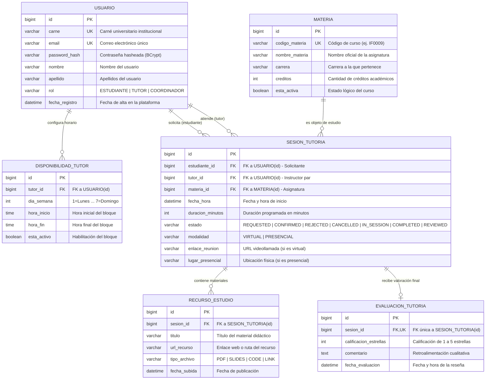

# Modelo Entidad-Relación (ERD): EduMentor Hub
## Especificación y Diagrama Base de Base de Datos Relacional

**Curso:** IF0009 - Desarrollo de Software IV  
**Semestre:** II Ciclo 2026 — Universidad de Costa Rica (Recinto de Paraíso)  
**Profesor:** Mag. Jonathan Granados C.  
**Propósito:** Artefacto de referencia técnica para el Paquete de Diseño (25%) del Proyecto Integrador.  
**Motor Soportado:** Microsoft SQL Server / H2 Database (ANSI SQL).  

---

## 1. Diagrama Entidad-Relación (Mermaid ERD)

El siguiente diagrama modela las 6 entidades fundamentales requeridas por la plataforma **EduMentor Hub**, especificando sus atributos, tipos de datos, claves primarias (`PK`), claves foráneas (`FK`), restricciones de unicidad (`UK`) y cardinalidades formales:



---

## 2. Diccionario de Datos Detallado

A continuación se detalla la estructura física recomendada para cada tabla en base de datos:

### 2.1 Tabla `USUARIO`
Almacena las credenciales, datos personales y perfiles de acceso al sistema.

| Columna | Tipo de Dato (SQL Server / H2) | Restricciones | Descripción |
|---|---|---|---|
| `id` | `BIGINT` | `PK`, `IDENTITY(1,1)` | Identificador autonumérico único. |
| `carne` | `VARCHAR(20)` | `NOT NULL`, `UNIQUE` | Carné universitario del estudiante/tutor. |
| `email` | `VARCHAR(100)` | `NOT NULL`, `UNIQUE` | Correo institucional para autenticación. |
| `password_hash` | `VARCHAR(255)` | `NOT NULL` | Hash seguro de la contraseña (BCrypt). |
| `nombre` | `VARCHAR(50)` | `NOT NULL` | Nombre de pila. |
| `apellido` | `VARCHAR(50)` | `NOT NULL` | Primer y segundo apellido. |
| `rol` | `VARCHAR(20)` | `NOT NULL` | Valores: `ESTUDIANTE`, `TUTOR`, `COORDINADOR`. |
| `fecha_registro` | `DATETIME` | `NOT NULL`, `DEFAULT GETDATE()` | Marca temporal de creación. |

---

### 2.2 Tabla `MATERIA`
Catálogo de cursos académicos sobre los cuales se imparten tutorías.

| Columna | Tipo de Dato | Restricciones | Descripción |
|---|---|---|---|
| `id` | `BIGINT` | `PK`, `IDENTITY(1,1)` | Identificador autonumérico único. |
| `codigo_materia` | `VARCHAR(20)` | `NOT NULL`, `UNIQUE` | Código del plan de estudios (ej. `IF0009`). |
| `nombre_materia` | `VARCHAR(100)` | `NOT NULL` | Nombre descriptivo oficial del curso. |
| `carrera` | `VARCHAR(100)` | `NOT NULL` | Carrera a la que pertenece la asignatura. |
| `creditos` | `INT` | `NOT NULL`, `CHECK (creditos > 0)` | Cantidad de créditos universitarios. |
| `esta_activa` | `BOOLEAN` / `BIT` | `NOT NULL`, `DEFAULT 1` | Estado lógico para habilitar tutorías. |

---

### 2.3 Tabla `DISPONIBILIDAD_TUTOR`
Ventanas semanales recurrentes en las que un tutor se encuentra disponible.

| Columna | Tipo de Dato | Restricciones | Descripción |
|---|---|---|---|
| `id` | `BIGINT` | `PK`, `IDENTITY(1,1)` | Identificador de la franja horaria. |
| `tutor_id` | `BIGINT` | `NOT NULL`, `FK -> USUARIO(id)` | Tutor que habilita la disponibilidad. |
| `dia_semana` | `INT` | `NOT NULL`, `CHECK (dia_semana BETWEEN 1 AND 7)` | Día de la semana (1 = Lunes ... 7 = Domingo). |
| `hora_inicio` | `TIME` | `NOT NULL` | Hora de inicio del bloque de atención. |
| `hora_fin` | `TIME` | `NOT NULL`, `CHECK (hora_fin > hora_inicio)` | Hora de finalización del bloque. |
| `esta_activo` | `BOOLEAN` / `BIT` | `NOT NULL`, `DEFAULT 1` | Bandera de activación por el tutor. |

---

### 2.4 Tabla `SESION_TUTORIA`
Registro central de cada tutoría solicitada, programada o ejecutada.

| Columna | Tipo de Dato | Restricciones | Descripción |
|---|---|---|---|
| `id` | `BIGINT` | `PK`, `IDENTITY(1,1)` | Identificador único de la sesión. |
| `estudiante_id` | `BIGINT` | `NOT NULL`, `FK -> USUARIO(id)` | Estudiante que solicita la tutoría. |
| `tutor_id` | `BIGINT` | `NOT NULL`, `FK -> USUARIO(id)` | Tutor par asignado a la sesión. |
| `materia_id` | `BIGINT` | `NOT NULL`, `FK -> MATERIA(id)` | Asignatura objeto de la tutoría. |
| `fecha_hora` | `DATETIME` | `NOT NULL` | Fecha y hora programada de la cita. |
| `duracion_minutos` | `INT` | `NOT NULL`, `DEFAULT 60` | Duración pactada de la sesión. |
| `estado` | `VARCHAR(20)` | `NOT NULL` | `REQUESTED`, `CONFIRMED`, `REJECTED`, `CANCELLED`, `IN_SESSION`, `COMPLETED`, `REVIEWED`. |
| `modalidad` | `VARCHAR(20)` | `NOT NULL` | Valores: `VIRTUAL` o `PRESENCIAL`. |
| `enlace_reunion` | `VARCHAR(255)` | `NULL` | Enlace a videollamada (Zoom/Teams/Meet). |
| `lugar_presencial` | `VARCHAR(100)` | `NULL` | Sala de estudio, aula o cubículo asignado. |

---

### 2.5 Tabla `RECURSO_ESTUDIO`
Archivos, guías y enlaces complementarios compartidos durante la sesión.

| Columna | Tipo de Dato | Restricciones | Descripción |
|---|---|---|---|
| `id` | `BIGINT` | `PK`, `IDENTITY(1,1)` | Identificador del recurso. |
| `sesion_id` | `BIGINT` | `NOT NULL`, `FK -> SESION_TUTORIA(id)` | Sesión a la cual pertenece el material. |
| `titulo` | `VARCHAR(100)` | `NOT NULL` | Título del material o documento. |
| `url_recurso` | `VARCHAR(500)` | `NOT NULL` | URL o ruta de acceso al documento. |
| `tipo_archivo` | `VARCHAR(50)` | `NOT NULL` | Ej. `PDF`, `SLIDES`, `CODE`, `LINK`. |
| `fecha_subida` | `DATETIME` | `NOT NULL`, `DEFAULT GETDATE()` | Marca temporal de la carga. |

---

### 2.6 Tabla `EVALUACION_TUTORIA`
Evaluación formativa post-sesión registrada por el estudiante solicitante.

| Columna | Tipo de Dato | Restricciones | Descripción |
|---|---|---|---|
| `id` | `BIGINT` | `PK`, `IDENTITY(1,1)` | Identificador de la evaluación. |
| `sesion_id` | `BIGINT` | `NOT NULL`, `UNIQUE`, `FK -> SESION_TUTORIA(id)` | Sesión calificada (relación 1 a 1). |
| `calificacion_estrellas` | `INT` | `NOT NULL`, `CHECK (calificacion_estrellas BETWEEN 1 AND 5)` | Puntaje de satisfacción (1 a 5 estrellas). |
| `comentario` | `VARCHAR(1000)` | `NULL` | Observaciones cualitativas sobre la sesión. |
| `fecha_evaluacion` | `DATETIME` | `NOT NULL`, `DEFAULT GETDATE()` | Marca temporal del registro. |

---

## 3. Justificación de Cardinalidades y Reglas de Integridad

* **`USUARIO` (Tutor) 1:N `DISPONIBILIDAD_TUTOR`:** Un tutor puede registrar múltiples bloques de horario a lo largo de la semana, pero cada franja horaria pertenece a un único tutor.
* **`USUARIO` (Estudiante) 1:N `SESION_TUTORIA`:** Un estudiante puede solicitar múltiples sesiones de tutoría en distintas materias y fechas.
* **`USUARIO` (Tutor) 1:N `SESION_TUTORIA`:** Un tutor puede atender múltiples sesiones con diferentes estudiantes a lo largo del ciclo.
* **`MATERIA` 1:N `SESION_TUTORIA`:** Una materia puede ser solicitada en múltiples sesiones de tutoría.
* **`SESION_TUTORIA` 1:N `RECURSO_ESTUDIO`:** Durante una sesión se pueden adjuntar cero, uno o múltiples materiales didácticos de apoyo.
* **`SESION_TUTORIA` 1:1 `EVALUACION_TUTORIA`:** Una sesión de tutoría completada genera **como máximo una única evaluación** (garantizado mediante restricción `UNIQUE` en la columna foránea `sesion_id`).

---

## 4. Índices Recomendados para Optimización de Consultas

Para evitar cuellos de botella en la verificación de traslapes y filtrado por estado, se recomienda la creación de los siguientes índices en la base de datos:

1. **Índice Compuesto de Traslapes:**
   ```sql
   CREATE INDEX idx_sesion_tutor_fecha 
   ON SESION_TUTORIA (tutor_id, fecha_hora, estado);
   ```
2. **Índice de Sesiones por Estudiante:**
   ```sql
   CREATE INDEX idx_sesion_estudiante 
   ON SESION_TUTORIA (estudiante_id, estado);
   ```
3. **Índice de Disponibilidad por Día:**
   ```sql
   CREATE INDEX idx_disp_tutor_dia 
   ON DISPONIBILIDAD_TUTOR (tutor_id, dia_semana, esta_activo);
   ```
