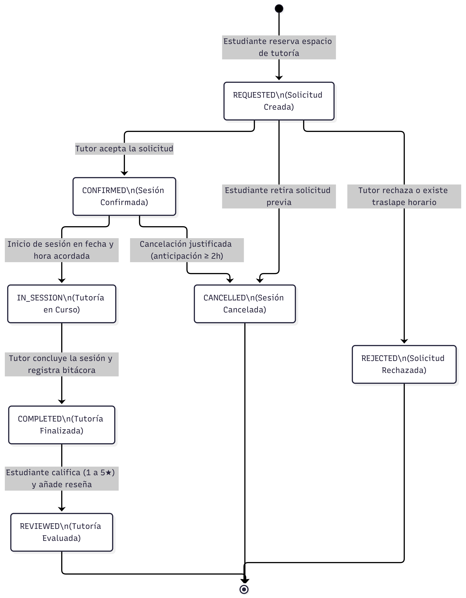

# Especificación del Proyecto Integrador: EduMentor Hub
## Plataforma Web de Tutorías Académicas entre Pares y Gestión Docente

**Curso:** IF0009 - Desarrollo de Software IV  
**Semestre:** II Ciclo 2026 — Universidad de Costa Rica (UCR, Recinto de Paraíso)  
**Profesor:** Mag. Jonathan Granados C.  
**Modalidad:** Trabajo Colaborativo en Equipos de Máximo 4 Estudiantes (1 a 4 personas)  
**Fechas Clave:**
* **Inicio:** Lunes 26 de octubre de 2026
* **Entrega Final y Defensas:** Lunes 30 de noviembre de 2026
* **Duración:** 5 semanas de desarrollo activo  

**Ponderación:** 30% de la Nota Final del Curso (100 puntos en escala del proyecto)  
**Alcance Temático:** Exclusivamente los **Temas 1 a 4** del programa del curso (Fundamentos Web, Git Colaborativo, Backend Spring Boot 3 y Frontend Angular Standalone). No incluye desarrollo móvil (Tema 5) ni despliegue en contenedores/nube (Tema 7).

---

## 1. Descripción General del Sistema

**EduMentor Hub** es una plataforma web universitaria diseñada para conectar a estudiantes que requieren refuerzo académico con tutores pares capacitados de niveles superiores. El sistema automatiza la oferta y administración de asignaturas, la parametrización de disponibilidad horaria por parte de los tutores, la reserva controlada de sesiones académicas sin traslapes de horario, el intercambio de recursos didácticos y la evaluación formativa del servicio de tutoría mediante calificaciones y retroalimentación.

La solución se concibe como una aplicación web de pila completa (Full-Stack) construida sobre una arquitectura desacoplada: una API RESTful desarrollada con **Spring Boot 3** y un cliente web reactivo desarrollado como Single Page Application (SPA) con **Angular Standalone**.

---

## 2. Dominio del Problema y Flujo de Trabajo

El sistema debe gestionar el flujo operativo de la tutoría académica respetando estrictamente el ciclo de vida modelado mediante la siguiente máquina de estados finitos:

### Matriz de Estados y Transiciones de la Tutoría:

| Estado | Descripción Operativa | Disparadores y Siguientes Estados Válidos |
|---|---|---|
| **`REQUESTED`** | Solicitud inicial creada por el estudiante. | • Aceptación del tutor → `CONFIRMED` • Rechazo del tutor o traslape → `REJECTED` • Desistimiento del estudiante → `CANCELLED` |
| **`CONFIRMED`** | Sesión aceptada; horario reservado en agenda. | • Cumplimiento de fecha y hora pactada → `IN_SESSION` • Cancelación con al menos 2h de anticipación → `CANCELLED` |
| **`REJECTED`** | Solicitud declinada por el tutor o por conflicto de agenda. | Estado final (*Terminación del flujo*). |
| **`CANCELLED`** | Sesión anulada cumpliendo la política de anticipación. | Estado final (*Terminación del flujo*). |
| **`IN_SESSION`** | Sesión académica en desarrollo activo (virtual o presencial). | • Finalización de la sesión por el tutor → `COMPLETED` |
| **`COMPLETED`** | Tutoría concluida; el tutor registra resumen del trabajo. | • Registro de evaluación por el estudiante → `REVIEWED` |
| **`REVIEWED`** | Calificación formativa y comentario guardados exitosamente. | Estado final (*Terminación del flujo*). |

### Reglas de Negocio Fundamentales:

* **Prevención Determinista de Traslapes:** La capa de servicio del backend debe validar rigurosamente que ni el tutor ni el estudiante posean dos sesiones confirmadas en el mismo rango de fecha y hora.
* **Control de Cancelación Oportuna:** Las sesiones solo pueden ser canceladas por las partes con al menos 2 horas de anticipación a la hora pactada.
* **Cálculo de Calificación Promedio:** Cada nueva evaluación registrada (escala de 1 a 5 estrellas) actualiza de forma automática el promedio acumulado de calificación del tutor.
* **Validación Desacoplada:** Todas las reglas de negocio complejas deben residir en la capa de servicio (`@Service`), manteniéndose independientes de los controladores web y de las entidades de persistencia.

---

## 3. Modelo de Datos Relacional y Esquema Base

El backend debe implementar y mapear mediante **Spring Data JPA** al menos las siguientes 6 entidades fundamentales sobre un motor relacional (**Microsoft SQL Server** o **H2 Database** en modo archivo/memoria):

1. **`Usuario`**: Gestión de identidad y seguridad (`id`, `carne`, `email`, `password_hash`, `nombre`, `apellido`, `rol` [`ESTUDIANTE`, `TUTOR`, `COORDINADOR`]).
2. **`Materia`**: Catálogo de asignaturas académicas (`id`, `codigo_materia`, `nombre_materia`, `carrera`, `creditos`).
3. **`DisponibilidadTutor`**: Bloques de horario habilitados (`id`, `tutor_id`, `dia_semana`, `hora_inicio`, `hora_fin`, `esta_activo`).
4. **`SesionTutoria`**: Registro de la tutoría (`id`, `estudiante_id`, `tutor_id`, `materia_id`, `fecha_hora`, `duracion_minutos`, `estado` [`REQUESTED`, `CONFIRMED`, `REJECTED`, `CANCELLED`, `IN_SESSION`, `COMPLETED`, `REVIEWED`], `modalidad` [`VIRTUAL`, `PRESENCIAL`]).
5. **`RecursoEstudio`**: Enlaces y materiales didácticos (`id`, `sesion_id`, `titulo`, `url_recurso`, `tipo_archivo`).
6. **`EvaluacionTutoria`**: Calificación y reseña post-sesión (`id`, `sesion_id`, `calificacion_estrellas` [1-5], `comentario`, `fecha_evaluacion`).

---

## 4. Organización del Trabajo en Equipo y Flexibilidad Operativa

Para el desarrollo del proyecto rigen los siguientes lineamientos de trabajo colaborativo:

* **Conformación de Equipos:** Los equipos estarán formados por un **máximo de 4 estudiantes** (se admiten equipos de 1, 2, 3 o 4 integrantes).
* **Autonomía en la Distribución de Tareas:** El equipo tiene total libertad para acordar internamente la distribución de tareas, asignación de componentes e historias de usuario (diseño de base de datos, endpoints REST, seguridad JWT, componentes de Angular, validaciones y estilos).
* **Responsabilidad Compartida:** Aunque los integrantes asuman tareas específicas, todo el equipo debe comprender la arquitectura completa de la solución. Cada estudiante defenderá individualmente su dominio sobre el código fuente en la evaluación oral.
* **Transparencia y Trazabilidad:** Toda contribución debe quedar registrada en el historial de commits y Pull Requests de GitHub. No se aceptarán contribuciones opacas subidas por un único integrante en nombre de otros.

---

## 5. Gobernanza de Repositorios y Flujo de Trabajo en Git

Cada equipo debe estructurar y versionar el desarrollo en **dos repositorios públicos o compartidos con el docente en GitHub**:

* **Repositorio Backend:** `dsw4-2026-equipoXX-edumentor-backend`  
  Tecnologías: Java 17/21, Spring Boot 3, Spring Data JPA, Maven.
* **Repositorio Frontend:** `dsw4-2026-equipoXX-edumentor-frontend`  
  Tecnologías: Node.js, Angular CLI (v17+ Standalone), TypeScript, CSS3.

### Políticas Obligatorias de Control de Versiones:

* **Protección de la Rama Principal:** Queda terminantemente prohibido realizar commits directos sobre la rama `main`.
* **Estrategia de Ramas por Funcionalidad:** Cada tarea o requerimiento debe elaborarse en una rama propia (`feature/auth-jwt`, `feature/materia-service`, `feature/reserva-ui`).
* **Revisiones de Código Mediante Pull Requests (PR):** Para integrar código a `main`, es obligatorio abrir un Pull Request y obtener al menos una revisión y aprobación explícita de un compañero de equipo.
* **Mensajes de Commit Claros:** Utilice la convención de commits semánticos (`feat:`, `fix:`, `docs:`, `test:`, `refactor:`).

---

## 6. Esquema de Evaluación y Ponderación (Fase Única: 100%)

El proyecto se evaluará en **una única fase integral** entregada al término de las 5 semanas, con la siguiente distribución porcentual:

| Componente Evaluativo | Porcentaje | Modalidad |
|---|:---:|---|
| **1. Paquete de Diseño y Especificación** • Modelo Entidad-Relación (ERD) • Diagrama de Clases UML • Especificación OpenAPI 3.0 | **25 %** (8%) (8%) (9%) | **Grupal (Documentación)** |
| **2. Proyecto Funcional Desarrollado** • Backend Spring Boot 3 y Persist. • Frontend Angular SPA y UX/A11y • Calidad Git, PRs y Pruebas Unit. • Defensa Oral y Live Coding | **75 %** (25%) (20%) (10%) (20%) | **Mixta (Código + Oral)** • Repositorio GitHub • Repositorio GitHub • Repositorio GitHub • Individual con Docente |

### 📐 Detalle del Componente 1: Paquete de Diseño y Especificación (25%)

El equipo debe incluir en una carpeta `docs/` dentro del repositorio o entregar en formato PDF/YAML los siguientes **tres artefactos exclusivos**:

1. **Modelo Entidad-Relación (ERD) (8%):**  
   Diagrama entidad-relación detallado que contemple las 6 entidades mínimas, claves primarias (PK), claves foráneas (FK), tipos de datos relacionales, restricciones de nulidad y unicidad, y cardinalidades precisas (1:N, N:M).

2. **Diagrama de Clases UML del Backend (8%):**  
   Modelado orientado a objetos de la arquitectura en capas de Spring Boot. Debe mostrar entidades `@Entity`, repositorios Spring Data, servicios con sus métodos de negocio, controladores RESTful y DTOs con sus relaciones de agregación y dependencia.

3. **Especificación OpenAPI 3.0 (`openapi.yaml` o `openapi.json`) (9%):**  
   Definición técnica rigurosa de los endpoints REST expuestos: rutas, verbos HTTP (GET, POST, PUT, DELETE), parámetros de cabecera y consulta, esquemas de DTOs de entrada y salida, códigos de estado HTTP (200, 201, 400, 401, 403, 404, 500) y estructuras de error conformes con **RFC 7807 (`ProblemDetails`)**.

*(Nota: Se excluyen explícitamente diagramas C4, wireframes detallados con orden de foco, diagramas de secuencia y diagramas de estados).*

---

### 💻 Detalle del Componente 2: Proyecto Funcional Desarrollado (75%)

El software desarrollado se evaluará considerando la calidad del código, completitud funcional, apego a los estándares del curso y la defensa individual:

#### A. Backend Spring Boot 3 y Persistencia (25%):
* Arquitectura desacoplada en capas: `Controller` → `Service` → `Repository` → `Entity`.
* Persistencia relacional con Spring Data JPA sobre SQL Server o H2, evitando el problema de consultas N+1 mediante el uso apropiado de `JOIN FETCH` o `@EntityGraph`.
* Validaciones robustas de lógica de negocio (detección determinista de traslapes de horario y anticipación de cancelación).
* Manejo global centralizado de excepciones con `@RestControllerAdvice` respondiendo bajo el estándar RFC 7807.
* Mecanismo de autenticación y autorización mediante **Spring Security** y tokens **JWT**.

#### B. Frontend Angular SPA, Accesibilidad e Internacionalización (20%):
* Aplicación Single Page Application (SPA) estructurada con **Angular Standalone Components**.
* Formularios Reactivos fuertemente tipados (`Reactive Forms`) con validaciones síncronas de campos obligatorios y formatos.
* Enrutamiento protegido mediante Guardas Funcionales (`CanActivateFn`) que restrinjan vistas según el token JWT y el rol del usuario.
* Interceptores HTTP funcionales para adjuntar el encabezado `Authorization: Bearer <token>` automáticamente.
* Accesibilidad web auditada con Google Lighthouse, alcanzando una puntuación mínima de **90 en Accesibilidad** en las vistas principales.
* Soporte de internacionalización dinámico **i18n** (Español / Inglés).

#### C. Gobernanza de Git, Pull Requests y Pruebas Unitarias (10%):
* Trazabilidad de trabajo colaborativo en GitHub: ramas `feature/*` activas, commits descriptivos y Pull Requests revisados y aprobados entre pares.
* Pruebas unitarias automatizadas con **JUnit 5 y Mockito** en el backend para validar al menos 2 escenarios de lógica de negocio en la capa de servicios (ej. validación exitosa de disponibilidad vs. rechazo por traslape).

#### D. Defensa Oral Individual y Codificación en Vivo (Live Coding) (20%):
* Sesión síncrona individual con el docente donde cada estudiante explicará los componentes en los que participó y justificará las decisiones arquitectónicas tomadas.
* Cada estudiante resolverá un reto práctico menor de modificación o extensión de código en tiempo real (Live Coding) frente al docente para evidenciar la autoría y el dominio técnico del proyecto.

---

## 7. Cronograma Sugerido de 5 Semanas de Desarrollo

Para garantizar el avance ordenado del proyecto entre el **26 de octubre** y el **30 de noviembre de 2026**, se recomienda el siguiente ritmo de trabajo semanal:

| Semana | Periodo | Hito de Trabajo Recomendado |
|:---:|---|---|
| **Semana 1** | 26 de oct. al 01 de nov. | • Definición y diseño del ERD. • Elaboración del Diagrama UML. • Redacción del OpenAPI 3.0. • Inicialización de repositorios. |
| **Semana 2** | 02 de nov. al 08 de nov. | • Creación de Entidades JPA y DB. • Configuración de Spring Security y emisión de tokens JWT. • Interfaz inicial de Login en Angular Standalone. |
| **Semana 3** | 09 de nov. al 15 de nov. | • Implementación de Servicios de negocio y algoritmo de traslapes. • Controladores RESTful completos. • Manejo de errores RFC 7807. • Pruebas unitarias JUnit/Mockito. |
| **Semana 4** | 16 de nov. al 22 de nov. | • Componentes de Angular: catálogo de materias y matriz de horarios. • Formularios Reactivos de reserva. • Enrutamiento y Guardas JWT. |
| **Semana 5** | 23 de nov. al 30 de nov. | • Internacionalización i18n (ES/EN). • Auditoría de accesibilidad A11y. • Integración final y merge a main. • Entrega Final y Defensas Orales el Lunes 30 de Noviembre. |

---

## 8. Criterios de Aceptación Técnica Básica

Para que el proyecto sea recibido y evaluado, debe satisfacer la siguiente lista de verificación técnica:

- [ ] **Ejecución Local Estándar:** El proyecto debe compilar y ejecutarse localmente sin requerir herramientas fuera de los Temas 1 a 4 (Node.js/npm, Java 17/21 con Maven, y el motor de base de datos SQL Server o H2). No se requiere configuración de Docker ni contenedores.
- [ ] **Persistencia y Consultas:** La base de datos debe inicializarse correctamente y no presentar fallas de concurrencia ni consultas N+1 en las relaciones JPA.
- [ ] **Seguridad de Endpoints:** Los endpoints protegidos deben validar el token JWT y rechazar solicitudes no autorizadas con código HTTP `401 Unauthorized` o `403 Forbidden`.
- [ ] **Contratos de Error RFC 7807:** Toda respuesta de error en la API REST debe estructurarse mediante un payload JSON estandarizado (`title`, `status`, `detail`, `instance`).
- [ ] **Frontend Reactivo y Accesible:** La SPA en Angular debe ser responsiva en navegadores de escritorio, cumplir la meta de Lighthouse ≥ 90 en Accesibilidad y soportar el cambio dinámico de idioma español/inglés.
- [ ] **Trazabilidad en GitHub:** Ambos repositorios deben contar con archivo `README.md` con instrucciones claras de ejecución local, historial de commits de todos los miembros del equipo y ramas integradas mediante Pull Requests.

---

## 9. Pautas de Entrega Oficial

* **Fecha y Hora Límite:** Lunes 30 de noviembre de 2026, a las 12:59 horas.
* **Plataforma de Recepción:** Mediación Virtual (UCR).
* **Formato de Entrega:** Se entregará un documento PDF consolidado o enlace formal que contenga:
  1. Enlaces a los repositorios de GitHub (Backend y Frontend).
  2. Documentos de diseño (ERD, Diagrama de Clases UML y archivo `openapi.yaml` o `openapi.json`).
  3. Instrucciones paso a paso para la configuración, arranque de la base de datos y ejecución local de ambas aplicaciones.
  4. Lista de credenciales de usuario preconfiguradas para pruebas de los distintos roles (`ESTUDIANTE`, `TUTOR`, `COORDINADOR`).
