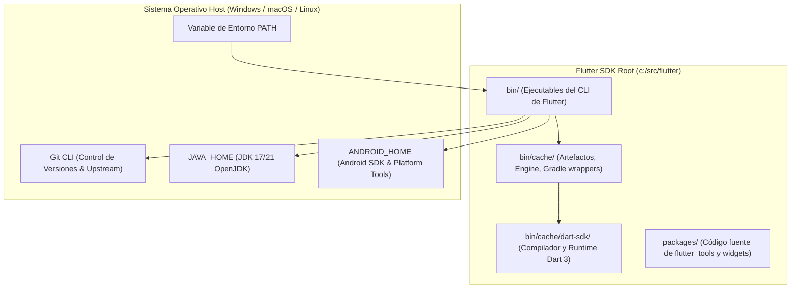

**UNIVERSIDAD DE COSTA RICA**  
**SEDE DEL ATLÁNTICO - RECINTO PARAÍSO**  
**CARRERA DE INFORMÁTICA EMPRESARIAL**  
**CURSO:** IF0009 - Desarrollo de Software IV  
**PROFESOR:** Mag. Jonathan Granados C.  
**SEMESTRE:** II-2026  

---

# Tema 5.2.2.1: Instalación, Configuración de Variables de Entorno y Verificación del Flutter SDK

> [!NOTE]
> Este documento corresponde a la lectura teórica fundamental del **Subtema 5.2.2.1**. En esta guía usted comprenderá la arquitectura del Software Development Kit (SDK) de Flutter, el funcionamiento de sus canales de distribución, la inyección en el subsistema de variables de entorno y el diagnóstico integral del toolchain mediante la herramienta `flutter doctor`.

---

## 1. Resumen Ejecutivo

Esta lectura proporciona las bases arquitectónicas y operativas necesarias para aprovisionar un entorno de ingeniería móvil profesional con Flutter. Al finalizar este estudio, usted dominará la anatomía interna del SDK de Flutter, la configuración determinista de variables de entorno del sistema operativo (`PATH`, `ANDROID_HOME`, `JAVA_HOME`), y la resolución rigurosa de advertencias y licencias binarias reportadas por la utilidad diagnóstica `flutter doctor`.

---

## 2. Concepto Principal (El "Qué"): Arquitectura del Flutter SDK y su Toolchain

El **Flutter SDK** no es simplemente una biblioteca o dependencia de software; es un **toolchain completo de compilación cruzada** (*cross-compilation toolchain*) que integra compiladores de código de máquina nativo (AOT - Ahead-Of-Time), el compilador Just-In-Time (JIT) para desarrollo interactivo, el SDK completo del lenguaje **Dart**, motores de empaquetado para plataformas heterogéneas y herramientas diagnósticas avanzadas.



### 2.1 Componentes Fundamentales del SDK

**A.** **CLI `flutter` (`bin/flutter` o `bin/flutter.bat`):**  
Es el punto de entrada orquestador. Está programado primordialmente en Dart y se apoya en scripts bash/batch para inicializar el runtime preliminar. Se encarga de descargar las dependencias del motor gráfico (Skia/Impeller precompilados) en la subcarpeta `bin/cache`.

**B.** **Dart SDK Integrado (`bin/cache/dart-sdk`):**  
Flutter incluye su propia versión acoplada y validada del SDK de Dart. Usted **no debe instalar Dart de forma independiente** para trabajar con Flutter, ya que el motor requiere una paridad exacta de versión entre el compilador y las bibliotecas base.

**C.** **Canales de Distribución Oficial (*Release Channels*):**
Flutter mantiene ramas de distribución con diferentes niveles de madurez:

*   **`stable`:** Canal recomendado para ambientes de producción académica y empresarial. Recibe pruebas rigurosas y actualizaciones acumulativas mensuales.
*   **`beta`:** Publicación mensual de nuevas funcionalidades para pruebas anticipadas.
*   **`master`:** Rama activa de desarrollo continuo de Google. Contiene las últimas características de vanguardia, pero está sujeta a regresiones funcionales transitorias.

### 2.2 Variables de Entorno y Resolución del Sistema

Para que su terminal de comandos (PowerShell, CMD o zsh) localice el ejecutable sin rutas absolutas, la carpeta `bin` de Flutter debe inyectarse en la variable `PATH`.

Adicionalmente, Flutter requiere tres componentes externos de plataforma:
*   **Git:** Utilizado internamente por el comando `flutter upgrade` para sincronizar etiquetas y ramas directamente contra el repositorio oficial de GitHub de Google.
*   **Java Development Kit (JDK 17 o 21):** Requerido por el sistema de construcción de Gradle en Android para compilar los envoltorios nativos (*wrappers*) en bytecode de JVM.
*   **Android Command-line Tools (`cmdline-tools`):** Conjunto de utilidades de Google (`sdkmanager`, `avdmanager`) para validar licencias y emuladores.

---

## 3. Analogía Técnica: La Cabina de Inspección Pre-Vuelo

Imagine que el Flutter SDK es una aeronave comercial de fuselaje ancho de última generación:

*   El **SDK de Flutter** es la aeronave lista para despegar con todos sus sistemas de propulsión y navegación integrados.
*   El **`PATH`** es la pista de rodaje que conecta los hangares con la torre de control de su sistema operativo; si la pista no está señalizada, la torre no sabe dónde encontrar el avión.
*   El comando **`flutter doctor`** representa el riguroso **protocolo de chequeo pre-vuelo (Checklist Pre-flight)** que realizan el capitán y el primer oficial: verifica los niveles de combustible (JDK), los radares y flaps (Android SDK & Command-line Tools), y los permisos de la autoridad de aviación civil (**Android Licenses**). Despegar sin completar el checklist provocará una falla catastrófica en pleno vuelo durante la fase de compilación.

---

## 4. Implementación y Procedimiento Operativo (El "Cómo")

A continuación se detallan las instrucciones operativas para aprovisionar el entorno en **Windows PowerShell** conforme a los estándares de desarrollo del curso.

### 4.1 Descarga y Ubicación Determinista

Descargue el paquete binario de la rama `stable` desde el portal oficial de Flutter y descomprímalo en una ruta sin espacios ni caracteres especiales, por ejemplo: `C:\src\flutter`.

> [!CAUTION]
> **Nunca** descomprima el SDK de Flutter en carpetas protegidas del sistema como `C:\Program Files\` o `C:\Program Files (x86)\`. Esto genera fallas graves de permisos cuando el CLI intenta escribir artefactos en `bin/cache`.

### 4.2 Inyección en el PATH mediante PowerShell

Abra una ventana de PowerShell y ejecute la configuración permanente para el usuario actual:

```powershell
# Definir la ruta de instalacion de Flutter SDK
$FlutterPath = "C:\src\flutter\bin"

# Obtener el PATH actual del usuario
$CurrentPath = [Environment]::GetEnvironmentVariable("Path", "User")

# Concatenar unicamente si no existe previamente
if ($CurrentPath -notlike "*$FlutterPath*") {
    $NewPath = "$CurrentPath;$FlutterPath"
    [Environment]::SetEnvironmentVariable("Path", $NewPath, "User")
    Write-Host "PATH configurado correctamente." -ForegroundColor Green
}
```

### 4.3 Verificación Diagnóstica con `flutter doctor`

Cierre y vuelva a abrir su terminal para recargar las variables de entorno. Ejecute el comando diagnóstico con el flag de máxima verbosidad (`-v`):

```powershell
flutter doctor -v
```

Explicación detallada del flujo de diagnóstico:

**1.** **Flutter Channel & Version:** Valida si el árbol de Git local coincide con una etiqueta oficial estable de Google.

**2.** **Android Toolchain:** Inspecciona la presencia del Android SDK, la versión de las `platform-tools` y valida si las licencias de software privativas de Google han sido suscritas legalmente.

**3.** **Java Binary Check:** Rastrea la existencia de una máquina virtual de Java válida (`java -version`), comprobando si proviene de Android Studio o de una instalación de OpenJDK configurada en `JAVA_HOME`.

**4.** **Visual Studio Code / Android Studio Plugins:** Revisa si el entorno de desarrollo tiene los plugins de lenguaje Dart y Flutter activados.

**5.** **Connected Devices:** Verifica la disponibilidad de emuladores activos o dispositivos físicos conectados mediante el protocolo ADB (*Android Debug Bridge*).

### 4.4 Aceptación Obligatoria de Licencias de Android

Si `flutter doctor` muestra una advertencia indicando que las licencias de Android no han sido aceptadas, ejecute el siguiente comando interactivo:

```powershell
flutter doctor --android-licenses
```

Presione la tecla `y` y luego `Enter` en cada una de las licencias del SDK Manager presentadas para validar el contrato de desarrollo de Google.

---

## 5. Trampas Comunes y Errores de Configuración

A continuación se analizan los errores más frecuentes detectados en la práctica profesional:

### Trampa 1: Espacios en blanco en las rutas de directorios
*   **Problema:** Instalar el SDK en rutas como `C:\Usuarios\Mi Nombre\flutter`.
*   **Causa raíz:** Las herramientas subyacentes de compilación de Android (Gradle y los scripts internos de compilación C++) dividen los argumentos de línea de comandos en cada espacio en blanco, interpretando erróneamente la ruta como dos comandos distintos.
*   **Mitigación:** Ubique siempre el SDK en rutas cortas como `C:\src\flutter` o `C:\dev\flutter`.

### Trampa 2: "Android cmdline-tools component is missing"
*   **Problema:** `flutter doctor` muestra una equis roja en el componente de herramientas de línea de comandos de Android.
*   **Causa raíz:** Las versiones modernas de Android Studio no instalan este paquete por defecto durante el asistente inicial de instalación.
*   **Mitigación:** Abra Android Studio, ingrese a **Settings > Languages & Frameworks > Android SDK > SDK Tools**, marque la casilla **Android SDK Command-line Tools (latest)** y presione **Apply**.

### Trampa 3: Incompatibilidad entre Java SDK y Gradle
*   **Problema:** Al compilar un proyecto se genera el error: `Unsupported class file major version` o `Could not open cp_settings generic class cache`.
*   **Causa raíz:** `JAVA_HOME` apunta a una versión de Java extremadamente reciente (ej. Java 23/24) no soportada por la versión de Gradle vinculada a la plantilla de Android de Flutter, o apunta a una versión obsoleta (Java 8).
*   **Mitigación:** Configure su variable `JAVA_HOME` apuntando al JDK provisto por Android Studio (localizado típicamente en `C:\Program Files\Android\Android Studio\jbr`) o instale **OpenJDK 17 LTS / OpenJDK 21 LTS**.

---

## 6. Pregunta de Reflexión Académica

> **Pregunta para el Análisis:**  
> ¿Por qué el equipo de ingeniería de Google en Flutter decidió integrar su propio SDK de Dart dentro de la carpeta `bin/cache/dart-sdk` en lugar de requerir que el desarrollador instale y gestione Dart como un paquete global independiente en el sistema operativo?  
>  
> *Pista:* Considere la estrecha acoplamiento entre las optimizaciones del compilador AOT del motor gráfico C++ de Flutter y las características sintácticas y de recolector de basura (*Garbage Collector*) de versiones específicas del lenguaje Dart.
