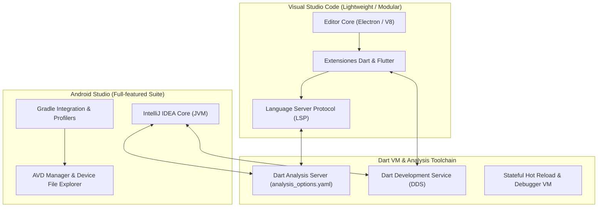
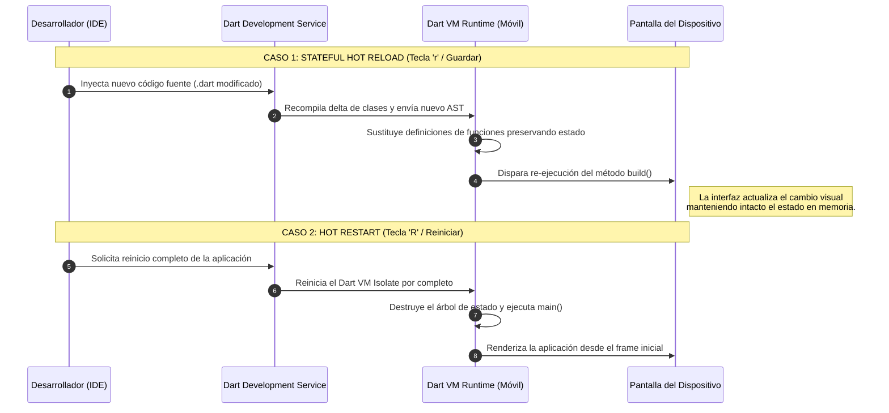

**UNIVERSIDAD DE COSTA RICA**  
**SEDE DEL ATLÁNTICO - RECINTO PARAÍSO**  
**CARRERA DE INFORMÁTICA EMPRESARIAL**  
**CURSO:** IF0009 - Desarrollo de Software IV  
**PROFESOR:** Mag. Jonathan Granados C.  
**SEMESTRE:** II-2026  

---

# Tema 5.2.2.2: Configuración Avanzada de IDEs: Visual Studio Code vs. Android Studio

> [!NOTE]
> Este documento representa la lectura teórica fundamental del **Subtema 5.2.2.2**. Analiza en detalle las diferencias arquitectónicas, el consumo de recursos en memoria, la mecánica interna del *Stateful Hot Reload* y la configuración de productividad profesional en Visual Studio Code y Android Studio.

---

## 1. Resumen Ejecutivo

Esta lectura instruye al estudiantado en la selección, personalización y aprovechamiento técnico de los dos entornos integrados de desarrollo (IDEs) líderes para Flutter. Al finalizar este módulo, usted comprenderá los compromisos de rendimiento entre una arquitectura basada en *Language Server Protocol* (VS Code) frente a un IDE completo basado en JVM (Android Studio), dominará la configuración de autocompletado y formateo automático mediante *trailing commas*, y manipulará con solvencia las operaciones de *Hot Reload* y *Hot Restart*.

---

## 2. Concepto Principal (El "Qué"): Arquitectura de Desarrollo en IDEs

El desarrollo eficiente en Flutter depende críticamente de la comunicación bidireccional entre el editor de código y el **Dart Analysis Server**. La elección entre Visual Studio Code y Android Studio responde a una decisión de arquitectura de flujo de trabajo:



### 2.1 Tabla Comparativa de Arquitectura y Rendimiento

| Dimensión Técnica | Visual Studio Code | Android Studio |
| :--- | :--- | :--- |
| **Motor Base** | Electron (Node.js + Chromium V8) | JetBrains IntelliJ Platform (JVM) |
| **Consumo de Memoria RAM** | Liviano (350 MB - 700 MB) | Exigente (1.8 GB - 3.5 GB+) |
| **Tiempo de Arranque** | Casi instantáneo (1 a 3 segundos) | Moderado a lento (10 a 30 segundos) |
| **Análisis de Código** | Vía *Dart Language Server* (LSP) | Motor semántico interno de IntelliJ + Dart Plugin |
| **Edición Nativa (Kotlin/Java)** | Soporte limitado sin plugins pesados | Soporte nativo de primer nivel con Gradle |
| **Casos de Uso Recomendados** | Programación diaria de UI, lógica Dart y refactorización rápida | Configuración profunda de módulos Android, Gradle y empaquetado |

---

### 2.2 Mecánica Interna: Stateful Hot Reload vs. Hot Restart

Una de las mayores innovaciones del ecosistema Flutter es su ciclo de retroalimentación en subsegundos:



*   **Stateful Hot Reload (`r`):** Carga los cambios de código directamente en la máquina virtual de Dart en ejecución. Preserva las variables de estado (`State`) existentes. **No ejecuta de nuevo `initState()` ni reinicia variables estáticas.**
*   **Hot Restart (`R` o `Ctrl+F5`):** Destruye el estado en memoria, reinicia el *isolate* de Dart y vuelve a invocar la función `main()`. Se debe utilizar de manera obligatoria cuando se modifican constructores estáticos, métodos `initState` o dependencias inyectadas en tiempo de inicio.

---

## 3. Analogía Técnica: El Vehículo Monoplaza y el Camión de Soporte

Para comprender cuándo utilizar cada herramienta:

*   **Visual Studio Code es un vehículo monoplaza de Fórmula 1:** Es extremadamente ligero, aerodinámico y diseñado para alcanzar máxima velocidad en la pista de desarrollo diario (escritura de código en Dart, navegación de widgets y depuración ágil).
*   **Android Studio es el camión taller y banco de pruebas de la escudería:** Pesa varias toneladas y consume mucho combustible (RAM), pero contiene grúas hidráulicas y herramientas industriales (configuración de Gradle, diagnóstico de manifiestos XML, depuración de capas nativas C++/NDK y gestión de certificados criptográficos de Android).
*   **Recomendación profesional:** Utilice VS Code como su entorno diario de desarrollo de código Flutter, manteniendo Android Studio instalado como el soporte de plataforma y gestión del Android SDK.

---

## 4. Implementación y Procedimiento Operativo (El "Cómo")

### 4.1 Configuración de Productividad en `.vscode/settings.json`

Para garantizar que su código mantenga la máxima legibilidad y cumpla los estándares del curso, configure su espacio de trabajo de Visual Studio Code creando el archivo `.vscode/settings.json`:

```json
{
  "editor.formatOnSave": true,
  "editor.formatOnType": true,
  "editor.defaultFormatter": "Dart-Code.dart-code",
  "editor.codeActionsOnSave": {
    "source.fixAll": "explicit",
    "source.organizeImports": "explicit"
  },
  "dart.previewFlutterUiGuides": true,
  "dart.closingLabels": true,
  "dart.flutterCreateAndroidLanguage": "kotlin",
  "dart.openDevTools": "flutter"
}
```

Explicación de las directivas clave:
*   `"editor.formatOnSave": true`: Aplica el formateador oficial de Dart cada vez que usted guarda el archivo (`Ctrl+S`).
*   `"dart.previewFlutterUiGuides": true`: Dibuja líneas verticales punteadas en el editor que representan la anidación del árbol de widgets, permitiendo identificar visualmente el cierre de cada nodo hijo.
*   `"dart.closingLabels": true`: Agrega comentarios virtuales no intrusivos al final de cada paréntesis indicando a cuál widget pertenece (ej. `// Container`, `// Column`).

### 4.2 La Regla de Oro: La Coma Final (*Trailing Comma*)

El formateador oficial de Dart utiliza las comas finales para determinar el estilo de indentación del árbol:

```dart
// FORMA INCORRECTA (Sin coma final -> Se formatea en una sola linea):
return Scaffold(body: Center(child: Text('Hola')));

// FORMA CORRECTA Y OBLIGATORIA (Con comas finales tras cada widget):
return Scaffold(
  appBar: AppBar(
    title: const Text('Panel Principal'),
  ),
  body: const Center(
    child: Text(
      'Configuracion completada',
      style: TextStyle(fontSize: 16.0),
    ),
  ),
);
```

---

## 5. Trampas Comunes y Errores de Productividad

### Trampa 1: El cambio no se visualiza con Hot Reload
*   **Problema:** Usted modifica un valor asignado dentro de `initState()` o en una variable final de estado, guarda los cambios (`Hot Reload`), pero la interfaz sigue mostrando el valor anterior.
*   **Causa raíz:** `Hot Reload` no vuelve a ejecutar `initState()`. Como el widget ya fue instanciado y montado en el *Element Tree*, conserva los valores de estado ya asignados.
*   **Mitigación:** Ejecute un **Hot Restart** (`R` en la terminal o el botón de reinicio circular en la barra de herramientas del IDE).

### Trampa 2: Desactivación accidental de las extensiones oficiales
*   **Problema:** VS Code pierde el resaltado de sintaxis o no sugiere atajos de refactorización (`Alt+Enter` o `Ctrl+.`).
*   **Causa raíz:** Conflicto entre extensiones no oficiales de Flutter o desactivación de la extensión **Flutter** (desarrollada por Dart Code / Google).
*   **Mitigación:** Asegúrese de instalar exclusivamente el paquete oficial verificado: `Dart-Code.flutter`.

---

## 6. Pregunta de Reflexión Académica

> **Pregunta para el Análisis:**  
> ¿Por qué el compilador de Dart en modo desarrollo (*Debug Mode*) compila bajo un paradigma **JIT (Just-In-Time)** mientras que para la distribución final a producción (*Release Mode*) compila estrictamente bajo **AOT (Ahead-Of-Time)**?  
>  
> *Pista:* Evalúe cómo el modo JIT requiere una máquina virtual interactiva que soporte la carga dinámica de código delta (*Hot Reload*), a expensas de un consumo de memoria y tiempo de arranque que resultarían inaceptables en una aplicación final en la tienda de aplicaciones.
