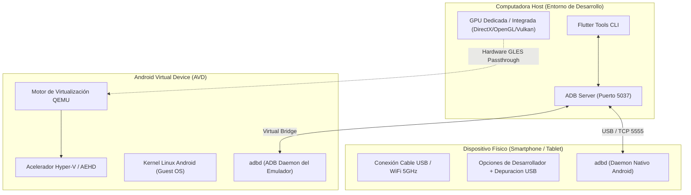

**UNIVERSIDAD DE COSTA RICA**  
**SEDE DEL ATLÁNTICO - RECINTO PARAÍSO**  
**CARRERA DE INFORMÁTICA EMPRESARIAL**  
**CURSO:** IF0009 - Desarrollo de Software IV  
**PROFESOR:** Mag. Jonathan Granados C.  
**SEMESTRE:** II-2026  

---

# Tema 5.2.2.3: Gestión de Emuladores (AVD Manager) y Dispositivos Físicos

> [!NOTE]
> Este documento representa la lectura teórica fundamental del **Subtema 5.2.2.3**. Explora la arquitectura de virtualización del Android Emulator (QEMU/KVM/WHPX), la optimización gráfica por GPU, la configuración del puente ADB (*Android Debug Bridge*) y el aprovisionamiento de dispositivos físicos mediante depuración USB e inalámbrica.

---

## 1. Resumen Ejecutivo

Esta lectura proporciona las directrices de ingeniería para configurar y orquestar entornos de ejecución móviles tanto virtuales como reales. Al concluir este tema, usted dominará la configuración de imágenes del sistema (*System Images*) con aceleración por hardware (AEHD/Hyper-V), la resolución de cuellos de botella gráficos en emuladores de Android, y el protocolo de depuración segura de dispositivos físicos mediante autorización criptográfica RSA en ADB.

---

## 2. Concepto Principal (El "Qué"): Arquitectura de Ejecución Virtual y Física

Para validar y probar una aplicación móvil en desarrollo, Flutter interactúa con el sistema operativo anfitrión (*Host*) y los dispositivos de destino (*Targets*) a través del subsistema **ADB (Android Debug Bridge)**.



---

### 2.1 Aceleración de Virtualización de CPU y GPU

El emulador oficial de Android se ejecuta sobre una versión modificada del hipervisor de código abierto **QEMU**.

**A. Aceleración de CPU:**
*   Para ejecutar un sistema operativo invitado (*Guest OS*) Android a velocidad casi nativa, el procesador anfitrión no debe emular instrucciones por software.
*   En equipos con arquitectura **x86_64** (Intel o AMD), se debe seleccionar una imagen del sistema con ABI `x86_64`.
*   En Windows 10/11, la virtualización es coordinada por la plataforma de hipervisor de Windows (**WHPX / Hyper-V**) o el **Android Emulator Hypervisor Driver (AEHD)**.

**B. Aceleración de GPU (Renderizado Gráfico):**
En el gestor de dispositivos virtuales (Device Manager), la opción **Emulated Performance - Graphics** determina drásticamente la tasa de refresco:
*   **Hardware - GLES 2.0:** El emulador canaliza las llamadas gráficas de Skia o Impeller directamente a la tarjeta gráfica física de su computadora. Es la configuración **obligatoria** para alcanzar 60 cuadros por segundo (FPS).
*   **Software - GLES 2.0:** La CPU anfitriona calcula cada píxel matemáticamente. Genera caídas severas de cuadros (*jank*) y lentitud extrema.

---

### 2.2 Comparativa: Emuladores vs. Dispositivos Físicos

| Característica | Emulador AVD | Dispositivo Físico |
| :--- | :--- | :--- |
| **Consumo de Recursos Host** | Alto (Requiere 4-8 GB de RAM y CPU constante) | Nulo (Ejecución 100% autónoma en el procesador móvil) |
| **Pruebas de Sensores Reales** | Simulado (Acelerómetro, giroscopio y GPS por panel) | Auténtico (Cámara real, Bluetooth BLE, biometría, GPS) |
| **Velocidad de Despliegue** | Rápida mediante red virtual interna | Rápida vía USB 3.0 o WiFi Direct |
| **Pruebas de Variedad de Pantallas** | Excelente (Creación de tablets, teléfonos plegables, etc.) | Limitado al hardware físicamente disponible |

---

## 3. Analogía Técnica: El Simulador de Vuelo y el Avión de Pruebas

Para visualizar la diferencia entre ambos entornos:

*   El **Emulador AVD** equivale a un **simulador de vuelo profesional en tierra**: permite alterar artificialmente las condiciones climáticas (geolocalización simulada, nivel de batería falso, rotación de giroscopio con el mouse) y probar configuraciones extremas de fuselaje (pantallas de 4 pulgadas hasta pantallas de 12 pulgadas) sin arriesgar un avión real.
*   El **Dispositivo Físico** es el **avión real volando en condiciones atmosféricas verdaderas**: es el único entorno capaz de medir la degradación térmica real de la batería (*thermal throttling*), la precisión exacta de la antena GPS bajo el cielo abierto, la velocidad de enfoque del sensor de la cámara y la respuesta háptica táctil en la mano del usuario.

---

## 4. Implementación y Procedimiento Operativo (El "Cómo")

### 4.1 Comandos Esenciales de ADB y Flutter

Abra su terminal de PowerShell para orquestar los dispositivos conectados:

```powershell
# 1. Listar dispositivos fisicos y emuladores activos en ADB
adb devices -l

# 2. Listar todos los emuladores AVD instalados en el sistema
flutter emulators

# 3. Lanzar un emulador especifico por su identificador
flutter emulators --launch Pixel_8_API_34

# 4. Listar los targets reconocidos por Flutter con sus IDs
flutter devices

# 5. Ejecutar la aplicacion dirigiendola a un dispositivo especifico
flutter run -d emulator-5554
```

### 4.2 Habilitación de Depuración en Dispositivos Físicos

Para transformar su teléfono inteligente Android personal en un entorno de pruebas:

**1.** Ingrese a **Ajustes > Información del Teléfono**.  
**2.** Localice la opción **Número de Compilación** (*Build Number*) y presiónela repetidamente **7 veces consecutivas** hasta observar el mensaje `"¡Ya eres desarrollador!"`.  
**3.** Regrese al menú principal, ingrese a **Sistema > Opciones de Desarrollador**.  
**4.** Active el interruptor **Depuración por USB** (*USB Debugging*).  
**5.** Conecte el teléfono mediante cable USB a la computadora. En la pantalla del móvil aparecerá un cuadro de diálogo solicitando autorizar la clave criptográfica RSA de su computadora. Marque la casilla **"Permitir siempre desde esta computadora"** y presione **Aceptar**.

### 4.3 Depuración Inalámbrica en Android 11+ (Wireless Debugging)

Si desea prescindir del cable USB:

**1.** Conecte la computadora y el teléfono a la misma red WiFi local (preferiblemente 5 GHz).  
**2.** En **Opciones de Desarrollador**, active **Depuración Inalámbrica** (*Wireless Debugging*).  
**3.** Seleccione **Vincular dispositivo con código de vinculación**.  
**4.** En su terminal PowerShell ejecute:

```powershell
# Vincular mediante la IP, puerto de emparejamiento y codigo de 6 digitos
adb pair 192.168.1.15:42135

# Conectar al puerto final de depuracion indicado en la pantalla
adb connect 192.168.1.15:39841
```

---

## 5. Trampas Comunes y Diagnóstico de Errores

### Trampa 1: El dispositivo físico figura como `unauthorized`
*   **Problema:** Al ejecutar `adb devices`, el móvil aparece listado como `device_id unauthorized`.
*   **Causa raíz:** La pantalla del teléfono estaba bloqueada al conectarlo y el usuario no aceptó el mensaje de validación de la huella digital de la clave RSA del anfitrión.
*   **Mitigación:** Desconecte el cable USB, ejecute `adb kill-server` seguido de `adb start-server`, vuelva a conectar el cable con la pantalla desbloqueada y confirme la autorización.

### Trampa 2: Conflicto entre emuladores y WSL2 / VirtualBox
*   **Problema:** Al iniciar el emulador AVD, la computadora sufre un congelamiento o muestra el error `AVD Pixel could not be started: Hyper-V is disabled`.
*   **Causa raíz:** Coexistencia de motores de virtualización de tipo 2 antiguos con el hipervisor nativo de Windows.
*   **Mitigación:** Asegúrese de activar la característica de Windows: **Plataforma de hipervisor de Windows** (*Windows Hypervisor Platform*) en las opciones de características del sistema operativo.

---

## 6. Pregunta de Reflexión Académica

> **Pregunta para el Análisis:**  
> En equipos de escritorio con arquitectura de procesador x86_64, ¿por qué ejecutar una imagen de emulador Android con arquitectura **ARM64** resulta hasta diez veces más lento que ejecutar una imagen **x86_64**, mientras que en computadoras con procesadores Apple Silicon (M1/M2/M3) ocurre exactamente lo opuesto?  
>  
> *Pista:* Analice la diferencia computacional entre la ejecución directa de instrucciones binarias mediante extensiones de virtualización del procesador anfitrión frente a la traducción dinámica de instrucciones por software (*binary translation*).
