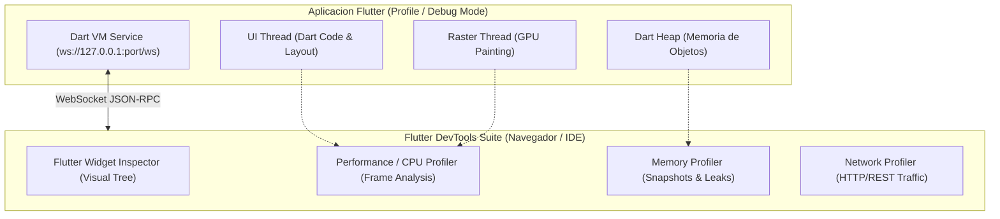

**UNIVERSIDAD DE COSTA RICA**  
**SEDE DEL ATLÁNTICO - RECINTO PARAÍSO**  
**CARRERA DE INFORMÁTICA EMPRESARIAL**  
**CURSO:** IF0009 - Desarrollo de Software IV  
**PROFESOR:** Mag. Jonathan Granados C.  
**SEMESTRE:** II-2026  

---

# Tema 5.2.2.4: Profiling y Depuración Avanzada con Flutter DevTools (Inspector, Memory y Network)

> [!NOTE]
> Este documento representa la lectura teórica fundamental del **Subtema 5.2.2.4**. Analiza exhaustivamente la suite de rendimiento **Flutter DevTools**, el diagnóstico de la tasa de cuadros por segundo (FPS) en los hilos UI y Raster, la auditoría del ciclo de vida de objetos en el Heap y la inspección de tráfico de red RESTful.

---

## 1. Resumen Ejecutivo

Esta lectura capacita al estudiantado en el uso de las herramientas de telemetría y diagnóstico de rendimiento más avanzadas del ecosistema Flutter. Al finalizar este módulo, usted será capaz de auditar la jerarquía declarativa con el *Widget Inspector*, aislar cuellos de botella gráficos (*jank*) mediante el *Performance Overlay*, diagnosticar fugas de memoria (*memory leaks*) en el *Memory Profiler* y auditar transacciones HTTP/HTTPS en el *Network Profiler*.

---

## 2. Concepto Principal (El "Qué"): Arquitectura de Flutter DevTools

**Flutter DevTools** es una suite de diagnóstico web modular que se comunica directamente con la máquina virtual de Dart a través del **Dart VM Service Protocol** (expuesto mediante WebSockets):



---

### 2.1 Herramientas Centrales de DevTools

#### 1. Flutter Widget Inspector
Permite visualizar y explorar el árbol de widgets exacto que se está ejecutando en el dispositivo:
*   **Select Widget Mode:** Al activarlo, usted toca cualquier elemento visual en la pantalla del teléfono o emulador, y el inspector salta automáticamente a la línea exacta de código fuente donde fue instanciado dicho widget.
*   **Highlight Repaints (Repaint Rainbow):** Rodea los widgets con bordes de colores aleatorios que cambian cada vez que el widget se vuelve a dibujar. Si un borde cambia de color sin que el usuario interactúe, indica un redibujado redundante e ineficiente.
*   **Performance Overlay:** Despliega dos gráficos de barras superpuestos en la pantalla:
    *   **UI Graph:** Muestra el tiempo invertido por la CPU ejecutando código Dart y calculando el árbol de renderizado.
    *   **Raster Graph:** Muestra el tiempo invertido por la GPU convirtiendo capas en píxeles.
    *   **Umbral Crítico (16.6 ms):** Para mantener **60 FPS** fluidos, ningún cuadro puede superar los 16.6 ms. Las barras que exceden la línea roja representan cuadros perdidos (*jank*).

#### 2. Memory Profiler (Auditoría del Heap)
Monitorea el uso de memoria en megabytes y la actividad del recolector de basura (*Garbage Collector*):
*   Permite capturar **Heap Snapshots** para analizar cuántas instancias de una clase existen en memoria.
*   Es la herramienta estándar para detectar objetos huérfanos que el GC no puede recolectar debido a suscripciones activas.

#### 3. Network Profiler (Tráfico de Red)
Permite inspeccionar todas las solicitudes HTTP/HTTPS originadas por la biblioteca `dart:io` o el paquete `http`:
*   Muestra el método (GET, POST, PUT, DELETE), código de respuesta (200, 404, 500), duración de la llamada, encabezados y cuerpo del JSON.

---

## 3. Analogía Técnica: La Telemetría en la Pista de Pruebas

Piense en su aplicación móvil como un prototipo de vehículo de alta competición:

*   El **Widget Inspector** es el escáner de carrocería y chasis: permite tocar un alerón o una puerta y saber instantáneamente qué plano de ingeniería y tornillo lo sostiene.
*   El **Performance Overlay** es el sensor de revoluciones por minuto (RPM) y velocímetro digital: si el indicador pasa a la zona roja (más de 16.6 milisegundos por cuadro), el motor está sufriendo tirones visibles.
*   El **Memory Profiler** es el sensor de flujo de fluidos y radiador: detecta fugas de refrigerante (fugas de memoria) que acumulan presión hasta hacer estallar el motor (*Out Of Memory Crash*).
*   El **Network Profiler** es la radio de telemetría bidireccional entre el piloto y el muro de ingenieros de boxes: audita cada mensaje enviado y recibido, verificando el tiempo de respuesta y los paquetes perdidos.

---

## 4. Implementación y Procedimiento Operativo (El "Cómo")

### 4.1 Lanzamiento de DevTools

Existen tres formas estándar de abrir DevTools:

**1.** Desde Visual Studio Code: Presione `Ctrl+Shift+P`, escriba `Flutter: Open DevTools` y seleccione la herramienta deseada.  
**2.** Desde la terminal interactiva: Mientras `flutter run` se encuentra activo, presione la tecla `v` en su teclado.  
**3.** Mediante el comando global del CLI:

```powershell
# Lanzar el servidor de DevTools en el navegador predeterminado
dart devtools
```

---

### 4.2 Código Demostrativo: Prevención de Fugas de Memoria

El error de rendimiento más severo en aplicaciones Flutter es no liberar controladores y streams en el método `dispose()` de un `StatefulWidget`:

```dart
import 'package:flutter/material.dart';
import 'dart:async';

class MonitorSensorWidget extends StatefulWidget {
  const MonitorSensorWidget({super.key});

  @override
  State<MonitorSensorWidget> createState() => _MonitorSensorWidgetState();
}

class _MonitorSensorWidgetState extends State<MonitorSensorWidget> {
  // Controlador de texto y suscripcion a stream
  late final TextEditingController _filtroController;
  StreamSubscription<int>? _sensorSubscription;
  int _ultimoValor = 0;

  @override
  void initState() {
    super.initState();
    _filtroController = TextEditingController();

    // Stream simulado de telemetria cada segundo
    _sensorSubscription = Stream.periodic(
      const Duration(seconds: 1), 
      (count) => count,
    ).listen((valor) {
      if (mounted) {
        setState(() => _ultimoValor = valor);
      }
    });
  }

  // REGLA CRITICA: Liberar recursos en dispose()
  @override
  void dispose() {
    // 1. Cancelar la suscripcion al stream para liberar el listener
    _sensorSubscription?.cancel();
    
    // 2. Destruir el controlador de texto del arbol de elementos
    _filtroController.dispose();
    
    // 3. Invocar la limpieza en la clase padre
    super.dispose();
  }

  @override
  Widget build(BuildContext context) {
    return Column(
      children: [
        TextField(controller: _filtroController),
        Text('Telemetria actual: $_ultimoValor'),
      ],
    );
  }
}
```

Explicación analítica del bloque de código:
*   `_sensorSubscription?.cancel()`: Detiene la escucha asíncrona. Si no se cancela, el closure dentro de `.listen()` mantiene una referencia viva a la instancia de `_MonitorSensorWidgetState`, impidiendo que el recolector de basura (*Garbage Collector*) libere la memoria aunque la pantalla se haya cerrado.
*   `_filtroController.dispose()`: Notifica a la infraestructura nativa que desvincule los listeners de texto del sistema operativo.
*   `super.dispose()`: Finaliza el desmantelamiento del estado en el *Element Tree*.

---

## 5. Trampas Comunes y Prácticas Incorrectas

### Trampa 1: Realizar profiling en modo Debug
*   **Problema:** El desarrollador observa barras rojas continuas en el Performance Overlay e intenta optimizar código prematuramente.
*   **Causa raíz:** En **Debug Mode**, Flutter ejecuta comprobaciones de aserciones continuas, no aplica optimizaciones de código muerto (*tree shaking*) y la máquina virtual utiliza el compilador JIT.
*   **Mitigación:** Ejecute siempre las pruebas de rendimiento en **Profile Mode** sobre un dispositivo físico real:

```powershell
flutter run --profile
```

### Trampa 2: Invocar operaciones pesadas de CPU dentro de `build()`
*   **Problema:** Al hacer scroll en una lista, la aplicación se congela periódicamente.
*   **Causa raíz:** Realizar ordenamiento de listas de miles de elementos, parseo de cadenas JSON complejas o procesamiento de imágenes dentro del método `build()`.
*   **Mitigación:** El método `build()` debe ser puramente declarativo y ejecutarse en menos de 1 milisegundo. Cualquier cálculo pesado debe delegarse a un **Dart Isolate** secundario mediante `compute()`.

---

## 6. Pregunta de Reflexión Académica

> **Pregunta para el Análisis:**  
> Si al observar el **Performance Overlay** usted nota que la barra del **UI Thread** es de apenas 3 milisegundos (completamente verde), pero la barra del **Raster Thread** sube a 45 milisegundos (zona roja profunda con caída a 20 FPS), ¿dónde se localiza el defecto técnico?  
>  
> *Pista:* Determine si la falla radica en un bucle lógico en código Dart o si proviene de llamadas gráficas excesivamente complejas para la GPU, tales como la combinación masiva de widgets `BackdropFilter` (desenfoque gaussiano / glassmorphism) o capas `Opacity` sin guardar en caché de renderizado (*SaveLayer*).
