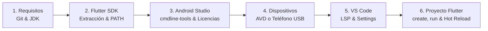

**UNIVERSIDAD DE COSTA RICA**  
**SEDE DEL ATLÁNTICO - RECINTO PARAÍSO**  
**CARRERA DE INFORMÁTICA EMPRESARIAL**  
**CURSO:** IF0009 - Desarrollo de Software IV  
**PROFESOR:** Mag. Jonathan Granados C.  
**SEMESTRE:** II-2026  

---

# Guía Paso a Paso: Instalación, Configuración, Uso y Desarrollo con Flutter SDK

> [!NOTE]
> **Propósito de este documento:** Esta guía de ingeniería instruccional proporciona el procedimiento metódico, secuencial y reproducible para aprovisionar desde cero un entorno completo de desarrollo móvil multiplataforma con **Flutter 3.x / Dart 3.x** en sistemas operativos **Windows 11 / Windows 10**, complementado con directrices de interoperabilidad para **macOS** y **Linux**.

---

## 📋 Resumen del Flujo de Trabajo



---

## FASE 1: Preparación de Requisitos Previos del Sistema

Antes de manipular el SDK de Flutter, asegúrese de contar con los componentes base de compilación y control de versiones.

### 1.1 Instalación de Git para Windows

Git es una dependencia estricta utilizada por el CLI de Flutter para gestionar versiones y descargar paquetes de dependencias.

**1.** Descargue el instalador oficial de 64 bits desde [git-scm.com](https://git-scm.com).

**2.** Durante el asistente de instalación:
*   Seleccione como editor predeterminado el editor de su preferencia (VS Code o Notepad).
*   En la opción **Adjusting your PATH environment**, elija: **Git from the command line and also from 3rd-party software**.
*   En la opción **Choosing the default branch name**, seleccione **Override the default branch name for new repositories** y defina **`main`**.

**3.** Abra una consola de **PowerShell** y verifique la versión:

```powershell
git --version
```

Salida esperada: `git version 2.40.x` o superior.

---

### 1.2 Verificación de Java Development Kit (JDK)

Flutter utiliza el sistema de construcción Gradle en Android, el cual requiere **Java 17 LTS o Java 21 LTS**.

> [!TIP]
> Si usted ya tiene instalado Android Studio, este incluye su propio entorno Java preconfigurado (**JBR - JetBrains Runtime**). Si prefiere una instalación independiente de Java, puede instalar **Eclipse Temurin OpenJDK 17 LTS**.

Verifique en PowerShell:

```powershell
java -version
```

---

## FASE 2: Descarga e Instalación del Flutter SDK

### 2.1 Descarga y Ubicación Determinista

**1.** Descargue el archivo ZIP de la versión estable (**Stable Channel**) desde el sitio oficial de Google: [docs.flutter.dev](https://docs.flutter.dev/get-started/install/windows/mobile).

**2.** Cree un directorio base para herramientas de desarrollo en la raíz de su disco local. En PowerShell ejecute:

```powershell
# Crear directorio de desarrollo sin espacios
mkdir C:\src
```

**3.** Descomprima el archivo descargado de modo que la estructura resultante sea exactamente:

```
C:\src\flutter\
```

> [!CAUTION]
> **REGLA ESTRICTA DE SEGURIDAD:**  
> Nunca instale Flutter en `C:\Program Files\`. Los espacios en blanco en la ruta y los privilegios restringidos de administrador romperán los scripts de compilación de Gradle y la caché interna del CLI.

---

### 2.2 Inyección Permanente en la Variable de Entorno PATH

Para ejecutar el comando `flutter` desde cualquier terminal, configure la variable de entorno de usuario.

Abra **PowerShell** y ejecute el siguiente bloque de comandos:

```powershell
# Variable con la ruta al directorio bin de Flutter
$FlutterBin = "C:\src\flutter\bin"

# Lectura de la variable PATH del usuario actual
$UserPath = [Environment]::GetEnvironmentVariable("Path", "User")

# Insercion determinista si no se encuentra presente
if ($UserPath -notlike "*$FlutterBin*") {
    $UpdatedPath = "$UserPath;$FlutterBin"
    [Environment]::SetEnvironmentVariable("Path", $UpdatedPath, "User")
    Write-Host "PATH actualizado exitosamente." -ForegroundColor Green
} else {
    Write-Host "La ruta ya existe en la variable PATH." -ForegroundColor Yellow
}
```

**Cierre la ventana actual de PowerShell y abra una nueva** para que el sistema operativo refresque el entorno de variables.

Verifique la accesibilidad del binario:

```powershell
flutter --version
```

---

## FASE 3: Configuración de Android Studio y Command-line Tools

### 3.1 Instalación de Android Studio

**1.** Descargue e instale la versión más reciente de **Android Studio** desde [developer.android.com/studio](https://developer.android.com/studio).

**2.** Ejecute el instalador con las opciones estándar (*Standard Setup*). Asegúrese de dejar marcadas las casillas de **Android SDK**, **Android SDK Platform** y **Android Virtual Device**.

---

### 3.2 Instalación de Android SDK Command-line Tools (`cmdline-tools`)

Por defecto, las versiones modernas de Android Studio no instalan las utilidades de consola que Flutter requiere para interactuar con el SDK Manager.

**1.** Inicie Android Studio. En la pantalla de bienvenida (*Welcome Screen*), haga clic en **More Actions** (o en el menú de los tres puntos) y seleccione **SDK Manager**.  
*(Si ya tiene un proyecto abierto, ingrese a **File > Settings > Languages & Frameworks > Android SDK**)*.

**2.** Ingrese a la pestaña **SDK Tools**.

**3.** Localice y marque la casilla: **Android SDK Command-line Tools (latest)**.

**4.** Presione el botón **Apply** y luego **OK** para descargar e instalar el paquete.

---

### 3.3 Aceptación Formal de Licencias de Android

Ejecute en su terminal de PowerShell el comando de suscripción de licencias binarias:

```powershell
flutter doctor --android-licenses
```

Aparecerán de forma sucesiva los contratos de licencia de software de Google y de Android SDK. **Presione la tecla `y` seguida de `Enter` en cada una de las solicitudes** hasta que la consola indique: `All SDK package licenses accepted`.

---

### 3.4 Diagnóstico con `flutter doctor`

Ejecute la verificación integral:

```powershell
flutter doctor -v
```

**Resultado esperado:**
*   `[✓] Flutter (Channel stable, ...)`
*   `[✓] Android toolchain - develop for Android devices (Android SDK version ...)`
*   `[✓] Chrome - develop for the web`
*   `[✓] Android Studio`
*   `[✓] VS Code`
*   `[✓] Connected device`

*(Si algún apartado muestra advertencia, revise la sección de Solución de Problemas al final de esta guía)*.

---

## FASE 4: Configuración del Emulador AVD (Android Virtual Device)

Para depurar aplicaciones en un teléfono virtualizado en su computadora:

**1.** En Android Studio, abra el panel **Device Manager** (ícono de teléfono móvil en la barra lateral derecha o desde *Tools > Device Manager*).

**2.** Haga clic en el botón **Create Device** (+).

**3.** **Selección de Hardware:** Elija un perfil de pantalla estándar, por ejemplo **Pixel 8** o **Phone > Medium Phone**, y presione **Next**.

**4.** **Selección de Imagen del Sistema (System Image):**
*   Ingrese a la pestaña **Recommended** o **x86 Images**.
*   Seleccione una versión moderna de Android (ejemplo: **UpsideDownCake / API Level 34** o **VanillaIceCream / API Level 35**).
*   Asegúrese de seleccionar una imagen que incluya **Google APIs** con ABI **x86_64**.
*   Haga clic en el ícono de descarga si no está instalada localmente. Presione **Next**.

**5.** **Configuración Avanzada de Gráficos (Crítico para Rendimiento):**
*   Haga clic en el botón **Show Advanced Settings**.
*   Desplácese hasta la sección **Emulated Performance**.
*   En el campo **Graphics**, cambie la opción de *Automatic* a **Hardware - GLES 2.0**.  
    *(Esto instruye al emulador a utilizar la tarjeta gráfica física de su PC)*.
*   En **Memory and Storage**, asigne al menos **2048 MB (2 GB)** de RAM.

**6.** Presione **Finish**.

**7.** Haga clic en el botón **Play (▶)** junto al dispositivo creado para iniciar el emulador.

---

## FASE 5: Configuración de Dispositivo Físico Android (Alternativa Óptima)

Si su computadora tiene recursos limitados de memoria RAM (8 GB o menos), depurar directamente sobre su teléfono físico es la solución más rápida y eficiente.

**1.** En su teléfono Android, abra **Ajustes** (Configuración) > **Acerca del teléfono** (*Información de software*).

**2.** Localice la opción **Número de compilación** (*Build number*) y púlsela **7 veces seguidas**. El teléfono mostrará la notificación: *"¡Ya es un desarrollador!"*.

**3.** Regrese al menú de Ajustes y entre en **Sistema > Opciones de desarrollador**.

**4.** Active el interruptor **Depuración por USB** (*USB Debugging*).

**5.** Conecte el teléfono mediante su cable USB a la computadora.

**6.** Desbloquee la pantalla del teléfono. Aparecerá un cuadro de diálogo: *"¿Permitir depuración por USB desde esta computadora?"*.

**7.** Marque la casilla **"Permitir siempre desde esta computadora"** y presione **Permitir**.

**8.** En su terminal de PowerShell, ejecute:

```powershell
adb devices
```

Salida esperada:
```
List of devices attached
RF8N10ABCD    device
```

Si el estado indica `device`, su teléfono está listo para recibir aplicaciones Flutter.

---

## FASE 6: Configuración de Visual Studio Code para Desarrollo Ágil

### 6.1 Instalación de Extensiones Oficiales

**1.** Abra **Visual Studio Code**.

**2.** Presione `Ctrl+Shift+X` para abrir la pestaña de **Extensions**.

**3.** Busque e instale el paquete oficial:
*   **Flutter** (desarrollado por *Dart Code*). Al instalarlo, se instalará automáticamente la extensión de soporte para el lenguaje **Dart**.

---

### 6.2 Configuración del Editor (`settings.json`)

Para automatizar el formateo, la importación de módulos y la visualización de la jerarquía de widgets:

**1.** Presione `Ctrl+Shift+P` en VS Code y escriba: **Preferences: Open User Settings (JSON)**.

**2.** Agregue las siguientes directivas dentro del objeto JSON principal:

```json
{
  "editor.formatOnSave": true,
  "editor.formatOnType": true,
  "editor.defaultFormatter": "Dart-Code.dart-code",
  "editor.codeActionsOnSave": {
    "source.fixAll": "explicit",
    "source.organizeImports": "explicit"
  },
  "dart.previewFlutterUiGuides": true,
  "dart.closingLabels": true,
  "dart.flutterCreateAndroidLanguage": "kotlin"
}
```

---

## FASE 7: Creación y Estructura del Primer Proyecto Flutter

Abra PowerShell, navegue al directorio donde almacena sus proyectos académicos y cree la aplicación:

```powershell
# Crear proyecto con nombre en snake_case
flutter create mi_primer_proyecto

# Ingresar a la carpeta del proyecto
cd mi_primer_proyecto
```

### Anatomía de Directorios Generados

```
mi_primer_proyecto/
  ├── android/             <-- Proyecto nativo Android y build.gradle
  ├── ios/                 <-- Proyecto nativo iOS (Xcode workspace)
  ├── lib/                 <-- CODIGO FUENTE PRINCIPAL EN DART
  │    └── main.dart       <-- Punto de entrada de la aplicacion
  ├── test/                <-- Pruebas unitarias y de widgets
  └── pubspec.yaml         <-- Manifiesto de dependencias y assets
```

---

## FASE 8: Desarrollo de una Aplicación Funcional con Buenas Prácticas

Abra la carpeta del proyecto en Visual Studio Code:

```powershell
code .
```

Abra el archivo `lib/main.dart`, elimine el código de ejemplo por defecto e implemente el siguiente código limpio, documentado y tipado:

```dart
import 'package:flutter/material.dart';

void main() {
  runApp(const MiAplicacionEmpresarial());
}

class MiAplicacionEmpresarial extends StatelessWidget {
  const MiAplicacionEmpresarial({super.key});

  @override
  Widget build(BuildContext context) {
    return MaterialApp(
      title: 'IF0009 Flutter Demo',
      debugShowCheckedModeBanner: false,
      theme: ThemeData(
        colorScheme: ColorScheme.fromSeed(
          seedColor: const Color(0xFF0D47A1),
          brightness: Brightness.light,
        ),
        useMaterial3: true,
      ),
      home: const PantallaContador(titulo: 'Panel de Control IF0009'),
    );
  }
}

class PantallaContador extends StatefulWidget {
  final String titulo;

  const PantallaContador({
    super.key,
    required this.titulo,
  });

  @override
  State<PantallaContador> createState() => _PantallaContadorState();
}

class _PantallaContadorState extends State<PantallaContador> {
  int _contador = 0;

  void _incrementarContador() {
    setState(() {
      _contador++;
    });
  }

  void _reiniciarContador() {
    setState(() {
      _contador = 0;
    });
  }

  @override
  Widget build(BuildContext context) {
    final tema = Theme.of(context);

    return Scaffold(
      appBar: AppBar(
        title: Text(widget.titulo),
        backgroundColor: tema.colorScheme.primaryContainer,
        actions: [
          IconButton(
            icon: const Icon(Icons.refresh),
            tooltip: 'Reiniciar contador',
            onPressed: _reiniciarContador,
          ),
        ],
      ),
      body: Center(
        child: Column(
          mainAxisAlignment: MainAxisAlignment.center,
          children: [
            const Text(
              'Transacciones procesadas en la sesion:',
              style: TextStyle(fontSize: 16.0),
            ),
            const SizedBox(height: 12.0),
            Text(
              '$_contador',
              style: tema.textTheme.displayMedium?.copyWith(
                fontWeight: FontWeight.bold,
                color: tema.colorScheme.primary,
              ),
            ),
          ],
        ),
      ),
      floatingActionButton: FloatingActionButton.extended(
        onPressed: _incrementarContador,
        icon: const Icon(Icons.add),
        label: const Text('Incrementar'),
      ),
    );
  }
}
```

---

## FASE 9: Ejecución y Flujo de Trabajo en Vivo (Hot Reload)

### 9.1 Ejecución de la Aplicación

**1.** Con su emulador activo o su teléfono USB conectado, presione la tecla **`F5`** en Visual Studio Code (o abra la terminal integrada y ejecute `flutter run`).

**2.** Si tiene múltiples dispositivos disponibles, elija el destino en la barra de estado inferior de VS Code o utilice:

```powershell
# Listar identificadores de targets
flutter devices

# Lanzar en un dispositivo especifico
flutter run -d <DEVICE_ID>
```

**3.** Espere a que Gradle compile el archivo APK inicial y lo instale en el dispositivo.

---

### 9.2 El Ciclo de Desarrollo Acelerado

Una vez que la aplicación se está ejecutando:

*   **Stateful Hot Reload (`r` en consola o `Ctrl+S` en VS Code):**  
    Modifique un texto o color en `lib/main.dart` y guarde el archivo. En menos de **1 segundo** verá el cambio reflejado en la pantalla sin perder el valor del contador numérico.
*   **Hot Restart (`R` en consola o `Ctrl+F5`):**  
    Reinicia el estado en memoria de la aplicación a sus valores iniciales en aproximadamente 2 segundos.

---

## FASE 10: Profiling y Depuración con Flutter DevTools

Durante la sesión activa de ejecución:

**1.** En la barra flotante de depuración de VS Code, haga clic en el ícono del **dardo con engrane** (*Open DevTools*) o presione `Ctrl+Shift+P` y ejecute **Flutter: Open DevTools**.

**2.** Se abrirá el panel en su navegador web o dentro del mismo editor:
*   **Widget Inspector:** Active el modo *Select Widget* para hacer clic en el botón de la interfaz y ver su nodo correspondiente en el código.
*   **Performance:** Active el *Performance Overlay* para verificar que los gráficos de barras se mantengan por debajo del umbral de **16.6 ms (60 FPS)**.
*   **Memory:** Monitoree la curva de memoria RAM para verificar que el recolector de basura (*Garbage Collector*) libere objetos correctamente.

---

## FASE 11: Guía Rápida de Solución de Problemas (Troubleshooting)

### Error 1: "cmdline-tools component is missing" en `flutter doctor`
*   **Causa:** No se instaló el paquete de consola en el SDK Manager.
*   **Solución:** Ingrese a Android Studio > **Settings > Languages & Frameworks > Android SDK > SDK Tools**, marque **Android SDK Command-line Tools (latest)** y presione **Apply**.

### Error 2: "Android license status unknown"
*   **Causa:** No se han aceptado los contratos legales del SDK.
*   **Solución:** Ejecute `flutter doctor --android-licenses` en PowerShell y presione `y` en cada solicitud.

### Error 3: El emulador inicia extremadamente lento o se congela
*   **Causa:** El renderizado gráfico está configurado por software en lugar de usar la GPU física.
*   **Solución:** En el Device Manager de Android Studio, edite el emulador (ícono de lápiz), abra **Advanced Settings**, ubique **Emulated Performance - Graphics** y cámbielo a **Hardware - GLES 2.0**.

### Error 4: Dispositivo físico figura como `unauthorized`
*   **Causa:** La pantalla estaba bloqueada al conectar el cable USB y no se autorizó la huella digital RSA.
*   **Solución:** Desconecte el cable USB, ejecute `adb kill-server` y `adb start-server`, reconecte el teléfono desbloqueado y pulse **Aceptar** en el diálogo en pantalla.

### Error 5: "Unsupported class file major version" al compilar Gradle
*   **Causa:** Incompatibilidad entre la versión de Java configurada en `JAVA_HOME` y el Gradle wrapper de Flutter.
*   **Solución:** Utilice Java 17 LTS o apunte su variable `JAVA_HOME` al directorio JBR provisto por Android Studio:  
    `C:\Program Files\Android\Android Studio\jbr`.

---

## ANEXO: Comandos Equivalentes para macOS y Linux

Si usted desarrolla en un entorno Unix (macOS o Ubuntu/Debian):

*   **Configuración del PATH en `~/.bashrc` o `~/.zshrc`:**
    ```bash
    export PATH="$PATH:$HOME/development/flutter/bin"
    ```
*   **Instalación de dependencias en Linux (Ubuntu/Debian):**
    ```bash
    sudo apt-get update
    sudo apt-get install -y clang cmake ninja-build pkg-config \
        libgtk-3-dev liblzma-dev
    ```
*   **Instalación en macOS (Homebrew o descarga directa):**
    ```bash
    sudo xcode-select --switch /Applications/Xcode.app/Contents/Developer
    sudo xcodebuild -runFirstLaunch
    ```
