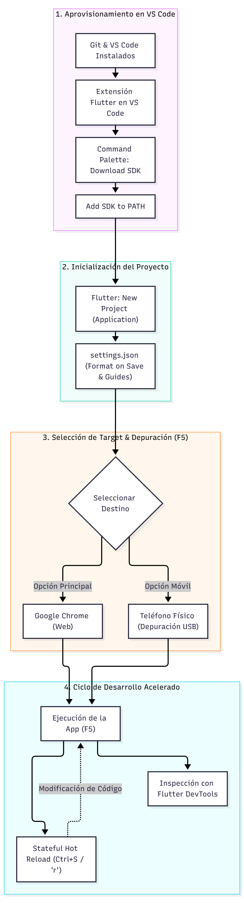

**UNIVERSIDAD DE COSTA RICA**  
**SEDE DEL ATLÁNTICO - RECINTO PARAÍSO**  
**CARRERA DE INFORMÁTICA EMPRESARIAL**  
**CURSO:** IF0009 - Desarrollo de Software IV  
**PROFESOR:** Mag. Jonathan Granados C.  
**SEMESTRE:** II-2026  

---

# Guía Paso a Paso: Instalación, Configuración, Uso y Desarrollo Móvil Multiplataforma con Flutter SDK (Android e iOS)

> [!NOTE]
> **Propósito de este documento:** Esta guía de ingeniería instruccional proporciona el procedimiento metódico, secuencial y reproducible para aprovisionar desde cero un entorno completo de desarrollo móvil multiplataforma con **Flutter 3.x / Dart 3.x** enfocado en **Android** e **iOS**, utilizando **Visual Studio Code** como editor central integrado, con gestión de emuladores, simuladores, dispositivos físicos y toolchains nativos.

---

## 📋 Resumen del Flujo de Trabajo

<p align="center">
  
</p>

---

## FASE 1: Preparación de Requisitos Previos del Sistema

Antes de inicializar Flutter, asegúrese de contar con los componentes base de compilación, control de versiones y el runtime de Java en su equipo.

### 1.1 Instalación de Git

Git es una dependencia estricta utilizada por Flutter para clonar el SDK, gestionar paquetes del repositorio `pub.dev` y sincronizar dependencias de plugins nativos.

**1.** Descargue el instalador oficial desde [git-scm.com](https://git-scm.com).

**2.** Durante el asistente de instalación:
*   Seleccione **Visual Studio Code** como editor predeterminado de Git.
*   En la opción **Adjusting your PATH environment**, elija: **Git from the command line and also from 3rd-party software**.
*   En la opción **Choosing the default branch name**, seleccione **Override the default branch name for new repositories** y defina **`main`**.

**3.** Abra una consola (PowerShell en Windows o Terminal en macOS/Linux) y verifique la versión:

```powershell
git --version
```

Salida esperada: `git version 2.40.x` o superior.

---

### 1.2 Instalación de Visual Studio Code

Descargue e instale **Visual Studio Code** desde el portal oficial [code.visualstudio.com](https://code.visualstudio.com). Durante la instalación en Windows, active las casillas:
*   *Agregar la acción "Abrir con Code" al menú contextual de archivos*.
*   *Agregar la acción "Abrir con Code" al menú contextual de carpetas*.
*   *Agregar a PATH (disponible después de reiniciar)*.

---

### 1.3 Verificación del Java Development Kit (JDK 17 LTS o 21 LTS)

El sistema de compilación de Android (**Gradle**) requiere obligatoriamente una máquina virtual Java compatible.

**1.** Verifique si ya cuenta con una versión adecuada de Java:

```powershell
java -version
```

**2.** Si no cuenta con Java instalado o su versión es incompatible, instale **Eclipse Temurin OpenJDK 17 LTS** (o OpenJDK 21 LTS) desde [adoptium.net](https://adoptium.net) y configure la variable de entorno `JAVA_HOME`.

---

## FASE 2: Descarga e Instalación del Flutter SDK

Siguiendo el flujo oficial moderno de Flutter, la instalación y configuración del SDK puede realizarse de manera automatizada y visual directamente desde Visual Studio Code o mediante descarga manual determinista.

### 2.1 Agregar la Extensión Oficial de Flutter a VS Code

**1.** Inicie **Visual Studio Code**.

**2.** Presione `Ctrl + Shift + X` (en Windows/Linux) o `Cmd + Shift + X` (en macOS) para abrir la pestaña de **Extensiones**.

**3.** Busque la extensión oficial **Flutter** (desarrollada por *Dart Code*) y haga clic en **Install**. Al completarse, se instalará automáticamente la extensión complementaria para el lenguaje **Dart**.

---

### 2.2 Instalar el Flutter SDK mediante VS Code

**1.** Abra la paleta de comandos de VS Code presionando `Ctrl + Shift + P` (o `Cmd + Shift + P` en macOS).

**2.** En la barra de búsqueda superior, escriba **`flutter`**.

**3.** Seleccione el comando: **`Flutter: New Project`**.

**4.** Dado que aún no cuenta con el SDK configurado, VS Code le solicitará ubicarlo. Haga clic en la opción: **`Download SDK`**.

**5.** En el cuadro de diálogo para seleccionar la carpeta de destino (*Select Folder for Flutter SDK*), elija una ruta limpia sin espacios en blanco ni caracteres especiales, por ejemplo:
*   En Windows: `C:\src` (resultando en `C:\src\flutter`).
*   En macOS / Linux: `~/development` (resultando en `~/development/flutter`).

**6.** Haga clic en el botón **Clone Flutter**.

**7.** VS Code comenzará la descarga y mostrará la notificación:  
`Downloading the Flutter SDK. This may take a few minutes.`

**8.** Al finalizar la descarga, aparecerá un mensaje solicitando registrar el SDK en el sistema: haga clic en **Add SDK to PATH**.

**9.** Cuando la operación culmine con éxito, se mostrará la confirmación:  
`The Flutter SDK was added to your PATH`.

**10.** **Reinicio Requerido:**  
*   Cierre y vuelva a abrir todas las consolas abiertas.
*   Reinicie Visual Studio Code para consolidar el entorno de variables.

> [!NOTE]
> **Instalación Manual Alternativa:**  
> También puede descargar el archivo ZIP oficial de la versión estable desde [docs.flutter.dev](https://docs.flutter.dev/get-started/install), descomprimirlo en `C:\src\flutter` (o `~/development/flutter`) y agregar manualmente la subcarpeta `bin` a la variable `PATH` de su sistema operativo.

---

### 2.3 Diagnóstico Inicial con `flutter doctor`

Abra la terminal integrada en VS Code (`Ctrl + ñ` o `Cmd + ñ`) y ejecute la herramienta de diagnóstico integral:

```powershell
flutter doctor -v
```

Este comando inspecciona qué componentes de los toolchains móviles de Android e iOS se encuentran configurados en el sistema anfitrión.

---

## FASE 3: Aprovisionamiento del Toolchain de Android (SDK, Licencias y Dispositivos)

Para compilar y ejecutar aplicaciones móviles en **Android** (disponible en Windows, macOS y Linux), Flutter requiere las herramientas de plataforma de Google.

### 3.1 Instalación de Android SDK y Command-line Tools

**1.** Descargue e instale **Android Studio** desde [developer.android.com/studio](https://developer.android.com/studio). Aunque utilizaremos VS Code como editor diario, Android Studio provee el gestor del Android SDK y los emuladores.

**2.** Inicie Android Studio y acceda al **SDK Manager** (*Settings > Languages & Frameworks > Android SDK*).

**3.** En la pestaña **SDK Platforms**, asegúrese de tener instalada al menos una versión moderna de Android (ej. **Android 14 - API 34** o **Android 15 - API 35**).

**4.** En la pestaña **SDK Tools**, marque de forma obligatoria las siguientes casillas:
*   **Android SDK Command-line Tools (latest)** *(indispensable para Flutter)*.
*   **Android SDK Platform-Tools** *(contiene el ejecutable adb)*.
*   **Android SDK Build-Tools**.
*   **Android Emulator**.

**5.** Presione **Apply** y luego **OK** para descargar e instalar los paquetes.

---

### 3.2 Aceptación Obligatoria de Licencias de Android

Ejecute en la terminal de VS Code el siguiente comando interactivo:

```powershell
flutter doctor --android-licenses
```

Presione la tecla `y` y luego `Enter` en cada una de las licencias de software presentadas hasta observar el mensaje: `All SDK package licenses accepted`.

---

### 3.3 Configuración de Dispositivo Físico Android (Depuración USB)

Probar directamente sobre su smartphone Android es el método más liviano y de mayor fidelidad de rendimiento:

**1.** En su teléfono Android, abra **Ajustes > Acerca del teléfono** (*Información de software*).

**2.** P impulse **7 veces consecutivas** el campo **Número de compilación** (*Build number*) para activar las opciones de desarrollador.

**3.** En **Ajustes > Sistema > Opciones de desarrollador**, active el interruptor **Depuración por USB** (*USB Debugging*).

**4.** Conecte el teléfono a la computadora con su cable USB.

**5.** Desbloquee la pantalla del móvil, marque la casilla **"Permitir siempre desde esta computadora"** y presione **Aceptar** ante el mensaje de autorización criptográfica RSA.

**6.** En la terminal de VS Code compruebe la vinculación ejecutando:

```powershell
adb devices
```

Su teléfono aparecerá en la lista con el estado `device`.

---

### 3.4 Configuración de Emulador Android (AVD)

Si prefiere emular un dispositivo Android en su computadora:

**1.** En Android Studio, abra el **Device Manager** (*Tools > Device Manager*).

**2.** Haga clic en **Create Device (+)**, seleccione un dispositivo estándar (ej. **Pixel 8**) y presione **Next**.

**3.** Seleccione una imagen del sistema (**System Image**) con arquitectura **x86_64** (en Intel/AMD) o **arm64** (en Apple Silicon), preferiblemente con **Google APIs**, y presione **Next**.

**4.** En **Show Advanced Settings**, ubique **Emulated Performance - Graphics** y elija **Hardware - GLES 2.0** para activar la aceleración por la tarjeta gráfica física.

**5.** Presione **Finish**. A partir de este momento, podrá iniciar el emulador directamente desde VS Code sin necesidad de abrir Android Studio.

---

## FASE 4: Aprovisionamiento del Toolchain de iOS (macOS y Xcode)

> [!IMPORTANT]
> **Regla de Plataforma de Apple:**  
> Por restricciones legales y de arquitectura de compiladores de Apple (`clang` y Metal), la compilación, firmado y empaquetado de aplicaciones para **iOS (iPhone/iPad)** requiere obligatoriamente ejecutarse sobre el sistema operativo **macOS** con **Xcode**.  
>  
> **¿Qué ocurre si usted utiliza Windows o Linux?**  
> Gracias a la arquitectura desacoplada de Flutter, el **100% del código fuente en Dart (`lib/`)** que usted programe en Windows o Linux es exactamente el mismo que correrá en iOS. Usted desarrollará y depurará su aplicación sobre Android (dispositivo físico o emulador) y, para generar el build de iOS, simplemente trasladará el proyecto a una Mac o a un servicio de integración continua (CI/CD) en la nube como GitHub Actions o Codemagic.

Si dispone de un equipo con **macOS**, realice la configuración del toolchain de iOS:

### 4.1 Instalación de Xcode

**1.** Descargue e instale **Xcode** desde la Mac App Store.

**2.** Configure las herramientas de línea de comandos de Xcode en la Terminal:

```bash
sudo xcode-select --switch /Applications/Xcode.app/Contents/Developer
sudo xcodebuild -runFirstLaunch
```

**3.** Acepte el acuerdo de licencia de Xcode:

```bash
sudo xcodebuild -license accept
```

---

### 4.2 Instalación de CocoaPods

CocoaPods es el gestor de dependencias nativas para Objective-C y Swift utilizado por los plugins móviles de Flutter en iOS:

```bash
# Instalacion recomendada mediante Homebrew
brew install cocoapods
```

---

### 4.3 Configuración de Simuladores de iOS y Dispositivos Físicos iPhone

**1.** **Simulador de iOS:**  
Abra el simulador ejecutando en la Terminal:

```bash
open -a Simulator
```

El simulador aparecerá inmediatamente listado en el selector de dispositivos de VS Code.

**2.** **Dispositivo Físico iPhone (iOS 16+):**  
*   En el iPhone, ingrese a **Ajustes > Privacidad y Seguridad > Modo de Desarrollador** y actívelo (requiere reiniciar el dispositivo).
*   Conecte el iPhone a la Mac por cable y presione **Confiar en esta computadora**.
*   Abra la subcarpeta `ios/Runner.xcworkspace` en Xcode una única vez, ingrese a la pestaña **Signing & Capabilities** y seleccione su **Apple ID** (cuenta gratuita) en el campo *Team* para autorizar la firma de depuración.

---

## FASE 5: Configuración de Productividad en Visual Studio Code

Configure su entorno para desarrollo móvil ágil en `.vscode/settings.json`:

**1.** Presione `Ctrl + Shift + P` (o `Cmd + Shift + P`) y escriba: **Preferences: Open User Settings (JSON)**.

**2.** Agregue las directivas oficiales de Google para Flutter:

```json
{
  "editor.formatOnSave": true,
  "editor.formatOnType": true,
  "editor.defaultFormatter": "Dart-Code.dart-code",
  "editor.codeActionsOnSave": {
    "source.fixAll": "explicit",
    "source.organizeImports": "explicit"
  },
  "dart.previewFlutterUiGuides": true,
  "dart.closingLabels": true,
  "dart.openDevTools": "flutter"
}
```

---

## FASE 6: Creación y Estructura del Proyecto Móvil Multiplataforma

### 6.1 Creación Asistida del Proyecto Móvil

**1.** Presione `Ctrl + Shift + P` y ejecute: **`Flutter: New Project`**.

**2.** Seleccione la plantilla: **Application**.

**3.** Elija el directorio padre en su disco y defina el nombre del proyecto en minúsculas (*snake_case*), por ejemplo: **`mi_app_movil`**.

*(Alternativamente, puede crearlo desde consola especificando explícitamente las plataformas móviles objetivo):*

```powershell
flutter create --platforms=android,ios mi_app_movil
cd mi_app_movil
```

---

### 6.2 Anatomía del Proyecto Móvil

```
mi_app_movil/
  ├── android/             <-- Proyecto nativo Android (Gradle, Manifest)
  ├── ios/                 <-- Proyecto nativo iOS (Xcode workspace, Podfile)
  ├── lib/                 <-- CODIGO FUENTE COMPARTIDO EN DART
  │    └── main.dart       <-- Punto de entrada de la aplicacion
  ├── test/                <-- Pruebas unitarias y de widgets
  └── pubspec.yaml         <-- Manifiesto de dependencias y assets
```

---

## FASE 7: Desarrollo de una Aplicación Móvil con Buenas Prácticas

Abra el archivo **`lib/main.dart`** en VS Code e implemente el siguiente código limpio, documentado, adaptado con `SafeArea` (esencial para notch y barras de navegación en Android/iOS) y basado en **Material 3**:

```dart
import 'package:flutter/material.dart';

void main() {
  runApp(const MiAppMovilEmpresarial());
}

class MiAppMovilEmpresarial extends StatelessWidget {
  const MiAppMovilEmpresarial({super.key});

  @override
  Widget build(BuildContext context) {
    return MaterialApp(
      title: 'IF0009 Mobile Demo',
      debugShowCheckedModeBanner: false,
      theme: ThemeData(
        colorScheme: ColorScheme.fromSeed(
          seedColor: const Color(0xFF0D47A1),
          brightness: Brightness.light,
        ),
        useMaterial3: true,
      ),
      home: const PantallaPrincipalMovil(
        titulo: 'Panel Móvil IF0009',
      ),
    );
  }
}

class PantallaPrincipalMovil extends StatefulWidget {
  final String titulo;

  const PantallaPrincipalMovil({
    super.key,
    required this.titulo,
  });

  @override
  State<PantallaPrincipalMovil> createState() => 
      _PantallaPrincipalMovilState();
}

class _PantallaPrincipalMovilState 
    extends State<PantallaPrincipalMovil> {
  int _contador = 0;

  void _incrementar() {
    setState(() {
      _contador++;
    });
  }

  void _decrementar() {
    setState(() {
      if (_contador > 0) {
        _contador--;
      }
    });
  }

  void _reiniciar() {
    setState(() {
      _contador = 0;
    });
  }

  @override
  Widget build(BuildContext context) {
    final tema = Theme.of(context);

    // SafeArea protege la interfaz contra el notch, Dynamic Island
    // y gestos del sistema tanto en Android como en iOS
    return Scaffold(
      appBar: AppBar(
        title: Text(widget.titulo),
        backgroundColor: tema.colorScheme.primaryContainer,
        actions: [
          IconButton(
            icon: const Icon(Icons.refresh),
            tooltip: 'Reiniciar contador',
            onPressed: _reiniciar,
          ),
        ],
      ),
      body: SafeArea(
        child: Padding(
          padding: const EdgeInsets.symmetric(horizontal: 20.0),
          child: Column(
            mainAxisAlignment: MainAxisAlignment.center,
            children: [
              Card(
                elevation: 2.0,
                shape: RoundedRectangleBorder(
                  borderRadius: BorderRadius.circular(16.0),
                ),
                child: Padding(
                  padding: const EdgeInsets.all(24.0),
                  child: Column(
                    children: [
                      Icon(
                        Icons.mobile_friendly,
                        size: 48.0,
                        color: tema.colorScheme.primary,
                      ),
                      const SizedBox(height: 16.0),
                      const Text(
                        'Registros móviles sincronizados:',
                        textAlign: TextAlign.center,
                        style: TextStyle(fontSize: 16.0),
                      ),
                      const SizedBox(height: 12.0),
                      Text(
                        '$_contador',
                        style: tema.textTheme.displayMedium?.copyWith(
                          fontWeight: FontWeight.bold,
                          color: tema.colorScheme.primary,
                        ),
                      ),
                    ],
                  ),
                ),
              ),
            ],
          ),
        ),
      ),
      floatingActionButton: Row(
        mainAxisAlignment: MainAxisAlignment.end,
        children: [
          FloatingActionButton(
            heroTag: 'btn_decrementar',
            onPressed: _decrementar,
            tooltip: 'Decrementar',
            child: const Icon(Icons.remove),
          ),
          const SizedBox(width: 14.0),
          FloatingActionButton(
            heroTag: 'btn_incrementar',
            onPressed: _incrementar,
            tooltip: 'Incrementar',
            child: const Icon(Icons.add),
          ),
        ],
      ),
    );
  }
}
```

---

## FASE 8: Ejecución Móvil y Flujo de Trabajo en Vivo (Hot Reload)

### 8.1 Selección de Dispositivo Móvil en VS Code

En la barra de estado inferior derecha de VS Code (o mediante `Ctrl+Shift+P` > **`Flutter: Select Device`**), elija su destino de ejecución móvil:
*   **Android:** Su teléfono físico conectado por USB o el emulador AVD.
*   **iOS:** El simulador de iPhone (ej. `iPhone 15 Pro`) o su iPhone físico.

---

### 8.2 Iniciar la Depuración Móvil

Presione **`F5`** en VS Code. La herramienta compilará el código (generando un APK en Android o un bundle App en iOS) y lo instalará automáticamente en el dispositivo seleccionado.

---

### 8.3 Ciclo de Stateful Hot Reload

Una vez que la aplicación esté corriendo en su teléfono o emulador:
*   Incremente el contador varias veces (ejemplo: déjelo en `5`).
*   Modifique un color, icono o texto en `lib/main.dart` y guarde con **`Ctrl + S`** (o `Cmd + S`).
*   En **menos de 1 segundo**, la pantalla de su teléfono reflejará los cambios visuales manteniendo el valor `5` en memoria.
*   Si modifica constructores o métodos `initState()`, ejecute un **Hot Restart** con **`Ctrl + F5`** (o tecla `R` en consola).

---

## FASE 9: Profiling y Telemetría Móvil con Flutter DevTools

Durante la sesión de depuración activa:

**1.** En la barra flotante de depuración, haga clic en el ícono del dardo (*Open DevTools*) o presione `Ctrl+Shift+P` > **`Flutter: Open DevTools`**.

**2.** **Widget Inspector:** Utilice el modo *Select Widget* para tocar cualquier elemento en la pantalla de su teléfono y saltar directamente al código fuente en Dart.

**3.** **Performance Overlay:** Active el overlay de rendimiento para auditar que el renderizado de la pantalla móvil se mantenga estrictamente por debajo de los **16.6 ms (60 FPS)** o **8.3 ms (120 FPS)**.

---

## FASE 10: Solución de Problemas Frecuentes en Android e iOS (Troubleshooting)

### Error 1: "cmdline-tools component is missing" en Android
*   **Causa:** No se instaló el paquete de línea de comandos en Android Studio.
*   **Solución:** Abra Android Studio > *SDK Manager > SDK Tools*, marque **Android SDK Command-line Tools (latest)** y presione **Apply**.

### Error 2: Dispositivo Android figura como `unauthorized`
*   **Causa:** La pantalla estaba bloqueada al conectar el cable USB y no se autorizó la huella digital RSA.
*   **Solución:** Desconecte el cable USB, desbloquee la pantalla del teléfono, vuelva a conectarlo y pulse **Permitir siempre desde esta computadora**.

### Error 3: "CocoaPods's specs repository is too out-of-date" en iOS
*   **Causa:** Los repositorios de pods en macOS están desactualizados.
*   **Solución:** En la Terminal de macOS ejecute:
    ```bash
    pod repo update
    cd ios && pod install
    ```

### Error 4: "Signing for Runner requires a development team" en iOS
*   **Causa:** La aplicación no tiene una firma de desarrollador configurada para desplegar en un iPhone físico.
*   **Solución:** Abra `ios/Runner.xcworkspace` en Xcode, seleccione el target **Runner**, ingrese a **Signing & Capabilities** y elija su cuenta personal gratuita de Apple ID en el campo **Team**.

### Error 5: "Unsupported class file major version" al compilar Gradle
*   **Causa:** Incompatibilidad de versión de Java con el Gradle wrapper del proyecto.
*   **Solución:** Asegúrese de que `JAVA_HOME` apunte a **Java 17 LTS o Java 21 LTS**.
