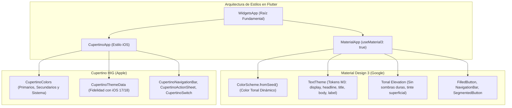

**UNIVERSIDAD DE COSTA RICA**  
**SEDE DEL ATLÁNTICO - RECINTO PARAÍSO**  
**CARRERA DE INFORMÁTICA EMPRESARIAL**  
**CURSO:** IF0009 - Desarrollo de Software IV  
**PROFESOR:** Mag. Jonathan Granados C.  
**SEMESTRE:** II-2026  

---

# Tema 5.2.3.1: Sistemas de Diseño en Flutter: Material Design 3, Cupertino y Enfoque Adaptativo

> [!NOTE]
> Este documento corresponde a la lectura teórica fundamental del **Subtema 5.2.3.1**. En esta guía usted estudiará la arquitectura de diseño declarativo en Flutter, la implementación rigurosa de **Material Design 3 (Material You)**, los lineamientos visuales de **Cupertino (Apple Human Interface Guidelines)** y las estrategias arquitectónicas para construir interfaces verdaderamente adaptativas y multiplataforma.

---

## 1. Resumen Ejecutivo

La construcción de interfaces móviles profesionales exige trascender la maquetación estática y adoptar sistemas de diseño coherentes con los ecosistemas Android e iOS. En esta lección, usted analizará los fundamentos de **Material Design 3 (M3)** —destacando la generación de paletas tonales con `ColorScheme.fromSeed` y la jerarquía tipográfica de `TextTheme`— junto con los componentes nativos de **Cupertino**. Finalmente, usted dominará el desarrollo de widgets adaptativos (`.adaptive`) y la selección contextual de componentes, permitiendo que una base de código única ofrezca una experiencia visual y táctil indistinguible de una aplicación nativa en cada sistema operativo.

---

## 2. Concepto Principal (El "Qué"): Sistemas de Diseño e Identidad Multiplataforma

En la ingeniería de software móvil, un **sistema de diseño** (*Design System*) no es únicamente un conjunto de colores o botones decorativos; es un contrato estandarizado de principios de interacción, medidas proporcionales, paletas cromáticas, tratamiento de elevaciones, tipografías y físicas de respuesta háptica y animada.



### 2.1 Material Design 3 (Material You)

A partir de Flutter 3.16+, **Material Design 3 es el estándar predeterminado** (`useMaterial3: true`). Las innovaciones arquitectónicas clave respecto a Material Design 2 incluyen:

**A.** **Sistemas de Color Tonal (`ColorScheme`):**  
Material 3 abandona la designación rígida de color primario y secundario estático. Mediante el algoritmo de extracción cromática HCT (*Hue, Chroma, Tone*), a partir de un único color semilla (`seedColor`), el motor calcula automáticamente una gama completa de tonalidades: `primary`, `onPrimary`, `primaryContainer`, `onPrimaryContainer`, `surface`, `onSurface`, `surfaceVariant`, `outline`, entre otras. Esto asegura contrastes matemáticos que cumplen las normas internacionales de accesibilidad WCAG AAA.

**B.** **Elevación Tonal vs. Sombras Tradicionales:**  
En M2, la elevación se representaba mediante sombras difusas (`elevation: 4.0`). En M3, la elevación se logra aplicando un tinte de color primario sobre la superficie (`surfaceTintColor`), incrementando la saturación según el plano espacial del componente.

**C.** **Jerarquía Tipográfica Estandarizada:**  
M3 define 15 roles tipográficos agrupados en 5 categorías jerárquicas:
1. `display` (Large, Medium, Small): Para encabezados de gran impacto.
2. `headline` (Large, Medium, Small): Títulos de pantallas principales.
3. `title` (Large, Medium, Small): Encabezados de tarjetas, diálogos y listas.
4. `body` (Large, Medium, Small): Texto de lectura principal y párrafos.
5. `label` (Large, Medium, Small): Rótulos de botones, tags y pestañas.

### 2.2 Sistema Cupertino (Human Interface Guidelines)

Para aplicaciones que requieren adherirse a la identidad visual de Apple en iOS y iPadOS, Flutter provee la biblioteca `package:flutter/cupertino.dart`. A diferencia de Material, los componentes Cupertino se caracterizan por:
*   Fondos con translucidez y desenfoque dinámico (*blur* o efecto cristalino).
*   Navegación con barras superiores integradas (`CupertinoNavigationBar`) con títulos centrados y botones de retroceso textuales (*Chevron* + etiqueta).
*   Diálogos modales y selectores cilíndricos de tipo rueda (`CupertinoPicker`).
*   Físicas de scroll con rebote elástico (*BouncingScrollPhysics*).

### 2.3 Estrategias de Adaptabilidad

Existen tres niveles de aproximación para manejar la identidad de plataforma:

**1.** **Identidad de Marca Única (Brand-Driven):**  
La aplicación mantiene exactamente la misma interfaz (generalmente Material 3 personalizada) en todas las plataformas.

**2.** **Widgets Adaptativos Nativos (`.adaptive`):**  
Flutter proporciona constructores especializados como `Switch.adaptive`, `Slider.adaptive`, `CircularProgressIndicator.adaptive` e `Icons.adaptive`. Estos constructores detectan en tiempo de ejecución la plataforma host (`Theme.of(context).platform` o `defaultTargetPlatform`) y renderizan la versión correspondiente sin alterar la lógica de negocio.

**3.** **Bifurcación Declarativa Condicional:**  
Para pantallas o flujos completos, se utiliza la clase `Platform` de `dart:io` o el valor `Theme.of(context).platform` para retornar un árbol de widgets completamente Material o Cupertino.

---

## 3. Analogía Técnica: La Empresa de Renta de Automóviles Global

Para asimilar conceptualmente la coexistencia de Material Design y Cupertino:

*   El **motor y chasis** del automóvil representan el **código de negocio en Dart** (sus entidades, casos de uso, lógica de validación y acceso a bases de datos).
*   El **volante, tablero e interfaz de mandos** son los **sistemas de diseño**:
    *   Un automóvil fabricado para el mercado continental norteamericano sitúa los mandos y controles según estándares específicos (**Material Design 3**).
    *   Un automóvil diseñado para el mercado británico adapta la posición del volante a la derecha y ajusta los instrumentos métricos a la ergonomía local (**Cupertino**).
*   El conductor puede manejar el vehículo sin importar el país, pero la familiaridad ergonómica evita fricciones cognitivas. De igual forma, un usuario de iPhone espera que un selector de fecha sea una rueda deslizante en la parte inferior, mientras que un usuario de Android espera un diálogo modal flotante.

---

## 4. Implementación y Código Práctico (El "Cómo")

A continuación se presenta una implementación completa y robusta en Flutter 3 / Dart 3 que ilustra la configuración de un tema Material 3 avanzado, paletas tonales automáticas y un componente adaptativo conmutador.

### 4.1 Configuración del Tema Centralizado (`AppTheme`)

```dart
import 'package:flutter/material.dart';

/// Clase inmutable responsable de centralizar la configuracion
/// estetica de la aplicacion bajo lineamientos Material Design 3.
class AppTheme {
  // Color semilla base institucional
  static const Color _seedColor = Color(0xFF003865); // Azul Marino UCR

  /// Genera la configuracion del tema claro
  static ThemeData get lightTheme {
    return ThemeData(
      useMaterial3: true,
      colorScheme: ColorScheme.fromSeed(
        seedColor: _seedColor,
        brightness: Brightness.light,
      ),
      appBarTheme: const AppBarTheme(
        centerTitle: true,
        elevation: 0,
      ),
      cardTheme: CardTheme(
        elevation: 1.0,
        shape: RoundedRectangleBorder(
          borderRadius: BorderRadius.circular(16.0),
        ),
      ),
      filledButtonTheme: FilledButtonThemeData(
        style: FilledButton.styleFrom(
          padding: const EdgeInsets.symmetric(
            horizontal: 24.0,
            vertical: 14.0,
          ),
          shape: RoundedRectangleBorder(
            borderRadius: BorderRadius.circular(12.0),
          ),
        ),
      ),
    );
  }

  /// Genera la configuracion del tema oscuro de alto contraste
  static ThemeData get darkTheme {
    return ThemeData(
      useMaterial3: true,
      colorScheme: ColorScheme.fromSeed(
        seedColor: _seedColor,
        brightness: Brightness.dark,
      ),
      appBarTheme: const AppBarTheme(
        centerTitle: true,
        elevation: 0,
      ),
    );
  }
}
```

### 4.2 Componente Adaptativo Multiplataforma

```dart
import 'dart:io' show Platform;
import 'package:flutter/cupertino.dart';
import 'package:flutter/foundation.dart' show kIsWeb;
import 'package:flutter/material.dart';

/// Widget reutilizable que renderiza un dialogo de confirmacion
/// adaptado a la estetica nativa de la plataforma anfitriona.
class AdaptiveConfirmationDialog extends StatelessWidget {
  final String title;
  final String message;
  final String confirmText;
  final String cancelText;
  final VoidCallback onConfirm;

  const AdaptiveConfirmationDialog({
    super.key,
    required this.title,
    required this.message,
    required this.onConfirm,
    this.confirmText = 'Aceptar',
    this.cancelText = 'Cancelar',
  });

  /// Determina si la plataforma en ejecucion corresponde al entorno Apple
  bool get _isApplePlatform {
    if (kIsWeb) return false;
    return Platform.isIOS || Platform.isMacOS;
  }

  @override
  Widget build(BuildContext context) {
    if (_isApplePlatform) {
      return CupertinoAlertDialog(
        title: Text(title),
        content: Padding(
          padding: const EdgeInsets.only(top: 8.0),
          child: Text(message),
        ),
        actions: [
          CupertinoDialogAction(
            isDestructiveAction: true,
            onPressed: () => Navigator.of(context).pop(),
            child: Text(cancelText),
          ),
          CupertinoDialogAction(
            isDefaultAction: true,
            onPressed: () {
              Navigator.of(context).pop();
              onConfirm();
            },
            child: Text(confirmText),
          ),
        ],
      );
    }

    // Renderizado alternativo conforme a Material Design 3
    return AlertDialog(
      title: Text(title),
      content: Text(message),
      shape: RoundedRectangleBorder(
        borderRadius: BorderRadius.circular(20.0),
      ),
      actions: [
        TextButton(
          onPressed: () => Navigator.of(context).pop(),
          child: Text(cancelText),
        ),
        FilledButton(
          onPressed: () {
            Navigator.of(context).pop();
            onConfirm();
          },
          child: Text(confirmText),
        ),
      ],
    );
  }
}
```

### 4.3 Explicación Paso a Paso de las Instrucciones Clave

**1.** **Invocación de `useMaterial3: true`:**  
Activa las especificaciones visuales de M3 en toda la aplicación, transformando componentes como `AppBar`, `Card`, `FloatingActionButton` y diálogos a su variante dimensional moderna.

**2.** **`ColorScheme.fromSeed`:**  
Calcula automáticamente las relaciones de luminosidad, cromaticidad y tono para crear más de 30 variantes de color armónicas y accesibles partiendo únicamente de `_seedColor`.

**3.** **Detección Condicional con `kIsWeb` y `Platform`:**  
Validar `kIsWeb` antes de invocar `Platform.isIOS` es indispensable en Flutter; de lo contrario, compilar para la Web provocará una excepción irrecuperable en tiempo de ejecución (`UnsupportedError`), ya que el paquete `dart:io` no está disponible en navegadores.

**4.** **Composición de Diálogos Nativos:**  
`CupertinoAlertDialog` acata los esquemas tipográficos de San Francisco y las proporciones de botón de iOS, mientras que `AlertDialog` respeta el redondeo perimetral y el espaciado de Material 3.

---

## 5. Trampas Comunes y Errores de Arquitectura

Al trabajar con sistemas de diseño en Flutter, usted debe anticipar y prevenir los siguientes desaciertos frecuentes:

### Trampa 1: Hardcoding de Colores Hexadecimales Directos
*   **Problema:** Asignar colores constantes en el árbol como `color: Color(0xFF1E88E5)` o `Colors.blue`.
*   **Causa raíz:** Desconocer el sistema de tokens de diseño (`Theme.of(context).colorScheme`).
*   **Consecuencia:** La aplicación rompe inmediatamente el soporte para Modo Oscuro (*Dark Mode*), provocando textos ilegibles (texto oscuro sobre fondo oscuro).
*   **Mitigación:** Acceda siempre a los colores a través del contexto: `Theme.of(context).colorScheme.primary` o `Theme.of(context).colorScheme.surface`.

### Trampa 2: Importar `dart:io` sin Protección Web
*   **Problema:** Invocar directamente `Platform.isAndroid` o `Platform.isIOS` en aplicaciones que tienen habilitado el soporte Web.
*   **Causa raíz:** `dart:io` depende de APIs de bajo nivel del sistema operativo que no existen en el sandbox de JavaScript/Wasm del navegador.
*   **Mitigación:** Utilice la bandera booleana `kIsWeb` de `package:flutter/foundation.dart` o inspeccione `Theme.of(context).platform`.

### Trampa 3: Incompatibilidad de Árbol entre `MaterialApp` y Widgets de Cupertino
*   **Problema:** Insertar un widget que depende de `Material` (como `InkWell` o `TextField`) dentro de una jerarquía pura de `CupertinoApp` sin un contenedor `Material`.
*   **Causa raíz:** Ciertos widgets de Material requieren ancestros específicos como `Material` o `Directionality` para gestionar animaciones de ondas de tinta (*ink splashes*).
*   **Mitigación:** Cuando combine componentes, envuelva los widgets de Material en un contenedor `Material(type: MaterialType.transparency, child: ...)` o use componentes puros de cada catálogo.

---

## 6. Pregunta de Reflexión Académica

> **Pregunta para el Análisis:**  
> ¿Por qué el algoritmo de color HCT de Material Design 3 garantiza una mayor accesibilidad visual para usuarios con diferentes tipos de daltonismo en comparación con los modelos de color tradicionales RGB o HSL al generar paletas de contraste en tiempo de ejecución?  
>  
> *Pista:* Reflexione sobre cómo el parámetro de **Tono (Tone)** en HCT modela la percepción humana de la luminancia luminosa de manera independiente del tono cromático (*Hue*), a diferencia del canal de luminosidad (*Lightness*) en HSL.
