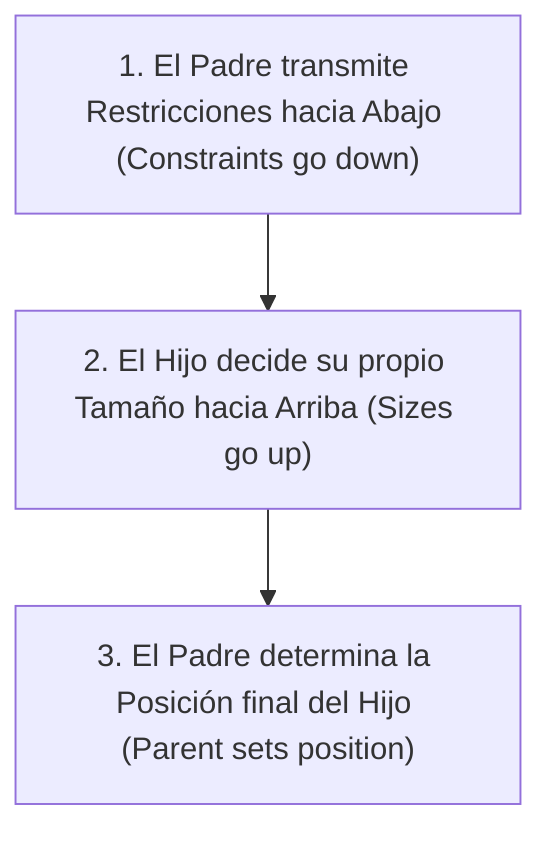
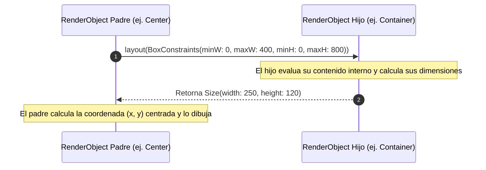

**UNIVERSIDAD DE COSTA RICA**  
**SEDE DEL ATLÁNTICO - RECINTO PARAÍSO**  
**CARRERA DE INFORMÁTICA EMPRESARIAL**  
**CURSO:** IF0009 - Desarrollo de Software IV  
**PROFESOR:** Mag. Jonathan Granados C.  
**SEMESTRE:** II-2026  

---

# Tema 5.2.3.2: Layouts Responsivos, Adaptativos y Desplazamiento Avanzado con Slivers

> [!NOTE]
> Este documento corresponde a la lectura teórica fundamental del **Subtema 5.2.3.2**. En esta guía usted profundizará en el algoritmo de maquetación unidireccional de Flutter (*BoxConstraints*), la discriminación arquitectónica entre `MediaQuery` y `LayoutBuilder`, el diseño responsivo basado en puntos de quiebre (*breakpoints*) y la virtualización de desplazamiento de alto rendimiento mediante la arquitectura de **Slivers** y `CustomScrollView`.

---

## 1. Resumen Ejecutivo

El desarrollo móvil moderno exige que una aplicación funcione de forma impecable tanto en pantallas compactas de 5 pulgadas como en tabletas, dispositivos plegables (*foldables*) y escritorios ultrapanorámicos. En esta lectura, usted comprenderá la regla matemática de oro del diseño en Flutter: *"Constraints go down, sizes go up, parent sets position"*. Asimismo, dominará la construcción de layouts responsivos que optimizan el rendimiento evitando reconstrucciones masivas del árbol y aprenderá a orquestar experiencias de desplazamiento desacopladas y complejas con efectos de colapso mediante `SliverAppBar`, `SliverList` y `SliverGrid`.

---

## 2. Concepto Principal (El "Qué"): Algoritmo de Diseño y Arquitectura de Slivers

### 2.1 El Algoritmo de Maquetación de Flutter (Box Constraints)

A diferencia del modelo de caja web (CSS Box Model) o de los layouts declarativos basados en restricciones relativas de Android XML, el motor de renderizado de Flutter opera bajo un **algoritmo de una sola pasada** (*single-pass layout algorithm*), cuya complejidad temporal es $O(N)$. Este algoritmo se sintetiza en tres preceptos fundamentales:



*   **Restricciones (`BoxConstraints`):** Consisten en cuatro valores cardinales: `minWidth`, `maxWidth`, `minHeight` y `maxHeight`. Si `minWidth == maxWidth`, la restricción es **estricta** (*tight*); si `minWidth == 0`, la restricción es **laxa** (*loose*).
*   **Tamaño (`Size`):** El widget hijo recibe las restricciones y, respetando esos límites, calcula su anchura y altura exactas.
*   **Posicionamiento:** El hijo nunca decide su posición en coordenadas cartesianas $(x, y)$; el padre (por ejemplo, un `Stack`, `Flex`, `Padding` o `Center`) sitúa al hijo en el espacio disponible.



### 2.2 `MediaQuery` vs. `LayoutBuilder`: Diferencias de Rendimiento

Una de las decisiones más críticas al construir interfaces adaptativas radica en seleccionar la fuente de restricciones:

| Criterio | `MediaQuery.of(context)` | `LayoutBuilder` |
| :--- | :--- | :--- |
| **Ámbito de Medición** | Dimensiones totales de la ventana / pantalla. | Dimensiones exactas provistas por el widget padre. |
| **Punto de Reconstrucción** | Reconstruye todo el sub-árbol ante cualquier cambio global (rotación, teclado virtual). | Reconstruye únicamente si las restricciones del padre varían. |
| **Uso Óptimo** | Puntos de quiebre globales a nivel de pantalla completa o detección de temas/safe areas. | Componentes modulares y reutilizables que deben adaptarse a su contenedor. |

### 2.3 Arquitectura de Slivers y Desplazamiento Virtualizado

Un widget de desplazamiento estándar (`ListView` o `GridView`) opera como un viewport cerrado con dimensiones fijas. Cuando se requiere coordinar múltiples listas, cuadrículas y cabeceras dinámicas con un único controlador de desplazamiento unificado, dicho enfoque colapsa.

Para resolver este desafío, Flutter introduce los **Slivers**. Un *Sliver* es una porción visualmente desplazable de la pantalla que no opera bajo `BoxConstraints`, sino bajo **`SliverConstraints`** (longitud del scroll, dirección del desplazamiento, solapamiento y factor de compresión) y produce una **`SliverGeometry`**.

Los componentes fundamentales de esta arquitectura son:
*   **`CustomScrollView`:** El viewport orquestador que aloja una colección heterogénea de Slivers.
*   **`SliverAppBar`:** Barra superior dinámica capaz de colapsar, expandirse, anclarse (`pinned`), flotar (`floating`) o auto-completarse (`snap`).
*   **`SliverList`:** Lista lineal con virtualización eficiente mediante `SliverChildBuilderDelegate`, instanciando en memoria únicamente los ítems visibles en pantalla.
*   **`SliverGrid`:** Cuadrícula virtualizada bidimensional con delegados de tamaño fijo o aspect ratio.
*   **`SliverToBoxAdapter`:** Adaptador puente que permite envolver cualquier widget tradicional basado en `BoxConstraints` dentro de un `CustomScrollView`.

---

## 3. Analogía Técnica: La Línea de Ensamblaje Modular

Para comprender la orquestación entre `BoxConstraints` y `Slivers`:

*   Imagine un **túnel de lavado y mantenimiento automotriz**:
    *   La entrada del túnel impone restricciones físicas innegociables: altura máxima de 2 metros y ancho máximo de 2.5 metros (**BoxConstraints** del padre).
    *   El automóvil ingresa y ocupa exactamente su volumen físico sin rebasar el túnel (**Size** calculado por el hijo).
*   Ahora imagine una **cinta transportadora continua** en una fábrica de empaque (**CustomScrollView**):
    *   No todos los paquetes están en el almacén al mismo tiempo; la cinta sólo mantiene en movimiento las cajas que entran en la sección visible (**Virtualización de Slivers**).
    *   A medida que la cinta avanza, un letrero mecánico desciende suavemente sobre la primera caja y luego se oculta (**SliverAppBar** con efecto de compresión elástica). Los paquetes que salen de la cinta son desmontados de la memoria para que el sistema nunca se sature.

---

## 4. Implementación y Código Práctico (El "Cómo")

A continuación se presenta un caso de ingeniería completo: una pantalla con cabecera colapsable enriquecida (`SliverAppBar`), una lista virtualizada de alto rendimiento y adaptación responsiva de columnas mediante `LayoutBuilder`.

### 4.1 Pantalla Responsiva con `CustomScrollView`

```dart
import 'package:flutter/material.dart';

/// Modelo de datos inmutable para representar un articulo del catalogo
class ProductItem {
  final int id;
  final String title;
  final double price;
  final IconData icon;

  const ProductItem({
    required this.id,
    required this.title,
    required this.price,
    required this.icon,
  });
}

/// Pantalla avanzada que implementa un catalogo responsivo con Slivers
class ResponsiveSliverCatalogScreen extends StatelessWidget {
  const ResponsiveSliverCatalogScreen({super.key});

  // Generador estatico de 100 articulos para probar virtualizacion
  static final List<ProductItem> _items = List.generate(
    100,
    (index) => ProductItem(
      id: index + 1,
      title: 'Modulo de Software Profesional #${index + 1}',
      price: (index + 1) * 24.50,
      icon: Icons.developer_board,
    ),
  );

  @override
  Widget build(BuildContext context) {
    final theme = Theme.of(context);

    return Scaffold(
      body: CustomScrollView(
        physics: const BouncingScrollPhysics(),
        slivers: [
          // 1. Cabecera colapsable interactiva con imagen y titulo M3
          SliverAppBar(
            expandedHeight: 200.0,
            floating: false,
            pinned: true,
            stretch: true,
            backgroundColor: theme.colorScheme.primary,
            flexibleSpace: FlexibleSpaceBar(
              centerTitle: true,
              title: Text(
                'Catálogo IF0009',
                style: TextStyle(
                  color: theme.colorScheme.onPrimary,
                  fontWeight: FontWeight.bold,
                  fontSize: 18.0,
                ),
              ),
              background: Container(
                decoration: BoxDecoration(
                  gradient: LinearGradient(
                    begin: Alignment.topCenter,
                    end: Alignment.bottomCenter,
                    colors: [
                      theme.colorScheme.primary,
                      theme.colorScheme.primaryContainer,
                    ],
                  ),
                ),
                child: const Center(
                  child: Icon(
                    Icons.layers_outlined,
                    size: 70.0,
                    color: Colors.white24,
                  ),
                ),
              ),
            ),
          ),

          // 2. Elemento caja intermedia utilizando el adaptador de puente
          SliverToBoxAdapter(
            child: Padding(
              padding: const EdgeInsets.all(16.0),
              child: Text(
                'Módulos de Arquitectura Disponibles',
                style: theme.textTheme.titleMedium?.copyWith(
                  fontWeight: FontWeight.bold,
                ),
              ),
            ),
          ),

          // 3. Contenedor responsivo que conmuta entre Lista y Cuadricula
          SliverPadding(
            padding: const EdgeInsets.symmetric(horizontal: 16.0),
            sliver: SliverLayoutBuilder(
              builder: (BuildContext context, constraints) {
                // Punto de quiebre: Pantallas anchas (>= 600px) usan Grid
                if (constraints.crossAxisExtent >= 600) {
                  return SliverGrid(
                    gridDelegate:
                        const SliverGridDelegateWithFixedCrossAxisCount(
                      crossAxisCount: 3,
                      mainAxisSpacing: 12.0,
                      crossAxisSpacing: 12.0,
                      childAspectRatio: 1.8,
                    ),
                    delegate: SliverChildBuilderDelegate(
                      (context, index) => _buildCard(context, _items[index]),
                      childCount: _items.length,
                    ),
                  );
                }

                // Dispositivos moviles (< 600px) utilizan lista vertical
                return SliverList(
                  delegate: SliverChildBuilderDelegate(
                    (context, index) => _buildCard(context, _items[index]),
                    childCount: _items.length,
                  ),
                );
              },
            ),
          ),
        ],
      ),
    );
  }

  /// Construye una tarjeta estandarizada optimizada para reciclaje visual
  static Widget _buildCard(BuildContext context, ProductItem item) {
    final theme = Theme.of(context);
    return Card(
      margin: const EdgeInsets.only(bottom: 10.0),
      child: ListTile(
        leading: CircleAvatar(
          backgroundColor: theme.colorScheme.primaryContainer,
          child: Icon(item.icon, color: theme.colorScheme.primary),
        ),
        title: Text(item.title, maxLines: 1, overflow: TextOverflow.ellipsis),
        subtitle: Text(
          '\$${item.price.toStringAsFixed(2)} USD',
          style: TextStyle(
            color: theme.colorScheme.secondary,
            fontWeight: FontWeight.w600,
          ),
        ),
        trailing: const Icon(Icons.arrow_forward_ios, size: 14.0),
        onTap: () {
          // Gestion del evento de pulsacion
        },
      ),
    );
  }
}
```

### 4.2 Explicación Paso a Paso de las Instrucciones Clave

**1.** **Parámetros de `SliverAppBar` (`pinned: true`, `floating: false`):**  
Garantiza que la barra se reduzca a la altura mínima estándar de una `AppBar` conforme el usuario se desplaza, manteniendo el título siempre legible en la parte superior sin desaparecer del viewport.

**2.** **`FlexibleSpaceBar` y Fondo Degradado:**  
Permite que el contenido visual de la cabecera realice una interpolación de tamaño (*fade & scale*) sincronizada con el desplazamiento vertical del dedo del usuario.

**3.** **Uso de `SliverToBoxAdapter`:**  
Sirve como puente arquitectónico esencial. Los widgets estándar de caja (como `Padding` o `Container`) no pueden insertarse directamente en `CustomScrollView.slivers` sin este adaptador.

**4.** **`SliverLayoutBuilder` y Adaptabilidad Dinámica:**  
Evalúa el ancho en píxeles lógicos del área de contenido (`crossAxisExtent`). Si el usuario rota el dispositivo a modo horizontal o la aplicación se ejecuta en una tableta, se conmuta automáticamente a una cuadrícula de 3 columnas sin reconfigurar la lógica de negocio.

**5.** **`SliverChildBuilderDelegate`:**  
Asegura la virtualización estricta. Aunque la lista contenga 10,000 elementos, el recolector de basura destruye los elementos que salen del área visible, manteniendo un consumo de memoria plano.

---

## 5. Trampas Comunes y Errores de Arquitectura

### Trampa 1: El Error Clásico "Vertical viewport was given unbounded height"
*   **Problema:** Incrustar un `ListView` estándar dentro de un `Column` sin envolverlo en un `Expanded` o `Flexible`.
*   **Causa raíz:** Un `Column` pasa a sus hijos restricciones de altura infinita (`maxHeight: double.infinity`). Un `ListView` intenta expandirse hasta el infinito para mostrar todos sus elementos, provocando un conflicto insoluble de diseño.
*   **Mitigación:** Envuelva el widget con `Expanded`, asígnele una altura explícita con `SizedBox`, o utilice `shrinkWrap: true` (sólo para listas muy cortas).

### Trampa 2: Abuso de `shrinkWrap: true` en Listas Extensas
*   **Problema:** Configurar `shrinkWrap: true` en listas con cientos de elementos para "solucionar" el error de altura ilimitada.
*   **Causa raíz:** `shrinkWrap` fuerza a Flutter a medir de inmediato cada uno de los elementos de la lista en lugar de virtualizarlos bajo demanda.
*   **Consecuencia:** Congelamiento de fotogramas (*jank*) y consumo masivo de memoria al renderizar la pantalla.
*   **Mitigación:** Emplee `CustomScrollView` con `SliverList` o inserte la lista dentro de un `Expanded`.

### Trampa 3: Reconstrucción Masiva por Uso Indebido de `MediaQuery.of(context)`
*   **Problema:** Invocar `MediaQuery.of(context).size` en la raíz de un widget complejo para tomar una decisión estética menor de un botón o tarjeta secundaria.
*   **Causa raíz:** Cualquier evento periférico (como el despliegue del teclado virtual o un cambio de orientación) forzará la reconstrucción de todo el árbol.
*   **Mitigación:** Utilice selectores específicos como `MediaQuery.sizeOf(context)` (introducido en Flutter 3.10) o use `LayoutBuilder` para encapsular la respuesta responsiva en el componente local.

---

## 6. Pregunta de Reflexión Académica

> **Pregunta para el Análisis:**  
> En el algoritmo de renderizado de Flutter, ¿por qué un widget hijo que especifica internamente `width: 300` y `height: 300` puede ser forzado a renderizarse ocupando el 100% de la pantalla si su padre inmediato es un `MaterialApp` o un `Window` sin un widget intermedio como `Center` o `Align`?  
>  
> *Pista:* Analice cómo se comportan las restricciones estrictas (*tight constraints*) que la raíz del sistema operativo impone sobre la ventana de la aplicación.
