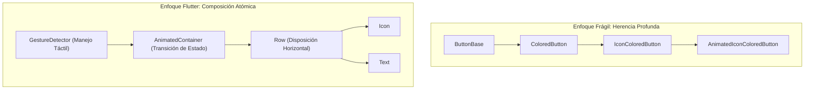
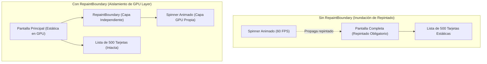

**UNIVERSIDAD DE COSTA RICA**  
**SEDE DEL ATLÁNTICO - RECINTO PARAÍSO**  
**CARRERA DE INFORMÁTICA EMPRESARIAL**  
**CURSO:** IF0009 - Desarrollo de Software IV  
**PROFESOR:** Mag. Jonathan Granados C.  
**SEMESTRE:** II-2026  

---

# Tema 5.2.3.3: Creación de Widgets Personalizados, Optimización de Renderizado y Animaciones

> [!NOTE]
> Este documento corresponde a la lectura teórica fundamental del **Subtema 5.2.3.3**. En esta guía usted estudiará el principio de composición declarativa sobre herencia, la optimización de memoria mediante constructores `const`, el aislamiento de repintado en GPU con `RepaintBoundary` y la arquitectura completa de animaciones implícitas y explícitas en Flutter a 60/120 FPS.

---

## 1. Resumen Ejecutivo

Una experiencia de usuario de clase mundial depende de una interfaz visualmente fluida y libre de interrupciones (*jank*). En este tema, usted analizará los principios arquitectónicos para diseñar **Custom Widgets** altamente desacoplados y reutilizables mediante el patrón de composición. Asimismo, explorará el ciclo de renderizado para aislar capas de repintado en la GPU con `RepaintBoundary` y dominará el espectro de animaciones de Flutter: desde las **animaciones implícitas** orientadas a cambios de estado declarativos hasta las **animaciones explícitas** orquestadas por controladores sincronizados con la tasa de refresco del hardware (*VSYNC*).

---

## 2. Concepto Principal (El "Qué"): Composición, Memoria y Motor de Animación

### 2.1 Composición sobre Herencia

En la programación orientada a objetos clásica, es común extender clases base para modificar comportamientos (por ejemplo, heredar de un botón para cambiar su color). Flutter descarta radicalmente este enfoque en favor del **Principio de Composición**:



La composición ofrece tres ventajas de ingeniería:
1. **Desacoplamiento Estricto:** Cada widget resuelve una única responsabilidad (gestión táctil, animación, diseño espacial, color).
2. **Inmutabilidad Absoluta:** Los widgets son configuraciones ligeras de un solo uso que se crean y descartan rápidamente sin sobrecarga en el Garbage Collector.
3. **Reutilización Horizontal:** Permite combinar cualquier comportamiento visual sin crear jerarquías de clases monolíticas.

### 2.2 Constructores `const` y Canonicidad de Memoria

Cuando usted marca un widget con la palabra clave `const`, el compilador de Dart realiza una optimización crítica: **la canonicalización de objetos**. Si el árbol de widgets se reconstruye ante un `setState()`, Flutter detecta que la instancia constante ya existe en la memoria estática del runtime y **omite por completo** la llamada al método `build()` de ese sub-árbol.

### 2.3 Aislamiento de Capas con `RepaintBoundary`

Durante el ciclo de renderizado, si un elemento secundario (por ejemplo, un indicador de carga que gira continuamente) se repinta en cada fotograma (16.6 ms a 60 Hz u 8.3 ms a 120 Hz), el motor de Flutter puede forzar el repintado de todos los ancestros y hermanos en el mismo `RenderView`.

`RepaintBoundary` inserta un nodo especial en el árbol de renderizado (`RenderRepaintBoundary`) que posee su propio búfer de texturas (**DisplayList / Layer**) en la GPU. De este modo, únicamente el contenido interno se redibuja, mientras el resto de la pantalla permanece estático en la memoria de vídeo sin consumir ciclos de CPU.



### 2.4 Taxonomía del Sistema de Animaciones

Flutter clasifica sus herramientas de animación en dos paradigmas complementarios:

| Característica | Animaciones Implícitas | Animaciones Explícitas |
| :--- | :--- | :--- |
| **Controlador** | No requiere `AnimationController`. | Requiere `AnimationController` y `TickerProvider`. |
| **Punto de Activación** | Se disparan automáticamente al cambiar una propiedad (`setState`). | Se controlan manualmente (`forward()`, `reverse()`, `repeat()`, `stop()`). |
| **Complejidad** | Mínima, curva de aprendizaje inmediata. | Mayor, control granular fotograma a fotograma. |
| **Widgets Típicos** | `AnimatedContainer`, `AnimatedOpacity`, `TweenAnimationBuilder`. | `AnimatedBuilder`, `FadeTransition`, `RotationTransition`. |
| **Casos de Uso** | Transiciones simples de color, tamaño o visibilidad. | Bucles continuos, secuencias escalonadas (*staggered*) y gestos arrastrables. |

---

## 3. Analogía Técnica: La Linterna Mágica y el Titiritero

Para discernir la diferencia entre animaciones implícitas y explícitas:

*   **Animación Implícita (El Termostato Inteligente):**  
    Usted no mueve manualmente los engranajes del calentador. Usted simplemente ajusta el dial de 20°C a 25°C. El sistema interno calcula la curva de calentamiento progresivo y la ejecuta gradualmente hasta alcanzar la meta (**`AnimatedContainer`** interpola automáticamente entre el estado viejo y el nuevo).
*   **Animación Explícita (El Titiritero de Hilos):**  
    El titiritero controla los hilos con precisión milimétrica mediante una cruz de madera (**`AnimationController`**). Cada movimiento de su mano responde a una señal temporal o pulso rítmico (**`TickerProvider / VSYNC`**). El titiritero decide si la marioneta avanza, retrocede a mitad del movimiento, baila en bucle infinito o se detiene súbitamente ante una interacción física.

---

## 4. Implementación y Código Práctico (El "Cómo")

A continuación se presenta un componente profesional que combina:
1. Una tarjeta interactiva con animación implícita de elevación y color.
2. Un botón de acción con animación explícita sincronizada por `AnimationController` y `RepaintBoundary`.

```dart
import 'package:flutter/material.dart';

/// Widget personalizado interactivo que demuestra composicion,
/// aislamiento de repintado y animaciones explicitas e implicitas.
class AdvancedInteractiveCard extends StatefulWidget {
  final String title;
  final String subtitle;
  final VoidCallback onAction;

  const AdvancedInteractiveCard({
    super.key,
    required this.title,
    required this.subtitle,
    required this.onAction,
  });

  @override
  State<AdvancedInteractiveCard> createState() =>
      _AdvancedInteractiveCardState();
}

class _AdvancedInteractiveCardState extends State<AdvancedInteractiveCard>
    with SingleTickerProviderStateMixin {
  // Estado para la animacion implicita
  bool _isHovered = false;

  // Controlador para la animacion explicita (rotacion del icono)
  late final AnimationController _pulseController;
  late final Animation<double> _scaleAnimation;

  @override
  void initState() {
    super.initState();

    // 1. Inicializar AnimationController acoplado a VSYNC (1200 ms)
    _pulseController = AnimationController(
      vsync: this,
      duration: const Duration(milliseconds: 1200),
    );

    // 2. Definir una curva no lineal elastica de tipo easeInOut
    _scaleAnimation = Tween<double>(begin: 1.0, end: 1.25).animate(
      CurvedAnimation(
        parent: _pulseController,
        curve: Curves.easeInOut,
      ),
    );

    // Iniciar bucle continuo autorreversible (efecto latido)
    _pulseController.repeat(reverse: true);
  }

  @override
  void dispose() {
    // 3. Liberar obligatoriamente el Ticker para evitar memory leaks
    _pulseController.dispose();
    super.dispose();
  }

  @override
  Widget build(BuildContext context) {
    final theme = Theme.of(context);

    return GestureDetector(
      onTapDown: (_) => setState(() => _isHovered = true),
      onTapUp: (_) => setState(() => _isHovered = false),
      onTapCancel: () => setState(() => _isHovered = false),
      child: AnimatedContainer(
        duration: const Duration(milliseconds: 250),
        curve: Curves.easeOutCubic,
        padding: const EdgeInsets.all(20.0),
        decoration: BoxDecoration(
          color: _isHovered
              ? theme.colorScheme.primaryContainer
              : theme.colorScheme.surface,
          borderRadius: BorderRadius.circular(_isHovered ? 24.0 : 16.0),
          boxShadow: [
            BoxShadow(
              color: Colors.black.withOpacity(_isHovered ? 0.15 : 0.05),
              blurRadius: _isHovered ? 20.0 : 8.0,
              offset: Offset(0, _isHovered ? 8.0 : 3.0),
            ),
          ],
        ),
        child: Row(
          children: [
            // 4. Aislamiento de GPU para el elemento en continua animacion
            RepaintBoundary(
              child: AnimatedBuilder(
                animation: _scaleAnimation,
                builder: (context, child) {
                  return Transform.scale(
                    scale: _scaleAnimation.value,
                    child: child,
                  );
                },
                child: Container(
                  padding: const EdgeInsets.all(12.0),
                  decoration: BoxDecoration(
                    color: theme.colorScheme.primary,
                    shape: BoxShape.circle,
                  ),
                  child: Icon(
                    Icons.bolt,
                    color: theme.colorScheme.onPrimary,
                    size: 24.0,
                  ),
                ),
              ),
            ),
            const SizedBox(width: 16.0),
            Expanded(
              child: Column(
                crossAxisAlignment: CrossAxisAlignment.start,
                mainAxisSize: MainAxisSize.min,
                children: [
                  Text(
                    widget.title,
                    style: theme.textTheme.titleMedium?.copyWith(
                      fontWeight: FontWeight.bold,
                    ),
                  ),
                  const SizedBox(height: 4.0),
                  Text(
                    widget.subtitle,
                    style: theme.textTheme.bodyMedium?.copyWith(
                      color: theme.colorScheme.onSurfaceVariant,
                    ),
                  ),
                ],
              ),
            ),
            IconButton.filledTonal(
              onPressed: widget.onAction,
              icon: const Icon(Icons.arrow_forward),
            ),
          ],
        ),
      ),
    );
  }
}
```

### 4.2 Explicación Paso a Paso de las Instrucciones Clave

**1.** **`SingleTickerProviderStateMixin`:**  
Provee un `Ticker` único que enlaza el `AnimationController` con la tasa de refresco de la pantalla física. Evita que la animación consuma energía cuando la pantalla está apagada o la aplicación está en segundo plano.

**2.** **`dispose()` del Controlador:**  
Regla cardinal de ciclo de vida: olvidar invocar `_pulseController.dispose()` retiene el objeto `State` en memoria indefinidamente, generando una **fuga de memoria silenciosa** (*memory leak*).

**3.** **`AnimatedContainer` con Curva Cúbica:**  
Modifica simultáneamente el radio de borde, el color de fondo y la elevación de sombra sin requerir matemáticas de interpolación manuales; Flutter calcula el valor delta por fotograma de forma transparente.

**4.** **`RepaintBoundary` + `AnimatedBuilder`:**  
El icono realiza un latido continuo a 60 FPS mediante `Transform.scale`. Al envolverlo en `RepaintBoundary`, la GPU únicamente repinta la textura del círculo y el rayo, dejando el texto y el contenedor exterior en reposo absoluto de renderizado.

---

## 5. Trampas Comunes y Errores de Arquitectura

### Trampa 1: Olvido del método `dispose()` en Controladores
*   **Problema:** Dejar instancias activas de `AnimationController` tras cerrar o destruir la pantalla.
*   **Consecuencia:** La consola arroja excepciones de tipo *"AnimationController was used after being disposed"* o los Tickers continúan disparándose en segundo plano, agotando la batería del dispositivo.
*   **Mitigación:** Siempre anule `dispose()` en el `State` y descarte todos los controladores y listeners.

### Trampa 2: Reconstrucción Excesiva mediante `setState()` en Bucles de Animación
*   **Problema:** Agregar un listener manual al controlador (`controller.addListener(() => setState(() {}))`) para animar un widget pequeño.
*   **Causa raíz:** `setState()` fuerza la ejecución del método `build()` completo de todo el widget y sus descendientes en cada fotograma (60 veces por segundo).
*   **Mitigación:** Utilice `AnimatedBuilder` pasando el sub-árbol estático a través del parámetro `child` para que no se reconstruya.

### Trampa 3: Sobrecarga Innecesaria de `RepaintBoundary`
*   **Problema:** Envolver cada widget individual de una lista dentro de un `RepaintBoundary`.
*   **Causa raíz:** Cada `RepaintBoundary` crea una textura de capa en la memoria de vídeo de la GPU.
*   **Consecuencia:** Saturación de la memoria VRAM del dispositivo y penalización de rendimiento en terminales de gama baja.
*   **Mitigación:** Aplique `RepaintBoundary` únicamente a elementos de alta frecuencia de cambio visual (animaciones continuas, lienzos de dibujo táctil o feeds de vídeo).

---

## 6. Pregunta de Reflexión Académica

> **Pregunta para el Análisis:**  
> En el widget `AnimatedBuilder`, ¿por qué se considera una práctica fundamental de arquitectura separar el código del widget estático en la propiedad `child` y recibirlo como argumento en la función constructora `builder: (context, child)`, en lugar de instanciar el widget directamente dentro del cuerpo del builder?  
>  
> *Pista:* Evalúe el impacto en el recolector de basura (*Garbage Collector*) y en el árbol de elementos cuando una animación se ejecuta a 120 fotogramas por segundo.
