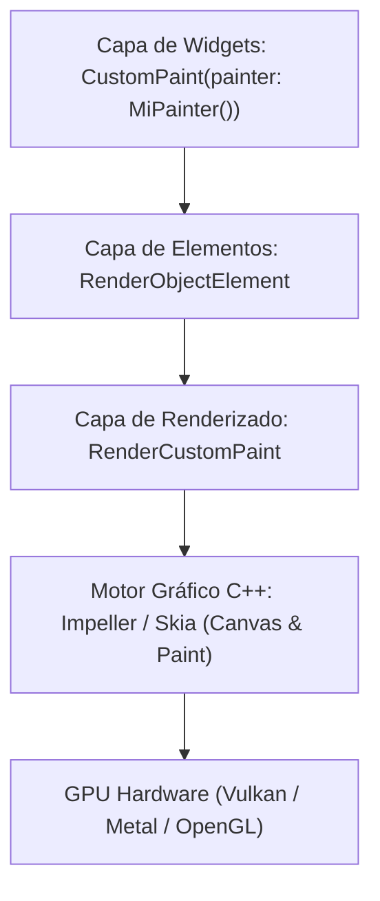
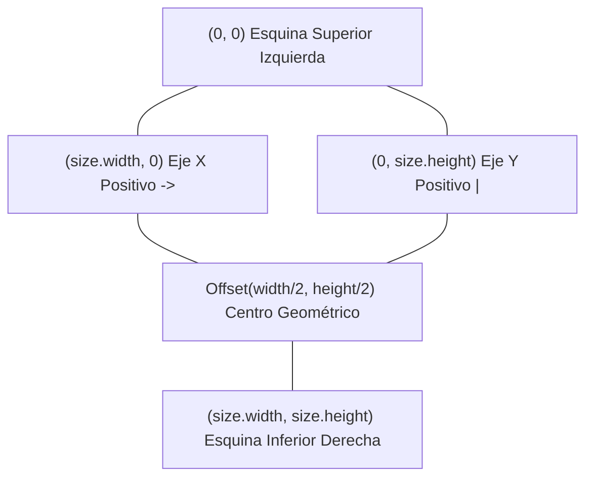

**UNIVERSIDAD DE COSTA RICA**  
**SEDE DEL ATLÁNTICO - RECINTO PARAÍSO**  
**CARRERA DE INFORMÁTICA EMPRESARIAL**  
**CURSO:** IF0009 - Desarrollo de Software IV  
**PROFESOR:** Mag. Jonathan Granados C.  
**SEMESTRE:** II-2026  

---

# Tema 5.2.3.4: Pintado Personalizado a Bajo Nivel con CustomPainter y Canvas

> [!NOTE]
> Este documento corresponde a la lectura teórica fundamental del **Subtema 5.2.3.4**. En esta guía usted descenderá a las capas más profundas del pipeline de renderizado de Flutter, estudiando la interacción directa con el motor gráfico Skia/Impeller mediante la clase abstracta `CustomPainter`, las primitivas vectoriales de `Canvas` y la optimización de repintado condicional mediante `shouldRepaint`.

---

## 1. Resumen Ejecutivo

Cuando los widgets preconstruidos de Material o Cupertino resultan insuficientes para satisfacer requerimientos de diseño gráfico a medida —tales como diagramas analíticos en tiempo real, velocímetros interactivos, gráficos de ondas sonoras o visualizadores de datos financieros—, la solución arquitectónica idónea radica en el **pintado personalizado vectorial**. En esta lección, usted dominará el sistema de coordenadas cartesiano bidimensional de Flutter, el uso del lienzo `Canvas` y el pincel `Paint`, el trazo de curvas de Bézier mediante `Path` y las técnicas de perfilado para garantizar una tasa de refresco constante de 60 a 120 FPS sin saturar la memoria de la GPU.

---

## 2. Concepto Principal (El "Qué"): Arquitectura del Pipeline de Dibujo

En la jerarquía de abstracción de Flutter, el widget `CustomPaint` se comunica directamente con la capa de renderizado creando un nodo `RenderCustomPaint`, el cual emite instrucciones gráficas de bajo nivel directamente al motor **Impeller** (en iOS y Android moderno) o **Skia**:



### 2.1 El Contrato de `CustomPainter`

Para dibujar sobre el lienzo, usted debe extender la clase abstracta `CustomPainter`, la cual impone la implementación obligatoria de dos métodos fundamentales:

```dart
abstract class CustomPainter extends Listenable {
  void paint(Canvas canvas, Size size);
  bool shouldRepaint(covariant CustomPainter oldDelegate);
}
```

**A.** **`paint(Canvas canvas, Size size)`:**  
Se ejecuta cada vez que el sub-árbol de renderizado determina que el componente requiere ser dibujado. Proporciona dos objetos esenciales:
*   **`canvas`:** La interfaz de comandos gráficos para trazar formas primitivas, líneas, arcos y caminos vectoriales.
*   **`size`:** Las dimensiones espaciales lógicas finales calculadas para el widget por el algoritmo de maquetación del padre.

**B.** **`shouldRepaint(covariant CustomPainter oldDelegate)`:**  
Es el **guardián del rendimiento**. Flutter compara la instancia actual del pintor contra la instancia previa (`oldDelegate`). Si este método retorna `false`, el motor reutiliza la capa de dibujo previamente rasterizada en la GPU, omitiendo el método `paint()` y ahorrando miles de operaciones matemáticas por segundo.

### 2.2 El Sistema de Coordenadas Cartesiano 2D

El espacio geométrico de un `Canvas` en Flutter se rige por un plano bidimensional con las siguientes características:
*   El **origen `(0, 0)`** se localiza estrictamente en la **esquina superior izquierda** del área asignada por `size`.
*   El eje **$X$** se incrementa positivamente hacia la derecha: desde `0.0` hasta `size.width`.
*   El eje **$Y$** se incrementa positivamente hacia abajo: desde `0.0` hasta `size.height`.
*   El centro geométrico exacto de cualquier lienzo se calcula mediante la fórmula: `Offset(size.width / 2, size.height / 2)`.



### 2.3 Las Clases `Paint` y `Path`

*   **`Paint` (El Pincel):** Modela las propiedades ópticas del trazo:
    *   `style`: Define si la figura se rellena completamente (`PaintingStyle.fill`) o sólo se traza su contorno (`PaintingStyle.stroke`).
    *   `strokeWidth`: Grosor en píxeles lógicos del trazo perimetral.
    *   `strokeCap`: Acabado de los extremos de las líneas (`StrokeCap.round`, `StrokeCap.square`, `StrokeCap.butt`).
    *   `shader`: Permite inyectar gradientes lineales o radiales (`ui.Gradient.linear`) en lugar de colores sólidos.
*   **`Path` (El Trazo Vectorial):** Permite encadenar secuencias de líneas rectas, arcos y curvas complejas:
    *   `moveTo(x, y)`: Mueve el lápiz a una coordenada sin dibujar.
    *   `lineTo(x, y)`: Traza un segmento recto hacia el punto especificado.
    *   `quadraticBezierTo(x1, y1, x2, y2)`: Dibuja una **Curva de Bézier Cuadrática** utilizando un punto de control `(x1, y1)` que ejerce una atracción gravitatoria sobre la curva hasta el punto final `(x2, y2)`.
    *   `close()`: Cierra automáticamente el polígono trazando una línea recta hacia el punto de origen.

---

## 3. Analogía Técnica: El Grabador Láser y la Ficha Técnica

Para asimilar la operación de `CustomPainter`:

*   El **`Canvas`** es una placa lisa de metal o acrílico colocada en la mesa de trabajo de una máquina CNC.
*   El objeto **`Paint`** es la configuración de potencia y enfoque del cabezal láser: determina si el láser cortará el acrílico atravesándolo (**`PaintingStyle.stroke`** con cierto grosor) o si aplicará un sombreado por calor en la superficie (**`PaintingStyle.fill`**).
*   El método **`paint()`** es el conjunto de coordenadas de código G (*G-code*) transmitidas al servomotor paso a paso: *"mueva el láser a (50, 100), trace una curva con punto de atracción en (100, 20), y corte hasta (150, 100)"*.
*   El método **`shouldRepaint()`** representa el control de calidad del operador: si la orden de fabricación recibida tiene las mismas especificaciones (mismo porcentaje de progreso o mismo valor de telemetría), el operador **no vuelve a encender el láser** ni a cortar otra placa; entrega directamente la pieza que ya tenía almacenada en el estante de producto terminado (**GPU Layer Cache**).

---

## 4. Implementación y Código Práctico (El "Cómo")

A continuación se presenta un caso de ingeniería completo: un **Indicador Radial de Rendimiento (Gauge Circular)** con gradiente cónico dinámico, arco de fondo y cálculo trigonométrico preciso.

### 4.1 Implementación del `RadialGaugePainter`

```dart
import 'dart:math' as math;
import 'package:flutter/material.dart';

/// Pintor personalizado para renderizar un indicador de porcentaje circular
/// con gradiente dinamico, fondo estatico y optimizacion shouldRepaint.
class RadialGaugePainter extends CustomPainter {
  final double percentage; // Valor normalizado entre 0.0 y 1.0
  final Color primaryColor;
  final Color trackColor;

  const RadialGaugePainter({
    required this.percentage,
    required this.primaryColor,
    required this.trackColor,
  });

  @override
  void paint(Canvas canvas, Size size) {
    // 1. Determinar el centro geometrico y el radio maximo circunscrito
    final center = Offset(size.width / 2, size.height / 2);
    final strokeWidth = size.width * 0.10; // 10% del ancho como grosor
    final radius = (math.min(size.width, size.height) - strokeWidth) / 2;

    // 2. Pincel para la pista de fondo inactiva
    final trackPaint = Paint()
      ..color = trackColor
      ..style = PaintingStyle.stroke
      ..strokeWidth = strokeWidth
      ..strokeCap = StrokeCap.round;

    // Dibujar el circulo completo de fondo (2 * PI radianes)
    canvas.drawCircle(center, radius, trackPaint);

    // Si el porcentaje es nulo o menor a cero, evitar dibujo activo
    if (percentage <= 0.0) return;

    // 3. Pincel activo con acabado redondeado
    final activePaint = Paint()
      ..color = primaryColor
      ..style = PaintingStyle.stroke
      ..strokeWidth = strokeWidth
      ..strokeCap = StrokeCap.round;

    // 4. Calculo trigonometrico del arco en radianes
    // Inicia en la parte superior (-PI / 2 radianes o -90 grados)
    const startAngle = -math.pi / 2;
    // Angulo de barrido proporcional al porcentaje
    final sweepAngle = 2 * math.pi * percentage.clamp(0.0, 1.0);

    // 5. Trazar el arco activo sobre el lienzo
    canvas.drawArc(
      Rect.fromCircle(center: center, radius: radius),
      startAngle,
      sweepAngle,
      false, // useCenter en false para evitar efecto rebanada de pastel
      activePaint,
    );
  }

  @override
  bool shouldRepaint(covariant RadialGaugePainter oldDelegate) {
    // Re-ejecutar paint() UNICAMENTE si los valores o colores cambiaron
    return oldDelegate.percentage != percentage ||
        oldDelegate.primaryColor != primaryColor ||
        oldDelegate.trackColor != trackColor;
  }
}
```

### 4.2 Integración en el Árbol de Widgets con `CustomPaint`

```dart
/// Widget de presentacion que consume el CustomPainter
class MetricGaugeWidget extends StatelessWidget {
  final double value; // Valor entre 0 y 100

  const MetricGaugeWidget({super.key, required this.value});

  @override
  Widget build(BuildContext context) {
    final theme = Theme.of(context);
    final normalized = (value / 100.0).clamp(0.0, 1.0);

    return Center(
      child: SizedBox(
        width: 180.0,
        height: 180.0,
        child: CustomPaint(
          painter: RadialGaugePainter(
            percentage: normalized,
            primaryColor: theme.colorScheme.primary,
            trackColor: theme.colorScheme.surfaceVariant.withOpacity(0.4),
          ),
          child: Center(
            child: Column(
              mainAxisSize: MainAxisSize.min,
              children: [
                Text(
                  '${value.toInt()}%',
                  style: theme.textTheme.headlineMedium?.copyWith(
                    fontWeight: FontWeight.bold,
                  ),
                ),
                Text(
                  'Eficiencia',
                  style: theme.textTheme.labelMedium?.copyWith(
                    color: theme.colorScheme.onSurfaceVariant,
                  ),
                ),
              ],
            ),
          ),
        ),
      ),
    );
  }
}
```

### 4.3 Explicación Paso a Paso de las Instrucciones Clave

**1.** **Cálculo del Radio Relativo y `strokeWidth`:**  
El radio se deriva dinámicamente de `math.min(size.width, size.height) - strokeWidth`. Esto garantiza que si el contenedor cambia de tamaño, el trazado nunca se desborde fuera de los márgenes lógicos del lienzo.

**2.** **`startAngle = -math.pi / 2`:**  
Por defecto, en trigonometría cartesiana el ángulo `0` apunta horizontalmente a las 3 en punto de las manecillas del reloj. Restar $\frac{\pi}{2}$ desplaza el inicio de rotación a las 12 en punto (arriba al centro).

**3.** **Parámetro `useCenter: false` en `drawArc`:**  
Al pasar `false`, el motor dibuja un arco perimetral de línea abierta. Si se pasara `true`, el arco cerraría sus líneas hacia el centro formando una porción triangular de pastel (*pie slice*).

**4.** **Optimización Determinista de `shouldRepaint`:**  
Si un widget padre reconstruye la pantalla debido a la llegada de una notificación o el movimiento de otro componente, `RadialGaugePainter` compara sus campos escalares. Si `percentage` no varió, el método `paint()` se descarta de inmediato, conservando la tasa de refresco a 120 FPS.

---

## 5. Trampas Comunes y Errores de Arquitectura

### Trampa 1: Instanciar Objetos Pesados dentro de `paint()`
*   **Problema:** Declarar `final paint = Paint()` o crear listas complejas de objetos dentro del cuerpo de `paint()`.
*   **Causa raíz:** En animaciones o gestos táctiles, `paint()` puede invocarse hasta 120 veces por segundo. Instanciar objetos en cada fotograma satura el recolector de basura de la memoria joven de Dart.
*   **Mitigación:** Reutilice instancias de `Paint` preconfiguradas o minimice la asignación de memoria dinámica durante el fotograma.

### Trampa 2: Retornar siempre `true` en `shouldRepaint`
*   **Problema:** Dejar `bool shouldRepaint(old) => true;` por comodidad o descuido.
*   **Consecuencia:** Fuerza el redibujado completo del lienzo en cada ciclo de pipeline, anulando el sistema de caché de la GPU e incrementando el consumo de batería del teléfono móvil.
*   **Mitigación:** Compare rigurosamente las propiedades primitivas del delegado previo contra el actual.

### Trampa 3: Coordenadas Absolutas sin Ajuste a `size`
*   **Problema:** Escribir coordenadas fijas en píxeles como `canvas.drawLine(Offset(0, 0), Offset(300, 300), paint)`.
*   **Consecuencia:** En pantallas pequeñas o ventanas reescalables, el dibujo se cortará lateralmente o quedará enano en pantallas de alta densidad de píxeles (tablets o 4K).
*   **Mitigación:** Multiplique siempre por proporciones relativas: `Offset(size.width * 0.5, size.height * 0.8)`.

---

## 6. Pregunta de Reflexión Académica

> **Pregunta para el Análisis:**  
> Cuando se dibujan gráficos vectoriales de alta complejidad matemática (por ejemplo, miles de puntos de datos en una serie temporal financiera con curvas de Bézier cúbicas), ¿qué rol juegan las banderas `isComplex: true` y `willChange: false` provistas por el widget `CustomPaint` sobre el compositor de capas del motor Impeller?  
>  
> *Pista:* Piense en la decisión que toma el motor gráfico entre rasterizar el dibujo en un mapa de bits (*bitmap layer*) almacenado en la memoria de vídeo de la GPU versus reevaluar la función de dibujo vectorial en cada fotograma.
