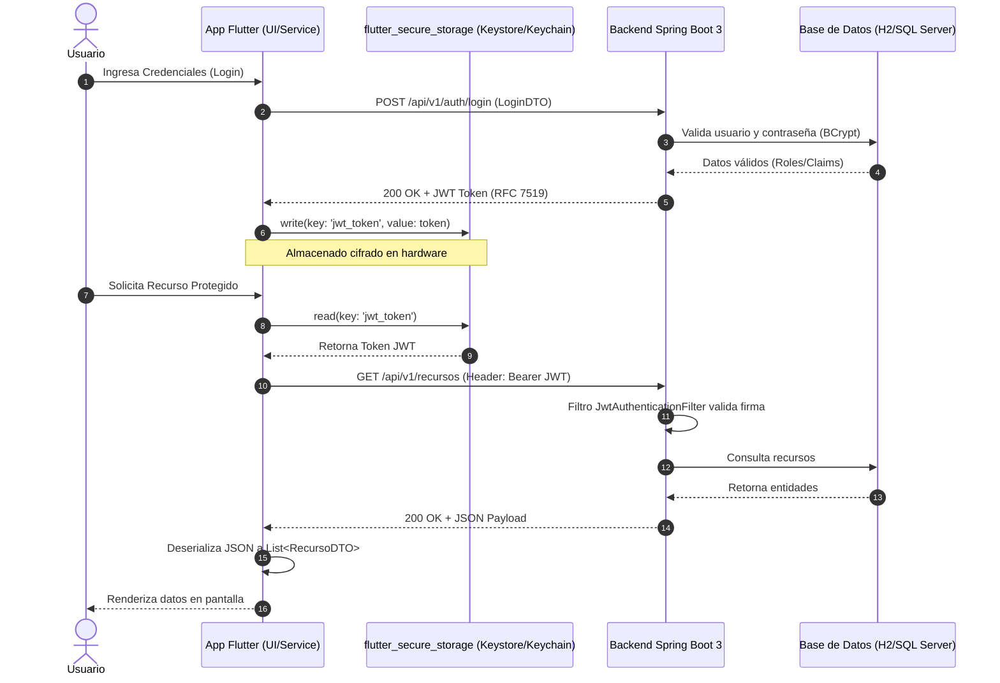

**UNIVERSIDAD DE COSTA RICA**  
**SEDE DEL ATLÁNTICO - RECINTO PARAÍSO**  
**CARRERA DE INFORMÁTICA EMPRESARIAL**  
**CURSO:** IF0009 - Desarrollo de Software IV  
**PROFESOR:** Mag. Jonathan Granados C.  
**SEMESTRE:** II-2026  

---

# Tema 5.2.4.1: Consumo Asíncrono de APIs RESTful en Spring Boot, Manejo de DTOs y Seguridad con Tokens JWT

> [!NOTE]
> Este documento corresponde a la lectura teórica fundamental del **Subtema 5.2.4.1**. En esta guía usted estudiará la integración cliente-servidor entre Flutter y servicios backend en Spring Boot 3, el consumo asíncrono con el paquete `http`, la deserialización fuertemente tipada mediante Data Transfer Objects (DTOs), el manejo resiliente de errores HTTP y el almacenamiento seguro de credenciales JWT en el dispositivo móvil mediante `flutter_secure_storage`.

---

## 1. Resumen Ejecutivo

Las aplicaciones móviles modernas operan en entornos de red dinámicos y frecuentemente inestables. En este módulo, usted aprenderá a diseñar una capa de servicios cliente robusta y desacoplada en Dart 3 para interactuar con APIs RESTful construidas en Spring Boot 3. Abordaremos el ciclo de vida de las peticiones HTTP (`GET`, `POST`, `PUT`, `DELETE`), la transformación de cargas útiles JSON hacia DTOs inmutables, la captura de fallas de red y códigos de estado conforme al estándar RFC 7807, y la implementación de almacenamiento criptográfico para tokens JWT utilizando las bóvedas de seguridad del hardware del dispositivo (**Android Keystore** y **Apple Keychain**).

---

## 2. Concepto Principal (El "Qué"): Arquitectura Cliente-Servidor Móvil y Seguridad

En el desarrollo móvil, el cliente no debe acoplarse directamente a la lógica de persistencia del servidor. La comunicación se realiza mediante mensajes estructurados sobre el protocolo HTTP/HTTPS, utilizando JSON como formato de intercambio ligero.



### 2.1 El Paquete `http` en Dart
El paquete oficial `http` de Dart proporciona abstracciones asíncronas de alto nivel para enviar peticiones web. Cada llamada devuelve un `Future<http.Response>`, el cual encapsula el código de respuesta HTTP (`statusCode`), las cabeceras (`headers`) y el cuerpo textual (`body`).

### 2.2 Serialización y DTOs en Dart 3
A diferencia de JavaScript o TypeScript, Dart es un lenguaje fuertemente tipado con verificación estricta de nulidad en tiempo de compilación (*Sound Null Safety*). Tratar las respuestas JSON como estructuras dinámicas (`Map<dynamic, dynamic>`) es una práctica deficiente que traslada las excepciones de tipo al entorno de producción. La práctica recomendada exige mapear cada estructura a una clase inmutable con constructores de fábrica (`factory fromJson`) y métodos de exportación (`toJson`).

### 2.3 Seguridad de Tokens con `flutter_secure_storage`
Almacenar secretos de autenticación en soluciones clave-valor estándar como `SharedPreferences` en Android o `NSUserDefaults` en iOS representa una vulnerabilidad crítica, ya que los archivos se guardan en texto plano en el almacenamiento de la aplicación y pueden ser extraídos en dispositivos con *root* o *jailbreak*. `flutter_secure_storage` cifra los valores utilizando:
* **Android:** El **Android Keystore**, cifrando datos con AES/RSA.
* **iOS:** Las APIs nativas del **Keychain Services**.

---

## 3. Analogía Didáctica (La Intuición)

Imagine el flujo de autenticación y consumo de una API como un hotel de alta seguridad con caja fuerte personal:
* **El Servidor Spring Boot** es la recepción del hotel. Al identificarse con su pasaporte (credenciales de inicio de sesión), el recepcionista le entrega una tarjeta magnética temporal codificada (**Token JWT**).
* **La Tarjeta Magnética (JWT)** tiene una validez limitada y abre únicamente las puertas autorizadas (recursos protegidos y roles).
* **`flutter_secure_storage`** es la caja fuerte biométrica de su habitación: usted no deja la tarjeta magnética en la mesa del vestíbulo (`SharedPreferences`), sino que la resguarda dentro del cofre cifrado del hotel (**Keystore / Keychain**).
* **El Paquete `http`** es el conserje que lleva su tarjeta magnética en cada solicitud para abrir las puertas del restaurante o gimnasio (`Authorization: Bearer <token>`).

---

## 4. Implementación Técnica (El "Cómo"): Código Completo y Funcional

### 4.1 Dependencias Requeridas (`pubspec.yaml`)
Asegúrese de declarar las siguientes bibliotecas en su proyecto móvil:

```yaml
dependencies:
  flutter:
    sdk: flutter
  http: ^1.2.1
  flutter_secure_storage: ^9.2.2
```

### 4.2 Modelo de Datos / DTO Fuertemente Tipado
Creamos el modelo `IncidenciaDTO` con validaciones de nulidad rigurosas:

```dart
// lib/models/incidencia_dto.dart
class IncidenciaDTO {
  final int? id;
  final String titulo;
  final String descripcion;
  final String estado;
  final double latitud;
  final double longitud;

  IncidenciaDTO({
    this.id,
    required this.titulo,
    required this.descripcion,
    required this.estado,
    required this.latitud,
    required this.longitud,
  });

  factory IncidenciaDTO.fromJson(Map<String, dynamic> json) {
    return IncidenciaDTO(
      id: json['id'] as int?,
      titulo: json['titulo'] as String? ?? 'Sin título',
      descripcion: json['descripcion'] as String? ?? '',
      estado: json['estado'] as String? ?? 'PENDIENTE',
      latitud: (json['latitud'] as num).toDouble(),
      longitud: (json['longitud'] as num).toDouble(),
    );
  }

  Map<String, dynamic> toJson() {
    return {
      if (id != null) 'id': id,
      'titulo': titulo,
      'descripcion': descripcion,
      'estado': estado,
      'latitud': latitud,
      'longitud': longitud,
    };
  }
}
```

### 4.3 Servicio de Autenticación y Token Storage
Implementación de almacenamiento seguro desacoplado:

```dart
// lib/services/auth_storage_service.dart
import 'package:flutter_secure_storage/flutter_secure_storage.dart';

class AuthStorageService {
  final FlutterSecureStorage _storage;

  AuthStorageService({FlutterSecureStorage? storage})
      : _storage = storage ??
            const FlutterSecureStorage(
              aOptions: AndroidOptions(
                encryptedSharedPreferences: true,
              ),
            );

  static const String _tokenKey = 'jwt_token';

  Future<void> saveToken(String token) async {
    await _storage.write(key: _tokenKey, value: token);
  }

  Future<String?> getToken() async {
    return await _storage.read(key: _tokenKey);
  }

  Future<void> deleteToken() async {
    await _storage.delete(key: _tokenKey);
  }
}
```

### 4.4 Servicio de Consumo RESTful con Manejo de Errores y Timeouts

```dart
// lib/services/incidencia_api_service.dart
import 'dart:async';
import 'dart:convert';
import 'dart:io';
import 'package:http/http.dart' as http;
import '../models/incidencia_dto.dart';
import 'auth_storage_service.dart';

class IncidenciaApiService {
  final String baseUrl;
  final http.Client client;
  final AuthStorageService authStorage;

  IncidenciaApiService({
    required this.baseUrl,
    http.Client? client,
    AuthStorageService? authStorage,
  })  : client = client ?? http.Client(),
        authStorage = authStorage ?? AuthStorageService();

  Future<List<IncidenciaDTO>> obtenerIncidencias() async {
    final token = await authStorage.getToken();
    final url = Uri.parse('$baseUrl/api/v1/incidencias');

    try {
      final response = await client.get(
        url,
        headers: {
          HttpHeaders.contentTypeHeader: 'application/json',
          if (token != null)
            HttpHeaders.authorizationHeader: 'Bearer $token',
        },
      ).timeout(const Duration(seconds: 10));

      if (response.statusCode == 200) {
        final List<dynamic> data = jsonDecode(
          utf8.decode(response.bodyBytes),
        );
        return data
            .map((item) => IncidenciaDTO.fromJson(item))
            .toList();
      } else if (response.statusCode == 401) {
        throw Exception('Sesión expirada o no autorizada (401).');
      } else {
        throw Exception(
          'Error en servidor: ${response.statusCode} - ${response.body}',
        );
      }
    } on SocketException {
      throw Exception('Sin conexión a Internet o servidor inalcanzable.');
    } on TimeoutException {
      throw Exception('Tiempo de espera agotado al conectar al servidor.');
    } catch (e) {
      throw Exception('Falla al obtener incidencias: $e');
    }
  }
}
```

---

## 5. Análisis Línea por Línea del Servicio de Consumo

1. **`utf8.decode(response.bodyBytes)`:** Evita la corrupción de caracteres acentuados o especiales en español (como tildes o 'ñ') que comúnmente ocurre al leer directamente `response.body`.
2. **`timeout(const Duration(seconds: 10))`:** Impide que la aplicación móvil quede en un estado de carga indefinido si el servidor backend se encuentra saturado o si la antena móvil pierde señal.
3. **`on SocketException` y `on TimeoutException`:** Permiten discernir entre fallas de conectividad física del dispositivo y errores lógicos devueltos por el servidor HTTP.
4. **`encryptedSharedPreferences: true`:** Habilita en Android la integración con el subsistema Jetpack Security para mayor compatibilidad y cifrado a nivel de hardware.

---

## 6. Trampas Comunes y Errores Frecuentes

* ❌ **Uso de `localhost` en el Emulador de Android:** En el emulador oficial de Android Studio, la dirección `localhost` o `127.0.0.1` apunta al propio sistema operativo virtualizado del teléfono móvil, **no a la computadora anfitriona** donde corre Spring Boot.  
  * *Solución:* Utilice la dirección especial de loopback del emulador de Android: `http://10.0.2.2:8080`. Si prueba en un dispositivo físico, use la IP local de su computadora (ej. `http://192.168.1.100:8080`) o un túnel como ngrok.
* ❌ **Tráfico HTTP No Seguro (Cleartext Traffic):** A partir de Android 9 (API 28) e iOS 9, el sistema bloquea por defecto peticiones a URLs `http://` no cifradas.  
  * *Solución:* Habilite temporalmente `android:usesCleartextTraffic="true"` en la etiqueta `<application>` del archivo `android/app/src/main/AndroidManifest.xml` durante el desarrollo local, o configure certificados HTTPS válidos.
* ❌ **No controlar el refresco y expiración del Token:** Enviar peticiones con un token expirado causa respuestas `401 Unauthorized` continuas que congelan la UI si no se implementa una redirección al inicio de sesión.

---

## 7. Pregunta de Reflexión Académica

> Si un usuario pierde la cobertura de red en su teléfono en medio de una transacción crítica (ej. el registro de una inspección técnica) y su aplicación móvil recibe un `SocketException`:
>
> ¿Por qué almacenar la transacción en memoria RAM antes de reintentar es un antipatrón en dispositivos móviles, y qué garantía ofrece delegar la operación a un motor de persistencia local en disco?
