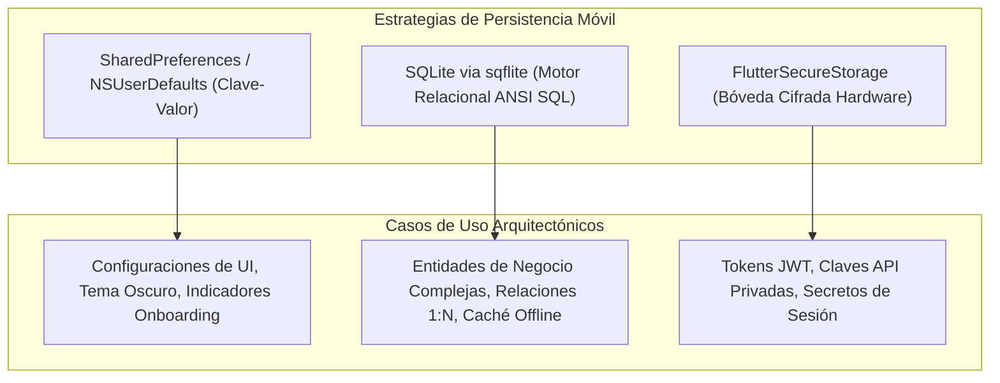
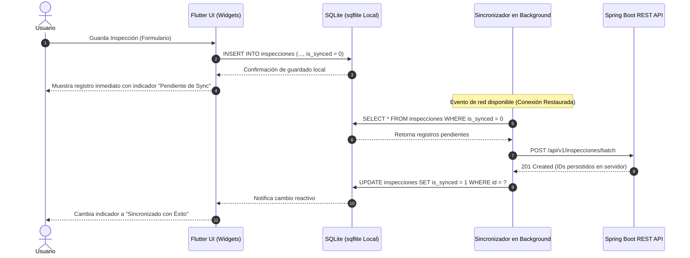

**UNIVERSIDAD DE COSTA RICA**  
**SEDE DEL ATLÁNTICO - RECINTO PARAÍSO**  
**CARRERA DE INFORMÁTICA EMPRESARIAL**  
**CURSO:** IF0009 - Desarrollo de Software IV  
**PROFESOR:** Mag. Jonathan Granados C.  
**SEMESTRE:** II-2026  

---

# Tema 5.2.4.2: Persistencia Local en Dispositivos Móviles: SQLite con `sqflite`, `SharedPreferences` y Arquitectura Offline-First

> [!NOTE]
> Este documento corresponde a la lectura teórica fundamental del **Subtema 5.2.4.2**. En esta guía usted estudiará la persistencia de datos local en el dispositivo móvil utilizando SQLite mediante la biblioteca `sqflite`, almacenamiento clave-valor con `shared_preferences`, y el diseño e implementación del patrón arquitectónico **Offline-First** para permitir el funcionamiento de aplicaciones sin conexión a Internet y su posterior sincronización bidireccional.

---

## 1. Resumen Ejecutivo

Una de las deficiencias más notorias en aplicaciones móviles es la dependencia absoluta de una conexión ininterrumpida a Internet. En escenarios empresariales de campo —como logística, inspecciones técnicas o telemedicina— el personal suele encontrarse en zonas geográficas con cobertura deficiente o nula. En este módulo, usted aprenderá a implementar una arquitectura **Offline-First**, donde el motor local relacional SQLite actúa como la única fuente de verdad inmediata para la interfaz gráfica, desacoplando la interacción del usuario de la disponibilidad del servidor y gestionando colas de sincronización resilientes hacia el backend Spring Boot.

---

## 2. Concepto Principal (El "Qué"): Almacenamiento Local y Arquitectura Offline-First

El desarrollo móvil distingue dos niveles fundamentales de persistencia en disco:



### 2.1 Almacenamiento Clave-Valor (`shared_preferences`)
Adecuado para tipos primitivos (`int`, `double`, `bool`, `String`, `List<String>`). No debe utilizarse para almacenar catálogos ni tablas de datos de negocio, ya que carece de soporte para transacciones ACID, índices y consultas complejas.

### 2.2 Motor Relacional Embebido (`sqflite`)
`sqflite` es el plugin oficial comunitario que expone las capacidades nativas de SQLite en Android e iOS. Proporciona:
* Transacciones ACID completas (`db.transaction`).
* Creación estructurada de tablas e índices mediante sentencias DDL.
* Control de versiones de esquema y scripts automáticos de migración (`onUpgrade`).
* Consultas fuertemente tipadas y soporte para sintaxis SQL pura o helpers estructurados (`query`, `insert`, `update`, `delete`).

### 2.3 Patrón Arquitectónico Offline-First
En una arquitectura reactiva Offline-First:
1. **La UI lee siempre de SQLite:** La interfaz de usuario nunca espera una respuesta HTTP para renderizar un dato; se suscribe o consulta la base de datos local.
2. **Las escrituras se guardan localmente:** Cuando el usuario crea o edita un registro, se inserta en SQLite con una bandera de estado (ej. `is_synced = 0`).
3. **Sincronización en segundo plano:** Un servicio monitoriza la conectividad. Al detectar red, envía los registros pendientes al backend Spring Boot.
4. **Confirmación del Servidor:** Al recibir el código `200/201` del backend con el ID persistido definitivo, el registro local actualiza su bandera a `is_synced = 1`.



---

## 3. Analogía Didáctica (La Intuición)

Piense en la arquitectura **Offline-First** como una libreta de recibos física de un cartero rural:
* Si el cartero necesitara llamar por teléfono a la central de correos antes de entregar cada paquete, y se queda sin cobertura en una montaña, su trabajo se paralizaría por completo.
* En su lugar, el cartero anota la entrega y la firma en su libreta local (**SQLite**). El paquete se entrega inmediatamente.
* Al final de la tarde, cuando el cartero regresa a la oficina o ingresa a una zona con cobertura celular (**Restauración de Red**), sincroniza todas las hojas acumuladas en el sistema central de la empresa (**Backend Spring Boot**).

---

## 4. Implementación Técnica (El "Cómo"): Código Completo y Funcional

### 4.1 Declaración de Dependencias (`pubspec.yaml`)

```yaml
dependencies:
  flutter:
    sdk: flutter
  sqflite: ^2.3.3+1
  path: ^1.9.0
  shared_preferences: ^2.2.3
```

### 4.2 Helper de Base de Datos SQLite Singleton

```dart
// lib/data/database_helper.dart
import 'package:sqflite/sqflite.dart';
import 'package:path/path.dart';

class DatabaseHelper {
  static final DatabaseHelper instance = DatabaseHelper._init();
  static Database? _database;

  DatabaseHelper._init();

  Future<Database> get database async {
    if (_database != null) return _database!;
    _database = await _initDB('fieldtech_local.db');
    return _database!;
  }

  Future<Database> _initDB(String filePath) async {
    final dbPath = await getDatabasesPath();
    final path = join(dbPath, filePath);

    return await openDatabase(
      path,
      version: 1,
      onCreate: _createDB,
    );
  }

  Future<void> _createDB(Database db, int version) async {
    await db.execute('''
      CREATE TABLE incidencias (
        id INTEGER PRIMARY KEY AUTOINCREMENT,
        titulo TEXT NOT NULL,
        descripcion TEXT NOT NULL,
        latitud REAL NOT NULL,
        longitud REAL NOT NULL,
        fecha_registro TEXT NOT NULL,
        is_synced INTEGER NOT NULL DEFAULT 0
      )
    ''');
  }

  Future<int> insertarIncidencia(Map<String, dynamic> row) async {
    final db = await instance.database;
    return await db.insert('incidencias', row);
  }

  Future<List<Map<String, dynamic>>> obtenerNoSincronizadas() async {
    final db = await instance.database;
    return await db.query(
      'incidencias',
      where: 'is_synced = ?',
      whereArgs: [0],
    );
  }

  Future<int> marcarComoSincronizado(int id) async {
    final db = await instance.database;
    return await db.update(
      'incidencias',
      {'is_synced': 1},
      where: 'id = ?',
      whereArgs: [id],
    );
  }

  Future<void> close() async {
    final db = await instance.database;
    db.close();
  }
}
```

### 4.3 Servicio de Sincronización en Segundo Plano

```dart
// lib/services/sync_service.dart
import 'dart:convert';
import 'package:http/http.dart' as http;
import '../data/database_helper.dart';

class SyncService {
  final DatabaseHelper dbHelper;
  final String backendUrl;
  final http.Client client;

  SyncService({
    required this.backendUrl,
    DatabaseHelper? dbHelper,
    http.Client? client,
  })  : dbHelper = dbHelper ?? DatabaseHelper.instance,
        client = client ?? http.Client();

  Future<int> sincronizarPendientes(String token) async {
    final pendientes = await dbHelper.obtenerNoSincronizadas();
    if (pendientes.isEmpty) return 0;

    int totalSincronizadas = 0;

    for (final row in pendientes) {
      final int localId = row['id'] as int;
      final payload = {
        'titulo': row['titulo'],
        'descripcion': row['descripcion'],
        'latitud': row['latitud'],
        'longitud': row['longitud'],
      };

      try {
        final response = await client.post(
          Uri.parse('$backendUrl/api/v1/incidencias'),
          headers: {
            'Content-Type': 'application/json',
            'Authorization': 'Bearer $token',
          },
          body: jsonEncode(payload),
        );

        if (response.statusCode == 200 || response.statusCode == 201) {
          await dbHelper.marcarComoSincronizado(localId);
          totalSincronizadas++;
        }
      } catch (e) {
        // En caso de corte de red en el bucle, se detiene para reintentar luego
        break;
      }
    }
    return totalSincronizadas;
  }
}
```

---

## 5. Análisis Línea por Línea de la Implementación

1. **`DatabaseHelper._init()` y Singleton:** Asegura que exista una única instancia y un único pool de conexiones abierto hacia el archivo SQLite, evitando bloqueos de archivo por escrituras concurrentes (`DatabaseLockedException`).
2. **`is_synced INTEGER NOT NULL DEFAULT 0`:** Dado que SQLite no posee un tipo booleano nativo, se adopta la convención ANSI SQL de representar booleanos mediante valores enteros `0` (*false*) y `1` (*true*).
3. **`openDatabase(path, version: 1, onCreate: _createDB)`:** Gestiona de forma automática la creación inicial del esquema y delega la ejecución de scripts al callback `_createDB`.
4. **`break` en el bloque de sincronización:** Si la red se cae a mitad del lote, el bucle se detiene ordenadamente; las ya procesadas tienen `is_synced = 1` y no se duplicarán en el próximo reintento.

---

## 6. Trampas Comunes y Errores Frecuentes

* ❌ **Olvidar cerrar transacciones o abrir múltiples instancias:** Abrir el archivo `.db` en múltiples instancias paralelas en lugar de usar un Singleton puede corromper la base de datos o lanzar errores de contención.
* ❌ **No manejar la duplicidad de registros:** Si el servidor guarda la entidad pero la respuesta HTTP `201 Created` se pierde por una microdesconexión antes de que el cliente reciba el paquete, el cliente volverá a enviar el registro en la siguiente sincronización.  
  * *Solución:* Incluya un identificador único universal generado en el cliente (**UUID / `client_uuid`**) para que el backend Spring Boot aplique idempotencia.
* ❌ **Almacenar imágenes en base de datos como campos BLOB pesados:** Guardar fotografías de alta resolución directamente en SQLite degrada la velocidad de las consultas y puede saturar los límites de memoria de los cursores de SQLite.  
  * *Solución:* Guarde la imagen en el sistema de archivos del dispositivo mediante `path_provider` y persista en SQLite únicamente la ruta de archivo local en formato `TEXT`.

---

## 7. Pregunta de Reflexión Académica

> Si dos usuarios editan el mismo registro mientras ambos operan en modo sin conexión (Offline) y luego se conectan simultáneamente a la red celular:
>
> ¿Por qué la estrategia *Last-Write-Wins* (el último que escribe sobrescribe) puede resultar inaceptable en registros contables o médicos, y qué ventajas ofrece un algoritmo de resolución basado en control de concurrencia optimista (*Optimistic Locking* con `@Version` en Spring Data JPA)?
