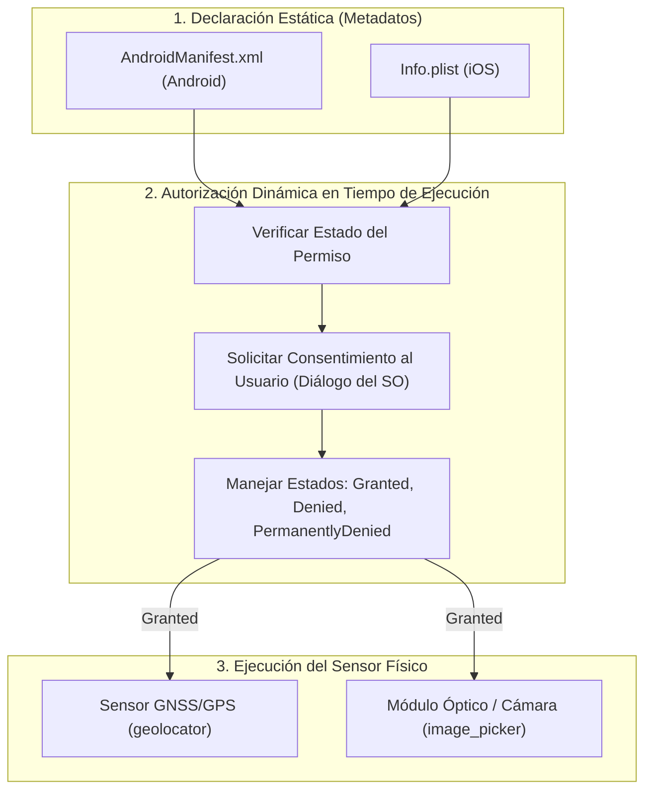

**UNIVERSIDAD DE COSTA RICA**  
**SEDE DEL ATLÁNTICO - RECINTO PARAÍSO**  
**CARRERA DE INFORMÁTICA EMPRESARIAL**  
**CURSO:** IF0009 - Desarrollo de Software IV  
**PROFESOR:** Mag. Jonathan Granados C.  
**SEMESTRE:** II-2026  

---

# Tema 5.2.4.3: Integración de Hardware Móvil: Geolocalización GPS, Cámara Fotográfica y Permisos Nativos en Android e iOS

> [!NOTE]
> Este documento corresponde a la lectura teórica fundamental del **Subtema 5.2.4.3**. En esta guía usted estudiará los mecanismos de interacción directa entre el framework Flutter y los sensores físicos del dispositivo móvil, abarcando la configuración de permisos nativos en `AndroidManifest.xml` e `Info.plist`, la geolocalización satelital de alta precisión mediante `geolocator`, la captura de evidencia fotográfica con `image_picker` y el envío de binarios al backend mediante `http.MultipartRequest`.

---

## 1. Resumen Ejecutivo

Una de las ventajas competitivas más determinantes de las aplicaciones móviles frente a los sitios web convencionales es su capacidad para interactuar de forma fluida con el hardware del teléfono. En el ámbito empresarial, capturar la posición geográfica exacta de una incidencia y adjuntar fotografías tomadas in situ constituye la base de la auditoría y la trazabilidad operativa. En este módulo, usted dominará el ciclo de vida de los permisos en tiempo de ejecución (*Runtime Permissions*), el acceso al sensor GPS y la cámara fotográfica, y la transmisión de archivos binarios hacia controladores RESTful en Spring Boot mediante el estándar multipart/form-data.

---

## 2. Concepto Principal (El "Qué"): Sensores de Hardware y Sandbox de Seguridad

Los sistemas operativos móviles modernos (Android 10+ e iOS 14+) operan bajo un estricto modelo de aislamiento (*Sandbox*). Ninguna aplicación puede acceder a los sensores físicos (antena GPS, cámara, micrófono) ni al almacenamiento privado sin cumplir dos condiciones indispensables:



### 2.1 Permisos Estáticos vs Permisos en Tiempo de Ejecución
* **Declaración Estática:** Se especifican las intenciones de la aplicación en los archivos de manifiesto de cada plataforma nativa.
* **Consentimiento Dinámico:** Desde Android 6.0 (API 23) y en todas las versiones de iOS, el usuario debe autorizar explícitamente el uso del sensor mediante un diálogo emergente nativo en el instante exacto en que la aplicación intenta utilizarlo. Si el usuario rechaza el permiso permanentemente, la aplicación no debe cerrarse abruptly (*crash*), sino guiarlo amablemente a la configuración del sistema.

### 2.2 Geolocalización Satelital (`geolocator`)
El paquete `geolocator` proporciona una API multiplataforma para interactuar con los servicios de ubicación (GPS, antenas celulares y redes Wi-Fi). Permite consultar la disponibilidad del servicio de hardware, evaluar el nivel de precisión deseado (`LocationAccuracy`) y obtener coordenadas cartográficas estándar (latitud, longitud, altitud y precisión en metros).

### 2.3 Captura Fotográfica y Almacenamiento Temporal (`image_picker`)
`image_picker` delega la captura fotográfica a la aplicación de cámara nativa del sistema operativo o permite al usuario seleccionar una imagen desde su galería. Devuelve una referencia a un archivo abstracto `XFile`, el cual reside temporalmente en el caché de la aplicación hasta que sea persistido en almacenamiento permanente o enviado mediante HTTP al servidor.

---

## 3. Analogía Didáctica (La Intuición)

Piense en los permisos de hardware como el control de acceso a una zona restringida en un aeropuerto:
* **El Manifiesto (`AndroidManifest.xml` / `Info.plist`)** es la solicitud formal previa de acceso que su empresa envía a la administración del aeropuerto (indica qué áreas planea visitar).
* **El Diálogo de Permisos en Pantalla** es el oficial de seguridad en el punto de control que le solicita su identificación biométrica en tiempo real. Aunque la empresa haya solicitado el acceso, si el oficial detecta que usted revoca el permiso, no podrá cruzar la puerta.
* **El Sensor GPS o Cámara** es la maquinaria especializada dentro de la zona restringida: solo puede encenderse cuando el oficial ha firmado y sellado su pase de acceso en ese preciso momento.

---

## 4. Configuración de Plataforma Nativa

### 4.1 Configuración para Android (`android/app/src/main/AndroidManifest.xml`)
Agregue los siguientes permisos como hijos directos de `<manifest>`:

```xml
<manifest xmlns:android="http://schemas.android.com/apk/res/android">
    <!-- Permisos de Geolocalización -->
    <uses-permission android:name="android.permission.ACCESS_FINE_LOCATION" />
    <uses-permission android:name="android.permission.ACCESS_COARSE_LOCATION" />
    
    <!-- Permisos de Cámara y Multimedia -->
    <uses-permission android:name="android.permission.CAMERA" />
    
    <application
        android:label="fieldtech_app"
        android:name="${applicationName}"
        android:icon="@mipmap/ic_launcher">
        ...
    </application>
</manifest>
```

### 4.2 Configuración para iOS (`ios/Runner/Info.plist`)
En iOS es obligatorio proporcionar una justificación clara y legible en lenguaje humano dentro del archivo `Info.plist`. Si estas cadenas de texto se omiten, **Apple rechazará de forma inmediata la aplicación en el App Store**:

```xml
<dict>
    <!-- Justificaciones de Geolocalización -->
    <key>NSLocationWhenInUseUsageDescription</key>
    <string>FieldTech requiere su ubicación para registrar las coordenadas exactas de la incidencia en campo.</string>
    
    <!-- Justificaciones de Cámara y Galería -->
    <key>NSCameraUsageDescription</key>
    <string>FieldTech requiere acceso a la cámara para capturar evidencia fotográfica del desperfecto.</string>
    <key>NSPhotoLibraryUsageDescription</key>
    <string>FieldTech requiere acceso a la galería para adjuntar imágenes tomadas previamente.</string>
</dict>
```

---

## 5. Implementación Técnica (El "Cómo"): Código Completo y Funcional

### 5.1 Declaración de Dependencias (`pubspec.yaml`)

```yaml
dependencies:
  flutter:
    sdk: flutter
  geolocator: ^12.0.0
  image_picker: ^1.1.2
  http: ^1.2.1
```

### 5.2 Servicio de Geolocalización Seguro

```dart
// lib/services/location_service.dart
import 'package:geolocator/geolocator.dart';

class LocationService {
  Future<Position> obtenerPosicionActual() async {
    bool servicioHabilitado = await Geolocator.isLocationServiceEnabled();
    if (!servicioHabilitado) {
      throw Exception(
        'Los servicios de ubicación física (GPS) están desactivados.',
      );
    }

    LocationPermission permiso = await Geolocator.checkPermission();
    if (permiso == LocationPermission.denied) {
      permiso = await Geolocator.requestPermission();
      if (permiso == LocationPermission.denied) {
        throw Exception('El usuario denegó los permisos de geolocalización.');
      }
    }

    if (permiso == LocationPermission.deniedForever) {
      throw Exception(
        'Los permisos de ubicación fueron denegados permanentemente. '
        'Active los permisos desde la configuración del teléfono.',
      );
    }

    return await Geolocator.getCurrentPosition(
      locationSettings: const LocationSettings(
        accuracy: LocationAccuracy.high,
        timeLimit: Duration(seconds: 15),
      ),
    );
  }
}
```

### 5.3 Captura Fotográfica y Envío Multipart al Backend Spring Boot

```dart
// lib/services/media_upload_service.dart
import 'dart:io';
import 'package:http/http.dart' as http;
import 'package:image_picker/image_picker.dart';

class MediaUploadService {
  final ImagePicker _picker;

  MediaUploadService({ImagePicker? picker})
      : _picker = picker ?? ImagePicker();

  Future<File?> capturarFotoEvidencia() async {
    final XFile? foto = await _picker.pickImage(
      source: ImageSource.camera,
      maxWidth: 1920,
      maxHeight: 1080,
      imageQuality: 80, // Optimización de compresión para redes móviles
    );

    if (foto == null) return null;
    return File(foto.path);
  }

  Future<bool> subirIncidenciaConFoto({
    required String backendUrl,
    required String token,
    required String titulo,
    required String descripcion,
    required double latitud,
    required double longitud,
    File? imagen,
  }) async {
    final uri = Uri.parse('$backendUrl/api/v1/incidencias/con-evidencia');
    final request = http.MultipartRequest('POST', uri);

    request.headers['Authorization'] = 'Bearer $token';

    // Campos de texto del formulario
    request.fields['titulo'] = titulo;
    request.fields['descripcion'] = descripcion;
    request.fields['latitud'] = latitud.toString();
    request.fields['longitud'] = longitud.toString();

    // Adjuntar archivo binario si existe
    if (imagen != null) {
      request.files.add(
        await http.MultipartFile.fromPath(
          'foto',
          imagen.path,
        ),
      );
    }

    final streamedResponse = await request.send();
    final response = await http.Response.fromStream(streamedResponse);

    if (response.statusCode == 200 || response.statusCode == 201) {
      return true;
    } else {
      throw Exception('Falla al subir incidencia: ${response.statusCode}');
    }
  }
}
```

---

## 6. Integración del Endpoint en el Backend Spring Boot 3

Para procesar este formulario multipart, el controlador en Spring Boot 3 se estructura de la siguiente forma:

```java
@RestController
@RequestMapping("/api/v1/incidencias")
public class IncidenciaController {

    @PostMapping(
        value = "/con-evidencia", 
        consumes = MediaType.MULTIPART_FORM_DATA_VALUE
    )
    public ResponseEntity<IncidenciaResponseDTO> registrarIncidencia(
            @RequestParam("titulo") String titulo,
            @RequestParam("descripcion") String descripcion,
            @RequestParam("latitud") Double latitud,
            @RequestParam("longitud") Double longitud,
            @RequestParam(value = "foto", required = false) MultipartFile foto
    ) {
        // Procesamiento en la capa de negocio y almacenamiento de archivo
        IncidenciaResponseDTO dto = incidenciaService.guardarConFoto(
            titulo, descripcion, latitud, longitud, foto
        );
        return ResponseEntity.status(HttpStatus.CREATED).body(dto);
    }
}
```

---

## 7. Trampas Comunes y Errores Frecuentes

* ❌ **Subir fotografías sin optimización de tamaño:** Las cámaras modernas de smartphones capturan fotos de 12 a 108 Megapíxeles (archivos de 8MB a 25MB). Subir estos archivos sin comprimir satura el ancho de banda del usuario y desborda la cuota de memoria en Spring Boot (`MaxUploadSizeExceededException`).  
  * *Solución:* Ajuste `maxWidth: 1920` e `imageQuality: 80` en `ImagePicker` para reducir el tamaño a menos de 1 MB conservando una nitidez impecable.
* ❌ **Omitir el permiso de ubicación en el Emulador de Android:** En el emulador de Android Studio, si la geolocalización no devuelve coordenadas, asegúrese de ingresar a los controles extendidos del emulador (`...` > *Location*) y presionar *Set Location* para enviar coordenadas virtuales al sensor GPS simulado.
* ❌ **No verificar `isLocationServiceEnabled()`:** Solicitar la posición sin verificar si el GPS del teléfono está encendido provoca una excepción o una espera indefinida.

---

## 8. Pregunta de Reflexión Académica

> Si un usuario revoca permanentemente el permiso de cámara en los ajustes de su teléfono tras instalar la aplicación:
>
> ¿Por qué el código en Flutter no puede forzar la aparición del diálogo del sistema operativo nuevamente mediante `requestPermission()`, y cuál es la directriz de experiencia de usuario (UX) recomendada utilizando `openAppSettings()` de `permission_handler`?
