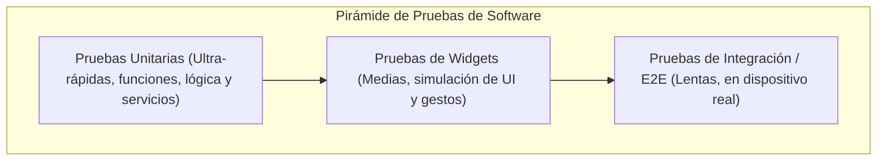

**UNIVERSIDAD DE COSTA RICA**  
**SEDE DEL ATLÁNTICO - RECINTO PARAÍSO**  
**CARRERA DE INFORMÁTICA EMPRESARIAL**  
**CURSO:** IF0009 - Desarrollo de Software IV  
**PROFESOR:** Mag. Jonathan Granados C.  
**SEMESTRE:** II-2026  

---

# Tema 5.2.5.1: Pruebas Unitarias en Flutter: Lógica de Negocio, Servicios y Simulación con Mocktail

> [!NOTE]
> Este documento corresponde a la lectura teórica fundamental del **Subtema 5.2.5.1**. En esta guía usted estudiará la pirámide de pruebas de software aplicada a aplicaciones móviles, el diseño e implementación de pruebas unitarias puras en Dart 3 utilizando el paquete `test` / `flutter_test`, el uso riguroso de aserciones y matchers, y la técnica de simulación de dependencias (*Mocking*) con `mocktail` para aislar servicios HTTP sin requerir un servidor backend activo.

---

## 1. Resumen Ejecutivo

En el ciclo de vida de desarrollo de software móvil, detectar defectos en tiempo de ejecución en los teléfonos de los usuarios finales representa un costo inasumible. Las pruebas unitarias (*Unit Tests*) se sitúan en la base de la pirámide de calidad de software: son rápidas, deterministas y aíslan minuciosamente funciones, modelos y servicios individuales. En este módulo, usted aprenderá a estructurar suites de pruebas automatizadas en Dart 3, implementar aserciones con matchers tipados y utilizar dobles de prueba (*Test Doubles*) para simular clientes de red y repositorios de datos, garantizando que su aplicación responda correctamente ante cualquier eventualidad de red o error de servidor.

---

## 2. Concepto Principal (El "Qué"): La Pirámide de Pruebas en Flutter

El ecosistema Flutter clasifica las pruebas automatizadas en tres categorías estructurales:



### 2.1 Pruebas Unitarias (Unit Testing)
Una prueba unitaria evalúa la menor unidad lógica comprobable de código (una función pura, un método de cálculo, la deserialización de un DTO o un método de servicio). Se ejecutan directamente en la máquina virtual de Dart (Dart VM) en su computadora, sin necesidad de compilar la aplicación para Android ni levantar un emulador gráfico, lo que permite ejecutar cientos de pruebas en pocos segundos.

### 2.2 Dobles de Prueba y Mocking con `mocktail`
Cuando una clase bajo prueba (por ejemplo, `IncidenciaApiService`) depende de recursos externos —como una conexión a Internet, un servidor Spring Boot o un archivo en disco—, no debemos realizar peticiones de red reales durante las pruebas unitarias. Los motivos son categóricos:
1. **Lentitud:** Las llamadas de red introducen latencia de cientos de milisegundos.
2. **Fragilidad:** Si el servidor backend está caído o la red falla, la prueba fallará aun cuando el código en Flutter sea 100% correcto.
3. **Imposibilidad de reproducir errores:** Es muy difícil forzar al servidor a que responda un error `503 Service Unavailable` o un timeout en el momento exacto de la prueba.

Para resolver esto, utilizamos **Mocking**: creamos un objeto simulado que hereda de la clase dependiente y programamos su comportamiento utilizando las directivas `when()` y `thenAnswer()`. En Dart moderno, `mocktail` ofrece una experiencia limpia con *Null Safety* sin requerir generadores de código pesados (`build_runner`).

---

## 3. Analogía Didáctica (La Intuición)

Piense en una prueba unitaria con mocking como un simulador de vuelo para pilotos:
* Si quisiéramos evaluar cómo reacciona un piloto ante una falla crítica de motor durante una tormenta, no subimos al piloto a un avión comercial real con pasajeros esperando que ocurra un rayo fortuito (**probar contra el servidor real en producción**).
* En su lugar, colocamos al piloto en una cabina simulada donde un software de control simula de forma exacta el viento y la pérdida de altitud (**el Mock**).
* De este modo, verificamos que el piloto ejecute los procedimientos correctos (**la lógica de negocio bajo prueba**) en un entorno 100% controlado, repetible y seguro.

---

## 4. Implementación Técnica (El "Cómo"): Código Completo y Funcional

### 4.1 Configuración de Dependencias (`pubspec.yaml`)
Las herramientas de prueba deben residir en la sección `dev_dependencies`:

```yaml
dev_dependencies:
  flutter_test:
    sdk: flutter
  mocktail: ^1.0.4
```

### 4.2 Código Bajo Prueba: El Servicio de Autenticación y API
Tomemos como base la clase `IncidenciaApiService` que consume `http.Client`:

```dart
// lib/services/incidencia_service.dart
import 'dart:convert';
import 'package:http/http.dart' as http;
import '../models/incidencia_dto.dart';

class IncidenciaService {
  final http.Client client;
  final String baseUrl;

  IncidenciaService({required this.client, required this.baseUrl});

  Future<IncidenciaDTO> obtenerPorId(int id) async {
    final response = await client.get(
      Uri.parse('$baseUrl/api/v1/incidencias/$id'),
      headers: {'Accept': 'application/json'},
    );

    if (response.statusCode == 200) {
      final Map<String, dynamic> json = jsonDecode(response.body);
      return IncidenciaDTO.fromJson(json);
    } else if (response.statusCode == 404) {
      throw Exception('Incidencia no encontrada (404)');
    } else {
      throw Exception('Falla del servidor: ${response.statusCode}');
    }
  }
}
```

### 4.3 Suite de Pruebas Unitarias con Mocking (`test/unit/incidencia_service_test.dart`)

```dart
// test/unit/incidencia_service_test.dart
import 'package:flutter_test/flutter_test.dart';
import 'package:http/http.dart' as http;
import 'package:mocktail/mocktail.dart';
import 'package:fieldtech_app/models/incidencia_dto.dart';
import 'package:fieldtech_app/services/incidencia_service.dart';

// 1. Declaración de la clase Mock
class MockHttpClient extends Mock implements http.Client {}

void main() {
  late MockHttpClient mockClient;
  late IncidenciaService service;
  const String testBaseUrl = 'http://test-server:8080';

  // Configuración previa a cada prueba individual
  setUp(() {
    mockClient = MockHttpClient();
    service = IncidenciaService(client: mockClient, baseUrl: testBaseUrl);
  });

  group('IncidenciaService - Pruebas de obtenerPorId', () {
    test('Debe retornar un IncidenciaDTO válido cuando el servidor responde 200 OK', () async {
      // GIVEN (Dado): Configuración del comportamiento del Mock
      const String fakeJson = '''
      {
        "id": 42,
        "titulo": "Fuga de Agua",
        "descripcion": "Tubería colapsada",
        "estado": "EN_PROCESO",
        "latitud": 9.93,
        "longitud": -84.08
      }
      ''';

      when(() => mockClient.get(
            Uri.parse('$testBaseUrl/api/v1/incidencias/42'),
            headers: any(named: 'headers'),
          )).thenAnswer(
        (_) async => http.Response(fakeJson, 200),
      );

      // WHEN (Cuando): Se ejecuta el método bajo prueba
      final resultado = await service.obtenerPorId(42);

      // THEN (Entonces): Se verifican los resultados y contratos
      expect(resultado, isA<IncidenciaDTO>());
      expect(resultado.id, equals(42));
      expect(resultado.titulo, equals('Fuga de Agua'));
      expect(resultado.latitud, closeTo(9.93, 0.001));

      // Verificar que el mock fue invocado exactamente una vez
      verify(() => mockClient.get(
            Uri.parse('$testBaseUrl/api/v1/incidencias/42'),
            headers: any(named: 'headers'),
          )).called(1);
    });

    test('Debe lanzar una Excepción cuando el servidor responde 404 Not Found', () async {
      // GIVEN: El mock responde 404
      when(() => mockClient.get(
            Uri.parse('$testBaseUrl/api/v1/incidencias/99'),
            headers: any(named: 'headers'),
          )).thenAnswer(
        (_) async => http.Response('Recurso no encontrado', 404),
      );

      // WHEN & THEN: Se espera que la llamada asíncrona lance una excepción
      expect(
        () async => await service.obtenerPorId(99),
        throwsA(
          isA<Exception>().having(
            (e) => e.toString(),
            'mensaje',
            contains('Incidencia no encontrada (404)'),
          ),
        ),
      );
    });
  });
}
```

---

## 5. Análisis Línea por Línea de la Suite de Pruebas

1. **`class MockHttpClient extends Mock implements http.Client {}`:** Genera un doble de prueba que implementa toda la interfaz de `http.Client`. Cualquier método no configurado explícitamente lanzará un error si es invocado por accidente.
2. **`setUp(() { ... })`:** Se ejecuta antes de cada bloque `test()`, asegurando que cada caso de prueba inicie con instancias limpias y sin contaminación de estado anterior (*Isolation*).
3. **`when(() => mockClient.get(...)).thenAnswer(...)`:** Define el contrato simulado. Intercepta la llamada a la URI especificada y devuelve una respuesta HTTP simulada inmediata.
4. **`verify(...).called(1)`:** Garantiza que el servicio no realizó peticiones redundantes o duplicadas hacia el cliente de red.
5. **`expect(..., throwsA(...))`:** Evalúa el comportamiento de error de métodos asíncronos verificando que se arroje la excepción esperada.

---

## 6. Trampas Comunes y Errores Frecuentes

* ❌ **Olvidar inyectar el cliente HTTP por constructor:** Si la clase `IncidenciaService` instancia internamente `final client = http.Client();` en lugar de recibirlo como parámetro en el constructor, es imposible inyectar el `MockHttpClient` durante las pruebas.  
  * *Solución:* Aplique siempre el principio de **Inversión de Dependencias (DIP)**.
* ❌ **Probar llamadas reales en pruebas unitarias:** Si una prueba requiere conexión a Internet activa para pasar, no es una prueba unitaria; es una prueba de integración frágil.
* ❌ **No registrar fallbacks en Mocktail para objetos complejos:** Al usar `any()` con tipos propios en Mocktail, debe invocar `registerFallbackValue(MiClase())` en el método `setUpAll()` para evitar excepciones de tipo.

---

## 7. Pregunta de Reflexión Académica

> Si un desarrollador argumenta que "no es necesario escribir pruebas unitarias para los DTOs porque solo son clases de datos con constructores `fromJson`":
>
> ¿Por qué un cambio imprevisto en el tipo de un atributo en la API de Spring Boot (ej. cambiar un ID de entero `Long` a cadena `UUID`) puede provocar la caída masiva de la aplicación en producción si no existe una prueba que valide la serialización ante valores nulos o esquemas inesperados?
