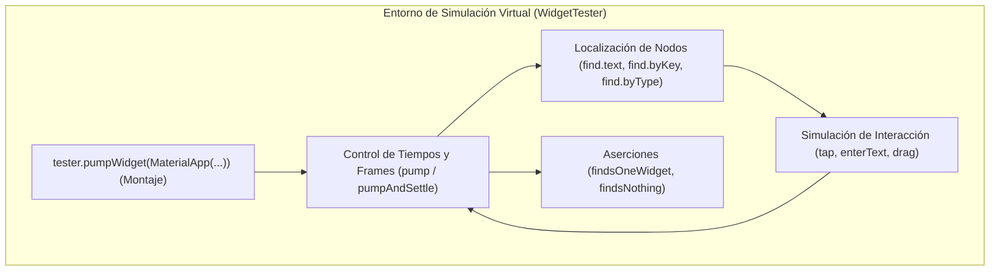

**UNIVERSIDAD DE COSTA RICA**  
**SEDE DEL ATLÁNTICO - RECINTO PARAÍSO**  
**CARRERA DE INFORMÁTICA EMPRESARIAL**  
**CURSO:** IF0009 - Desarrollo de Software IV  
**PROFESOR:** Mag. Jonathan Granados C.  
**SEMESTRE:** II-2026  

---

# Tema 5.2.5.2: Pruebas de Interfaz con Widget Testing y Reportes de Cobertura de Código en Flutter

> [!NOTE]
> Este documento corresponde a la lectura teórica fundamental del **Subtema 5.2.5.2**. En esta guía usted estudiará la simulación programática de interfaces de usuario en Flutter mediante **Widget Testing**, el control del tiempo y microtareas con `WidgetTester`, el rastreo de elementos en el árbol visual con `Finder`, la simulación de gestos táctiles (toques, ingreso de texto, desplazamiento) y la medición cuantitativa de calidad mediante reportes de **cobertura de código (Code Coverage)** en formato LCOV.

---

## 1. Resumen Ejecutivo

Una de las innovaciones más notables de la arquitectura de Flutter es que su motor gráfico (Impeller/Skia) permite renderizar y probar widgets de interfaz sin necesidad de arrancar un emulador Android pesado ni un simulador de iOS. Las pruebas de widgets (*Widget Tests*) se ejecutan de forma desacoplada y rápida en un entorno virtual (*Headless*), permitiendo verificar el comportamiento visual, la interacción táctil del usuario y las respuestas reactivas del estado local. En este módulo, usted dominará el uso de `WidgetTester`, la orquestación del ciclo de renderizado mediante `pump` y `pumpAndSettle`, la interacción con formularios y botones, y la generación automatizada de métricas de cobertura de código.

---

## 2. Concepto Principal (El "Qué"): Arquitectura de Widget Testing

A diferencia de las pruebas unitarias tradicionales —que solo interactúan con clases y memoria—, un **Widget Test** construye un entorno de renderizado completo, permitiendo examinar el árbol de widgets, el árbol de elementos y el render tree.



### 2.1 El Entorno de Prueba y `WidgetTester`
La función `testWidgets()` reemplaza a `test()`, proporcionando una instancia de `WidgetTester`. Este objeto actúa como el controlador del entorno: permite enviar eventos táctiles simulados, alterar la resolución de pantalla virtual y forzar el avance de frames gráficos.

### 2.2 El Ciclo de Vida del Renderizado: `pump()` vs `pumpAndSettle()`
En una aplicación Flutter en ejecución, el motor dibuja frames a 60 o 120 FPS de forma continua. En el entorno de prueba, **el tiempo está congelado por defecto**. El desarrollador tiene control total del avance temporal:
* **`tester.pumpWidget(Widget)`:** Infla y construye el árbol de widgets por primera vez.
* **`tester.pump(Duration)`:** Avanza el reloj de prueba en un intervalo discreto (un solo frame o una duración específica).
* **`tester.pumpAndSettle()`:** Avanza repetidamente los frames hasta que no quede ninguna animación pendiente, temporizador programado ni microtarea en la cola del Event Loop. Si una animación es infinita (ej. un `CircularProgressIndicator` activo sin detenerse), `pumpAndSettle()` lanzará un timeout.

### 2.3 Localización con Finders
Los *Finders* escanean el árbol de widgets buscando elementos que cumplan con criterios específicos:
* `find.text('Guardar')`: Localiza widgets que contengan esa cadena textual.
* `find.byKey(const Key('btn_enviar'))`: Localiza por clave explícita (la práctica más robusta y desacoplada).
* `find.byType(ElevatedButton)`: Localiza instancias de una clase de widget particular.
* `find.byIcon(Icons.camera_alt)`: Localiza iconos visuales de Material o Cupertino.

---

## 3. Analogía Didáctica (La Intuición)

Imagine el Widget Testing como una sesión de fotografía de alta velocidad en un estudio de cine con cámara lenta (*Stop-Motion*):
* La aplicación no rueda a velocidad normal en el cine (**emulador en tiempo real**).
* El director coloca a los actores en el escenario (**`pumpWidget`**).
* Para que un actor mueva el brazo o abra una puerta (**una animación o cambio de estado con `setState`**), el director mueve físicamente la escena un milímetro y toma una fotografía (**`pump()`**).
* Si el director dice "esperemos a que todos los actores terminen de sentarse y el polvo se asiente por completo", eso equivale a invocar **`pumpAndSettle()`**.
* Finalmente, el supervisor de continuidad revisa la foto para certificar que el sombrero esté en la mesa (**`expect(find.text('Confirmado'), findsOneWidget)`**).

---

## 4. Implementación Técnica (El "Cómo"): Código Completo y Funcional

### 4.1 Widget Bajo Prueba: Formulario de Registro de Incidencias

```dart
// lib/widgets/incidencia_form_widget.dart
import 'package:flutter/material.dart';

class IncidenciaFormWidget extends StatefulWidget {
  final Future<void> Function(String titulo, String descripcion) onGuardar;

  const IncidenciaFormWidget({super.key, required this.onGuardar});

  @override
  State<IncidenciaFormWidget> createState() => _IncidenciaFormWidgetState();
}

class _IncidenciaFormWidgetState extends State<IncidenciaFormWidget> {
  final _formKey = GlobalKey<FormState>();
  final _tituloController = TextEditingController();
  final _descController = TextEditingController();
  bool _guardando = false;

  Future<void> _enviar() async {
    if (_formKey.currentState!.validate()) {
      setState(() => _guardando = true);
      await widget.onGuardar(_tituloController.text, _descController.text);
      if (mounted) {
        setState(() => _guardando = false);
      }
    }
  }

  @override
  Widget build(BuildContext context) {
    return Form(
      key: _formKey,
      child: Column(
        children: [
          TextFormField(
            key: const Key('campo_titulo'),
            controller: _tituloController,
            decoration: const InputDecoration(labelText: 'Título de la Incidencia'),
            validator: (v) => (v == null || v.trim().isEmpty) ? 'El título es obligatorio' : null,
          ),
          TextFormField(
            key: const Key('campo_descripcion'),
            controller: _descController,
            decoration: const InputDecoration(labelText: 'Descripción'),
          ),
          const SizedBox(height: 16),
          if (_guardando)
            const CircularProgressIndicator(key: Key('indicador_progreso'))
          else
            ElevatedButton(
              key: const Key('boton_guardar'),
              onPressed: _enviar,
              child: const Text('Registrar Incidencia'),
            ),
        ],
      ),
    );
  }
}
```

### 4.2 Suite de Pruebas de Interfaz (`test/widget/incidencia_form_widget_test.dart`)

```dart
// test/widget/incidencia_form_widget_test.dart
import 'package:flutter/material.dart';
import 'package:flutter_test/flutter_test.dart';
import 'package:fieldtech_app/widgets/incidencia_form_widget.dart';

void main() {
  testWidgets('Debe mostrar error de validación cuando el título está vacío', (WidgetTester tester) async {
    // 1. Inflar el widget envuelto en MaterialApp y Scaffold (imprescindible para temas y texto)
    await tester.pumpWidget(
      MaterialApp(
        home: Scaffold(
          body: IncidenciaFormWidget(
            onGuardar: (_, __) async {},
          ),
        ),
      ),
    );

    // 2. Verificar estado inicial: no debe haber mensajes de error visibles
    expect(find.text('El título es obligatorio'), findsNothing);

    // 3. Simular pulsación en el botón Guardar con el campo vacío
    await tester.tap(find.byKey(const Key('boton_guardar')));

    // 4. Forzar el redibujado del frame para que la validación pinte el error
    await tester.pump();

    // 5. Comprobar que el mensaje de error de validación se renderizó en pantalla
    expect(find.text('El título es obligatorio'), findsOneWidget);
  });

  testWidgets('Debe invocar onGuardar con los datos ingresados por el usuario', (WidgetTester tester) async {
    String? tituloEnviado;
    String? descEnviada;

    await tester.pumpWidget(
      MaterialApp(
        home: Scaffold(
          body: IncidenciaFormWidget(
            onGuardar: (t, d) async {
              tituloEnviado = t;
              descEnviada = d;
            },
          ),
        ),
      ),
    );

    // Escribir texto simulado en los campos usando sus Keys
    await tester.enterText(find.byKey(const Key('campo_titulo')), 'Poste Eléctrico Caído');
    await tester.enterText(find.byKey(const Key('campo_descripcion')), 'Sector norte sin fluido');

    // Pulsar botón
    await tester.tap(find.byKey(const Key('boton_guardar')));

    // Esperar a que se completen todas las microtareas y animaciones
    await tester.pumpAndSettle();

    // Validar que el callback recibió los valores correctos
    expect(tituloEnviado, equals('Poste Eléctrico Caído'));
    expect(descEnviada, equals('Sector norte sin fluido'));
  });
}
```

---

## 5. Medición de Cobertura de Código (*Code Coverage*)

El análisis de cobertura mide el porcentaje de líneas, ramas y funciones de su código que fueron efectivamente ejecutadas por su suite de pruebas automatizadas.

### 5.1 Ejecución con Generación de Reporte LCOV
Ejecute en la raíz de su proyecto:

```bash
flutter test --coverage
```

Este comando ejecuta todas las pruebas unitarias y de widgets, generando automáticamente el archivo estandarizado `coverage/lcov.info`.

### 5.2 Visualización Local del Reporte en HTML
Para convertir el archivo LCOV a un reporte interactivo navegable, puede utilizar la herramienta `genhtml` (incluida en el paquete `lcov`):

```bash
# En terminales con lcov instalado
genhtml coverage/lcov.info -o coverage/html
```

Luego, abra `coverage/html/index.html` en su navegador para examinar línea por línea cuáles ramas lógicas (`if/else`) o excepciones no están siendo cubiertas por sus pruebas.

---

## 6. Trampas Comunes y Errores Frecuentes

* ❌ **Olvidar envolver el Widget en `MaterialApp`:** Si prueba un widget que utiliza componentes de Material (`Scaffold`, `TextField`, `ElevatedButton`) sin envolverlo en `MaterialApp(home: Scaffold(body: ...))` dentro de `pumpWidget()`, la prueba fallará con el error: `No MaterialLocalizations found` o `No Directionality widget found`.
* ❌ **Usar `pumpAndSettle()` con animaciones infinitas activas:** Si su pantalla muestra un `CircularProgressIndicator` indeterminado que nunca se apaga, `pumpAndSettle()` esperará infinitamente hasta que la prueba falle por tiempo límite agotado (*TimeoutException*).  
  * *Solución:* Use `tester.pump(const Duration(milliseconds: 500))` para avanzar un tiempo controlado en lugar de `pumpAndSettle()`.
* ❌ **Depender exclusivamente de `find.text()` en aplicaciones internacionalizadas:** Si su aplicación cambia de idioma (i18n), las pruebas basadas en texto se romperán.  
  * *Solución:* Utilice identificadores unívocos basados en `Key(const Key('nombre_unico'))`.

---

## 7. Pregunta de Reflexión Académica

> Si una empresa de desarrollo móvil reporta que su aplicación cuenta con un **95% de cobertura de código (Line Coverage)**, pero los usuarios continúan reportando fallas críticas de interfaz al girar la pantalla de vertical a horizontal o al recibir un payload con campos nulos:
>
> ¿Por qué una alta métrica cuantitativa de cobertura de líneas no equivale necesariamente a una cobertura cualitativa de casos límite (*Edge Cases*), y cuál es la importancia de diseñar pruebas orientadas al comportamiento del usuario (*Behavior-Driven*)?
