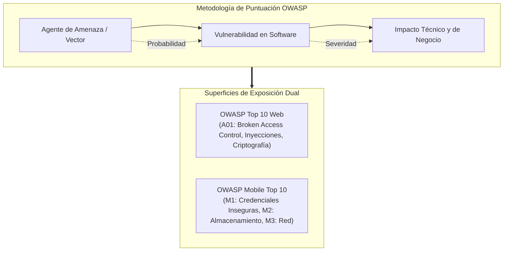

**UNIVERSIDAD DE COSTA RICA**  
**SEDE DEL ATLÁNTICO - RECINTO PARAÍSO**  
**CARRERA DE INFORMÁTICA EMPRESARIAL**  
**CURSO:** IF0009 - Desarrollo de Software IV  
**PROFESOR:** Mag. Jonathan Granados C.  
**SEMESTRE:** II-2026  

---

# Tema 6.1.1: El Estándar OWASP Top 10 (Edición Web y Ecosistema Móvil)

> [!NOTE]
> Este documento constituye la base teórica del **Subtema 6.1.1**. A lo largo de esta lección, usted estudiará la taxonomía del estándar internacional de seguridad **OWASP (Open Web Application Security Project)**, analizando la metodología de evaluación de riesgos (Probabilidad vs. Impacto), las categorías críticas del **OWASP Top 10 Web** y los vectores de ataque prevalentes en el **OWASP Mobile Top 10**.

---

## 1. Resumen Ejecutivo

La seguridad en aplicaciones modernas distribuidas no es un complemento operacional de última hora, sino una disciplina arquitectónica que debe concebirse desde el diseño (*Security by Design*). En esta lectura, usted profundizará en los marcos de referencia provistos por OWASP, comprendiendo cómo se categorizan, puntúan y priorizan las vulnerabilidades que afectan a backends empresariales y clientes móviles. Analizaremos en paralelo la superficie de ataque de aplicaciones web convencionales frente a los riesgos particulares del entorno móvil: uso indebido de credenciales, persistencia local insegura, exposición en canales de red abiertos y ejecución en dispositivos modificados (*root* / *jailbreak*).

---

## 2. Concepto Principal (El "Qué"): Metodología de Riesgos OWASP y Superficie de Ataque

El proyecto **OWASP** publica periódicamente informes basados en datos de telemetría forense provistos por empresas globales de ciberseguridad, clasificando los riesgos según su severidad técnica y prevalencia estadística.



### 2.1 La Fórmula de Estimación de Riesgos
OWASP adopta una variante adaptada del estándar de puntuación CVSS (*Common Vulnerability Scoring System*):

$$\text{Riesgo} = \text{Probabilidad (Likelihood)} \times \text{Impacto (Impact)}$$

* **Probabilidad:** Mide la facilidad de descubrimiento de la debilidad y la complejidad requerida por el atacante para explotarla exitosamente.
* **Impacto:** Cuantifica la pérdida potencial de confidencialidad, integridad, disponibilidad o perjuicio financiero y regulatorio para la organización.

### 2.2 Comparativa Crítica: Top 10 Web vs. Top 10 Móvil

A diferencia de un servidor web protegido dentro de una red privada o DMZ, las aplicaciones móviles residen en dispositivos de usuarios finales bajo control físico absoluto del atacante.

| Categoría Web (OWASP Web 2021) | Categoría Móvil (OWASP Mobile 2024) | Diferencial Arquitectónico |
| :--- | :--- | :--- |
| **A01: Broken Access Control** | **M1: Improper Credential Usage** | En web el servidor valida la sesión; en móvil los tokens suelen filtrarse en el cliente. |
| **A02: Cryptographic Failures** | **M2: Inadequate Supply Chain** | Las dependencias móviles empaquetadas en el binario (`.apk`/`.ipa`) pueden ser alteradas. |
| **A03: Injection (SQL/Command)** | **M4: Insufficient Input Validation** | Inyección a través de esquemas de URL profundos (*Deep Links*) y llamadas IPC locales. |
| **A05: Security Misconfiguration** | **M9: Insecure Data Storage** | Persistencia en SQLite no cifrado, logs en consola (`adb logcat`) y Shared Preferences. |
| **A07: Identification & Auth Failures** | **M3: Insecure Communication** | Tráfico interceptable mediante proxies en redes Wi-Fi públicas o certificados falsos. |

---

## 3. Analogía Didáctica (La Intuición)

Imagine la seguridad de software como el sistema de defensa de una entidad bancaria:
* **La Aplicación Web** es la bóveda y las ventanillas blindadas de la sede central: usted controla los guardas en la entrada (firewalls perimetrales, WAF), el acceso al mostrador (filtros de sesión y Spring Security) y los registros de las cámaras de seguridad en un cuarto cerrado (logs de auditoría).
* **La Aplicación Móvil**, en cambio, equivale a un camión blindado o una terminal de punto de venta que viaja por la vía pública: cualquier persona puede inspeccionar sus llantas, conectarle sensores clandestinos, intentar abrir su carrocería con herramientas pesadas (descompilación de binarios) o circular por caminos controlados por delincuentes (redes inalámbricas hostiles). Por ende, el vehículo debe transportar sus propios cofres blindados con claves criptográficas en hardware (**Keystore / Keychain**).

---

## 4. Implementación Técnica (El "Cómo"): Verificación Defensiva en Java 25 y Flutter 3

Para ilustrar el abordaje defensivo contra vectores combinados de OWASP (A01 Web y M9 Móvil), implementaremos:
1. Una regla de autorización en el backend Spring Boot 3 con Java 25.
2. La mitigación móvil en Flutter para almacenamiento seguro.

### 4.1 Backend Seguro en Java 25 / Spring Boot 3
En Java 25, empleamos *Pattern Matching* y tipado estricto en controladores para garantizar la pertenencia del recurso antes de autorizar el acceso:

```java
package com.ucr.seguridad.controller;

import org.springframework.security.access.prepost.PreAuthorize;
import org.springframework.security.core.Authentication;
import org.springframework.web.bind.annotation.*;
import org.springframework.http.ResponseEntity;

@RestController
@RequestMapping("/api/v1/expedientes")
public class ExpedienteController {

    private final ExpedienteService expedienteService;

    public ExpedienteController(ExpedienteService expedienteService) {
        this.expedienteService = expedienteService;
    }

    // Mitigación de Broken Access Control (OWASP A01):
    // Garantiza que el usuario autenticado solo consulte su propio ID
    @GetMapping("/{id}")
    @PreAuthorize("hasRole('ADMIN') or #id == authentication.principal.id")
    public ResponseEntity<ExpedienteDTO> obtenerExpediente(
            @PathVariable Long id, 
            Authentication authentication) {
        
        ExpedienteDTO expediente = expedienteService.buscarPorId(id);
        return ResponseEntity.ok(expediente);
    }
}
```

**Análisis línea por línea:**
* **Línea 17:** La anotación `@PreAuthorize` evalúa expresiones SpEL (*Spring Expression Language*) antes de invocar el método.
* **Línea 18:** `#id == authentication.principal.id` comprueba formalmente que el identificador enviado en la URL coincida con el identificador inmutable verificado dentro del token criptográfico del usuario.
* Si un usuario malintencionado intenta solicitar el expediente de otro cambiando el número de ID (ataque IDOR), el contenedor de Spring Security intercepta la llamada arrojando un código HTTP `403 Forbidden`.

---

### 4.2 Mitigación de Almacenamiento Móvil Inseguro en Flutter 3 (Dart)
Para evitar la vulnerabilidad **M9 (Insecure Data Storage)**, nunca almacene tokens o llaves en `SharedPreferences`. Emplee `flutter_secure_storage`:

```dart
import 'package:flutter_secure_storage/flutter_secure_storage.dart';

class GestorSeguridadLocal {
  // Inicialización con opciones de hardware seguro nativo
  static const _storage = FlutterSecureStorage(
    aOptions: AndroidOptions(
      encryptedSharedPreferences: true,
      keyCipherAlgorithm: 
          KeyCipherAlgorithm.RSA_ECB_PKCS1Padding,
      storageCipherAlgorithm: 
          StorageCipherAlgorithm.AES_GCM_NoPadding,
    ),
    iOptions: IOSOptions(
      accessibility: KeychainAccessibility.first_unlock,
    ),
  );

  // Almacena credenciales bajo cifrado AES-256 en hardware
  static Future<void> guardarTokenSesion(String token) async {
    await _storage.write(
      key: 'auth_jwt_token', 
      value: token,
    );
  }

  // Recupera el token descifrándolo en tiempo de ejecución
  static Future<String?> obtenerTokenSesion() async {
    return await _storage.read(key: 'auth_jwt_token');
  }
}
```

---

## 5. Trampas Comunes y Antipatrones

*   **Confiar en el lado del cliente (*Client-Side Validation Only*):** Creer que las validaciones de formularios en Angular o Flutter son suficientes. Los atacantes pueden emitir peticiones `cURL` o Postman directamente a la API saltándose toda la interfaz gráfica.
*   **Ofuscación como único mecanismo de defensa:** Pensar que compilar con ProGuard o R8 hace invulnerable una app móvil. La ofuscación solo retrasa la ingeniería inversa; no reemplaza el cifrado ni la validación server-side.
*   **Exposición accidental en logs de depuración:** Utilizar `print()` en Dart o `System.out.println()` en Java para inspeccionar tokens o contraseñas. Estos textos quedan registrados en `logcat` o archivos de log del servidor accesibles sin privilegios.

---

## 6. Preguntas de Reflexión y Autoevaluación

1. Si una aplicación móvil utiliza HTTPS para todas sus comunicaciones, ¿por qué sigue siendo susceptible al ataque de interceptación de tráfico Man-in-the-Middle (MitM) en un dispositivo con privilegios de superusuario (*root*)?
2. ¿Cuál es la diferencia fundamental entre una falla de control de acceso vertical y una falla de control de acceso horizontal dentro del contexto del estándar OWASP A01?

