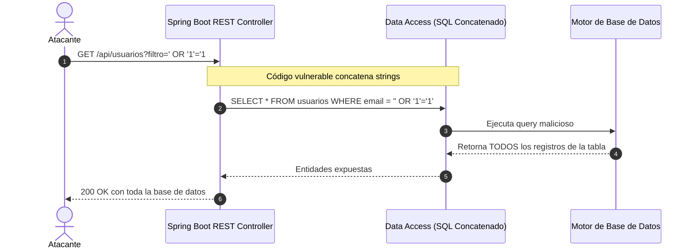

**UNIVERSIDAD DE COSTA RICA**  
**SEDE DEL ATLÁNTICO - RECINTO PARAÍSO**  
**CARRERA DE INFORMÁTICA EMPRESARIAL**  
**CURSO:** IF0009 - Desarrollo de Software IV  
**PROFESOR:** Mag. Jonathan Granados C.  
**SEMESTRE:** II-2026  

---

# Tema 6.1.2: Vectores de Inyección y Pérdida de Control de Acceso (Broken Access Control)

> [!NOTE]
> Este documento corresponde a la lectura técnica del **Subtema 6.1.2**. En esta unidad usted analizará dos de las fallas más devastadoras en el desarrollo de software: las **Inyecciones de Código (SQLi, Command Injection)** y la **Pérdida de Control de Acceso (Broken Access Control / IDOR)**, implementando su remediación rigurosa con Spring Data JPA y Spring Security 6 en **Java 25**.

---

## 1. Resumen Ejecutivo

Las fallas de inyección y de control de acceso representan la causa primordial de filtración masiva de datos y secuestro de plataformas corporativas. En esta lección, usted comprenderá la mecánica interna mediante la cual un atacante altera la semántica de una consulta de base de datos a través de cadenas no sanitizadas. Asimismo, desglosaremos la evasión de privilegios tanto horizontal (acceso a recursos de usuarios pares) como vertical (escalamiento a privilegios administrativos). Finalmente, implementaremos patrones defensivos modernos basados en consultas parametrizadas, repositorios tipados en Spring Data y validación de contexto de seguridad a nivel de métodos de servicio.

---

## 2. Concepto Principal (El "Qué"): Mecánica de Explotación y Mitigación

### 2.1 Anatomía de la Inyección SQL (SQLi)
La inyección ocurre cuando datos suministrados por el cliente son interpretados como instrucciones del lenguaje por el intérprete del motor SQL. Esto viola el principio fundamental de separación entre **código** y **datos**.



### 2.2 Pérdida de Control de Acceso e IDOR
El control de acceso asegura que los usuarios solo ejecuten acciones autorizadas dentro de sus privilegios asignados:
* **Escalamiento Vertical:** Un usuario con rol `ROLE_ESTUDIANTE` accede a endpoints protegidos de `ROLE_PROFESOR` o `ROLE_ADMIN` porque el backend no verifica la autoridad antes de despachar la petición.
* **Escalamiento Horizontal (IDOR):** Un usuario legítimo modifica el identificador numérico de un recurso en la URL (`/api/facturas/1042` a `/api/facturas/1043`) accediendo a la factura confidencial de otro cliente. El sistema comprueba que esté autenticado, pero omite validar si es el **dueño legítimo** de la factura solicitada.

---

## 3. Analogía Didáctica (La Intuición)

* **Inyección SQL:** Piense en una orden médica para la farmacia. Si el médico escribe en una receta en blanco: *"Entregar medicamento a [Nombre del Paciente]"* y un paciente malicioso escribe: *"Juan Pérez y además entregar todos los antibióticos de la bodega central"*, y el farmacéutico obedece ciegamente el texto completo sin verificar qué parte era el nombre y qué parte era la orden, se produce una inyección. La **parametrización** equivale a un formulario prediseñado con casillas estrictas donde lo escrito en el campo "Nombre" solo puede interpretarse como un nombre propio, jamás como una instrucción médica.
* **IDOR:** Imagine el casillero de llaves de un hotel donde el recepcionista entrega la llave de cualquier habitación a cualquiera que simplemente diga el número en voz alta, sin pedir identificación ni verificar en el sistema si esa persona se hospeda en ese cuarto.

---

## 4. Implementación Técnica (El "Cómo"): Remediación en Java 25 / Spring Boot 3

### 4.1 Código Vulnerable vs. Código Defensivo (Spring Data JPA)

Observe primero el antipatrón peligroso con concatenación dinámica:

```java
// ANTIPATRÓN: Vulnerable a SQL Injection
@Repository
public class UsuarioDaoVulnerable {
    @PersistenceContext
    private EntityManager entityManager;

    public List<Usuario> buscarPorEmailInseguro(String email) {
        String query = "SELECT u FROM Usuario u WHERE u.email = '" 
                     + email + "'";
        return entityManager.createQuery(query, Usuario.class)
                            .getResultList();
    }
}
```

Ahora observe la implementación robusta mediante consultas derivadas y parametrizadas en **Spring Data JPA**:

```java
package com.ucr.seguridad.data;

import com.ucr.seguridad.domain.Usuario;
import org.springframework.data.jpa.repository.JpaRepository;
import org.springframework.data.jpa.repository.Query;
import org.springframework.data.repository.query.Param;
import org.springframework.stereotype.Repository;
import java.util.Optional;

@Repository
public interface UsuarioRepository extends JpaRepository<Usuario, Long> {

    // 1. Consulta derivada segura (Spring Data parametrizará internamente)
    Optional<Usuario> findByEmail(String email);

    // 2. Consulta JPQL segura con parámetro nombrado formal
    @Query("SELECT u FROM Usuario u WHERE u.email = :email")
    Optional<Usuario> buscarPorEmailSeguro(@Param("email") String email);
}
```

### 4.2 Mitigación de IDOR y Escalamiento Horizontal en la Capa de Negocio

En la capa de servicio (`business`), implementamos la comprobación contextual utilizando la información del usuario autenticado:

```java
package com.ucr.seguridad.business;

import com.ucr.seguridad.data.ExpedienteRepository;
import com.ucr.seguridad.domain.Expediente;
import org.springframework.security.access.AccessDeniedException;
import org.springframework.security.core.context.SecurityContextHolder;
import org.springframework.stereotype.Service;
import org.springframework.transaction.annotation.Transactional;

@Service
public class ExpedienteServiceImpl implements ExpedienteService {

    private final ExpedienteRepository expedienteRepository;

    public ExpedienteServiceImpl(ExpedienteRepository repository) {
        this.expedienteRepository = repository;
    }

    @Override
    @Transactional(readOnly = true)
    public Expediente consultarExpedienteSeguro(Long idExpediente) {
        Expediente expediente = expedienteRepository.findById(idExpediente)
            .orElseThrow(() -> new RecursoNoEncontradoException(
                "El expediente solicitado no existe."));

        String usuarioEnSesion = SecurityContextHolder.getContext()
            .getAuthentication()
            .getName();

        // Verificación contextual estricta de propiedad (Anti-IDOR):
        boolean esPropietario = expediente.getCreadoPor()
                                          .equals(usuarioEnSesion);
        
        boolean esAdministrador = SecurityContextHolder.getContext()
            .getAuthentication()
            .getAuthorities()
            .stream()
            .anyMatch(a -> a.getAuthority().equals("ROLE_ADMIN"));

        if (!esPropietario && !esAdministrador) {
            throw new AccessDeniedException(
                "Violación de seguridad: No posee autorización " +
                "para visualizar este expediente confidencial.");
        }

        return expediente;
    }
}
```

**Análisis técnico del flujo:**
* **`SecurityContextHolder`:** Extrae la identidad inmutable validada previamente por los filtros de seguridad.
* **Regla Contextual:** No basta con saber que el usuario está autenticado; se verifica formalmente la relación entre el recurso solicitado (`expediente.getCreadoPor()`) y el actor en sesión (`usuarioEnSesion`).
* Si un usuario intenta consultar datos de un tercero, el sistema aborta de inmediato con una excepción controlada `AccessDeniedException` que se traduce en un código HTTP `403 Forbidden`.

---

## 5. Trampas Comunes y Antipatrones

*   **Creer que los ORM eliminan automáticamente las inyecciones:** Si un desarrollador usa Hibernate o JPA pero concatena cadenas dentro de `entityManager.createNativeQuery("SELECT ... " + input)`, el sistema es tan vulnerable como si usara JDBC puro.
*   **Ofuscación de IDs numéricos como única protección:** Cambiar IDs secuenciales (`/api/pedidos/100`) por UUIDs (`/api/pedidos/a8f5b3...`) dificulta la enumeración automática, pero **no** soluciona el IDOR: si un usuario descubre o intercepta el UUID de otro, podrá acceder si no hay validación de pertenencia.
*   **Omitir validaciones en peticiones DELETE o PUT:** Proteger únicamente las peticiones de consulta `GET`, permitiendo que peticiones `DELETE /api/cuentas/{id}` modifiquen registros sin validar pertenencia.

---

## 6. Preguntas de Reflexión y Autoevaluación

1. ¿Por qué una consulta parametrizada con `PreparedStatement` o parámetros nombrados (`:param`) es inmune a la inyección SQL a nivel del compilador de base de datos?
2. En una arquitectura de microservicios o APIs desacopladas, ¿dónde debe ejecutarse la validación contra ataques IDOR: en el API Gateway o en la lógica de negocio del microservicio? Justifique su respuesta técnica.

