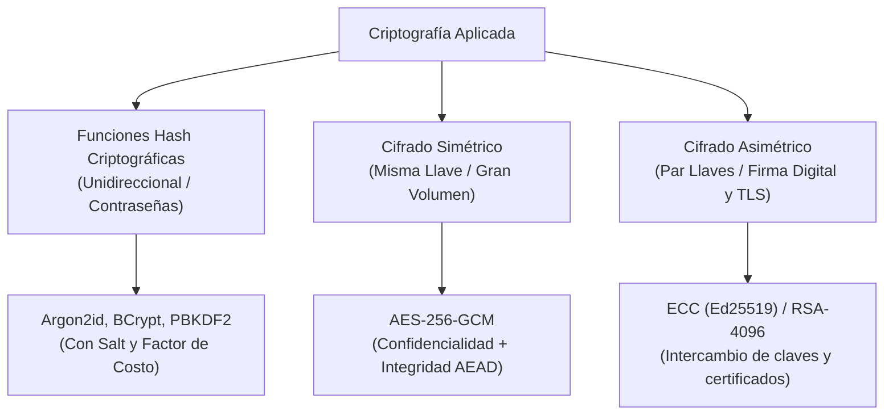

**UNIVERSIDAD DE COSTA RICA**  
**SEDE DEL ATLÁNTICO - RECINTO PARAÍSO**  
**CARRERA DE INFORMÁTICA EMPRESARIAL**  
**CURSO:** IF0009 - Desarrollo de Software IV  
**PROFESOR:** Mag. Jonathan Granados C.  
**SEMESTRE:** II-2026  

---

# Tema 6.1.3: Fallos Criptográficos y Exposición de Datos Sensibles (Cryptographic Failures)

> [!NOTE]
> Este documento contiene la fundamentación teórica del **Subtema 6.1.3**. En esta lección usted analizará la taxonomía de la criptografía aplicada al desarrollo de software, diferenciando con rigor matemático entre **funciones resumen (Hashing con Salt)**, **cifrado simétrico autenticado (AES-256-GCM)** y **cifrado asimétrico**. Además, implementaremos el resguardo de credenciales con **Argon2id / BCrypt** en Java 25 y el manejo seguro de secretos en tránsito y en reposo.

---

## 1. Resumen Ejecutivo

Los fallos criptográficos constituyen la segunda vulnerabilidad de mayor impacto en el OWASP Top 10 (anteriormente conocida como *Sensitive Data Exposure*). En esta lectura, usted aprenderá a seleccionar e implementar primitivas criptográficas robustas conforme a los estándares actuales del NIST. Examinaremos los riesgos de utilizar algoritmos matemáticamente rotos (como MD5, SHA-1 o DES), los requerimientos para proteger datos en tránsito mediante TLS 1.3 y la implementación práctica de funciones de derivación de claves diseñadas para resistir ataques de fuerza bruta asistidos por hardware GPU/ASIC.

---

## 2. Concepto Principal (El "Qué"): Las Tres Ramas de la Criptografía Moderna

En la ingeniería de software es mandatorio no confundir los tres propósitos fundamentales de las transformaciones criptográficas:



### 2.1 Tabla de Clasificación de Primitivas Criptográficas

| Tipo de Mecanismo | Algoritmos Vigentes (Seguros) | Algoritmos Obsoletos (Inseguros) | Propósito Primario |
| :--- | :--- | :--- | :--- |
| **Hash de Contraseñas** | **Argon2id**, **BCrypt** ($Cost \ge 12$), PBKDF2 | MD5, SHA-1, SHA-256 directo sin salt | Verificación irreversible de contraseñas. |
| **Cifrado Simétrico** | **AES-256-GCM**, ChaCha20-Poly1305 | DES, 3DES, AES-ECB | Confidencialidad masiva de datos en reposo. |
| **Cifrado Asimétrico** | **RSA $\ge 2048$ bits**, ECDSA, Ed25519 | RSA 512/1024 bits, Diffie-Hellman clásico | Negociación TLS, firmas y tokens JWT. |

### 2.2 ¿Por qué las contraseñas nunca deben cifrarse de forma reversible?
Cifrar una contraseña con un algoritmo simétrico implica que existe una llave secreta que permite recuperar el texto plano original. Si el atacante vulnera el servidor o el archivo de configuración, obtendrá la llave y descifrará todas las credenciales de la base de datos.
Por el contrario, las **funciones de derivación de claves basadas en memoria y tiempo (Argon2id y BCrypt)** son estrictamente **unidireccionales**:
1. Incorporan un valor aleatorio único por cada usuario denominado **Salt** (salting), neutralizando el uso de tablas precalculadas (*Rainbow Tables*).
2. Introducen un **factor de costo computable (Work Factor)** que ralentiza intencionalmente el cálculo (ej. 250 a 500 ms por verificación), haciendo inviable un ataque de fuerza bruta a gran escala.

---

## 3. Analogía Didáctica (La Intuición)

* **Función Hash con Salting (BCrypt / Argon2id):** Equivale a preparar un batido de frutas exóticas con un ingrediente secreto aleatorio. Una vez mezclado, es físicamente imposible separar los ingredientes para reconstruir la fruta original (unidireccional). Para verificar si una persona conoce la receta, se le pide que prepare otro batido con las mismas cantidades; si el sabor y color resultante coinciden exactamente, la receta es válida.
* **Cifrado Simétrico (AES-256-GCM):** Es una caja de caudales con una única llave maestra física: quien posea esa copia exacta puede abrirla para guardar o extraer documentos confidenciales.
* **Cifrado Asimétrico (RSA / Curvas Elípticas):** Es un buzón de correos con ranura exterior (clave pública): cualquier ciudadano puede depositar una carta dentro del buzón, pero únicamente el cartero con la llave de la cerradura trasera (clave privada) puede abrirlo para leer la correspondencia.

---

## 4. Implementación Técnica (El "Cómo"): Hashing con BCrypt y Argon2 en Java 25

En Spring Security 6 / Java 25, la configuración del codificador de contraseñas se desacopla mediante la interfaz `PasswordEncoder`:

### 4.1 Configuración de Beans Criptográficos en Spring Boot 3

```java
package com.ucr.seguridad.config;

import org.springframework.context.annotation.Bean;
import org.springframework.context.annotation.Configuration;
import org.springframework.security.crypto.argon2.Argon2PasswordEncoder;
import org.springframework.security.crypto.bcrypt.BCryptPasswordEncoder;
import org.springframework.security.crypto.password.PasswordEncoder;

@Configuration
public class CriptografiaConfig {

    // Configuración moderna con Argon2id (Recomendación OWASP/NIST)
    @Bean
    public PasswordEncoder passwordEncoder() {
        // Parámetros: saltLength, hashLength, parallelism, memory, iterations
        return new Argon2PasswordEncoder(
            16,     // Longitud del Salt (bytes)
            32,     // Longitud del Hash resultante (bytes)
            1,      // Hilos paralelos (paralelismo de CPU)
            65536,  // Consumo de memoria: 64 MB (resistencia a ASICs/GPUs)
            3       // Iteraciones computacionales
        );
    }
}
```

### 4.2 Servicio de Registro y Verificación en Java 25

```java
package com.ucr.seguridad.business;

import com.ucr.seguridad.data.UsuarioRepository;
import com.ucr.seguridad.domain.Usuario;
import org.springframework.security.crypto.password.PasswordEncoder;
import org.springframework.stereotype.Service;
import org.springframework.transaction.annotation.Transactional;

@Service
public class AutenticacionServiceImpl implements AutenticacionService {

    private final UsuarioRepository usuarioRepository;
    private final PasswordEncoder passwordEncoder;

    public AutenticacionServiceImpl(
            UsuarioRepository usuarioRepository, 
            PasswordEncoder passwordEncoder) {
        this.usuarioRepository = usuarioRepository;
        this.passwordEncoder = passwordEncoder;
    }

    @Transactional
    public void registrarNuevoUsuario(String email, String passwordPlano) {
        // El encoder genera automáticamente un Salt criptográfico único
        String hashProtegido = passwordEncoder.encode(passwordPlano);

        Usuario usuario = new Usuario();
        usuario.setEmail(email);
        usuario.setPasswordHash(hashProtegido);

        usuarioRepository.save(usuario);
    }

    @Transactional(readOnly = true)
    public boolean autenticar(String email, String passwordIngresado) {
        Usuario usuario = usuarioRepository.findByEmail(email)
            .orElseThrow(() -> new CredencialesInvalidasException(
                "Credenciales no válidas."));

        // Verificación segura en tiempo constante contra timing attacks
        return passwordEncoder.matches(
            passwordIngresado, 
            usuario.getPasswordHash()
        );
    }
}
```

**Puntos clave del código:**
* `passwordEncoder.encode()` genera automáticamente un salt criptográficamente seguro (usando `SecureRandom`) y lo incluye embebido en el string de salida junto con los parámetros del algoritmo.
* `passwordEncoder.matches()` no compara texto directamente con `equals()`; realiza una comparación en tiempo constante para neutralizar ataques de temporización (*Side-Channel Timing Attacks*).

---

## 5. Trampas Comunes y Antipatrones

*   **Usar SHA-256 estándar para guardar contraseñas:** Los algoritmos SHA-256 o SHA-512 están diseñados para ser extremadamente rápidos (comprobación de integridad de archivos). Una GPU moderna puede calcular más de 10.000 millones de hashes SHA-256 por segundo, facilitando ataques de diccionario en minutos.
*   **Modo de operación AES-ECB:** Usar AES en modo ECB (*Electronic Codebook*) filtra patrones visuales y repeticiones de datos (el famoso "pingüino de Tux"). Siempre debe utilizarse **AES-GCM** (*Galois/Counter Mode*) que proporciona autenticación e integridad (AEAD).
*   **Inventar algoritmos criptográficos caseros:** La regla número uno de la ingeniería de software seguro: *"Never roll your own crypto"*. Emplee siempre bibliotecas avaladas como Java Cryptography Architecture (JCA), Bouncy Castle o WebCrypto.

---

## 6. Preguntas de Reflexión y Autoevaluación

1. ¿Por qué es fundamental que la verificación de dos hashes criptográficos (`passwordEncoder.matches`) se realice en tiempo constante en lugar de comparar carácter por carácter con un bucle convencional?
2. Si un disco duro de base de datos es sustraído físicamente de un centro de datos, ¿qué tecnología previene la lectura directa de los archivos de tablas: TLS 1.3, hashing o Transparent Data Encryption (TDE)?

