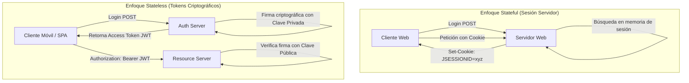

**UNIVERSIDAD DE COSTA RICA**  
**SEDE DEL ATLÁNTICO - RECINTO PARAÍSO**  
**CARRERA DE INFORMÁTICA EMPRESARIAL**  
**CURSO:** IF0009 - Desarrollo de Software IV  
**PROFESOR:** Mag. Jonathan Granados C.  
**SEMESTRE:** II-2026  

---

# Tema 6.2.1: Arquitectura de Autenticación Moderna: Sesiones Stateful vs. Tokens Stateless, MFA y Biometría

> [!NOTE]
> Este documento corresponde a la lectura teórica del **Subtema 6.2.1**. En esta guía usted estudiará los paradigmas de autenticación contemporáneos, la transición de sesiones tradicionales en memoria (*Stateful*) hacia arquitecturas desacopladas sin estado (*Stateless*), la incorporación de autenticación multifactor (**MFA/TOTP**) y el aprovechamiento de biometría en dispositivos móviles.

---

## 1. Resumen Ejecutivo

La autenticación es el proceso criptográfico y operacional mediante el cual un sistema confirma de manera inequívoca la identidad declarada por un actor. En esta lectura, usted profundizará en las ventajas y compromisos (*trade-offs*) entre mantener sesiones del lado del servidor frente a emitir credenciales criptográficas portables en aplicaciones distribuidas. Asimismo, analizaremos los vectores de autenticación multifactor (MFA), el funcionamiento del algoritmo TOTP (*Time-Based One-Time Password*) y la integración de biometría nativa con **Flutter** y **Spring Security 6** en **Java 25**.

---

## 2. Concepto Principal (El "Qué"): Paradigmas de Manejo de Identidad

### 2.1 Stateful (Basado en Sesiones) vs. Stateless (Basado en Tokens)



| Criterio | Sesiones Stateful (JSESSIONID) | Tokens Stateless (JWT) |
| :--- | :--- | :--- |
| **Almacenamiento de Estado** | En memoria del servidor o cluster Redis. | Exclusivamente en el cliente (Keystore/Storage). |
| **Escalabilidad Horizontal** | Requiere *Sticky Sessions* o replicación en caché. | Infinita: cualquier réplica valida la firma matemática. |
| **Idoneidad Móvil y SPA** | Complejo de sincronizar en clientes no-web. | Nativo: portable sobre cabeceras estándar HTTP. |
| **Revocación Inmediata** | Sencilla: se destruye la sesión en Redis. | Compleja: requiere listas de revocación o tiempos cortos. |

### 2.2 Autenticación Multifactor (MFA) y Estándar RFC 6238 (TOTP)
El estándar de la industria exige autenticar mediante al menos dos factores distintos de las tres categorías reconocidas:
1. **Algo que usted sabe:** Contraseña, PIN o clave secreta.
2. **Algo que usted tiene:** Dispositivo móvil con generador de tokens TOTP (Google Authenticator, Microsoft Authenticator) o llave física FIDO2/WebAuthn.
3. **Algo que usted es:** Huella dactilar, reconocimiento facial o biometría de iris.

El algoritmo **TOTP (RFC 6238)** deriva una clave temporal de un secreto compartido $K$ y el tiempo Unix $T$ en intervalos de 30 segundos:

$$T = \left\lfloor \frac{\text{Tiempo Actual} - T_0}{\text{Paso de Tiempo (30s)}} \right\rfloor$$

$$\text{TOTP} = \text{Truncate}(\text{HMAC-SHA1}(K, T)) \pmod{10^6}$$

---

## 3. Analogía Didáctica (La Intuición)

* **Sesión Stateful:** Piense en el guardarropa de un teatro clásico: usted entrega su abrigo (sus credenciales) y el empleado le da un ticket numerado de cartón (`JSESSIONID`). El teatro guarda su abrigo en una percha numerada en su propia bodega física (memoria del servidor). Si el teatro sufre un incendio o usted va a otra sucursal, su ticket de cartón no sirve porque el abrigo estaba guardado físicamente en ese único edificio.
* **Token Stateless (JWT):** Equivale a un pasaporte biométrico internacional emitido por el gobierno. El documento contiene su nombre, foto, fecha de vencimiento y un sello holográfico oficial (la firma digital del servidor de autenticación). Cuando usted viaja a cualquier país del mundo (cualquier microservicio o réplica), las autoridades aduaneras no necesitan llamar a su país de origen; únicamente inspeccionan el sello con luz ultravioleta (validan la clave pública) para certificar que el documento es auténtico e inalterado.

---

## 4. Implementación Técnica (El "Cómo"): Verificación TOTP en Java 25 y Biometría en Flutter

### 4.1 Generación y Validación de Códigos TOTP en Spring Boot (Java 25)

```java
package com.ucr.seguridad.business;

import org.apache.commons.codec.binary.Base32;
import org.springframework.stereotype.Service;
import javax.crypto.Mac;
import javax.crypto.spec.SecretKeySpec;
import java.nio.ByteBuffer;
import java.security.SecureRandom;

@Service
public class TotpService {

    private static final String HMAC_ALGO = "HmacSHA1";
    private static final int TIEMPO_VENTANA_SEGUNDOS = 30;

    // Genera un secreto aleatorio para asociar la app autenticadora
    public String generarSecretoBase32() {
        byte[] buffer = new byte[20];
        new SecureRandom().nextBytes(buffer);
        return new Base32().encodeToString(buffer);
    }

    // Valida si el código de 6 dígitos ingresado coincide con el tiempo
    public boolean validarCodigoTotp(String secretoBase32, int codigoIngresado) {
        long tiempoActual = System.currentTimeMillis() / 1000L;
        long ventanaTiempo = tiempoActual / TIEMPO_VENTANA_SEGUNDOS;

        // Comprobamos la ventana actual y una adyacente para mitigar desfases
        for (int i = -1; i <= 1; i++) {
            if (calcularTotp(secretoBase32, ventanaTiempo + i) == codigoIngresado) {
                return true;
            }
        }
        return false;
    }

    private int calcularTotp(String secretoBase32, long pasoTiempo) {
        try {
            byte[] key = new Base32().decode(secretoBase32);
            byte[] data = ByteBuffer.allocate(8).putLong(pasoTiempo).array();

            Mac mac = Mac.getInstance(HMAC_ALGO);
            mac.init(new SecretKeySpec(key, HMAC_ALGO));
            byte[] hash = mac.doFinal(data);

            // Dynamic Truncation según RFC 4226 / 6238
            int offset = hash[hash.length - 1] & 0xF;
            int binario = ((hash[offset] & 0x7F) << 24)
                        | ((hash[offset + 1] & 0xFF) << 16)
                        | ((hash[offset + 2] & 0xFF) << 8)
                        | (hash[offset + 3] & 0xFF);

            return binario % 1_000_000;
        } catch (Exception e) {
            throw new RuntimeException("Error calculando hash TOTP", e);
        }
    }
}
```

---

### 4.2 Integración Biométrica en Flutter 3 (`local_auth`)

En clientes móviles, la biometría desbloquea el acceso a las credenciales guardadas en el Keystore local:

```dart
import 'package:local_auth/local_auth.dart';

class ServicioBiometria {
  static final LocalAuthentication _auth = LocalAuthentication();

  // Verifica compatibilidad del hardware (huella o Face ID)
  static Future<bool> puedeAutenticarBiometricamente() async {
    final bool puedeComprobar = await _auth.canCheckBiometrics;
    final bool esDispositivoCompatible = await _auth.isDeviceSupported();
    return puedeComprobar && esDispositivoCompatible;
  }

  // Despliega el diálogo biométrico oficial del sistema operativo
  static Future<bool> solicitarAutenticacionBiometrica() async {
    try {
      return await _auth.authenticate(
        localizedReason: 'Por favor, autentíquese para acceder a su cuenta',
        options: const AuthenticationOptions(
          stickyAuth: true,
          biometricOnly: true,
        ),
      );
    } catch (e) {
      // Captura excepciones de hardware no disponible o cancelaciones
      return false;
    }
  }
}
```

---

## 5. Trampas Comunes y Antipatrones

*   **Usar biometría como sustituto del backend:** Creer que si `local_auth` retorna `true`, el usuario ya está autenticado ante la API. La biometría en el móvil solo debe utilizarse para desbloquear el token JWT criptográfico almacenado localmente en el Keystore.
*   **No contemplar el desfase de reloj (*Clock Drift*):** Rechazar códigos TOTP válidos porque el reloj del smartphone del usuario tiene 15 segundos de diferencia respecto al servidor. Siempre se debe validar una ventana previa y posterior ($[-1, +1]$).
*   **Almacenar secretos TOTP en texto plano:** Guardar la clave Base32 del usuario en la base de datos sin cifrado. Si la base de datos se filtra, los atacantes podrán generar códigos TOTP a discreción.

---

## 6. Preguntas de Reflexión y Autoevaluación

1. En una arquitectura orientada a microservicios con 10 réplicas elásticas, ¿cuál es el costo operativo y de infraestructura de implementar sesiones *Stateful* frente a tokens *Stateless*?
2. ¿Por qué el envío de códigos SMS de un solo uso es catalogado actualmente por el NIST como una práctica de MFA desaconsejada (*Restricted*) frente a generadores TOTP o llaves FIDO2?

