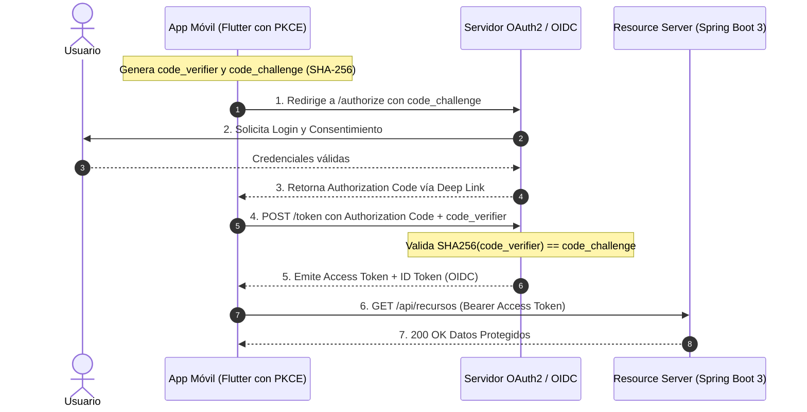

**UNIVERSIDAD DE COSTA RICA**  
**SEDE DEL ATLÁNTICO - RECINTO PARAÍSO**  
**CARRERA DE INFORMÁTICA EMPRESARIAL**  
**CURSO:** IF0009 - Desarrollo de Software IV  
**PROFESOR:** Mag. Jonathan Granados C.  
**SEMESTRE:** II-2026  

---

# Tema 6.2.2: Protocolos Estándar de Delegación e Identidad: OAuth 2.0, OpenID Connect (OIDC) y Flujo PKCE

> [!NOTE]
> Este documento corresponde a la lectura técnica del **Subtema 6.2.2**. En esta unidad usted analizará los estándares abiertos de autorización delegada e identidad digital federada: el marco de referencia **OAuth 2.0 (RFC 6749)** y la capa de identidad **OpenID Connect (OIDC)**. Profundizaremos en el flujo mandatorio para clientes móviles y aplicaciones SPA: el **Authorization Code Flow con PKCE (RFC 7636)**.

---

## 1. Resumen Ejecutivo

En sistemas empresariales modernos, las aplicaciones cliente (Flutter, Angular) no deben almacenar ni solicitar directamente las credenciales de usuario del servidor corporativo. En su lugar, se emplean protocolos de delegación de autorización federada. En esta lectura, usted aprenderá a diferenciar las responsabilidades de los cuatro roles definidos en OAuth 2.0, el propósito del `id_token` frente al `access_token` en OIDC, y la mecánica criptográfica del desafío de clave **PKCE (*Proof Key for Code Exchange*)**, la cual neutraliza ataques de interceptación del código de autorización en entornos móviles y de navegador.

---

## 2. Concepto Principal (El "Qué"): Los 4 Roles y el Flujo PKCE

### 2.1 Los Cuatro Roles de OAuth 2.0 (RFC 6749)
1. **Resource Owner (Propietario del Recurso):** El usuario final con capacidad de conceder acceso a su información protegida.
2. **Client (Cliente):** La aplicación web (Angular) o móvil (Flutter) que solicita acceso a los datos en nombre del usuario.
3. **Authorization Server (Servidor de Autorización):** El servidor que autentica al usuario, solicita su consentimiento y emite tokens criptográficos (ej. Keycloak, Okta, Auth0, Spring Authorization Server).
4. **Resource Server (Servidor de Recursos):** La API RESTful (Spring Boot 3 en Java 25) que almacena los datos protegidos y valida los tokens de acceso recibidos en la cabecera `Authorization`.



### 2.2 ¿Por qué el Implicit Flow fue deprecado y reemplazado por PKCE?
Históricamente, las aplicaciones SPA y móviles utilizaban el *Implicit Grant*, el cual devolvía el token de acceso directamente en el fragmento de la URL (`#access_token=...`). Este flujo quedó formalmente prohibido por el estándar de seguridad de OAuth por múltiples vulnerabilidades:
* El token quedaba expuesto en el historial del navegador, logs de proxies y referrers.
* En móviles, aplicaciones maliciosas podían registrar el mismo esquema de URL (*Custom URL Scheme*) para robar el token entrante.

**La solución: PKCE (RFC 7636)**
1. El cliente genera un secreto criptográfico aleatorio denominado `code_verifier`.
2. Calcula su resumen SHA-256 codificado en Base64-URL: $\text{code\_challenge} = \text{BASE64URL}(\text{SHA-256}(\text{code\_verifier}))$.
3. Envía únicamente el `code_challenge` en la petición de autorización inicial.
4. Al recibir el código temporal, lo intercambia enviando el `code_verifier` original a través de un canal TLS directo. El servidor comprueba matemáticamente la correspondencia antes de entregar el token.

### 2.3 OpenID Connect (OIDC): `id_token` vs. `access_token`
* **Access Token (OAuth 2.0):** Diseñado exclusivamente para el **Resource Server** (API). Otorga permisos de acceso (*scopes* como `read:perfil`, `write:documentos`). El cliente debe tratarlo como una cadena opaca.
* **ID Token (OIDC):** Diseñado exclusivamente para el **Client** (App móvil o frontend). Es un JWT firmado que contiene la información de perfil del usuario (`sub`, `name`, `email`, `iat`, `exp`), permitiendo que el cliente renderice la interfaz personalizada sin hacer peticiones adicionales.

---

## 3. Analogía Didáctica (La Intuición)

* **OAuth 2.0 (Delegación de Autorización):** Imagine que usted (Resource Owner) se hospeda en un hotel de lujo y contrata a un servicio de paseador de perros (Client). Usted no le entrega la llave maestra de su casa al paseador; usted va a la administración del edificio (Authorization Server) y solicita una tarjeta magnética temporal que solo abre la puerta del vestíbulo entre las 2:00 PM y las 3:00 PM (Access Token con scope limitado). El paseador presenta esa tarjeta en la cerradura del edificio (Resource Server) para cumplir su labor.
* **PKCE:** Equivale a acordar una contraseña secreta de un solo uso con el administrador antes de enviar a su mensajero: si un tercero intercepta el papel con la cita, no podrá retirar la tarjeta porque el administrador le exigirá recitar la clave secreta que solo usted y el mensajero conocen.

---

## 4. Implementación Técnica (El "Cómo"): Verificación en Spring Boot 3 (Java 25) y Flutter 3

### 4.1 Configuración de Resource Server con Validación JWT en Spring Boot 3

```java
package com.ucr.seguridad.config;

import org.springframework.context.annotation.Bean;
import org.springframework.context.annotation.Configuration;
import org.springframework.security.config.annotation.method.configuration.EnableMethodSecurity;
import org.springframework.security.config.annotation.web.builders.HttpSecurity;
import org.springframework.security.config.annotation.web.configuration.EnableWebSecurity;
import org.springframework.security.config.http.SessionCreationPolicy;
import org.springframework.security.oauth2.server.resource.authentication.JwtAuthenticationConverter;
import org.springframework.security.oauth2.server.resource.authentication.JwtGrantedAuthoritiesConverter;
import org.springframework.security.web.SecurityFilterChain;

@Configuration
@EnableWebSecurity
@EnableMethodSecurity
public class ResourceServerSecurityConfig {

    @Bean
    public SecurityFilterChain securityFilterChain(HttpSecurity http) 
            throws Exception {
        http
            .csrf(csrf -> csrf.disable())
            .sessionManagement(session -> 
                session.sessionCreationPolicy(SessionCreationPolicy.STATELESS))
            .authorizeHttpRequests(auth -> auth
                .requestMatchers("/api/v1/publico/**").permitAll()
                .anyRequest().authenticated()
            )
            .oauth2ResourceServer(oauth2 -> oauth2
                .jwt(jwt -> jwt.jwtAuthenticationConverter(
                    jwtAuthenticationConverter()))
            );

        return http.build();
    }

    // Mapea los roles del token JWT a autoridades de Spring Security
    @Bean
    public JwtAuthenticationConverter jwtAuthenticationConverter() {
        JwtGrantedAuthoritiesConverter grantedAuthoritiesConverter = 
            new JwtGrantedAuthoritiesConverter();
        grantedAuthoritiesConverter.setAuthoritiesClaimName("roles");
        grantedAuthoritiesConverter.setAuthorityPrefix("ROLE_");

        JwtAuthenticationConverter jwtConverter = 
            new JwtAuthenticationConverter();
        jwtConverter.setJwtGrantedAuthoritiesConverter(
            grantedAuthoritiesConverter);
        return jwtConverter;
    }
}
```

### 4.2 Generación de Parámetros PKCE en Flutter 3 (Dart)

```dart
import 'dart:convert';
import 'dart:math';
import 'package:crypto/crypto.dart';

class GeneradorPKCE {
  // Genera un verificador criptográfico de alta entropía (43-128 chars)
  static String generarCodeVerifier() {
    final Random random = Random.secure();
    final List<int> values = List<int>.generate(32, (i) => random.nextInt(256));
    return base64UrlEncode(values).replaceAll('=', '');
  }

  // Deriva el desafío code_challenge mediante SHA-256 en Base64-URL
  static String derivarCodeChallenge(String verifier) {
    final List<int> bytes = utf8.encode(verifier);
    final Digest digest = sha256.convert(bytes);
    return base64UrlEncode(digest.bytes).replaceAll('=', '');
  }
}
```

---

## 5. Trampas Comunes y Antipatrones

*   **Almacenar el `client_secret` en clientes públicos:** Incrustar una clave secreta de cliente en el código de Angular o en el binario de Flutter. Cualquier usuario puede extraer el secreto desensamblando el archivo `.apk` o abriendo las DevTools del navegador. Los clientes públicos por definición **no deben tener `client_secret`**; deben emplear PKCE.
*   **Inspeccionar el `access_token` en el cliente para obtener datos del usuario:** El token de acceso puede ser opaco (una cadena aleatoria) si el Authorization Server así lo define. Para consultar el perfil del usuario, el cliente debe leer el `id_token` o consultar el endpoint `/userinfo` de OIDC.
*   **Omitir el parámetro `state`:** No enviar un valor criptográfico aleatorio en el parámetro `state` en la URL de autorización, exponiendo al cliente a ataques de Login CSRF.

---

## 6. Preguntas de Reflexión y Autoevaluación

1. ¿Por qué el uso de PKCE (*Proof Key for Code Exchange*) elimina la necesidad de contar con un `client_secret` en aplicaciones móviles nativas?
2. Si un atacante intercepta en la red el `code_challenge` enviado en el paso 1 del flujo de autorización, ¿por qué no puede utilizarlo para canjear el token de acceso?

