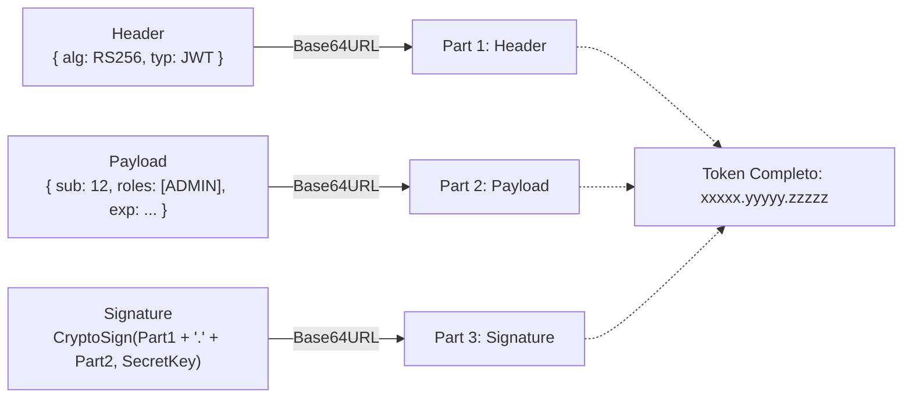
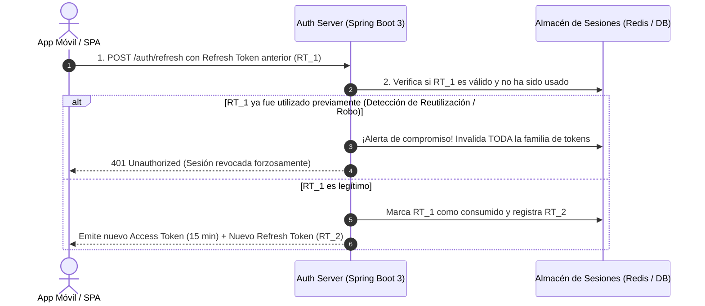

**UNIVERSIDAD DE COSTA RICA**  
**SEDE DEL ATLÁNTICO - RECINTO PARAÍSO**  
**CARRERA DE INFORMÁTICA EMPRESARIAL**  
**CURSO:** IF0009 - Desarrollo de Software IV  
**PROFESOR:** Mag. Jonathan Granados C.  
**SEMESTRE:** II-2026  

---

# Tema 6.2.3: Endurecimiento de JSON Web Tokens (JWT Hardening): Anatomía, Vectores de Explotación y Rotación de Refresh Tokens

> [!NOTE]
> Este documento contiene la fundamentación técnica del **Subtema 6.2.3**. En esta lectura usted estudiará en profundidad el estándar **RFC 7519**, la anatomía interna de los tokens JWT, los vectores de ataque criptográficos más comunes (como el ataque `alg: none` y la confusión de algoritmos HMAC/RSA) y la arquitectura de protección avanzada mediante el **Patrón de Doble Token con Rotación y Detección de Reutilización** en Spring Boot 3 con **Java 25**.

---

## 1. Resumen Ejecutivo

Los tokens JSON Web Tokens (JWT) se han consolidado como el estándar *de facto* para la transmisión compacta y autónoma de reclamos de seguridad en arquitecturas sin estado (*Stateless*). Sin embargo, una implementación descuidada puede abrir brechas de seguridad críticas que permitan la falsificación completa de identidades sin requerir la clave secreta. En esta lección, usted analizará los tres segmentos de un token JWT, los ataques teóricos y prácticos documentados en CVEs reales, y aprenderá a implementar una estrategia de robustecimiento (*Hardening*) con tokens de acceso efímeros y *Refresh Tokens* revocables.

---

## 2. Concepto Principal (El "Qué"): Anatomía y Vectores de Ataque en JWT

Un token JWT conforme al estándar **RFC 7519** consta de tres cadenas codificadas en **Base64-URL** delimitadas por puntos (`.`):

$$\text{JWT} = \text{HEADER} \,.\, \text{PAYLOAD} \,.\, \text{SIGNATURE}$$



### 2.1 Vectores de Ataque Críticos en Bibliotecas JWT

1. **Ataque de Algoritmo Nulo (`alg: none`):**
   * Algunas librerías vulnerables interpretan que si el campo del encabezado indica `"alg": "none"`, la firma no es requerida y aceptan el token como válido sin verificar la tercera sección. Esto permite a cualquier atacante modificar el payload (ej. autoasignarse `roles: ["ADMIN"]`) y suprimir la firma.
2. **Confusión de Algoritmos Asimétrico vs. Simétrico (Key Confusion Attack):**
   * El servidor espera tokens firmados asimétricamente con **RSA** (`RS256`), cuya clave pública es conocida por todos los clientes. Si la biblioteca no restringe el algoritmo esperado, el atacante altera el encabezado a **HMAC** (`HS256`) y firma el token malicioso utilizando la **clave pública RSA del servidor como clave secreta simétrica**. Cuando el servidor verifica la firma con su clave pública pensando que es HMAC, la operación matemática resulta exitosa.
3. **Falsa Creencia: "Base64 es Cifrado":**
   * El payload de un JWT estándar está únicamente codificado en Base64-URL, lo cual es trivialmente reversible por cualquier persona. Guardar contraseñas, números de tarjeta o datos personales sensibles en un claim sin cifrar constituye una violación grave a la confidencialidad.

---

## 3. Analogía Didáctica (La Intuición)

* **JWT Estándar:** Piense en un cheque bancario impreso en papel especial. El cheque tiene escrito el beneficiario y el monto (Payload) y en la esquina inferior lleva la firma a pluma del cuentahabiente (Signature). El texto no está escrito en tinta invisible ni en clave secreta; cualquiera que sostenga el cheque puede leer el monto a simple vista (Base64). Lo que evita que alguien altere el monto es que el banco verificará si el trazo de la firma coincide con la firma registrada en sus sistemas.
* **Ataque `alg: none`:** Equivale a que el cajero bancario acepte un cheque donde alguien tachó la línea de la firma y escribió: *"No se requiere firma para este cheque"*, y el cajero pague el dinero sin objeción.
* **Patrón de Doble Token:** Es como la llave de una habitación de hotel con vigencia de 15 minutos (Access Token) y un pase de huésped registrado en la recepción (Refresh Token). Si a usted se le cae la llave en el pasillo, quien la encuentre solo tendrá minutos para usarla antes de que expire. Cuando usted necesita renovar la llave, la recepción le entrega una nueva y destruye inmediatamente el pase anterior.

---

## 4. Implementación Técnica (El "Cómo"): Hardening y Manejo de Tokens en Java 25

### 4.1 Generación Robusta con HMAC-SHA256 y Parámetros Estrictos (Java 25)

```java
package com.ucr.seguridad.business;

import io.jsonwebtoken.Claims;
import io.jsonwebtoken.Jwts;
import io.jsonwebtoken.security.Keys;
import org.springframework.stereotype.Service;
import javax.crypto.SecretKey;
import java.nio.charset.StandardCharsets;
import java.time.Instant;
import java.time.temporal.ChronoUnit;
import java.util.Date;
import java.util.List;

@Service
public class JwtHardenedService {

    // Clave simétrica de al menos 256 bits (32 caracteres de alta entropía)
    private static final String CLAVE_SECRETA = 
        "UCR_IF0009_Software4_Super_Seguro_Token_Key_2026_Enterprise!";
    
    private final SecretKey key = Keys.hmacShaKeyFor(
        CLAVE_SECRETA.getBytes(StandardCharsets.UTF_8));

    // Genera un Access Token con tiempo de vida estricto (15 minutos)
    public String generarAccessToken(String usuarioId, List<String> roles) {
        Instant ahora = Instant.now();
        Instant expiracion = ahora.plus(15, ChronoUnit.MINUTES);

        return Jwts.builder()
            .header().empty().add("typ", "JWT").and() // Protege headers
            .subject(usuarioId)
            .claim("roles", roles)
            .issuer("UCR-IF0009-AuthServer")
            .issuedAt(Date.from(ahora))
            .expiration(Date.from(expiracion))
            .signWith(key, Jwts.SIG.HS256) // Algoritmo forzado de forma explícita
            .compact();
    }

    // Validación defensiva que rechaza algoritmos no autorizados y tokens expirados
    public Claims validarToken(String token) {
        return Jwts.parser()
            .verifyWith(key) // Exige firma exclusiva con la llave designada
            .requireIssuer("UCR-IF0009-AuthServer") // Valida emisor confiable
            .build()
            .parseSignedClaims(token)
            .getPayload();
    }
}
```

---

### 4.2 Arquitectura del Patrón de Doble Token con Rotación



---

## 5. Trampas Comunes y Antipatrones

*   **Tiempos de expiración excesivos en Access Tokens:** Configurar un `access_token` con vigencia de semanas o meses. Si el token es interceptado en una red hostil, el atacante tendrá acceso irrestricto durante todo ese tiempo sin que el backend pueda revocarlo fácilmente.
*   **Aceptar el encabezado `alg` suministrado por el cliente:** Permitir que la biblioteca dinámica determine qué algoritmo usar basándose en lo que declare el atacante en el JSON del encabezado.
*   **No implementar detección de reutilización de Refresh Tokens:** Si un atacante intercepta un Refresh Token y lo canjea antes que el usuario legítimo, ambos continuarán generando tokens si el servidor no detecta el uso duplicado de la misma credencial.

---

## 6. Preguntas de Reflexión y Autoevaluación

1. ¿Por qué es un error grave de seguridad almacenar el número de identificación nacional o la dirección de residencia de un usuario dentro de los reclamos (*Claims*) de un JWT ordinario?
2. ¿Cómo previene el algoritmo de *Detección de Reutilización de Refresh Tokens* el secuestro de cuentas en dispositivos móviles?

