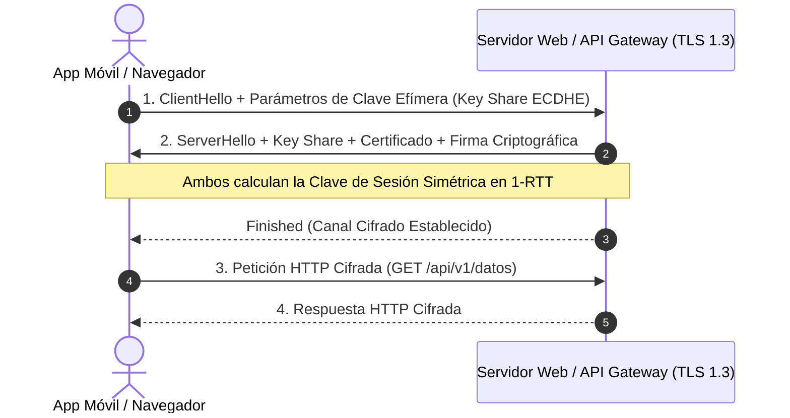

**UNIVERSIDAD DE COSTA RICA**  
**SEDE DEL ATLÁNTICO - RECINTO PARAÍSO**  
**CARRERA DE INFORMÁTICA EMPRESARIAL**  
**CURSO:** IF0009 - Desarrollo de Software IV  
**PROFESOR:** Mag. Jonathan Granados C.  
**SEMESTRE:** II-2026  

---

# Tema 6.3.1: Cifrado en Tránsito: Protocolo TLS 1.3, Cabeceras HSTS y Certificate Pinning en Móvil

> [!NOTE]
> Este documento corresponde a la lectura técnica del **Subtema 6.3.1**. En esta guía usted estudiará los fundamentos de la seguridad de datos en movimiento (*Data in Transit*), analizando las mejoras criptográficas del estándar **TLS 1.3 (RFC 8446)** frente a versiones previas, la directiva de transporte estricto **HSTS** y la implementación práctica de **Certificate Pinning** en clientes **Flutter 3** para neutralizar ataques de intercepción Man-in-the-Middle (MitM).

---

## 1. Resumen Ejecutivo

Cuando los datos viajan entre el cliente (móvil/web) y el servidor a través de Internet, atraviesan enrutadores, puntos de acceso inalámbrico y redes corporativas potencialmente hostiles. En este módulo, usted comprenderá cómo opera la capa de transporte seguro TLS 1.3 mediante el intercambio de claves efímeras Diffie-Hellman (ECDHE), garantizando la propiedad de *Secreto Perfecto hacia Adelante* (*Forward Secrecy*). Además, abordaremos el anclaje criptográfico de certificados (*Certificate Pinning*) en clientes móviles para impedir que certificados raíz instalados maliciosamente en el sistema operativo permitan descifrar las comunicaciones de la API.

---

## 2. Concepto Principal (El "Qué"): Arquitectura de TLS 1.3 y Anclaje de Certificados

### 2.1 TLS 1.3: Velocidad y Eliminación de Primitivas Inseguras (RFC 8446)
TLS 1.3 rediseñó el protocolo de enlace (*Handshake*) reduciendo la latencia de 2 viajes de ida y vuelta (2-RTT) en TLS 1.2 a **un solo viaje de ida y vuelta (1-RTT)**, o incluso **0-RTT** en reconexiones (*Early Data*).



* **Eliminación de Suites Criptográficas Débiles:** TLS 1.3 eliminó completamente el soporte para RSA sin intercambio de claves efímero, CBC mode, RC4, 3DES, MD5 y SHA-1. Solo admite algoritmos AEAD modernos (**AES-128-GCM, AES-256-GCM, ChaCha20-Poly1305**).
* **Forward Secrecy (Secreto Hacia Adelante):** Cada sesión negocia una clave efímera única. Si un atacante roba la clave privada del servidor años después, **no podrá descifrar** el tráfico histórico capturado previamente en la red.

### 2.2 Cabecera HTTP Strict Transport Security (HSTS)
HSTS instruye al navegador para que nunca intente comunicarse mediante HTTP inseguro, forzando todas las peticiones a HTTPS antes de que salgan a la red:
```http
Strict-Transport-Security: max-age=31536000; includeSubDomains; preload
```
Esto erradica los ataques de degradación de protocolo (*SSL Stripping*), donde un atacante intercepta la primera petición HTTP y redirige al usuario antes de que se inicie TLS.

### 2.3 Certificate Pinning (Anclaje de Certificados en Móvil)
Por defecto, los sistemas operativos móviles confían en más de un centenar de Autoridades Certificadoras (CAs) preinstaladas. Si un atacante o una entidad gubernamental compromete una sola CA o instala un certificado raíz en un teléfono rooteado, puede emitir certificados falsos para cualquier dominio y realizar ataques MitM imperceptibles.

**El Certificate Pinning** restringe la aplicación para que acepte únicamente la clave pública específica del servidor backend (verificando el hash SHA-256 del *Subject Public Key Info* - SPKI), rechazando cualquier otro certificado aunque esté firmado por una CA legítima del sistema.

---

## 3. Analogía Didáctica (La Intuición)

* **TLS Estándar con CAs:** Imagine que para entrar a una reunión confidencial en una empresa usted le pide al visitante que muestre una credencial sellada por cualquier notaría pública autorizada del país (CAs públicas). Si un falsificador soborna o engaña a un solo notario de provincia, obtendrá un sello legal y entrará al edificio sin ser detectado.
* **Certificate Pinning:** Equivale a que el guardia de la puerta tenga una fotografía exacta del rostro de la persona autorizada (el hash de la clave pública del servidor). Aunque el visitante traiga un documento legítimo firmado por la notaría más respetada del país, el guardia solo lo dejará pasar si su rostro coincide exactamente con la fotografía que tiene en sus manos.

---

## 4. Implementación Técnica (El "Cómo"): Certificate Pinning en Flutter 3 (Dart)

En Flutter, implementamos el anclaje de la clave pública mediante un `SecurityContext` personalizado en el cliente `HttpClient`:

```dart
import 'dart:io';
import 'package:flutter/services.dart';

class ClienteHttpSeguro {
  static HttpClient? _cliente;

  // Inicializa el cliente anclando el certificado del servidor
  static Future<HttpClient> obtenerClienteConPinning() async {
    if (_cliente != null) return _cliente!;

    final SecurityContext context = SecurityContext(withTrustedRoots: false);

    // Cargamos el certificado público del servidor desde los assets locales
    final ByteData certData = await rootBundle.load(
        'assets/certificados/api_ucr_backend.pem');
    
    // Configuramos el contexto para confiar ÚNICAMENTE en este certificado
    context.setTrustedCertificatesBytes(certData.buffer.asUint8List());

    _cliente = HttpClient(context: context);
    
    // Verificación estricta de nombres de dominio
    _cliente!.badCertificateCallback = (
        X509Certificate cert, 
        String host, 
        int port) {
      // Rechaza de inmediato cualquier certificado que no coincida exactamente
      return false;
    };

    return _cliente!;
  }
}
```

### 4.2 Verificación de Pinning mediante Hash SPKI en `dio`

```dart
import 'package:dio/dio.dart';
import 'package:dio/io.dart';

Dio crearDioConPinning(String sha256FingerprintEsperado) {
  final dio = Dio();

  dio.httpClientAdapter = IOHttpClientAdapter(
    createHttpClient: () {
      final client = HttpClient();
      return client;
    },
    validateCertificate: (cert, host, port) {
      if (cert == null) return false;
      
      // Compara el hash SHA-256 del certificado presentado con el hash esperado
      final String fingerprintPresentado = cert.sha256
          .map((b) => b.toRadixString(16).padLeft(2, '0'))
          .join(':')
          .toUpperCase();

      return fingerprintPresentado == sha256FingerprintEsperado;
    },
  );

  return dio;
}
```

---

## 5. Trampas Comunes y Antipatrones

*   **Retornar `true` en `badCertificateCallback`:** En entornos de desarrollo, muchos desarrolladores configuran `badCertificateCallback = (cert, host, port) => true;` para saltarse errores de certificados locales y olvidan eliminarlo en producción. Esto desactiva el 100% de la seguridad HTTPS, permitiendo cualquier ataque MitM.
*   **Anclar el certificado completo sin contemplar la expiración:** Los certificados X.509 expiran periódicamente (ej. cada 90 días con Let's Encrypt). Si ancla el certificado entero y se vence, la app móvil dejará de funcionar en todo el mundo. La práctica recomendada es anclar el **SPKI (Subject Public Key Info)** o incluir siempre una clave de respaldo (*Backup Pin*).
*   **Omitir HSTS en servidores web:** Servir páginas sobre HTTPS pero sin cabecera HSTS, dejando a los usuarios expuestos en su primera visita si ingresan la URL sin `https://`.

---

## 6. Preguntas de Reflexión y Autoevaluación

1. ¿Por qué el protocolo TLS 1.3 eliminó completamente el soporte para el intercambio de claves basado en RSA estático en favor exclusivo de Diffie-Hellman Efímero (ECDHE)?
2. Si una organización aplica *Certificate Pinning* en su aplicación móvil corporativa, ¿qué procedimiento técnico debe seguir para renovar el certificado SSL de su servidor backend sin dejar inoperativas las aplicaciones instaladas de sus clientes?

