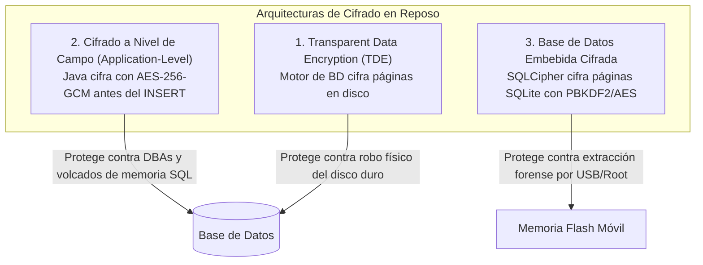

**UNIVERSIDAD DE COSTA RICA**  
**SEDE DEL ATLÁNTICO - RECINTO PARAÍSO**  
**CARRERA DE INFORMÁTICA EMPRESARIAL**  
**CURSO:** IF0009 - Desarrollo de Software IV  
**PROFESOR:** Mag. Jonathan Granados C.  
**SEMESTRE:** II-2026  

---

# Tema 6.3.2: Cifrado en Reposo: Cifrado a Nivel de Aplicación (JPA AttributeConverter) y Bases de Datos Móviles Cifradas (SQLCipher)

> [!NOTE]
> Este documento corresponde a la lectura técnica del **Subtema 6.3.2**. En esta unidad usted analizará las estrategias para garantizar la confidencialidad de datos en estado de almacenamiento (*Data at Rest*), contrastando el cifrado transparente de base de datos (**TDE**) con el cifrado granular a nivel de campo en **Spring Data JPA / Java 25** mediante **AES-256-GCM**, así como la persistencia móvil protegida con **SQLCipher** en Flutter 3.

---

## 1. Resumen Ejecutivo

La protección perimetral no garantiza la seguridad de los datos si un atacante obtiene acceso no autorizado a los archivos de base de datos físicos, respaldos en cinta (*backups*) o a la memoria flash de un dispositivo móvil extraviado. En este módulo, usted comprenderá la diferencia entre cifrar el volumen de almacenamiento completo frente a cifrar campos sensibles directamente en la capa de software antes de enviarlos al motor SQL. Desarrollaremos un convertidor JPA robusto con autenticación criptográfica adicional (AEAD) y analizaremos el funcionamiento de bases de datos móviles cifradas sector por sector.

---

## 2. Concepto Principal (El "Qué"): TDE vs. Cifrado a Nivel de Aplicación

### 2.1 Niveles de Cifrado en Reposo



### 2.2 Comparativa de Estrategias

| Enfoque | Quién posee la clave criptográfica | Qué protege | Limitaciones técnicas |
| :--- | :--- | :--- | :--- |
| **TDE (Transparent Data Encryption)** | El motor de base de datos (SQL Server, Oracle, PostgreSQL). | El archivo `.mdf` o disco duro físico. | Si un administrador (DBA) o atacante hace `SELECT`, ve los datos en claro. |
| **Cifrado en la Aplicación (JPA)** | La aplicación backend (Spring Boot) vía variables de entorno. | Filas y columnas individuales aun frente a un DBA comprometido. | No permite búsquedas por rango numérico o `LIKE %texto%` directo. |
| **SQLCipher (Móvil)** | La aplicación Flutter derivándola del Android Keystore / Keychain. | El archivo `.db` SQLite completo en el dispositivo. | Sobrecarga de cómputo del 5% al 15% en operaciones de I/O móvil. |

### 2.3 Modo AES-256-GCM (Galois/Counter Mode)
Para cifrar campos en la aplicación, es indispensable utilizar **AES-GCM**:
* Proporciona **Cifrado Autenticado con Datos Asociados (AEAD)**.
* Garantiza tanto la **confidencialidad** (el texto es ininteligible) como la **integridad** (mediante una etiqueta de autenticación o *Authentication Tag* de 128 bits).
* Si un atacante modifica un solo bit del registro cifrado en la base de datos, el algoritmo falla y rechaza descifrar el campo adulterado.
* Requiere un **Vector de Inicialización (IV)** aleatorio y único de 12 bytes por cada registro cifrado.

---

## 3. Analogía Didáctica (La Intuición)

* **TDE (Cifrado de Disco/Motor):** Es la cerradura de la puerta principal de un archivo de documentos en un hospital. Si alguien fuerza la puerta física del edificio, no podrá entrar. Sin embargo, los médicos, secretarias y empleados de limpieza que ya están dentro del edificio pueden abrir cualquier archivador y leer los historiales clínicos en texto plano.
* **Cifrado a Nivel de Aplicación (JPA Converter):** Es un candado digital con combinación biométrica colocado individualmente sobre el sobre de cada paciente. Aunque el personal de limpieza o los administradores de la base de datos caminen por los pasillos o hagan copias de seguridad de las carpetas, únicamente el médico autorizado con la clave criptográfica en memoria puede abrir el sobre y leer el diagnóstico.
* **SQLCipher:** Es una caja fuerte empotrada en el maletín del médico: cada página del bloc de notas se cifra de forma individual antes de escribirse en papel.

---

## 4. Implementación Técnica (El "Cómo"): JPA Converter Criptográfico en Java 25

Implementamos un `AttributeConverter` en JPA para cifrar y descifrar automáticamente columnas confidenciales (números de tarjeta, expedientes o identificaciones) con **AES-256-GCM**:

```java
package com.ucr.seguridad.data.converter;

import jakarta.persistence.AttributeConverter;
import jakarta.persistence.Converter;
import javax.crypto.Cipher;
import javax.crypto.SecretKey;
import javax.crypto.spec.GCMParameterSpec;
import javax.crypto.spec.SecretKeySpec;
import java.nio.ByteBuffer;
import java.nio.charset.StandardCharsets;
import java.security.SecureRandom;
import java.util.Base64;

@Converter
public class CifradoAesGcmConverter implements AttributeConverter<String, String> {

    private static final String ALGORITMO = "AES/GCM/NoPadding";
    private static final int IV_LONGITUD_BYTES = 12; // Recomendado NIST para GCM
    private static final int TAG_LONGITUD_BITS = 128;

    // En producción se inyecta desde variable de entorno o Secrets Manager
    private static final byte[] CLAVE_BYTES = 
        "UCR_IF0009_SecretKey_32Bytes_2026".getBytes(StandardCharsets.UTF_8);
    private final SecretKey secretKey = new SecretKeySpec(CLAVE_BYTES, "AES");
    private final SecureRandom secureRandom = new SecureRandom();

    @Override
    public String convertToDatabaseColumn(String datoEnClaro) {
        if (datoEnClaro == null) return null;
        try {
            byte[] iv = new byte[IV_LONGITUD_BYTES];
            secureRandom.nextBytes(iv); // Genera IV aleatorio único

            Cipher cipher = Cipher.getInstance(ALGORITMO);
            GCMParameterSpec parameterSpec = new GCMParameterSpec(
                TAG_LONGITUD_BITS, iv);
            cipher.init(Cipher.ENCRYPT_MODE, secretKey, parameterSpec);

            byte[] textoCifrado = cipher.doFinal(
                datoEnClaro.getBytes(StandardCharsets.UTF_8));

            // Empaquetamos: [IV (12 bytes)] + [Texto Cifrado + Auth Tag]
            ByteBuffer byteBuffer = ByteBuffer.allocate(iv.length + textoCifrado.length);
            byteBuffer.put(iv);
            byteBuffer.put(textoCifrado);

            return Base64.getEncoder().encodeToString(byteBuffer.array());
        } catch (Exception e) {
            throw new RuntimeException("Error al cifrar atributo en JPA", e);
        }
    }

    @Override
    public String convertToEntityAttribute(String datoCifradoBase64) {
        if (datoCifradoBase64 == null) return null;
        try {
            byte[] buffer = Base64.getDecoder().decode(datoCifradoBase64);
            ByteBuffer byteBuffer = ByteBuffer.wrap(buffer);

            byte[] iv = new byte[IV_LONGITUD_BYTES];
            byteBuffer.get(iv); // Extraemos los primeros 12 bytes del IV

            byte[] textoCifrado = new byte[byteBuffer.remaining()];
            byteBuffer.get(textoCifrado);

            Cipher cipher = Cipher.getInstance(ALGORITMO);
            GCMParameterSpec parameterSpec = new GCMParameterSpec(
                TAG_LONGITUD_BITS, iv);
            cipher.init(Cipher.DECRYPT_MODE, secretKey, parameterSpec);

            byte[] textoDescifrado = cipher.doFinal(textoCifrado);
            return new String(textoDescifrado, StandardCharsets.UTF_8);
        } catch (Exception e) {
            throw new RuntimeException("Error al descifrar atributo o tag corrupto", e);
        }
    }
}
```

### 4.2 Uso Declarativo en Entidades de Negocio (Java 25)

```java
package com.ucr.seguridad.domain;

import com.ucr.seguridad.data.converter.CifradoAesGcmConverter;
import jakarta.persistence.*;

@Entity
@Table(name = "pacientes")
public class Paciente {

    @Id
    @GeneratedValue(strategy = GenerationType.IDENTITY)
    private Long id;

    @Column(nullable = false)
    private String nombre;

    // Se cifra automáticamente antes del INSERT y se descifra tras el SELECT
    @Convert(converter = CifradoAesGcmConverter.class)
    @Column(name = "cedula_cifrada", nullable = false)
    private String cedula;

    // Getters y Setters...
}
```

---

## 5. Trampas Comunes y Antipatrones

*   **Reutilizar el mismo Vector de Inicialización (IV) en AES-GCM:** En modo GCM, reutilizar el mismo IV con la misma clave simétrica permite recuperar el texto plano mediante operaciones XOR directas. El IV **siempre debe ser único y generado con `SecureRandom`**.
*   **Almacenar la clave criptográfica en la misma base de datos:** Guardar la clave simétrica en una tabla de configuración de la propia base de datos. Si el atacante roba la base de datos, obtendrá simultáneamente los datos y la llave.
*   **Uso de SQLite plano para datos bancarios o médicos en móviles:** Almacenar tokens o bases de datos sin SQLCipher en la carpeta interna de la app. En terminales Android rooteados, cualquier aplicación con permisos de superusuario puede leer archivos SQLite de otras aplicaciones.

---

## 6. Preguntas de Reflexión y Autoevaluación

1. Si una columna de base de datos se encuentra cifrada con AES-256-GCM y un vector de inicialización aleatorio, ¿por qué resulta imposible ejecutar una consulta SQL como `WHERE cedula_cifrada = '301230456'`?
2. ¿Qué ventaja ofrece la etiqueta de autenticación (*Authentication Tag*) de AES-GCM frente a modos de cifrado tradicionales como AES-CBC?

