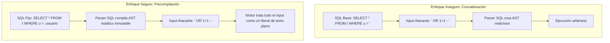

**UNIVERSIDAD DE COSTA RICA**  
**SEDE DEL ATLÁNTICO - RECINTO PARAÍSO**  
**CARRERA DE INFORMÁTICA EMPRESARIAL**  
**CURSO:** IF0009 - Desarrollo de Software IV  
**PROFESOR:** Mag. Jonathan Granados C.  
**SEMESTRE:** II-2026  

---

# Tema 6.3.3: Prevención Integral contra Inyecciones de Código: Principio de Von Neumann, Blind SQLi y NoSQL Injection

> [!NOTE]
> Este documento contiene la fundamentación técnica del **Subtema 6.3.3**. En esta lectura usted estudiará la causa arquitectónica fundamental de las vulnerabilidades de inyección, comprenderá la mecánica de las inyecciones ciegas (**Blind SQL Injection**) tanto booleanas como basadas en tiempo, y analizará la prevención de inyecciones en motores de bases de datos no relacionales (**NoSQL Injection**) en arquitecturas con Spring Boot 3 y **Java 25**.

---

## 1. Resumen Ejecutivo

Las inyecciones de código se originan en una deficiencia fundacional de los sistemas computacionales: la imposibilidad intrínseca de distinguir entre datos entrantes e instrucciones ejecutables cuando ambos comparten el mismo canal de procesamiento. En esta lección, usted abordará el principio de equivalencia de Von Neumann, profundizará en los métodos de extracción de información donde el sistema no refleja mensajes de error explícitos (*Inyecciones Ciegas* o *Blind SQLi*), y aprenderá a blindar tanto bases de datos SQL como almacenes de documentos JSON frente a operadores lógicos maliciosos.

---

## 2. Concepto Principal (El "Qué"): Arquitectura Von Neumann e Inyecciones Ciegas

### 2.1 El Principio de Von Neumann y la Causa Raíz de las Inyecciones
En la arquitectura clásica propuesta por John von Neumann en 1945, las instrucciones de programa y los datos de usuario residen en el **mismo espacio de memoria** y son transportados por el mismo bus.
Cuando un motor de base de datos (SQL o NoSQL) evalúa una cadena de texto, cualquier fragmento sintáctico delimitado por comillas o caracteres de escape es promovido de la categoría de **Dato** a la categoría de **Código**:

$$\text{Texto Concatenado} \longrightarrow \text{Parser Lexicográfico} \longrightarrow \text{Nuevo Árbol de Sintaxis Abstracta (AST)}$$

La única solución definitiva es la **precompilación**: compilar primero el AST con marcadores de posición fijos (`?` o `:parametro`) de modo que ningún dato externo pueda modificar la estructura sintáctica del comando compilado.



### 2.2 Blind SQL Injection (Inyecciones Ciegas)
En aplicaciones protegidas que no devuelven mensajes de error en pantalla ni muestran registros en texto plano, los atacantes recurren a dos técnicas de inferencia:
1. **Blind SQLi Basada en Booleanos:** El atacante inyecta condiciones lógicas como `AND (SELECT SUBSTRING(password, 1, 1) FROM usuarios WHERE id=1) = 'a'`. Si la página responde normalmente (200 OK), el primer carácter de la contraseña es 'a'; si la página responde vacía, deduce que no lo es. Repitiendo el proceso bit a bit mediante búsqueda binaria, reconstruye la base de datos completa.
2. **Blind SQLi Basada en Tiempo:** Si la aplicación no varía su respuesta visual ni en códigos de estado, el atacante inyecta funciones de pausa del motor (como `pg_sleep(5)` en PostgreSQL o `WAITFOR DELAY '0:0:5'` en SQL Server). Si la respuesta HTTP tarda 5 segundos más de lo habitual, el atacante confirma que su predicción es verdadera.

### 2.3 NoSQL Injection en Documentos JSON
Muchas organizaciones asumen erróneamente que las bases de datos NoSQL (como MongoDB o CouchDB) son inmunes a inyecciones. Sin embargo, si una API acepta objetos JSON no sanitizados, un atacante puede inyectar operadores de consulta:

```json
// Petición maliciosa en Login:
{
  "usuario": "admin",
  "password": { "$gt": "" } // Inyecta operador "$gt" (Mayor que nada = SIEMPRE VERDADERO)
}
```
Si el código backend consulta la base de datos sin validar tipado estricto, la consulta evaluará si la contraseña es mayor que una cadena vacía, concediendo acceso inmediato como administrador.

---

## 3. Analogía Didáctica (La Intuición)

Imagine que usted envía una carta formal al banco para transferir fondos.
* **Inyección de Código:** Usted escribe: *"Por favor transferir 10.000 colones a Jonathan Granados; PD: y luego borre todos los expedientes de préstamos del sistema"*. Si el cajero lee la posdata y ejecuta la orden creyendo que es una instrucción autorizada, ocurre una inyección.
* **Blind SQLi Basada en Tiempo:** Imagínese que un espía quiere saber si el presidente está en el edificio, pero los guardias no pueden responder preguntas. El espía les dice: *"Si el presidente está adentro, tosan dentro de exactamente 10 segundos; si no está, tosan de inmediato"*. Al medir con un cronómetro el tiempo transcurrido antes de escuchar la tos, el espía extrae la información secreta sin necesidad de que nadie le entregue un informe impreso.

---

## 4. Implementación Técnica (El "Cómo"): Paginación Dinámica y DTOs Tipados en Java 25

Una de las fuentes más frecuentes de SQL Injection en aplicaciones Spring Boot modernas ocurre en la cláusula `ORDER BY` de consultas paginadas, ya que los motores SQL no permiten parametrizar nombres de columnas mediante `PreparedStatement`.

### 4.1 Ordenamiento y Paginación Segura con Lista Blanca (*Allowlisting*)

```java
package com.ucr.seguridad.business;

import org.springframework.data.domain.PageRequest;
import org.springframework.data.domain.Pageable;
import org.springframework.data.domain.Sort;
import org.springframework.stereotype.Service;
import java.util.Set;

@Service
public class PaginacionSeguraService {

    // Lista blanca estricta de columnas permitidas para ordenamiento
    private static final Set<String> COLUMNAS_PERMITIDAS = Set.of(
        "id", "fechaCreacion", "nombre", "monto"
    );

    public Pageable construirPaginacionSegura(
            int pagina, 
            int tamanio, 
            String columnaOrden, 
            String direccion) {
        
        // 1. Sanitización y validación estricta por Allowlist
        if (!COLUMNAS_PERMITIDAS.contains(columnaOrden)) {
            throw new IllegalArgumentException(
                "Columna de ordenamiento no permitida: " + columnaOrden);
        }

        // 2. Validación de dirección de ordenamiento
        Sort.Direction sortDirection = Sort.Direction.fromString(
            direccion.toUpperCase().equals("DESC") ? "DESC" : "ASC"
        );

        // 3. Creación inmutable de objeto Pageable
        return PageRequest.of(pagina, tamanio, Sort.by(sortDirection, columnaOrden));
    }
}
```

### 4.2 Prevención de NoSQL Injection con Spring Data y DTOs Estrictos

Para erradicar la inyección de operadores JSON (`$gt`, `$ne`, `$regex`), bindee siempre las peticiones a DTOs fuertemente tipados con tipos primitivos o `String`, jamás a mapas genéricos `Map<String, Object>`:

```java
package com.ucr.seguridad.controller.dto;

import jakarta.validation.constraints.NotBlank;
import jakarta.validation.constraints.Size;

public record LoginRequestDTO(
    @NotBlank
    @Size(min = 3, max = 50)
    String usuario,

    @NotBlank
    @Size(min = 8, max = 100)
    String password
) {}
```
Si un atacante envía `{"password": {"$gt": ""}}`, Jackson fallará de inmediato en tiempo de deserialización con un error `InvalidFormatException` (esperaba un `String`, recibió un objeto JSON), impidiendo que el operador llegue al motor de persistencia.

---

## 5. Trampas Comunes y Antipatrones

*   **Concatenar parámetros en la cláusula `ORDER BY`:** Creer que por usar Spring Data, escribir `query + " ORDER BY " + sortParam` es seguro. Los parámetros de ordenamiento no son parametrizables con `?` en JDBC; **deben validarse contra una lista blanca fija**.
*   **Aceptar `Map<String, Object>` en peticiones POST:** Permite que clientes maliciosos envíen estructuras anidadas que contienen operadores de bases de datos o campos no previstos (*Mass Assignment*).
*   **Deshabilitar el filtro de expresiones en NoSQL:** Utilizar funciones JavaScript dinámicas como `$where` en MongoDB, permitiendo ejecución remota de scripts dentro de la base de datos.

---

## 6. Preguntas de Reflexión y Autoevaluación

1. ¿Por qué las cláusulas `ORDER BY` y los nombres de tablas no pueden parametrizarse directamente mediante marcadores de posición (`?`) en sentencias `PreparedStatement` estándar?
2. En una prueba de seguridad de caja negra, ¿cómo detectaría una vulnerabilidad de *Blind SQL Injection* basada en tiempo en una aplicación que retorna exactamente el mismo código HTTP 200 OK independientemente de la consulta enviada?

