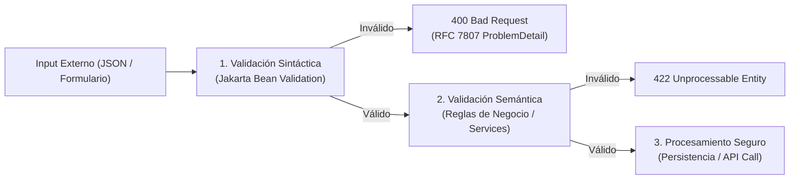

**UNIVERSIDAD DE COSTA RICA**  
**SEDE DEL ATLÁNTICO - RECINTO PARAÍSO**  
**CARRERA DE INFORMÁTICA EMPRESARIAL**  
**CURSO:** IF0009 - Desarrollo de Software IV  
**PROFESOR:** Mag. Jonathan Granados C.  
**SEMESTRE:** II-2026  

---

# Tema 6.4.1: Validación y Sanitización de Entradas: Jakarta Bean Validation, Listas Blancas y Formateo RFC 7807

> [!NOTE]
> Este documento corresponde a la lectura técnica del **Subtema 6.4.1**. En esta lección usted profundizará en la primera línea de defensa de cualquier sistema de software: la **Validación y Sanitización Formal de Entradas**. Abordaremos la superioridad de las listas blancas (*Allowlisting*) sobre las listas negras, la implementación de validadores declarativos y personalizados en **Spring Boot 3 / Java 25** con **Jakarta Bean Validation 3.0**, y el reporte estructurado de errores bajo la especificación **RFC 7807 (Problem Details)**.

---

## 1. Resumen Ejecutivo

La regla fundamental de la seguridad en ingeniería de software establece que *toda entrada procedente del exterior (usuarios, clientes móviles, servicios de terceros o parámetros de red) debe considerarse potencialmente maliciosa*. En este módulo, usted aprenderá a diferenciar con rigor entre validación sintáctica, validación semántica y sanitización. Implementaremos esquemas de validación fuertemente tipados utilizando Java 25 Records y diseñaremos un validador personalizado con algoritmo de verificación algorítmica para el contexto nacional costarricense.

---

## 2. Concepto Principal (El "Qué"): Validación vs. Sanitización

### 2.1 Definiciones Rigurosas
* **Validación Sintáctica:** Comprueba que el dato recibido cumpla con un formato predefinido: longitud mínima y máxima, tipos de caracteres permitidos (expresiones regulares), formato de fecha o estructura de correo electrónico.
* **Validación Semántica:** Comprueba que el dato tenga sentido en el contexto del negocio: que una fecha de nacimiento sea en el pasado, que un monto a transferir no supere el saldo disponible o que un identificador pertenezca al catálogo del sistema.
* **Sanitización (Neutralización):** Modificación activa del dato entrante para eliminar o transformar caracteres potencialmente peligrosos (por ejemplo, remover etiquetas `<script>` o codificar entidades HTML) antes de su procesamiento o almacenamiento.



### 2.2 Lista Blanca (Allowlisting) vs. Lista Negra (Blocklisting)
* **Lista Negra (Insegura):** Intenta definir lo que está "prohibido" (ejemplo: rechazar palabras como `admin`, `<script>`, `DROP`, o comillas `'`). Es intrínsecamente eludible porque los atacantes encuentran infinitas variantes de codificación (Unicode, Base64, ofuscación hex, mayúsculas intercaladas `sCrIpt`).
* **Lista Blanca (Segura):** Define con precisión matemática el conjunto exclusivo de lo que está "permitido" (ejemplo: un código postal costarricense debe contener exactamente 5 dígitos numéricos `^\d{5}$`). Todo lo que no encaje en esta regla se descarta de inmediato.

---

## 3. Analogía Didáctica (La Intuición)

Piense en la inspección de seguridad de un aeropuerto internacional:
* **Lista Negra (Blocklisting):** El oficial de aduanas tiene un cartel con dibujos de 5 tipos específicos de pistolas y cuchillos. Si un pasajero llega con un arma biológica, un explosivo químico líquido o una daga de cerámica que no está dibujada en el cartel, el guardia lo deja pasar.
* **Lista Blanca (Allowlisting):** El aeropuerto solo permite ingresar a la sala de abordaje a quienes porten únicamente una maleta de mano con dimensiones exactas ($55 \times 40 \times 20\text{ cm}$), ropa personal y líquidos en envases transparentes de menos de 100 mililitros. Cualquier objeto que no coincida con esta estricta lista de permitidos es confiscado en el arco de seguridad.

---

## 4. Implementación Técnica (El "Cómo"): Validador Personalizado y RFC 7807 en Java 25

Implementaremos una anotación personalizada `@CedulaCostarricense` con su validador algorítmico, y un controlador global para traducir excepciones en respuestas normalizadas **RFC 7807**.

### 4.1 Definición de la Anotación Personalizada

```java
package com.ucr.seguridad.validation;

import jakarta.validation.Constraint;
import jakarta.validation.Payload;
import java.lang.annotation.*;

@Documented
@Constraint(validatedBy = CedulaCostarricenseValidator.class)
@Target({ ElementType.FIELD, ElementType.PARAMETER })
@Retention(RetentionPolicy.RUNTIME)
public @interface CedulaCostarricense {
    String message() default "La cédula debe ser de 9 dígitos numéricos válidos (formato costarricense)";
    Class<?>[] groups() default {};
    Class<? extends Payload>[] payload() default {};
}
```

### 4.2 Lógica del Validador en Java 25

```java
package com.ucr.seguridad.validation;

import jakarta.validation.ConstraintValidator;
import jakarta.validation.ConstraintValidatorContext;
import java.util.regex.Pattern;

public class CedulaCostarricenseValidator 
        implements ConstraintValidator<CedulaCostarricense, String> {

    // Regla Allowlist: exactamente 9 dígitos numéricos, primer dígito de 1 a 9
    private static final Pattern PATRON_CEDULA = Pattern.compile("^[1-9]\\d{8}$");

    @Override
    public boolean isValid(String valor, ConstraintValidatorContext context) {
        if (valor == null || valor.isBlank()) {
            return false; // Delegamos obligatoriedad a @NotBlank si corresponde
        }

        // 1. Validación de patrón numérico estricto
        if (!PATRON_CEDULA.matcher(valor).matches()) {
            return false;
        }

        // 2. Validación semántica del rango de provincia válida (1 a 9)
        int provincia = Character.getNumericValue(valor.charAt(0));
        return provincia >= 1 && provincia <= 9;
    }
}
```

### 4.3 DTO Inmutable con Java 25 Records y Anotaciones Bean Validation

```java
package com.ucr.seguridad.controller.dto;

import com.ucr.seguridad.validation.CedulaCostarricense;
import jakarta.validation.constraints.Email;
import jakarta.validation.constraints.NotBlank;
import jakarta.validation.constraints.Size;

public record RegistrarClienteDTO(
    @NotBlank(message = "El nombre es obligatorio")
    @Size(min = 2, max = 80, message = "El nombre debe contener entre 2 y 80 caracteres")
    String nombre,

    @CedulaCostarricense
    String cedula,

    @NotBlank(message = "El correo electrónico es requerido")
    @Email(message = "Formato de correo electrónico inválido")
    String email
) {}
```

### 4.4 Manejo Global de Errores con RFC 7807 (`ProblemDetail`)

Spring Boot 3 soporta nativamente el estándar **RFC 7807** mediante la clase `ProblemDetail`:

```java
package com.ucr.seguridad.controller;

import org.springframework.http.HttpStatus;
import org.springframework.http.ProblemDetail;
import org.springframework.web.bind.MethodArgumentNotValidException;
import org.springframework.web.bind.annotation.ExceptionHandler;
import org.springframework.web.bind.annotation.RestControllerAdvice;
import java.net.URI;
import java.time.Instant;
import java.util.HashMap;
import java.util.Map;

@RestControllerAdvice
public class GlobalExceptionHandler {

    @ExceptionHandler(MethodArgumentNotValidException.class)
    public ProblemDetail manejarErroresValidacion(
            MethodArgumentNotValidException ex) {
        
        ProblemDetail problemDetail = ProblemDetail.forStatusAndDetail(
            HttpStatus.BAD_REQUEST, 
            "La petición contiene campos no válidos según las reglas de negocio."
        );
        problemDetail.setTitle("Error de Validación de Entrada");
        problemDetail.setType(URI.create("https://ucr.ac.cr/errores/validacion"));
        problemDetail.setProperty("timestamp", Instant.now());

        Map<String, String> errores = new HashMap<>();
        ex.getBindingResult().getFieldErrors().forEach(error -> 
            errores.put(error.getField(), error.getDefaultMessage())
        );
        problemDetail.setProperty("infracciones", errores);

        return problemDetail;
    }
}
```

---

## 5. Trampas Comunes y Antipatrones

*   **Olvidar la anotación `@Valid` en el Controlador:** Definir anotaciones en el DTO pero olvidar colocar `@Valid` o `@Validated` junto al parámetro `@RequestBody` en el método del controlador. Spring ignorará todas las reglas y el objeto pasará sin validar.
*   **Sanitizar antes de validar:** Modificar el texto entrante (por ejemplo, recortar caracteres o eliminar espacios) antes de verificar si cumplía la expresión regular. Siempre se debe **validar primero** en su estado original y rechazar peticiones maliciosas con HTTP 400.
*   **Fugas de información en mensajes de validación:** Responder con mensajes que revelen la estructura interna de la base de datos (ej. *"Fallo de clave foránea en tabla FK_CLIENTE_12"*).

---

## 6. Preguntas de Reflexión y Autoevaluación

1. ¿Por qué el enfoque de listas blancas (*Allowlisting*) es infinitamente superior a las listas negras (*Blocklisting*) cuando se procesan campos alfanuméricos como nombres de usuario o códigos de producto?
2. ¿Qué ventajas ofrece el estándar **RFC 7807 (Problem Details for HTTP APIs)** a los desarrolladores de frontend en Angular y Flutter frente a respuestas de error caseras en JSON?

