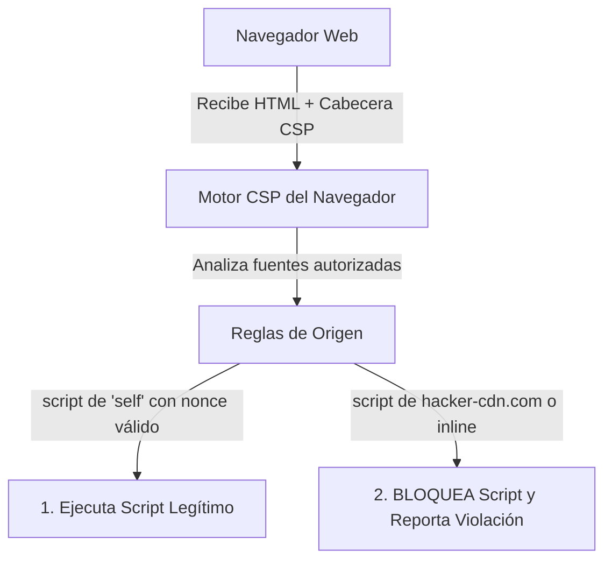

**UNIVERSIDAD DE COSTA RICA**  
**SEDE DEL ATLÁNTICO - RECINTO PARAÍSO**  
**CARRERA DE INFORMÁTICA EMPRESARIAL**  
**CURSO:** IF0009 - Desarrollo de Software IV  
**PROFESOR:** Mag. Jonathan Granados C.  
**SEMESTRE:** II-2026  

---

# Tema 6.4.3: Content Security Policy (CSP Nivel 3) y Mitigación de Cross-Site Request Forgery (CSRF)

> [!NOTE]
> Este documento corresponde a la lectura técnica del **Subtema 6.4.3**. En esta lección usted profundizará en dos mecanismos clave de defensa perimetral para aplicaciones web: la política de seguridad de contenido **Content Security Policy (CSP Nivel 3)** como mitigación de mitigación en profundidad contra XSS, y la protección contra ataques de falsificación de peticiones en sitios cruzados (**CSRF**), analizando por qué las APIs móviles y stateless basadas en tokens Bearer operan bajo un modelo intrínsecamente inmune a este vector.

---

## 1. Resumen Ejecutivo

Incluso si un atacante logra inyectar una cadena maliciosa en una aplicación web, un navegador moderno puede bloquear su ejecución si el servidor envía una política defensiva estricta. En esta lectura, usted aprenderá a configurar cabeceras **Content Security Policy (CSP Nivel 3)** utilizando *nonces* criptográficos y restricciones de orígenes. Asimismo, desmitificaremos el ataque **Cross-Site Request Forgery (CSRF)**, analizando cómo el atributo `SameSite` de las cookies y la arquitectura desacoplada de tokens en cabeceras eliminan esta amenaza en clientes móviles y Single Page Applications.

---

## 2. Concepto Principal (El "Qué"): Políticas CSP y Mecánica de CSRF

### 2.1 Content Security Policy (CSP Nivel 3)
CSP es una cabecera HTTP estándar que permite a los operadores de un sitio web restringir los recursos (JavaScript, hojas de estilo CSS, imágenes, fuentes, conexiones de red) que el navegador tiene autorización de cargar y ejecutar en esa página:



#### Directivas Fundamentales de CSP:
* `default-src 'self'`: Política base de denegación por defecto; todo recurso debe provenir del mismo origen exacto salvo excepción explícita.
* `script-src 'self' 'nonce-rAnd0m123'`: Solo permite ejecutar scripts alojados en el mismo dominio o scripts en línea que incluyan el atributo criptográfico exacto `<script nonce="rAnd0m123">`.
* `connect-src 'self' https://api.ucr.ac.cr`: Restringe a qué endpoints puede enviar peticiones `fetch()` o `XMLHttpRequest`.
* `frame-ancestors 'none'`: Impide que otros sitios incrusten la aplicación dentro de un `<iframe>`, neutralizando ataques de *Clickjacking*.

---

### 2.2 Cross-Site Request Forgery (CSRF)

El ataque CSRF ocurre cuando un sitio web malicioso en el que navega un usuario engaña a su navegador para que emita una petición HTTP involuntaria contra una aplicación web legítima en la que el usuario **ya cuenta con una sesión activa**:

```mermaid
sequenceDiagram
    autonumber
    actor Victima as Usuario con Sesión Activa
    participant Banco as Banco Web (Cookie Session)
    participant Malicioso as Sitio Web Malicioso (evil.com)

    Victima->>Banco: 1. Login exitoso (Recibe Cookie de sesión)
    Victima->>Malicioso: 2. Navega a evil.com en otra pestaña
    Note over Malicioso: Página maliciosa contiene:<br/>&lt;form action="banco.com/transferir" method="POST"&gt;
    Malicioso->>Banco: 3. Envía POST a banco.com/transferir (con Cookie de la víctima)
    Note over Banco: El navegador adjuntó la cookie automáticamente
    Banco-->>Victima: 4. Transfiere dinero creyendo que fue la víctima
```

### 2.3 ¿Por qué las APIs Móviles y Stateless son Inmunes a CSRF?
El vector de CSRF depende exclusivamente de un comportamiento automático histórico de los navegadores web: **adjuntar automáticamente las cookies asociadas al dominio de destino en peticiones de origen cruzado**.
* Si la aplicación (Flutter o Angular) se autentica mediante la cabecera:
  `Authorization: Bearer <jwt_token>`
* Un sitio web malicioso externo **no puede obligar al navegador** a inyectar una cabecera personalizada `Authorization` arbitraria con un token secreto que dicho sitio desconoce.
* Por lo tanto, en APIs REST sin cookies que utilizan tokens Bearer, la protección CSRF en Spring Security puede deshabilitarse legítimamente sin comprometer la seguridad (`csrf.disable()`).

---

## 3. Analogía Didáctica (La Intuición)

* **CSP con Nonce:** Imagine un club exclusivo que requiere que cada socio lleve una contraseña secreta de un solo uso escrita en un brazalete para poder hablar en el micrófono. Aunque un intruso suba al escenario con un micrófono propio (`<script>alert(1)</script>`), el equipo de seguridad le apagará el sonido inmediatamente porque su brazalete no tiene el código de acceso del día (*nonce*).
* **CSRF Tradicional:** Imagine que usted tiene una firma registrada en su banco local y el banco acepta órdenes de pago que lleguen por correo postal siempre que lleven su sello personal de cera. Un delincuente escribe una carta falsa pidiendo transferir fondos a su propia cuenta, toma su sello de cera de su escritorio mientras usted duerme, sella la carta y la deposita en el correo. El banco procesa la orden porque el sello de cera (la cookie) era auténtico.
* **Tokens Bearer (Anti-CSRF):** Equivale a que el banco solo acepte transferencias si usted se presenta físicamente en la ventanilla portando una llave criptográfica que nunca sale de su bolsillo personal.

---

## 4. Implementación Técnica (El "Cómo"): Configuración en Spring Boot 3 / Java 25

### 4.1 Configuración de CSP y SameSite Cookies en Spring Security 6

```java
package com.ucr.seguridad.config;

import org.springframework.context.annotation.Bean;
import org.springframework.context.annotation.Configuration;
import org.springframework.security.config.annotation.web.builders.HttpSecurity;
import org.springframework.security.config.annotation.web.configuration.EnableWebSecurity;
import org.springframework.security.web.SecurityFilterChain;
import org.springframework.security.web.header.writers.ReferrerPolicyHeaderWriter;

@Configuration
@EnableWebSecurity
public class WebSecurityPolicyConfig {

    @Bean
    public SecurityFilterChain configuracionSeguridadWeb(HttpSecurity http) 
            throws Exception {
        http
            // 1. En APIs REST stateless con Bearer tokens, CSRF se deshabilita
            .csrf(csrf -> csrf.disable())
            
            // 2. Blindaje de Cabeceras HTTP
            .headers(headers -> headers
                // Configuración de Content Security Policy (Nivel 3)
                .contentSecurityPolicy(csp -> csp
                    .policyDirectives(
                        "default-src 'self'; " +
                        "script-src 'self' https://trustedscripts.ucr.ac.cr; " +
                        "style-src 'self' 'unsafe-inline' https://fonts.googleapis.com; " +
                        "font-src 'self' https://fonts.gstatic.com; " +
                        "img-src 'self' data:; " +
                        "connect-src 'self' https://api.ucr.ac.cr; " +
                        "frame-ancestors 'none'; " +
                        "form-action 'self';"
                    )
                )
                // Prevención de fuga de rutas privadas en referrers
                .referrerPolicy(referrer -> referrer
                    .policy(ReferrerPolicyHeaderWriter.ReferrerPolicy
                        .STRICT_ORIGIN_WHEN_CROSS_ORIGIN)
                )
            );

        return http.build();
    }
}
```

### 4.2 Configuración del Atributo `SameSite=Strict` para Cookies de Sesión
Si su arquitectura web utiliza cookies, configure `application.properties`:

```properties
server.servlet.session.cookie.http-only=true
server.servlet.session.cookie.secure=true
server.servlet.session.cookie.same-site=strict
```
* **`SameSite=Strict`:** El navegador nunca enviará la cookie en peticiones que se originen desde otro sitio web (por ejemplo, al hacer clic en un enlace externo), neutralizando completamente el vector CSRF sin necesidad de tokens adicionales.

---

## 5. Trampas Comunes y Antipatrones

*   **Usar `'unsafe-inline'` y `'unsafe-eval'` en directivas `script-src`:** Configurar CSP pero agregar `'unsafe-inline'` anula por completo la protección contra XSS, permitiendo la ejecución de cualquier script inyectado en etiquetas `<script>` o atributos de evento.
*   **Deshabilitar CSRF en aplicaciones que usan cookies de sesión:** Quitar `csrf.disable()` en una aplicación web tradicional basada en formularios MVC y cookies sin haber configurado `SameSite=Strict`, dejando a los usuarios expuestos al secuestro de acciones.
*   **Confundir CSRF con CORS:** Creer que las políticas CORS previenen ataques CSRF. CORS restringe la lectura de la respuesta por parte del script de origen cruzado, pero **no impide** que la petición se envíe y se ejecute en el servidor.

---

## 6. Preguntas de Reflexión y Autoevaluación

1. ¿Por qué una política de Content Security Policy (CSP) bien diseñada es capaz de mitigar un ataque de Cross-Site Scripting incluso si el código fuente contenía una falla de inyección en una plantilla?
2. Si las políticas de CORS bloquean la lectura de respuestas entre orígenes distintos en el navegador, ¿por qué una petición CSRF clásica sigue siendo peligrosa para un servidor con sesiones de cookies tradicionales?

