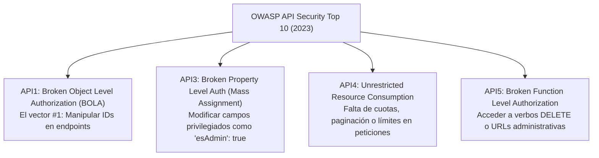

**UNIVERSIDAD DE COSTA RICA**  
**SEDE DEL ATLÁNTICO - RECINTO PARAÍSO**  
**CARRERA DE INFORMÁTICA EMPRESARIAL**  
**CURSO:** IF0009 - Desarrollo de Software IV  
**PROFESOR:** Mag. Jonathan Granados C.  
**SEMESTRE:** II-2026  

---

# Tema 6.5.1: El Estándar OWASP API Security Top 10: BOLA, Asignación Masiva y Consumo Desmedido

> [!NOTE]
> Este documento corresponde a la lectura técnica del **Subtema 6.5.1**. En esta lección usted analizará el marco de referencia especializado **OWASP API Security Top 10 (Edición 2023)**. Profundizaremos en las vulnerabilidades de mayor incidencia en servicios RESTful: la autorización deficiente a nivel de objeto (**BOLA**), la asignación masiva de propiedades (**Mass Assignment / BOPLA**) y el consumo irrestricto de recursos en **Spring Boot 3 / Java 25**.

---

## 1. Resumen Ejecutivo

Las interfaces de programación de aplicaciones (APIs RESTful) constituyen la columna vertebral de la comunicación entre clientes web (Angular), aplicaciones móviles (Flutter) y microservicios en la nube. A diferencia de las aplicaciones web monolíticas basadas en vistas renderizadas en servidor, las APIs exponen directamente la lógica de negocio y los modelos de datos en formato JSON. En esta lectura, usted aprenderá a identificar los riesgos particulares de las APIs, contrastándolos con el Top 10 web tradicional y aplicando directrices arquitectónicas para su neutralización proactiva.

---

## 2. Concepto Principal (El "Qué"): Los Riesgos del OWASP API Security Top 10



### 2.1 Comparativa de Vulnerabilidades Críticas

#### 1. API1:2023 Broken Object Level Authorization (BOLA)
Conocido previamente como IDOR, es la vulnerabilidad más devastadora en APIs. Ocurre cuando un endpoint como `GET /api/v1/cuentas/{idCuenta}` valida que el token JWT sea auténtico, pero **no comprueba si el usuario autenticado tiene derechos legítimos sobre ese `{idCuenta}` específico**. Un atacante puede iterar secuencialmente sobre millones de IDs extrayendo todos los registros de la plataforma.

#### 2. API3:2023 Broken Object Property Level Authorization (BOPLA / Mass Assignment)
Sucede cuando un endpoint recibe un payload JSON y lo deserializa directamente en una entidad JPA sin filtrado de propiedades:
```json
// Petición maliciosa en POST /api/usuarios/actualizar-perfil
{
  "nombre": "Carlos Gómez",
  "esAdmin": true,          // Campo privado que no debía modificarse
  "saldoBilletera": 999999   // Manipulación directa de saldo
}
```
Si el desarrollador vincula el cuerpo JSON directamente a la entidad `Usuario`, el atacante escala privilegios instantáneamente.

#### 3. API4:2023 Unrestricted Resource Consumption
Ocurre cuando la API no limita el consumo de recursos computacionales (memoria RAM, CPU, ancho de banda o conexiones a base de datos):
* Endpoints que devuelven listas sin paginación (`SELECT * FROM transacciones` devolviendo 2 millones de filas).
* Falta de límites en la subida de archivos (*Payload Too Large*).
* Procesamiento masivo de imágenes o PDFs en el hilo principal del servidor.

---

## 3. Analogía Didáctica (La Intuición)

* **BOLA:** Imagine un casillero postal en una terminal de autobuses. La recepcionista le pide su cédula para comprobar que usted es un cliente registrado. Una vez verificada su cédula, ella le dice: *"Indíqueme qué casillero desea abrir"*. Usted dice el número 45 (el de su vecino), y la empleada va y le entrega la correspondencia privada de su vecino sin verificar si el casillero 45 le pertenece.
* **Mass Assignment (BOPLA):** Piense en un formulario médico impreso donde el paciente debe llenar su nombre y teléfono. Al final de la página hay una sección que dice: *"Uso exclusivo del médico: Diagnóstico y Medicación recetada"*. El paciente escribe en esa casilla: *"Diagnóstico: Sano. Receta: 100 frascos de morfina"*. Si la farmacia procesa el documento completo sin verificar qué campos tenía autorización de llenar el paciente, ocurre asignación masiva.

---

## 4. Implementación Técnica (El "Cómo"): Defensa con DTOs Estrictos y Paginación en Java 25

### 4.1 Erradicación de Mass Assignment mediante Java 25 Records

Nunca exponga entidades JPA directamente en los controladores. Utilice Data Transfer Objects (DTOs) que declaren **únicamente** los campos mutables autorizados para el usuario:

```java
package com.ucr.seguridad.controller.dto;

import jakarta.validation.constraints.NotBlank;
import jakarta.validation.constraints.Size;

// DTO Inmutable: Excluye deliberadamente 'esAdmin', 'saldo' o 'roles'
public record ActualizarPerfilDTO(
    @NotBlank
    @Size(min = 2, max = 50)
    String nombreCompleto,

    @Size(max = 20)
    String telefono
) {
    // Solo expone propiedades autorizadas para actualización por el cliente
}
```

### 4.2 Mitigación de BOLA y Paginación Forzada en Spring Boot 3

```java
package com.ucr.seguridad.controller;

import com.ucr.seguridad.business.CuentaService;
import com.ucr.seguridad.controller.dto.CuentaDTO;
import org.springframework.data.domain.Page;
import org.springframework.data.domain.PageRequest;
import org.springframework.data.domain.Pageable;
import org.springframework.http.ResponseEntity;
import org.springframework.security.access.prepost.PreAuthorize;
import org.springframework.web.bind.annotation.*;

@RestController
@RequestMapping("/api/v1/cuentas")
public class CuentaController {

    private final CuentaService cuentaService;
    private static final int MAX_TAMANIO_PAGINA = 50; // Límite defensivo

    public CuentaController(CuentaService cuentaService) {
        this.cuentaService = cuentaService;
    }

    // Mitigación BOLA: Comprobación contextual SpEL
    @GetMapping("/{idCuenta}")
    @PreAuthorize("hasRole('ADMIN') or @cuentaSecurityService.esTitular(#idCuenta, authentication)")
    public ResponseEntity<CuentaDTO> obtenerCuenta(@PathVariable Long idCuenta) {
        return ResponseEntity.ok(cuentaService.buscarPorId(idCuenta));
    }

    // Mitigación API4 (Unrestricted Resource Consumption): Paginación acotada
    @GetMapping
    public ResponseEntity<Page<CuentaDTO>> listarTransacciones(
            @RequestParam(defaultValue = "0") int page,
            @RequestParam(defaultValue = "20") int size) {
        
        // Evita que un atacante solicite size=1000000 saturando la memoria JVM
        int tamanioAcotado = Math.min(size, MAX_TAMANIO_PAGINA);
        Pageable pageable = PageRequest.of(page, tamanioAcotado);

        return ResponseEntity.ok(cuentaService.listarTodas(pageable));
    }
}
```

---

## 5. Trampas Comunes y Antipatrones

*   **Vincular `@RequestBody EntidadJpa entidad` en el Controlador:** Permite que Jackson deserialice propiedades privadas anotadas en la entidad, facilitando la escalación de privilegios (*Mass Assignment*).
*   **Permitir paginaciones sin límite superior:** Aceptar parámetros `size` arbitrarios del cliente sin una cota máxima (como `Math.min(size, 50)`), permitiendo ataques DoS sencillos mediante peticiones masivas.
*   **Asumir que autenticación es igual a autorización:** Pensar que porque un usuario tiene un token JWT firmado válido ya está autorizado para consultar cualquier ID numérico en la API.

---

## 6. Preguntas de Reflexión y Autoevaluación

1. ¿Por qué el ataque BOLA (*Broken Object Level Authorization*) sigue siendo la falla número uno en APIs modernas a pesar de que los desarrolladores utilicen frameworks de seguridad avanzados como Spring Security?
2. ¿Cómo previene el patrón Data Transfer Object (DTO) implementado con Java Records el ataque de *Mass Assignment* a nivel de arquitectura de software?

