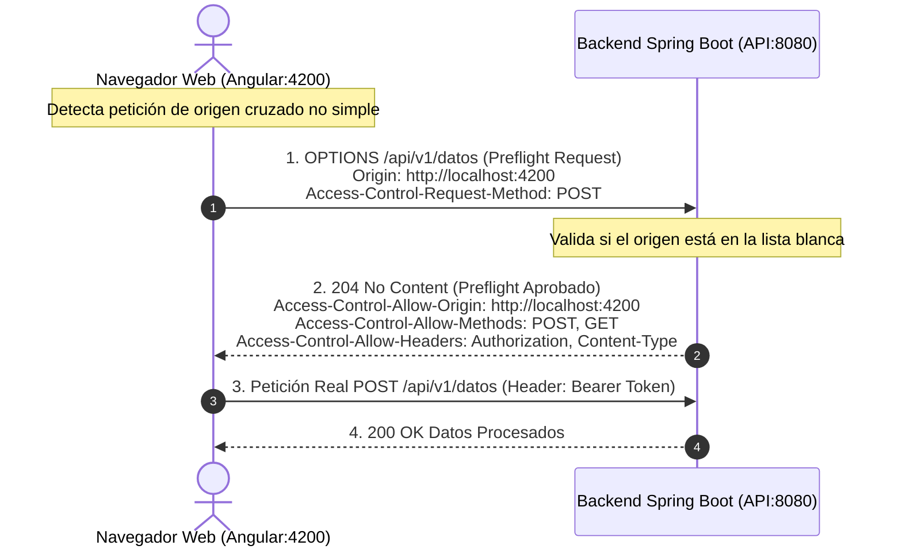

**UNIVERSIDAD DE COSTA RICA**  
**SEDE DEL ATLÁNTICO - RECINTO PARAÍSO**  
**CARRERA DE INFORMÁTICA EMPRESARIAL**  
**CURSO:** IF0009 - Desarrollo de Software IV  
**PROFESOR:** Mag. Jonathan Granados C.  
**SEMESTRE:** II-2026  

---

# Tema 6.5.2: Control de Acceso por Origen: Cross-Origin Resource Sharing (CORS) Riguroso y Peticiones Preflight

> [!NOTE]
> Este documento corresponde a la lectura técnica del **Subtema 6.5.2**. En esta unidad usted analizará el funcionamiento interno de la política de mismo origen (**Same-Origin Policy - SOP**) y el estándar **Cross-Origin Resource Sharing (CORS)**. Abordaremos el protocolo de peticiones pre-vuelo (**Preflight `OPTIONS`**), los riesgos de configuraciones permisivas con comodines (`*`) y la implementación de políticas CORS de alta precisión en **Spring Boot 3 / Java 25**.

---

## 1. Resumen Ejecutivo

Por diseño, los navegadores web restringen las llamadas de red realizadas mediante scripts JavaScript (como peticiones `fetch()` en Angular) hacia un dominio, puerto o protocolo distinto al de la página que cargó la aplicación. Esta restricción se denomina *Same-Origin Policy*. En este módulo, usted comprenderá cómo habilitar de forma segura el consumo cruzado de APIs REST mediante cabeceras CORS explícitas, cómo interactúa el navegador con las peticiones preliminares `OPTIONS`, y cómo evitar las vulnerabilidades habituales de configuración permisiva que exponen datos privados a dominios de terceros.

---

## 2. Concepto Principal (El "Qué"): Same-Origin Policy y Mecánica de CORS

### 2.1 Definición de "Origen" (Origin)
Dos URLs pertenecen al **mismo origen** si y solo si comparten de forma idéntica los tres componentes:
$$\text{Origen} = \text{Esquema (Protocolo)} + \text{Host (Dominio/IP)} + \text{Puerto}$$

Si una aplicación Angular corre en `http://localhost:4200` e intenta consumir una API Spring Boot en `http://localhost:8080`, el navegador detecta una discrepancia de puerto y bloquea la lectura de la respuesta a menos que el servidor devuelva cabeceras CORS autorizándolo.



### 2.2 Anatomía de las Cabeceras CORS
* `Access-Control-Allow-Origin`: Especifica el origen exacto autorizado (ej. `https://mi-app.ucr.ac.cr`).
* `Access-Control-Allow-Methods`: Verbos HTTP permitidos (`GET, POST, PUT, DELETE, OPTIONS`).
* `Access-Control-Allow-Headers`: Cabeceras que el cliente puede enviar (`Authorization, Content-Type, X-Requested-With`).
* `Access-Control-Allow-Credentials`: Booleano que indica si el navegador puede exponer la respuesta cuando la petición incluye cookies o credenciales de transporte.
* `Access-Control-Max-Age`: Tiempo en segundos que el navegador puede guardar en caché el resultado de la petición `OPTIONS` (reduciendo la sobrecarga de preflight).

---

## 3. Analogía Didáctica (La Intuición)

Piense en la política CORS como el protocolo diplomático de entrada a una embajada extranjera:
* **El Origen Cruzado:** Usted es un ciudadano de un país que desea realizar trámites en la embajada de otra nación. Las dos instituciones operan bajo leyes territoriales distintas (diferente origen).
* **Petición Preflight (`OPTIONS`):** Antes de enviar a su convoy oficial con documentos confidenciales, su gobierno envía un emisario desarmado a tocar el timbre de la embajada (petición pre-vuelo). El emisario pregunta: *"¿Acepta la embajada recibir al convoy del país A para entregar documentos de tipo pasaporte mediante el protocolo X?"*.
* **Respuesta Aprobatoria:** El cónsul responde: *"Sí, aceptamos únicamente al país A con ese protocolo"*. Solo entonces el convoy real avanza y entrega la información legítima.
* **El Peligro del Comodín (`*`):** Equivale a que la embajada coloque un cartel en la puerta diciendo: *"Cualquier persona de cualquier país del mundo puede entrar y revisar nuestros archivos de inteligencia con credenciales diplomáticas"*.

---

## 4. Implementación Técnica (El "Cómo"): CORS Seguro en Spring Boot 3 (Java 25)

En Spring Security 6, la configuración de CORS debe integrarse formalmente en el bean `SecurityFilterChain` mediante un `CorsConfigurationSource`:

```java
package com.ucr.seguridad.config;

import org.springframework.context.annotation.Bean;
import org.springframework.context.annotation.Configuration;
import org.springframework.security.config.Customizer;
import org.springframework.security.config.annotation.web.builders.HttpSecurity;
import org.springframework.security.config.annotation.web.configuration.EnableWebSecurity;
import org.springframework.security.web.SecurityFilterChain;
import org.springframework.web.cors.CorsConfiguration;
import org.springframework.web.cors.CorsConfigurationSource;
import org.springframework.web.cors.UrlBasedCorsConfigurationSource;
import java.util.List;

@Configuration
@EnableWebSecurity
public class CorsSeguroSecurityConfig {

    @Bean
    public SecurityFilterChain securityFilterChain(HttpSecurity http) 
            throws Exception {
        http
            .cors(Customizer.withDefaults()) // Activa el bean CorsConfigurationSource
            .csrf(csrf -> csrf.disable())
            .authorizeHttpRequests(auth -> auth
                .anyRequest().authenticated()
            );

        return http.build();
    }

    @Bean
    public CorsConfigurationSource corsConfigurationSource() {
        CorsConfiguration config = new CorsConfiguration();

        // 1. Lista blanca ESTRICTA de orígenes autorizados (NUNCA usar '*')
        config.setAllowedOrigins(List.of(
            "http://localhost:4200",               // Angular en Desarrollo
            "https://portal-estudiantes.ucr.ac.cr" // Angular en Producción
        ));

        // 2. Verbos HTTP explícitamente autorizados
        config.setAllowedMethods(List.of(
            "GET", "POST", "PUT", "PATCH", "DELETE", "OPTIONS"
        ));

        // 3. Cabeceras permitidas en las peticiones entrantes
        config.setAllowedHeaders(List.of(
            "Authorization", 
            "Content-Type", 
            "Accept", 
            "X-Requested-With"
        ));

        // 4. Cabeceras que el frontend puede leer en la respuesta
        config.setExposedHeaders(List.of(
            "X-Total-Count", 
            "Link"
        ));

        // 5. Permitir credenciales de transporte (tokens o cookies)
        config.setAllowCredentials(true);

        // 6. Caché del Preflight por 1 hora (3600 segundos) para optimizar rendimiento
        config.setMaxAge(3600L);

        UrlBasedCorsConfigurationSource source = 
            new UrlBasedCorsConfigurationSource();
        // Aplica esta política exclusivamente a las rutas de la API REST
        source.registerCorsConfiguration("/api/**", config);
        
        return source;
    }
}
```

---

## 5. Trampas Comunes y Antipatrones

*   **Configurar `Access-Control-Allow-Origin: *` con `Allow-Credentials: true`:** Los navegadores modernos bloquean activamente esta combinación por violar los estándares del W3C. Si se requieren credenciales, el origen **debe ser explícito y no un comodín**.
*   **Creer que CORS es un firewall del lado del servidor:** CORS es una política impuesta **únicamente por los navegadores web**. Un atacante que ejecute un script en Python, cURL o Postman **no respeta las cabeceras CORS** y puede enviar peticiones directamente al backend. CORS no sustituye la autenticación ni la autorización.
*   **Configurar CORS con anotaciones `@CrossOrigin` desordenadas:** Esparcir `@CrossOrigin(origins = "*")` en cada controlador genera inconsistencias y políticas excesivamente permisivas. Centralice siempre en un `CorsConfigurationSource`.

---

## 6. Preguntas de Reflexión y Autoevaluación

1. ¿Por qué una aplicación nativa construida en Flutter para Android o iOS no emite peticiones pre-vuelo `OPTIONS` ni se ve bloqueada por las políticas de CORS de un navegador?
2. Si un atacante programa un script malicioso en Python desde su terminal para descargar datos de su API, ¿de qué forma le impedirá la política de CORS que realice la descarga? Justifique su análisis técnico.

