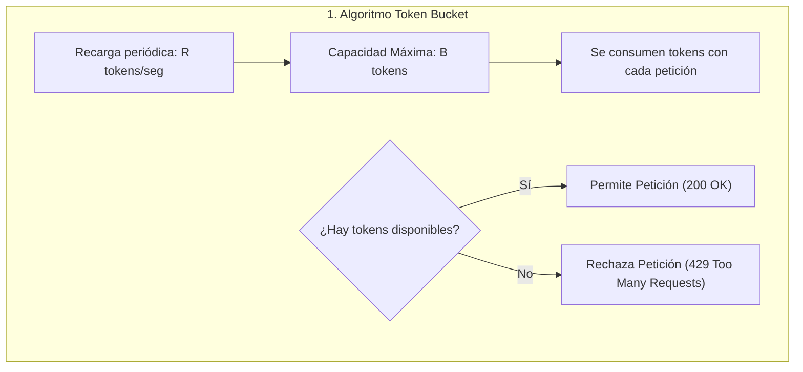

**UNIVERSIDAD DE COSTA RICA**  
**SEDE DEL ATLÁNTICO - RECINTO PARAÍSO**  
**CARRERA DE INFORMÁTICA EMPRESARIAL**  
**CURSO:** IF0009 - Desarrollo de Software IV  
**PROFESOR:** Mag. Jonathan Granados C.  
**SEMESTRE:** II-2026  

---

# Tema 6.5.3: Limitación de Tasa (Rate Limiting), Cuotas de Petición y Resiliencia contra Denegación de Servicio (DoS)

> [!NOTE]
> Este documento corresponde a la lectura técnica del **Subtema 6.5.3**. En esta lección usted analizará los algoritmos de control de flujo y limitación de tasa (**Rate Limiting**), contrastando los patrones **Token Bucket**, **Leaky Bucket** y **Ventana Deslizante**. Diseñaremos una estrategia de mitigación de saturación en **Spring Boot 3 / Java 25** con **Bucket4j**, estandarizando las respuestas mediante el código de estado **HTTP 429 Too Many Requests** y la cabecera **`Retry-After`**.

---

## 1. Resumen Ejecutivo

Una API que no imponga límites de consumo es vulnerable a ataques de fuerza bruta contra endpoints de login, saturación maliciosa de base de datos (DoS) y degradación de servicio por clientes mal programados con bucles infinitos de reintento. En este módulo, usted profundizará en las técnicas computacionales para medir y acotar el tráfico entrante por dirección IP o identidad de usuario, implementando un filtro de seguridad en Java 25 que proteja la estabilidad operacional de la plataforma sin penalizar el tráfico legítimo.

---

## 2. Concepto Principal (El "Qué"): Algoritmos de Limitación de Tasa



### 2.1 Comparativa de Algoritmos de Control de Tráfico

| Algoritmo | Mecánica de Funcionamiento | Ventajas Técnicas | Casos de Uso |
| :--- | :--- | :--- | :--- |
| **Token Bucket** | Se acumulan tokens en un contenedor a tasa constante. Cada petición gasta 1 token. Si está vacío, se rechaza. | Permite **ráfagas controladas** (*bursts*) de tráfico rápido sin perder datos. | APIs REST empresariales y pasarelas de pago. |
| **Leaky Bucket** | Las peticiones entran a una cola FIFO y se despachan a una tasa fija invariable (goteo continuo). | Suaviza el tráfico eliminando cualquier pico de consumo repentino. | Procesamiento asíncrono de colas y webhooks. |
| **Sliding Window Counter** | Mide el número de peticiones combinando el conteo de la ventana de tiempo anterior ponderado por el tiempo transcurrido. | Evita el "ataque del borde de ventana" (*Boundary Attack*) con mínimo uso de memoria. | Rate limiting distribuido en clusters Redis. |

### 2.2 Estándares HTTP para Rate Limiting
Cuando un cliente excede su cuota autorizada, la API debe devolver:
* **Código de Estado HTTP:** `429 Too Many Requests`.
* **Cabecera `Retry-After`:** Indica la cantidad exacta de segundos que el cliente debe esperar antes de reintentar:
  ```http
  HTTP/1.1 429 Too Many Requests
  Retry-After: 30
  X-RateLimit-Limit: 100
  X-RateLimit-Remaining: 0
  Content-Type: application/json
  ```

---

## 3. Analogía Didáctica (La Intuición)

* **Token Bucket (Balde de Fichas):** Imagine una atracción en un parque de diversiones donde usted tiene una bandeja con capacidad máxima de 10 fichas (Capacidad del balde). Cada minuto, un operador coloca 2 fichas nuevas en su bandeja (Tasa de recarga). Si usted desea subirse a la montaña rusa, entrega 1 ficha. Si llega un grupo de 5 amigos al mismo tiempo, pueden subirse de inmediato porque la bandeja tenía fichas acumuladas (soporte para ráfagas). Pero si el grupo gasta todas las fichas, nadie más podrá subir hasta que el operador agregue nuevas fichas con el paso del tiempo.
* **Leaky Bucket (Balde Perforado):** Es un embudo donde se vierte agua de golpe; el agua saldrá siempre gota a gota a velocidad fija por el orificio inferior, sin importar con qué violencia se haya vertido el líquido arriba.

---

## 4. Implementación Técnica (El "Cómo"): Filtro de Rate Limiting con Bucket4j en Java 25

Implementaremos un filtro `OncePerRequestFilter` en Spring Boot 3 que limita las peticiones por dirección IP remota a un máximo de **10 peticiones por minuto con capacidad de ráfaga de hasta 20 tokens**:

### 4.1 Dependencia en `pom.xml`
```xml
<dependency>
    <groupId>com.bucket4j</groupId>
    <artifactId>bucket4j-core</artifactId>
    <version>8.10.1</version>
</dependency>
```

### 4.2 Filtro de Control de Tasa en Java 25

```java
package com.ucr.seguridad.filter;

import io.github.bucket4j.Bandwidth;
import io.github.bucket4j.Bucket;
import io.github.bucket4j.Refill;
import jakarta.servlet.FilterChain;
import jakarta.servlet.ServletException;
import jakarta.servlet.http.HttpServletRequest;
import jakarta.servlet.http.HttpServletResponse;
import org.springframework.http.HttpStatus;
import org.springframework.stereotype.Component;
import org.springframework.web.filter.OncePerRequestFilter;
import java.io.IOException;
import java.time.Duration;
import java.util.Map;
import java.util.concurrent.ConcurrentHashMap;

@Component
public class RateLimitingFilter extends OncePerRequestFilter {

    // Almacena un balde de tokens independiente por cada IP remota
    private final Map<String, Bucket> bucketsPorIp = new ConcurrentHashMap<>();

    // Crea la configuración de tasa: 10 tokens por minuto, capacidad de 20
    private Bucket crearNuevoBucket() {
        Refill recarga = Refill.greedy(10, Duration.ofMinutes(1));
        Bandwidth limite = Bandwidth.classic(20, recarga);
        return Bucket.builder().addLimit(limite).build();
    }

    @Override
    protected void doFilterInternal(
            HttpServletRequest request, 
            HttpServletResponse response, 
            FilterChain filterChain) throws ServletException, IOException {
        
        // Obtiene la IP cliente (contemplando proxies inversos)
        String ipCliente = obtenerIpCliente(request);
        Bucket bucket = bucketsPorIp.computeIfAbsent(ipCliente, k -> crearNuevoBucket());

        // Intenta consumir 1 token para la petición actual
        if (bucket.tryConsume(1)) {
            // Se permite el paso al siguiente filtro / controlador
            response.addHeader("X-RateLimit-Remaining", 
                String.valueOf(bucket.getAvailableTokens()));
            filterChain.doFilter(request, response);
        } else {
            // Cuota agotada: Rechazar con HTTP 429
            response.setStatus(HttpStatus.TOO_MANY_REQUESTS.value());
            response.setHeader("Retry-After", "60");
            response.setContentType("application/json;charset=UTF-8");
            response.getWriter().write("""
                {
                  "status": 429,
                  "error": "Too Many Requests",
                  "message": "Ha excedido el límite permitido de peticiones. Intente más tarde.",
                  "retryAfterSeconds": 60
                }
                """);
        }
    }

    private String obtenerIpCliente(HttpServletRequest request) {
        String xForwardedFor = request.getHeader("X-Forwarded-For");
        if (xForwardedFor != null && !xForwardedFor.isBlank()) {
            return xForwardedFor.split(",")[0].trim();
        }
        return request.getRemoteAddr();
    }
}
```

---

## 5. Trampas Comunes y Antipatrones

*   **Rate Limiting basado únicamente en `getRemoteAddr()`:** En infraestructuras con balanceadores de carga o proxies inversos (Nginx, AWS ALB), `getRemoteAddr()` devuelve la IP interna del proxy para todos los usuarios. Si no se inspecciona la cabecera `X-Forwarded-For`, el sistema bloqueará a todos los clientes del mundo cuando uno solo exceda la cuota.
*   **Almacenar baldes en memoria sin expiración:** En un mapa en memoria `ConcurrentHashMap`, acumular millones de IPs a lo largo del tiempo satura la memoria heap de la JVM. Se debe emplear un almacén con tiempo de vida (TTL) como **Redis**.
*   **No comunicar la cabecera `Retry-After`:** Provoca que los clientes continúen reintentando frenéticamente, empeorando la congestión de la red.

---

## 6. Preguntas de Reflexión y Autoevaluación

1. ¿Por qué el algoritmo de *Token Bucket* es preferido sobre el algoritmo de *Ventana Fija* en pasarelas de pago y servicios de autenticación empresarial?
2. Si un atacante despliega una botnet distribuida con miles de IPs distintas que emiten una única petición cada 10 minutos contra un endpoint de login, ¿por qué el rate limiting basado en IP resulta ineficaz y qué técnica alternativa debe implementarse?

