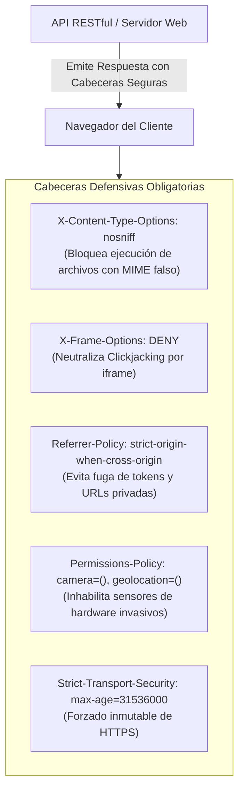

**UNIVERSIDAD DE COSTA RICA**  
**SEDE DEL ATLÁNTICO - RECINTO PARAÍSO**  
**CARRERA DE INFORMÁTICA EMPRESARIAL**  
**CURSO:** IF0009 - Desarrollo de Software IV  
**PROFESOR:** Mag. Jonathan Granados C.  
**SEMESTRE:** II-2026  

---

# Tema 6.5.4: Cabeceras de Seguridad HTTP Defensivas: Blindaje contra MIME Sniffing, Clickjacking y Fuga de Referrers

> [!NOTE]
> Este documento corresponde a la lectura técnica del **Subtema 6.5.4**. En esta lección usted analizará el catálogo de cabeceras de respuesta HTTP defensivas recomendadas por OWASP. Aprenderá a mitigar la adivinanza de tipos MIME (**MIME-Sniffing**), neutralizar ataques de incrustación oculta (**Clickjacking**), restringir el uso de hardware invasivo con **`Permissions-Policy`** y aplicar estas políticas de forma global en **Spring Boot 3 / Java 25**.

---

## 1. Resumen Ejecutivo

La comunicación HTTP entre clientes y servidores no transporta únicamente cargas útiles de datos, sino también metadatos de control que instruyen al motor del navegador sobre cómo interpretar y confinar la respuesta. Omitir estas cabeceras defensivas expone a los usuarios a ataques donde imágenes manipuladas son interpretadas como scripts ejecutables o interfaces legítimas son superpuestas de manera invisible en ventanas maliciosas. En este módulo, usted aprenderá a inyectar y verificar el conjunto completo de cabeceras de seguridad estandarizadas.

---

## 2. Concepto Principal (El "Qué"): Las 5 Cabeceras Defensivas Esenciales



### 2.1 Detalle Técnico de cada Cabecera

#### 1. `X-Content-Type-Options: nosniff`
Históricamente, los navegadores intentaban "ayudar" al usuario adivinando el tipo de archivo si el servidor no declaraba el `Content-Type` correcto (*MIME-Sniffing*). Un atacante podía subir un archivo malicioso con extensión `.png` que contenía código JavaScript; el navegador lo interpretaba como `text/javascript` y lo ejecutaba. Al configurar `nosniff`, el navegador está obligado a respetar estrictamente el `Content-Type` declarado por el servidor o descartar el recurso.

#### 2. `X-Frame-Options: DENY / SAMEORIGIN`
Mitiga el ataque de **Clickjacking** (secuestro de clics). En este ataque, una página maliciosa carga su aplicación legítima dentro de un `<iframe>` invisible con opacidad 0% y coloca botones engañosos encima (ej. *"Haga clic aquí para ganar un premio"*), induciendo al usuario a pulsar botones reales de su sistema (como *"Eliminar cuenta"* o *"Transferir dinero"*). `DENY` impide que cualquier sitio web incruste sus vistas en un iframe.

#### 3. `Referrer-Policy: strict-origin-when-cross-origin`
Cuando un usuario hace clic en un enlace externo desde su aplicación, el navegador envía la cabecera `Referer` con la URL completa de procedencia. Si su URL contenía identificadores confidenciales (`/expediente/1042/paciente-juan`), el sitio de destino recibirá esa información privada. Esta directiva envía la URL completa solo en el mismo origen, y únicamente el nombre de dominio (`https://ucr.ac.cr`) al navegar a sitios externos.

#### 4. `Permissions-Policy` (Reemplazo moderno de Feature-Policy)
Permite al servidor deshabilitar selectivamente el acceso a capacidades del dispositivo en el navegador (cámara, micrófono, geolocalización, acelerómetro):
```http
Permissions-Policy: camera=(), microphone=(), geolocation=(), payment=()
```

---

## 3. Analogía Didáctica (La Intuición)

* **`X-Content-Type-Options: nosniff`:** Es un farmacéutico riguroso que solo suministra medicamentos cuya etiqueta oficial diga claramente "Antibiótico". Si alguien le entrega un frasco con veneno líquido pero con olor a jarabe de fresas, el farmacéutico lo rechaza de inmediato porque la etiqueta no declara exactamente la fórmula autorizada.
* **Clickjacking y `X-Frame-Options`:** Imagine que un delincuente coloca una lámina de plástico transparente sobre el teclado de un cajero automático real, alineando un formulario falso encima que dice: *"Firma de petición comunitaria"*. Cuando usted firma sobre el papel transparente, su bolígrafo está presionando sin que usted lo sepa el botón de *"Autorizar retiro de fondos"* en el cajero real que está debajo. `X-Frame-Options: DENY` es un sensor que vuelve la pantalla del cajero completamente negra en cuanto detecta que alguien intenta colocar una lámina encima.

---

## 4. Implementación Técnica (El "Cómo"): Hardening Integral en Spring Boot 3 / Java 25

Configuramos el bean de seguridad inyectando todas las cabeceras defensivas conforme al estándar OWASP Secure Headers Project:

```java
package com.ucr.seguridad.config;

import org.springframework.context.annotation.Bean;
import org.springframework.context.annotation.Configuration;
import org.springframework.security.config.annotation.web.builders.HttpSecurity;
import org.springframework.security.config.annotation.web.configuration.EnableWebSecurity;
import org.springframework.security.web.SecurityFilterChain;
import org.springframework.security.web.header.writers.ReferrerPolicyHeaderWriter;

@Configuration
@EnableWebSecurity
public class CabecerasDefensivasConfig {

    @Bean
    public SecurityFilterChain filterChain(HttpSecurity http) throws Exception {
        http
            .headers(headers -> headers
                // 1. Previene MIME-Sniffing (X-Content-Type-Options: nosniff)
                .contentTypeOptions(customizer -> {})
                
                // 2. Previene Clickjacking (X-Frame-Options: DENY)
                .frameOptions(frame -> frame.deny())
                
                // 3. Forzado estricto de HTTPS (HSTS por 1 año)
                .httpStrictTransportSecurity(hsts -> hsts
                    .includeSubDomains(true)
                    .maxAgeInSeconds(31536000)
                    .preload(true)
                )
                
                // 4. Política de Referrer para evitar fuga de rutas privadas
                .referrerPolicy(referrer -> referrer
                    .policy(ReferrerPolicyHeaderWriter.ReferrerPolicy
                        .STRICT_ORIGIN_WHEN_CROSS_ORIGIN)
                )
                
                // 5. Inyección manual de Permissions-Policy moderna
                .addHeaderWriter((request, response) -> {
                    response.setHeader(
                        "Permissions-Policy", 
                        "camera=(), microphone=(), geolocation=(), payment=()"
                    );
                    // Oculta metadatos del servidor para evitar finger-printing
                    response.setHeader("X-Permitted-Cross-Domain-Policies", "none");
                })
            );

        return http.build();
    }
}
```

---

## 5. Trampas Comunes y Antipatrones

*   **Exponer cabeceras que revelan la tecnología del servidor:** Dejar activas cabeceras por defecto como `Server: Apache-Coyote/1.1` o `X-Powered-By: Express`. Estas cabeceras permiten a un atacante identificar con precisión la versión exacta del servidor y buscar CVEs conocidos para esa versión específica.
*   **Permitir iframes en sitios bancarios (`SAMEORIGIN` laxo):** Si su sitio web tiene una vulnerabilidad XSS en cualquier subpágina, un atacante dentro del mismo origen podrá incrustar la página de pagos en un iframe y capturar los clics del usuario.
*   **No verificar las cabeceras con herramientas automatizadas:** No incluir auditorías periódicas con herramientas como SecurityHeaders.com u OWASP ZAP en el pipeline de CI/CD.

---

## 6. Preguntas de Reflexión y Autoevaluación

1. Si una aplicación web no contiene ningún script JavaScript de terceros, ¿por qué sigue siendo necesario declarar la cabecera `X-Content-Type-Options: nosniff` en endpoints que permiten la descarga o visualización de imágenes subidas por los usuarios?
2. ¿Cuál es el impacto en la privacidad de los usuarios si un sistema médico omite la cabecera `Referrer-Policy: strict-origin-when-cross-origin` y coloca enlaces a sitios web de salud externos?

