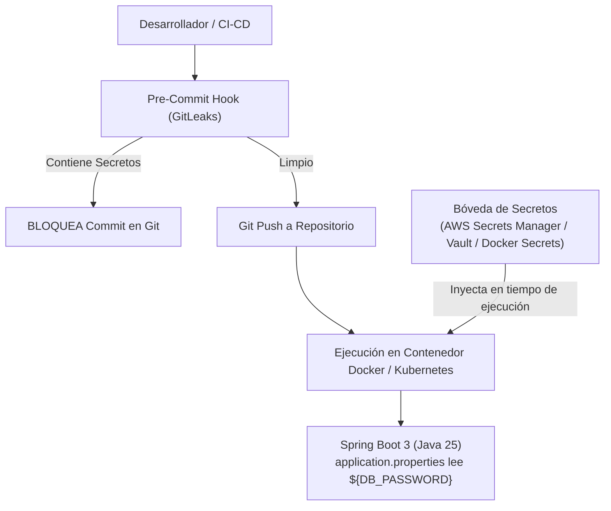

**UNIVERSIDAD DE COSTA RICA**  
**SEDE DEL ATLÁNTICO - RECINTO PARAÍSO**  
**CARRERA DE INFORMÁTICA EMPRESARIAL**  
**CURSO:** IF0009 - Desarrollo de Software IV  
**PROFESOR:** Mag. Jonathan Granados C.  
**SEMESTRE:** II-2026  

---

# Tema 6.6.1: Gestión de Secretos y Configuración Externa: 12-Factor App, Detección con GitLeaks y Bóvedas en la Nube

> [!NOTE]
> Este documento corresponde a la lectura técnica del **Subtema 6.6.1**. En esta lección usted analizará la administración de secretos criptográficos, credenciales de base de datos y llaves privadas en arquitecturas nativas de la nube (*Cloud-Native*). Estudiaremos el **Factor III de las 12-Factor Apps**, herramientas automatizadas para auditoría de repositorios (**GitLeaks**) y patrones de inyección segura con gestores de secretos en **Spring Boot 3 / Java 25**.

---

## 1. Resumen Ejecutivo

Uno de los errores más frecuentes y costosos en la industria del software es la exposición involuntaria de credenciales en repositorios de control de versiones (*Hardcoded Credentials*). Los motores de indexación y atacantes automatizados rastrean plataformas públicas como GitHub en cuestión de segundos, comprometiendo bases de datos y generando cargos financieros astronómicos por consumo indebido de APIs en la nube. En este módulo, usted comprenderá cómo desacoplar la configuración sensible del código fuente, cómo implementar compuertas de inspección previa a los commits (*pre-commit hooks*) y cómo operar con almacenes de secretos centralizados.

---

## 2. Concepto Principal (El "Qué"): Desacoplamiento de Configuración y Ciclo de Vida de Secretos



### 2.1 El Factor III de The Twelve-Factor App
La metodología de las 12-Factor Apps estipula con claridad:
* **Separación Estricta:** El código fuente debe ser completamente agnóstico al entorno. Si el repositorio fuera publicado como código abierto (*Open Source*) el día de mañana, **ninguna credencial secreta debería quedar expuesta**.
* **Almacenamiento en Variables de Entorno:** Las credenciales de bases de datos, claves de cifrado y tokens de servicios de terceros se inyectan dinámicamente desde el entorno de ejecución del sistema operativo o contenedor.

### 2.2 Auditoría y Detección de Secretos en Git
Hacer un nuevo commit que elimine la contraseña del archivo `.properties` **no soluciona la fuga**: Git es un grafo inmutable y el secreto permanece visible para siempre en el historial de confirmaciones (`git log`).
* **Herramientas de Auditoría:** `gitleaks`, `trufflehog` y `git-secrets`.
* **Procedimiento de Emergencia ante Compromiso:**
  1. **Rotación Inmediata:** Asumir que la credencial ya fue capturada y revocarla inmediatamente en el proveedor (AWS, base de datos, Stripe).
  2. **Reescritura de Historial:** Purgar el commit del árbol de Git con herramientas especializadas como `git-filter-repo` o BFG Repo-Cleaner.

---

## 3. Analogía Didáctica (La Intuición)

* **Secretos en Código:** Imagine que usted manda a construir una casa y le pide al cerrajero que grabe el código numérico de la alarma de seguridad directamente con cincel en la fachada visible de la puerta principal para no olvidarlo. Cualquier persona que pase por la acera verá la combinación y entrará a su casa.
* **Inyección de Secretos:** Equivale a que la cerradura sea un teclado electrónico en blanco, y usted le entrega el código secreto en un papel sellado únicamente al residente autorizado en el momento exacto en que entra a vivir a la casa. La puerta no sabe ni almacena la clave en su estructura física de madera.

---

## 4. Implementación Técnica (El "Cómo"): Inyección Segura en Spring Boot 3 / Java 25

Spring Boot permite mapear variables de entorno directamente sobre las propiedades de configuración mediante la sintaxis `${VARIABLE:valor_por_defecto}`.

### 4.1 Archivo `application.yml` Seguro sin Credenciales Quemadas

```yaml
spring:
  application:
    name: servicio-expedientes-seguro
  datasource:
    # URL inyectada por variable de entorno, con fallback para H2 en desarrollo
    url: ${SPRING_DATASOURCE_URL:jdbc:h2:mem:testdb;DB_CLOSE_DELAY=-1}
    username: ${SPRING_DATASOURCE_USERNAME:sa}
    # La contraseña NO tiene valor por defecto en producción; falla si no se inyecta
    password: ${SPRING_DATASOURCE_PASSWORD}
    hikari:
      maximum-pool-size: 10
      minimum-idle: 2

app:
  jwt:
    # Clave de firma inyectada en runtime desde el Secret Manager
    secret-key: ${JWT_SECRET_KEY}
```

### 4.2 Configuración del Pre-Commit Hook con GitLeaks
Para impedir que cualquier desarrollador envíe secretos accidentalmente a GitHub, creamos el archivo `.gitleaks.toml` en la raíz del proyecto:

```toml
# .gitleaks.toml
[extend]
useDefault = true

[[rules]]
id = "spring-password-detection"
description = "Detecta claves expuestas en archivos application.properties o yml"
regex = '''(?i)(password|secret|apikey|token)\s*[:=]\s*['"][a-zA-Z0-9_\-!@#$%^&*]{8,}['"]'''
entropy = 3.5
```

Instalamos el hook en `.git/hooks/pre-commit`:
```bash
#!/bin/sh
# Ejecuta gitleaks antes de permitir el commit local
gitleaks protect --verbose --staged
if [ $? -ne 0 ]; then
    echo "¡ERROR DE SEGURIDAD! GitLeaks detectó un secreto en los archivos preparados."
    echo "Elimine la credencial y configure una variable de entorno antes de confirmar."
    exit 1
fi
```

---

## 5. Trampas Comunes y Antipatrones

*   **Subir archivos `.env` al repositorio Git:** Crear un archivo `.env` pero olvidar incluirlo explícitamente en el archivo `.gitignore`.
*   **Creer que un commit de borrado elimina el secreto:** Hacer un commit titulado *"Borra credencial expuesta"*. La clave sigue estando disponible en el historial de commits anteriores de Git y los bots la habrán raspado en segundos.
*   **Imprimir variables de entorno en logs de inicio:** Configurar comandos como `System.getenv().forEach(...)` para depurar el arranque del contenedor. Esto traslada todos los secretos a los sistemas centralizados de logs (Splunk, Datadog).

---

## 6. Preguntas de Reflexión y Autoevaluación

1. Si un desarrollador publica accidentalmente una clave de API de AWS en un repositorio privado de GitHub, ¿por qué debe proceder a la revocación y rotación inmediata de la clave en lugar de simplemente eliminar el archivo?
2. ¿Qué diferencia operacional existe entre inyectar secretos mediante variables de entorno del sistema frente a utilizar montajes de archivos en memoria con **Docker Secrets** o Kubernetes Secrets?

