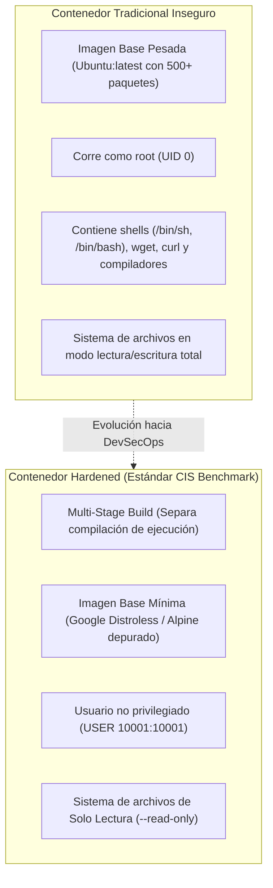

**UNIVERSIDAD DE COSTA RICA**  
**SEDE DEL ATLÁNTICO - RECINTO PARAÍSO**  
**CARRERA DE INFORMÁTICA EMPRESARIAL**  
**CURSO:** IF0009 - Desarrollo de Software IV  
**PROFESOR:** Mag. Jonathan Granados C.  
**SEMESTRE:** II-2026  

---

# Tema 6.6.2: Hardening de Imágenes y Contenedores Docker: Contenedores No-Root, Distroless y Multi-Stage Builds

> [!NOTE]
> Este documento corresponde a la lectura técnica del **Subtema 6.6.2**. En esta unidad usted analizará las mejores prácticas para el aseguramiento (*Hardening*) de contenedores Docker en entornos de producción. Abordaremos la mitigación de escapes de contenedor mediante la ejecución sin privilegios de superusuario (**Non-Root Containers**), la minimización de la superficie de ataque utilizando imágenes **Distroless**, y la construcción multi-etapa (**Multi-Stage Builds**) optimizada para **Spring Boot 3 en Java 25**.

---

## 1. Resumen Ejecutivo

La contenerización mediante Docker proporciona portabilidad y aislamiento; sin embargo, un contenedor no es una máquina virtual completa. Los contenedores comparten directamente el kernel del sistema operativo anfitrión (*Host Kernel*). Si un proceso dentro de un contenedor corre como usuario `root` (UID 0) y sufre una vulnerabilidad de ejecución remota de código, el atacante puede romper el aislamiento (*Container Breakout*) y tomar el control total del servidor físico. En este módulo, usted aprenderá a construir imágenes Docker reforzadas, desprovistas de intérpretes shell innecesarios y configuradas bajo el principio de menor privilegio.

---

## 2. Concepto Principal (El "Qué"): Superficie de Ataque y Reglas CIS Docker Benchmark



### 2.1 Principios Críticos de Aseguramiento

#### 1. Nunca ejecutar como `root` (Non-Root Containers)
Por defecto, si no se especifica la directiva `USER` en el `Dockerfile`, Docker ejecuta la aplicación con UID 0 (`root`). Si la aplicación tiene una vulnerabilidad de sobrescritura de archivos o deserialización, el atacante tiene privilegios de superusuario para interactuar con llamadas al kernel (`syscalls`), acceder a dispositivos `/dev` o modificar configuraciones del sistema.
* **Solución:** Crear un usuario y grupo dedicado sin privilegios (ej. `appuser` con UID 10001) y asignarle la propiedad exclusiva del directorio de la aplicación.

#### 2. Imágenes Base Mínimas y Filosofía Distroless
* Una imagen completa de Linux (`ubuntu`, `debian`) incluye paquetes de red, gestores de paquetes (`apt`), editores de texto y binarios como `curl` o `netcat`. Si un atacante inyecta comandos, usará estos binarios preinstalados para descargar malware o crear shells inversas (*Reverse Shells*).
* **Imágenes Distroless (GoogleContainerTools):** Contienen **únicamente** el entorno de ejecución de Java (JVM) y sus dependencias estrictas de sistema (glibc). **No contienen gestor de paquetes ni shells (`/bin/sh`)**. Si el atacante intenta invocar un comando bash, la ejecución fallará porque el archivo ejecutable ni siquiera existe en la imagen.

#### 3. Sistema de Archivos de Solo Lectura (`--read-only`)
Permite ejecutar el contenedor con su sistema de archivos raíz montado en modo lectura estricto, impidiendo que cualquier malware modifique archivos de sistema o instale binarios en disco. Los directorios temporales requeridos por la JVM se montan en memoria volátil (`tmpfs`).

---

## 3. Analogía Didáctica (La Intuición)

* **Contenedor Tradicional con Root:** Piense en rentar una habitación de hotel (el contenedor) donde el huésped recibe la llave maestra de todo el edificio (usuario `root`). Además, la habitación viene equipada con un soplete industrial, un taladro de banco y ganzúas (herramientas del sistema operativo como `curl`, `bash`, `apt`). Si el huésped resulta ser un delincuente, podrá perforar las paredes y entrar a las habitaciones vecinas con total impunidad.
* **Contenedor Hardened (Distroless + Non-Root):** Equivale a una cabina sellada donde el huésped solo tiene una cama y un interruptor de luz. No hay herramientas, no hay puertas de servicio y las paredes están blindadas en modo de solo lectura. El huésped no puede romper nada porque no tiene herramientas ni privilegios dentro del cuarto.

---

## 4. Implementación Técnica (El "Cómo"): Dockerfile Multi-Stage Hardened para Java 25

Implementamos un `Dockerfile` en dos etapas: la primera compila el proyecto con Maven y Java 25, y la segunda empaqueta el `.jar` en una imagen Distroless sin privilegios de root:

```dockerfile
# ==============================================================================
# ETAPA 1: Compilación y Construcción del Artefacto (Build Stage)
# ==============================================================================
FROM maven:3.9.6-eclipse-temurin-25 AS builder

WORKDIR /build

# 1. Copiamos los descriptores de dependencias para aprovechar la caché de Docker
COPY pom.xml .
RUN mvn dependency:go-offline -B

# 2. Copiamos el código fuente y compilamos el paquete ejecutable
COPY src ./src
RUN mvn clean package -DskipTests -B

# ==============================================================================
# ETAPA 2: Entorno de Ejecución Seguro (Runtime Stage - Distroless)
# ==============================================================================
FROM gcr.io/distroless/java25-debian12:nonroot

WORKDIR /app

# 1. Copiamos únicamente el binario compilado desde la etapa de construcción
COPY --from=builder /build/target/*.jar /app/aplicacion.jar

# 2. Cambiamos al usuario sin privilegios predefinido en la imagen distroless (UID 65532)
USER nonroot:nonroot

# 3. Exponemos el puerto de red de la API
EXPOSE 8080

# 4. Parámetros de la JVM optimizados para contenedores (cgroups v2)
ENV JAVA_TOOL_OPTIONS="-XX:MaxRAMPercentage=75.0 -XX:+UseG1GC -Djava.security.egd=file:/dev/./urandom"

# 5. Punto de entrada inmutable
ENTRYPOINT ["java", "-jar", "/app/aplicacion.jar"]
```

### 4.2 Comando de Despliegue con Sistema de Archivos Read-Only

Para ejecutar el contenedor con el máximo nivel de restricción en producción:

```bash
docker run -d \
  --name api-segura \
  --read-only \
  --tmpfs /tmp:rw,noexec,nosuid,size=64m \
  -p 8080:8080 \
  --security-opt=no-new-privileges:true \
  --cap-drop=ALL \
  api-segura-distroless:latest
```

**Análisis de parámetros defensivos:**
* `--read-only`: El sistema de archivos del contenedor es de solo lectura.
* `--tmpfs /tmp`: Monta un directorio temporal en memoria RAM para operaciones de Tomcat sin persistencia en disco.
* `--security-opt=no-new-privileges:true`: Impide que procesos eleven privilegios mediante llamadas `setuid`.
* `--cap-drop=ALL`: Elimina todas las capacidades (*Linux Capabilities*) del kernel no indispensables.

---

## 5. Trampas Comunes y Antipatrones

*   **Copiar el código fuente completo en la imagen final:** No usar Multi-Stage Builds, dejando archivos de configuración, código fuente `.java` y herramientas de compilación (`mvn`) dentro del contenedor productivo.
*   **Usar la etiqueta `latest` en imágenes base:** Configurar `FROM openjdk:latest`. Esta práctica provoca roturas inesperadas y despliegues con versiones no auditadas que pueden incorporar vulnerabilidades imprevistas.
*   **Almacenar logs en disco dentro del contenedor:** Forzar que la aplicación escriba logs en un archivo físico `/app/logs/app.log`. Esto falla en contenedores `--read-only` y satura el espacio. En contenedores, los logs **siempre deben enviarse a `stdout` y `stderr`** (Factor XI de 12-Factor App).

---

## 6. Preguntas de Reflexión y Autoevaluación

1. ¿Por qué una imagen Docker basada en Google Distroless dificulta drásticamente la explotación de un atacante que haya logrado inyección de comandos en la aplicación Java?
2. Si un contenedor se ejecuta con la bandera `--read-only`, ¿dónde deben almacenarse los archivos temporales generados por la JVM o por subidas de archivos en memoria?

