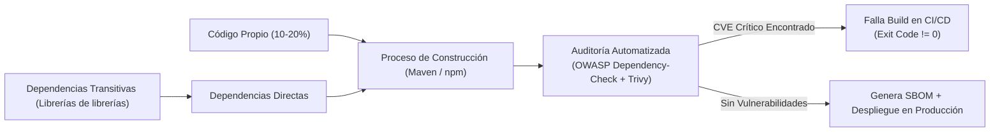

**UNIVERSIDAD DE COSTA RICA**  
**SEDE DEL ATLÁNTICO - RECINTO PARAÍSO**  
**CARRERA DE INFORMÁTICA EMPRESARIAL**  
**CURSO:** IF0009 - Desarrollo de Software IV  
**PROFESOR:** Mag. Jonathan Granados C.  
**SEMESTRE:** II-2026  

---

# Tema 6.6.3: Seguridad en la Cadena de Suministro de Software (Supply Chain Security): Auditoría de CVEs, SBOM y Escaneo con Trivy

> [!NOTE]
> Este documento corresponde a la lectura técnica del **Subtema 6.6.3**. En esta lección usted analizará la seguridad en la cadena de suministro de software (*Software Supply Chain Security*), examinando los vectores de contaminación de dependencias de código abierto, la detección de vulnerabilidades y exposiciones comunes (**CVEs**), la auditoría automatizada con **OWASP Dependency-Check**, el escaneo de imágenes con **Trivy** y la generación de inventarios **SBOM (Software Bill of Materials)**.

---

## 1. Resumen Ejecutivo

En el desarrollo de software empresarial contemporáneo, más del 80% de las líneas de código que componen un binario desplegado no fueron escritas por el equipo de desarrollo, sino que provienen de librerías de terceros y dependencias transitivas (paquetes de Maven Central, npm o paquetes de Flutter en pub.dev). Si una sola de estas librerías contiene una vulnerabilidad crítica (como ocurrió globalmente con **Log4Shell - CVE-2021-44228**), la aplicación completa queda expuesta a compromiso remoto. En este módulo, usted aprenderá a blindar su pipeline de integración continua (CI/CD) mediante compuertas de seguridad automatizadas que detienen el despliegue si se detectan paquetes con riesgos no mitigados.

---

## 2. Concepto Principal (El "Qué"): Vectores de Ataque en la Cadena de Suministro



### 2.1 Taxonomía de Ataques a la Cadena de Suministro
1. **Compromiso de Dependencias Transitivas:** Un atacante vulnera la cuenta del mantenedor de una pequeña biblioteca de utilidad de la cual dependen cientos de frameworks populares, inyectando código malicioso en una actualización automática menor.
2. **Typosquatting:** Publicación de paquetes con nombres casi idénticos a librerías populares (ejemplo: `lodas-js` en lugar de `lodash`) esperando que los desarrolladores cometan un error tipográfico en el archivo de dependencias.
3. **Inyección de Código en Compilación (Build Poisoning):** Ataques contra los servidores de CI/CD que modifican los artefactos compilados sin alterar el código fuente en Git.

### 2.2 Inventario de Materiales de Software (SBOM)
Un **SBOM (*Software Bill of Materials*)** es un inventario formal, legible por máquinas, que detalla todos los componentes, bibliotecas, licencias y versiones que integran un producto de software. Es el equivalente a la lista de ingredientes en la etiqueta de un producto alimenticio.
* **Estándares Principales:** **CycloneDX** (respaldado por OWASP) y **SPDX** (respaldado por la Linux Foundation).
* **Utilidad Crítica:** Cuando se descubre un nuevo CVE de día cero (*Zero-Day*), el SBOM permite a los equipos de seguridad consultar su base de datos y saber en segundos qué aplicaciones en producción contienen la librería vulnerable, sin tener que recompilar ni clonar los repositorios.

---

## 3. Analogía Didáctica (La Intuición)

* **Cadena de Suministro en Software:** Imagine una fábrica que ensambla automóviles de lujo (su aplicación web o móvil). La fábrica diseña la carrocería y el chasis (su código de negocio en Spring Boot o Flutter), pero compra los frenos, bolsas de aire, sensores y microchips a cientos de proveedores externos en todo el mundo (dependencias de Maven y pub.dev).
* **El Peligro del Proveedor Comprometido:** Si el fabricante de los sensores de las bolsas de aire utiliza un material defectuoso que explota con el calor (un CVE crítico en una librería de logging o JSON), el automóvil entero se vuelve inseguro, sin importar cuán perfecto haya sido el chasis diseñado por los ingenieros principales.
* **El SBOM:** Es el registro exhaustivo de trazabilidad que permite a la fábrica llamar a revisión a los vehículos específicos en cuanto la agencia reguladora emite una alerta sobre un lote de sensores defectuosos.

---

## 4. Implementación Técnica (El "Cómo"): Automatización de Escaneo en Maven y Trivy

### 4.1 Configuración de OWASP Dependency-Check en `pom.xml` (Java 25)

Integramos el plugin oficial de OWASP en el ciclo de vida de construcción para verificar vulnerabilidades contra la Base de Datos Nacional de Vulnerabilidades (NVD) del NIST:

```xml
<build>
    <plugins>
        <plugin>
            <groupId>org.owasp</groupId>
            <artifactId>dependency-check-maven</artifactId>
            <version>9.0.9</version>
            <configuration>
                <!-- Falla la compilación si encuentra un CVE con puntuación CVSS >= 7.0 (Alto/Crítico) -->
                <failBuildOnCVSS>7.0</failBuildOnCVSS>
                <formats>
                    <format>HTML</format>
                    <format>JSON</format>
                </formats>
                <!-- Genera reporte en target/dependency-check-report.html -->
                <outputDirectory>${project.build.directory}/auditoria-seguridad</outputDirectory>
            </configuration>
            <executions>
                <execution>
                    <goals>
                        <goal>check</goal>
                    </goals>
                </execution>
            </executions>
        </plugin>
    </plugins>
</build>
```

### 4.2 Generación de SBOM en formato CycloneDX con Maven

```xml
<plugin>
    <groupId>org.cyclonedx</groupId>
    <artifactId>cyclonedx-maven-plugin</artifactId>
    <version>2.7.11</version>
    <executions>
        <execution>
            <phase>package</phase>
            <goals>
                <goal>makeAggregateBom</goal>
            </goals>
        </execution>
    </executions>
</plugin>
```
* Genera automáticamente `target/bom.json` cumpliendo con el estándar CycloneDX 1.5.

### 4.3 Escaneo de Vulnerabilidades en Imágenes Docker con Trivy

En la consola o en el script de CI/CD:

```bash
# Escanea la imagen Docker buscando CVEs en el sistema operativo y paquetes Java
trivy image --severity HIGH,CRITICAL --exit-code 1 api-segura:latest
```
* **`--exit-code 1`:** Si Trivy encuentra vulnerabilidades de severidad Alta o Crítica en la imagen compilada, el comando retorna código de salida de error, impidiendo que el contenedor sea desplegado en el cluster de Kubernetes o servidor de producción.

---

## 5. Trampas Comunes y Antipatrones

*   **Ignorar dependencias transitivas:** Auditar únicamente el archivo `pom.xml` o `package.json` de primer nivel sin analizar el árbol completo de dependencias secundarias (`mvn dependency:tree`).
*   **Desactivar compuertas de seguridad por conveniencia:** Eliminar `<failBuildOnCVSS>` del pipeline porque una librería arrojó una advertencia y el equipo deseaba hacer el despliegue de prisa.
*   **Falta de un proceso de actualización regular:** No contar con herramientas de actualización periódica automatizada (como Renovate o GitHub Dependabot) que alerten cuando existen parches de seguridad para dependencias desactualizadas.

---

## 6. Preguntas de Reflexión y Autoevaluación

1. ¿Por qué una vulnerabilidad crítica (CVSS 10.0) en una librería de utilidades que su aplicación nunca invoca directamente (dependencia transitiva) puede representar un riesgo inmediato para su servidor?
2. ¿Qué ventaja ofrece disponer de un inventario SBOM en formato estandarizado JSON (CycloneDX) frente a tener únicamente un archivo de texto con la salida de `mvn dependency:tree`?

