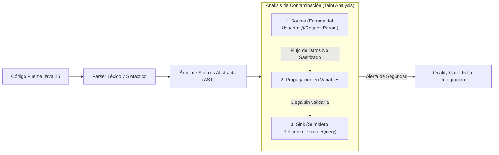

**UNIVERSIDAD DE COSTA RICA**  
**SEDE DEL ATLÁNTICO - RECINTO PARAÍSO**  
**CARRERA DE INFORMÁTICA EMPRESARIAL**  
**CURSO:** IF0009 - Desarrollo de Software IV  
**PROFESOR:** Mag. Jonathan Granados C.  
**SEMESTRE:** II-2026  

---

# Tema 6.7.1: Análisis Estático de Seguridad (SAST): SonarQube, Semgrep y Compuertas de Calidad (Quality Gates)

> [!NOTE]
> Este documento corresponde a la lectura técnica del **Subtema 6.7.1**. En esta lección usted analizará la metodología de pruebas de seguridad estáticas de aplicaciones (**SAST - Static Application Security Testing**), examinando cómo los motores de análisis léxico y sintáctico inspeccionan el código fuente y el Árbol de Sintaxis Abstracta (AST) para detectar vulnerabilidades en etapas tempranas (*Shift-Left Security*) con herramientas como **SonarQube**, **SonarLint** y **Semgrep**.

---

## 1. Resumen Ejecutivo

Corregir una vulnerabilidad de seguridad en producción cuesta hasta 30 veces más que detectarla durante la fase de codificación inicial. Las herramientas de Análisis Estático de Seguridad (SAST) permiten inspeccionar el código fuente sin compilarlo ni ejecutarlo, identificando fallas estructurales, violaciones de estándares y vulnerabilidades comunes antes de que el código sea integrado a la rama principal. En este módulo, usted comprenderá la mecánica interna del modelado de flujos de datos (*Dataflow & Taint Analysis*) y aprenderá a definir compuertas de calidad (*Security Quality Gates*) que bloquean automáticamente la integración de código vulnerable.

---

## 2. Concepto Principal (El "Qué"): Análisis Estático y Análisis de Contaminación (Taint Analysis)



### 2.1 Mecánica del Análisis de Contaminación (Taint Analysis)
La técnica más avanzada utilizada por los motores SAST para detectar inyecciones y vulnerabilidades complejas se basa en tres componentes:
1. **Source (Fuente de Entrada):** El punto exacto donde ingresan datos no confiables desde el exterior (ejemplo: un parámetro de método anotado con `@PathVariable`, `@RequestParam` o `request.getBody()`).
2. **Propagator (Propagación):** El seguimiento de cómo ese dato se asigna a nuevas variables, se concatena o se traslada a través de múltiples clases y métodos auxiliares.
3. **Sink (Sumidero / Destino Crítico):** Una función o API potencialmente peligrosa cuya ejecución puede tener consecuencias de seguridad (ejemplo: `Statement.execute()`, `Runtime.getRuntime().exec()`, `response.getWriter().write()`).
* **La Regla SAST:** Si existe una ruta de ejecución computable que conecta una **Fuente no confiable** con un **Sumidero crítico** sin pasar por una función de sanitización o validación reconocida (*Sanitizer*), la herramienta marca una **Vulnerabilidad Crítica**.

### 2.2 Herramientas Principales del Ecosistema SAST

| Herramienta | Enfoque Principal | Modo de Uso |
| :--- | :--- | :--- |
| **SonarLint** | Detección inmediata en tiempo real mientras el programador escribe código. | Plugin en VS Code o IntelliJ IDEA. |
| **SonarQube** | Análisis consolidado de calidad, bugs, cobertura y vulnerabilidades de seguridad (*Security Hotspots*). | Servidor centralizado y compuertas de CI/CD. |
| **Semgrep** | Motor ultra-rápido de búsqueda semántica basado en patrones de sintaxis semejantes al lenguaje destino. | CLI local y GitHub Actions. |
| **SpotBugs + Find Security Bugs** | Análisis de bytecode compilado de Java buscando antipatrones conocidos. | Plugin de Maven / Gradle. |

---

## 3. Analogía Didáctica (La Intuición)

* **Pruebas SAST (Análisis Estático):** Imagine a un ingeniero calculista que revisa los planos arquitectónicos impresos de un puente antes de que se vierta un solo metro cúbico de concreto. El ingeniero mide con su regla los grosores de las vigas y calcula con ecuaciones estructurales si el diseño soportará vientos huracanados. No necesita esperar a que el puente esté construido y pasen camiones pesados por encima para saber que se va a caer si el cálculo de los pilares está mal diseñado en el papel.
* **Taint Analysis:** Es como inyectar un tinte fluorescente inocuo en la tubería de entrada de agua potable de una casa: si el ingeniero ve aparecer el tinte fluorescente en los grifos del jardín sin haber pasado por el filtro purificador central, confirma que existe una conexión cruzada defectuosa en el diseño de las cañerías.

---

## 4. Implementación Técnica (El "Cómo"): Reglas Semgrep y Configuración SonarQube

### 4.1 Definición de Regla Personalizada en Semgrep (`semgrep.yml`)
Semgrep permite redactar reglas de seguridad utilizando la misma sintaxis del lenguaje objetivo:

```yaml
rules:
  - id: prohibir-concatenacion-sql-spring
    message: "¡ALERTA DE SEGURIDAD! Concatenación detectada en consulta JPQL/SQL. Use parámetros nombrados (:param)."
    severity: ERROR
    languages: [java]
    patterns:
      - pattern-either:
          - pattern: $EM.createQuery("..." + $VAR, ...)
          - pattern: $EM.createNativeQuery("..." + $VAR, ...)
          - pattern: $STMT.executeQuery("..." + $VAR)
```
Al ejecutar `semgrep --config semgrep.yml src/`, la herramienta detecta cualquier concatenación en milisegundos.

### 4.2 Definición de Compuertas de Calidad (Security Quality Gates) en SonarQube

Una **Security Quality Gate** impone condiciones matemáticas infranqueables en el pipeline de CI/CD:
* **Condición 1:** Nuevas vulnerabilidades de severidad Alta o Crítica = **0 (Cero tolerancia)**.
* **Condición 2:** *Security Hotspots* revisados = **100%**.
* **Condición 3:** Deuda técnica de seguridad nueva $\le 0\text{ días}$.

Integración en Maven (`pom.xml`):
```xml
<plugin>
    <groupId>org.sonarsource.scanner.maven</groupId>
    <artifactId>sonar-maven-plugin</artifactId>
    <version>3.11.0.3922</version>
</plugin>
```
Comando de escaneo en el pipeline de GitHub Actions o Jenkins:
```bash
mvn clean verify sonar:sonar \
  -Dsonar.host.url=https://sonarqube.ucr.ac.cr \
  -Dsonar.token=$SONAR_TOKEN \
  -Dsonar.qualitygate.wait=true
```
* **`-Dsonar.qualitygate.wait=true`:** Pausa la ejecución del pipeline hasta que SonarQube termine el análisis y aborta el despliegue con error si la Quality Gate no es aprobada.

---

## 5. Trampas Comunes y Antipatrones

*   **Fatiga de Alertas por Falsos Positivos:** No afinar las reglas de escaneo, provocando que los desarrolladores reciban cientos de advertencias irrelevantes y comiencen a ignorar todas las alertas, incluidas las reales.
*   **Limitar SAST únicamente al final del sprint:** Ejecutar los escaneos SAST únicamente el día antes del pase a producción. El análisis estático debe ejecutarse **localmente en el IDE (SonarLint)** y en cada *Pull Request*.
*   **Asumir que SAST es suficiente:** SAST no puede evaluar fallas en tiempo de ejecución, configuraciones de red, debilidades de certificados TLS ni errores de lógica de negocio dependientes de la infraestructura. Debe combinarse con DAST.

---

## 6. Preguntas de Reflexión y Autoevaluación

1. ¿Por qué el análisis de contaminación (*Taint Analysis*) resulta mucho más preciso que una simple búsqueda de cadenas con expresiones regulares (`grep`) para detectar inyecciones de código en proyectos grandes?
2. ¿Qué criterio pedagógico y técnico debe seguir un equipo de desarrollo al catalogar un hallazgo de SonarQube como un *Falso Positivo* frente a un *Riesgo Aceptado*?

