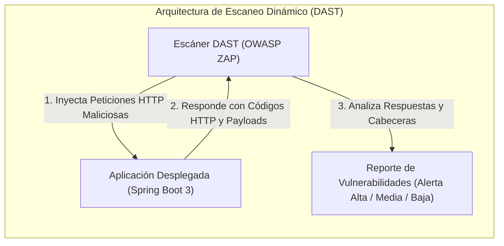

**UNIVERSIDAD DE COSTA RICA**  
**SEDE DEL ATLÁNTICO - RECINTO PARAÍSO**  
**CARRERA DE INFORMÁTICA EMPRESARIAL**  
**CURSO:** IF0009 - Desarrollo de Software IV  
**PROFESOR:** Mag. Jonathan Granados C.  
**SEMESTRE:** II-2026  

---

# Tema 6.7.2: Análisis Dinámico de Seguridad (DAST): Auditoría de APIs en Ejecución con OWASP ZAP

> [!NOTE]
> Este documento corresponde a la lectura técnica del **Subtema 6.7.2**. En esta unidad usted analizará el estándar de pruebas dinámicas de seguridad (**DAST - Dynamic Application Security Testing**), examinando cómo interactúan los escáneres de caja negra contra aplicaciones web y APIs RESTful en ejecución activa. Profundizaremos en el funcionamiento de **OWASP ZAP (Zed Attack Proxy)**, la automatización de escaneos mediante especificaciones OpenAPI y la interpretación analítica de sus reportes de vulnerabilidad.

---

## 1. Resumen Ejecutivo

Mientras que las pruebas estáticas (SAST) evalúan la corrección teórica del código fuente, las pruebas dinámicas (DAST) evalúan la resistencia operativa del software frente a ataques reales simulados desde el exterior de la red. Una aplicación puede tener un código fuente impecable pero ser vulnerable debido a errores de configuración en el servidor web, cabeceras HTTP omitidas, certificados desactualizados o fallas en el enrutamiento del balanceador de carga. En este módulo, usted aprenderá a operar **OWASP ZAP** en entornos contenerizados para auditar automáticamente los endpoints documentados de un backend en **Spring Boot 3 / Java 25**.

---

## 2. Concepto Principal (El "Qué"): SAST vs. DAST y los Dos Modos de OWASP ZAP



### 2.1 Comparativa Fundamental: SAST frente a DAST

| Dimensión | Análisis Estático (SAST) | Análisis Dinámico (DAST) |
| :--- | :--- | :--- |
| **Punto de Vista** | Caja Blanca (*White-Box*): Acceso total al código fuente. | Caja Negra (*Black-Box*): Simula la perspectiva de un atacante externo. |
| **Estado del Software** | No requiere compilación ni ejecución activa. | Requiere que la aplicación esté levantada y respondiendo en red. |
| **Fortalezas** | Detecta la línea exacta de código donde se origina el problema. | Detecta desconfiguraciones del servidor, TLS, cabeceras y fallas de runtime. |
| **Dependencia del Lenguaje** | Específico para cada lenguaje (Java, Dart, TypeScript). | Completamente independiente del lenguaje (solo evalúa HTTP/S). |

### 2.2 Modos de Escaneo en OWASP ZAP
1. **Escaneo Pasivo (Passive Scan):**
   * ZAP actúa como un proxy intermedio transparente que analiza el tráfico HTTP legítimo intercambiado entre clientes y la aplicación.
   * **No altera peticiones ni inyecta payloads maliciosos.**
   * Detecta ausencia de cabeceras de seguridad (`nosniff`, `CSP`, `HSTS`), cookies sin bandera `Secure` o `HttpOnly`, y exposición de metadatos del servidor.
2. **Escaneo Activo (Active Scan):**
   * ZAP toma los endpoints descubiertos y envía ráfagas de ataques dirigidos manipulando parámetros y cabeceras con payloads de inyección SQL, Cross-Site Scripting, Directory Traversal y Path Traversal.
   * **Es intrínseco y agresivo:** Únicamente debe ejecutarse en entornos de pruebas (*Staging*) aislados, nunca contra bases de datos de producción con datos reales.

---

## 3. Analogía Didáctica (La Intuición)

* **Pruebas SAST:** Es el control de calidad de un candado en la fábrica metalúrgica antes de salir a la venta: los técnicos inspeccionan con rayos X el cilindro interno de bronce para verificar que no tenga microfisuras estructurales.
* **Pruebas DAST (OWASP ZAP):** Es contratar a un cerrajero profesional y a un experto en robos para que intente abrir la puerta de su casa por la fuerza con ganzúas, palancas y taladros una vez que el candado ya está instalado en el portón exterior. No le importa si el candado fue fabricado con bronce o acero; solo le importa si cede o resiste cuando se le aplica presión mecánica en la vida real.

---

## 4. Implementación Técnica (El "Cómo"): Automatización de Escaneo con OpenAPI en Docker

OWASP ZAP provee imágenes Docker oficiales y scripts de automatización en Python (`zap-api-scan.py`) diseñados específicamente para auditar APIs RESTful a partir de su documentación **OpenAPI / Swagger (v3)**:

### 4.1 Exposición del Contrato OpenAPI en Spring Boot 3 (`springdoc-openapi`)

En `pom.xml`:
```xml
<dependency>
    <groupId>org.springdoc</groupId>
    <artifactId>springdoc-openapi-starter-webmvc-ui</artifactId>
    <version>2.5.0</version>
</dependency>
```
Al iniciar la aplicación, el esquema se encuentra disponible en:
`http://localhost:8080/v3/api-docs`

### 4.2 Ejecución de Escaneo Automatizado con Docker

Ejecutamos el contenedor oficial de OWASP ZAP apuntando a la especificación de la API:

```bash
docker run --rm -v $(pwd)/reportes-seguridad:/zap/wrk/:rw \
  ghcr.io/zaproxy/zaproxy:stable zap-api-scan.py \
  -t http://host.docker.internal:8080/v3/api-docs \
  -f openapi \
  -r reporte_zap_api.html \
  -J reporte_zap_api.json \
  -c zap-reglas.conf \
  -l WARN
```

**Análisis de parámetros del comando:**
* `-t`: URL del documento de definición OpenAPI. ZAP parseará automáticamente todas las rutas, métodos y parámetros documentados.
* `-f openapi`: Formato de la especificación entrante.
* `-r reporte_zap_api.html`: Genera un reporte visual interactivo en HTML.
* `-c zap-reglas.conf`: Archivo de reglas de exclusión para ignorar falsos positivos conocidos o degradar advertencias informativas.
* `-l WARN`: Define el umbral de tolerancia para el código de retorno. Si se encuentran alertas de severidad Media o Alta, el proceso retorna código de error para detener el pipeline de integración continua.

---

## 5. Trampas Comunes y Antipatrones

*   **Ejecutar escaneo activo contra bases de datos productivas:** Lanzar un escaneo activo contra un sistema en producción puede insertar registros de prueba corruptos, activar bloqueos de cuentas por fuerza bruta o saturar los servidores con miles de peticiones concurrentes.
*   **Confundir ausencia de alertas con seguridad absoluta:** Un escáner DAST solo puede auditar los endpoints que conoce. Si un endpoint administrativo privado no está documentado en la especificación OpenAPI o protegido detrás de una autenticación compleja con MFA, ZAP no lo explorará (*Shadow APIs*).
*   **No autenticar el escáner ZAP:** Ejecutar ZAP únicamente como usuario anónimo. El escáner solo auditará la pantalla de login pública, dejando el 95% de los endpoints protegidos sin analizar. Debe configurarse la autenticación con tokens Bearer o scripts de autenticación en ZAP.

---

## 6. Preguntas de Reflexión y Autoevaluación

1. ¿Por qué es indispensable alimentar a OWASP ZAP con la especificación OpenAPI (`/v3/api-docs`) al auditar una API RESTful en lugar de utilizar un rastreador web convencional (*Web Spider*)?
2. Si un escáner DAST reporta una alerta de severidad media indicando que la cabecera `X-Frame-Options` está ausente en una API que responde exclusivamente con JSON (`application/json`), ¿constituye esto una vulnerabilidad real o un falso positivo? Justifique su respuesta técnica.

