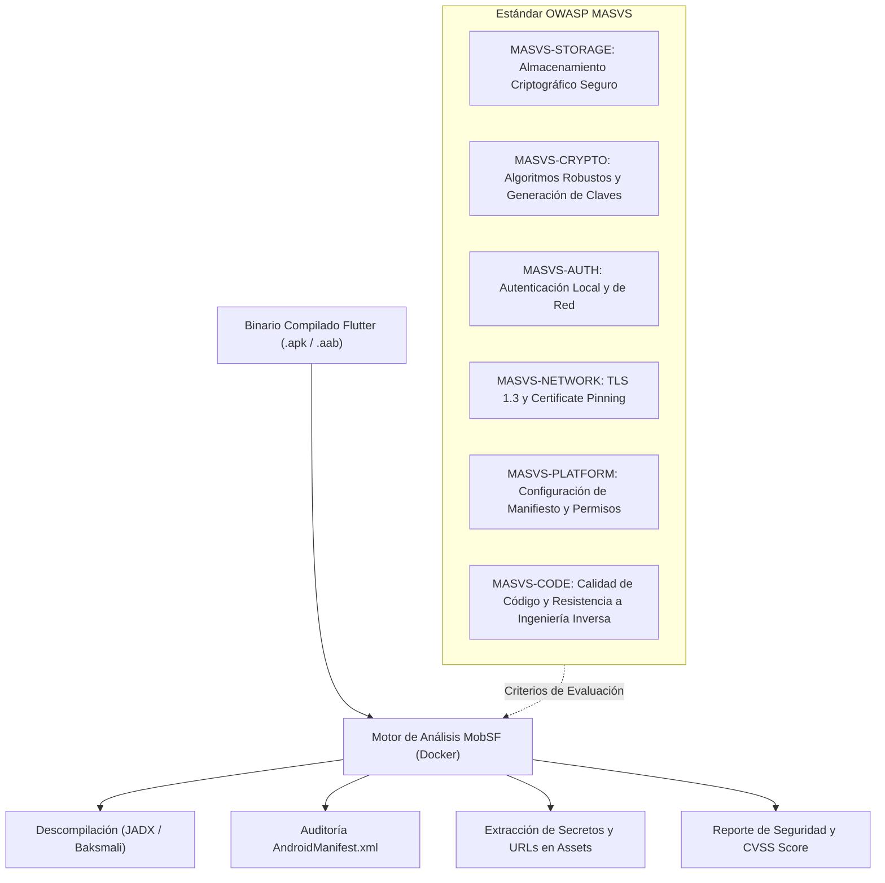

**UNIVERSIDAD DE COSTA RICA**  
**SEDE DEL ATLÁNTICO - RECINTO PARAÍSO**  
**CARRERA DE INFORMÁTICA EMPRESARIAL**  
**CURSO:** IF0009 - Desarrollo de Software IV  
**PROFESOR:** Mag. Jonathan Granados C.  
**SEMESTRE:** II-2026  

---

# Tema 6.7.3: Análisis y Auditoría de Seguridad Móvil: Estándar OWASP MASVS y Análisis Forense con MobSF

> [!NOTE]
> Este documento corresponde a la lectura técnica del **Subtema 6.7.3**. En esta lección usted analizará la auditoría de seguridad integral en aplicaciones móviles mediante el estándar internacional **OWASP MASVS (Mobile Application Security Verification Standard)** y su guía técnica **MASTG**. Además, aprenderá a utilizar la plataforma **Mobile Security Framework (MobSF)** para realizar análisis estáticos y dinámicos de binarios compilados de **Flutter 3** (`.apk` y `.aab`).

---

## 1. Resumen Ejecutivo

A diferencia de un backend protegido en un centro de datos corporativo, un binario de aplicación móvil distribuido a través de Google Play Store o Apple App Store queda completamente a merced del análisis de terceros. Cualquier persona puede descargar el paquete ejecutable, descompilar su código intermedio, extraer recursos y examinar permisos de hardware. En este módulo, usted comprenderá la estructura de los dominios del estándar OWASP MASVS y aprenderá a utilizar **MobSF** en contenedores Docker para auditar automáticamente binarios compilados, identificando banderas inseguras en el manifiesto, permisos excesivos y secretos expuestos en código compilado.

---

## 2. Concepto Principal (El "Qué"): Estándar MASVS y Plataforma MobSF



### 2.1 Niveles de Verificación en OWASP MASVS
* **MASVS-L1 (Mobile App Security Baseline):** Requisitos fundamentales para toda aplicación móvil. Garantiza buenas prácticas de almacenamiento, validación de certificados y confinamiento de datos.
* **MASVS-L2 (High Security):** Nivel de defensa en profundidad diseñado para aplicaciones altamente reguladas (banca en línea, billeteras digitales, expedientes clínicos médicos). Exige autenticación biométrica estricta, Certificate Pinning y cifrado de bases de datos.
* **MASVS-R (Resilience Against Reverse Engineering):** Requisitos específicos de protección de código: detección de entornos con *root* / *jailbreak*, prevención de ejecución en emuladores, ofuscación de símbolos y resistencia contra depuradores dinámicos (*anti-tampering* con Frida).

### 2.2 Funcionalidades Críticas de MobSF (Mobile Security Framework)
MobSF es una suite de auditoría integral capaz de ejecutar:
1. **Auditoría del Manifiesto Android (`AndroidManifest.xml`):**
   * Banderas peligrosas: `android:debuggable="true"` (permite conectar depuradores remotos en producción), `android:allowBackup="true"` (permite volcar los datos privados de la app mediante comandos `adb backup`).
   * Componentes exportados no protegidos: `android:exported="true"` en actividades o proveedores de contenido que permiten a otras apps maliciosas invocar pantallas internas sin autenticación.
2. **Extracción Automatizada de Secretos:**
   * Rastreo de cadenas de texto en archivos binarios y assets buscando claves de AWS, tokens de Firebase, contraseñas de bases de datos y URLs de staging.
3. **Puntuación de Seguridad (Security Scorecard):**
   * Genera un puntaje del 0 al 100 ponderando las debilidades halladas y mapeándolas directamente a los identificadores del OWASP Mobile Top 10.

---

## 3. Analogía Didáctica (La Intuición)

* **El Binario Móvil en la Tienda:** Imagine que usted diseña un reloj de pulsera suizo con una caja fuerte miniatura en su interior (su aplicación en Flutter). Vender la app en la tienda equivale a entregarle el reloj físico a cualquier persona en la calle. Un atacante no va a pedirle permiso para mirar: se llevará el reloj a su taller mecánico, lo desarmará con destornilladores de precisión (descompiladores como JADX), examinará los engranajes con microscopio y buscará cualquier combinación anotada en un papelito dentro de la maquinaria.
* **MobSF:** Es el banco de pruebas de un laboratorio de metrología antes de lanzar el reloj al mercado: los ingenieros someten el reloj a pruebas de impacto, examinan si las juntas son herméticas y comprueban que el código de la caja fuerte no esté escrito en la tapa trasera.

---

## 4. Implementación Técnica (El "Cómo"): Hardening del Manifiesto y Auditoría en MobSF

### 4.1 Configuración Defensiva en `android/app/src/main/AndroidManifest.xml` (Flutter 3)

```xml
<manifest xmlns:android="http://schemas.android.com/apk/res/android"
    package="com.ucr.seguridad.movil">

    <!-- 1. Principio de Menor Privilegio: Declarar solo permisos indispensables -->
    <uses-permission android:name="android.permission.INTERNET" />

    <application
        android:label="UCR App Segura"
        android:name="${applicationName}"
        android:icon="@mipmap/ic_launcher"
        <!-- 2. NUNCA permitir copias de seguridad de datos por ADB -->
        android:allowBackup="false"
        <!-- 3. NUNCA desplegar con la bandera de depuración activa en release -->
        android:debuggable="false"
        <!-- 4. Política de Red Estricta: Prohibir tráfico HTTP en texto plano -->
        android:usesCleartextTraffic="false"
        android:networkSecurityConfig="@xml/network_security_config">

        <activity
            android:name=".MainActivity"
            <!-- 5. Componente exportado con filtro de intención restringido -->
            android:exported="true"
            android:launchMode="singleTop"
            android:theme="@style/LaunchTheme"
            android:configChanges="orientation|keyboardHidden|keyboard|screenSize"
            android:hardwareAccelerated="true"
            android:windowSoftInputMode="adjustResize">
            
            <intent-filter>
                <action android:name="android.intent.action.MAIN"/>
                <category android:name="android.intent.category.LAUNCHER"/>
            </intent-filter>
        </activity>

    </application>
</manifest>
```

### 4.2 Despliegue y Ejecución de MobSF en Contenedor Docker

Podemos levantar la plataforma MobSF localmente en segundos sin necesidad de complejas instalaciones de Android SDK:

```bash
# 1. Levanta el contenedor oficial de MobSF
docker run -it --rm -p 8000:8000 opensecurity/mobsf:latest
```

Una vez levantado:
1. Abra su navegador en `http://localhost:8000`.
2. Compile el binario de Flutter en modo producción:
   ```bash
   flutter build apk --release
   ```
3. Arrastre el archivo generado (`build/app/outputs/flutter-apk/app-release.apk`) a la interfaz web de MobSF.
4. MobSF ejecutará la descompilación completa y presentará un informe detallado indicando:
   * Análisis de firmas de certificados.
   * Permisos solicitados vs. permisos recomendados.
   * Archivos y clases analizadas.
   * Puntuación de riesgo global (*Security Score*).

---

## 5. Trampas Comunes y Antipatrones

*   **Dejar `android:allowBackup="true"`:** Permitir que cualquier persona que tenga acceso físico al teléfono durante 2 minutos conecte un cable USB y ejecute `adb backup` para extraer la base de datos local y las preferencias sin desbloquear la aplicación.
*   **Permitir tráfico HTTP en claro (`android:usesCleartextTraffic="true"`):** Habilitar tráfico HTTP para pruebas locales y olvidar deshabilitarlo para la versión de producción, permitiendo ataques de intercepción en redes públicas.
*   **Almacenar credenciales en el archivo `strings.xml` o assets:** Creer que por estar compilado en el binario `.apk`, los archivos de configuración o recursos son secretos. MobSF extrae y lee todos los archivos XML y JSON del paquete en un solo clic.

---

## 6. Preguntas de Reflexión y Autoevaluación

1. ¿Por qué la bandera `android:allowBackup="false"` resulta crítica para aplicaciones bancarias o de salud que almacenan datos sensibles en el dispositivo móvil?
2. Si el código fuente de Flutter en modo release se compila a código de máquina binario nativo (AOT - *Ahead-of-Time*), ¿por qué las herramientas de auditoría móvil como MobSF todavía logran detectar brechas de seguridad y permisos inseguros en el paquete APK?

