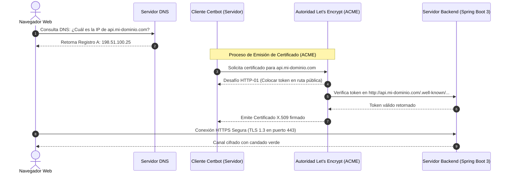

**UNIVERSIDAD DE COSTA RICA**  
**SEDE DEL ATLÁNTICO - RECINTO PARAÍSO**  
**CARRERA DE INFORMÁTICA EMPRESARIAL**  
**CURSO:** IF0009 - Desarrollo de Software IV  
**PROFESOR:** Mag. Jonathan Granados C.  
**SEMESTRE:** II-2026  

---

# Tema 7.1.3: Dominios, Resolución DNS y Automatización de Certificados SSL/TLS con Let's Encrypt

> [!NOTE]
> Este documento corresponde a la lectura técnica del **Subtema 7.1.3**. En esta lección usted analizará la infraestructura de nombres en Internet (**DNS**), los tipos de registros fundamentales (`A`, `CNAME`, `TXT`), la arquitectura de certificados digitales **SSL/TLS** para el cifrado HTTPS y la automatización de emisión y renovación mediante el protocolo **ACME** con **Let's Encrypt y Certbot**, integrándolo en **Spring Boot 3 / Java 25**.

---

## 1. Resumen Ejecutivo

Para que los usuarios puedan interactuar de forma segura con una aplicación web, es imperativo asociar las direcciones IP numéricas de los servidores a nombres de dominio mnemotécnicos y establecer canales de comunicación cifrados mediante certificados digitales válidos. En este módulo, usted comprenderá la jerarquía global del Sistema de Nombres de Dominio (DNS), cómo propagar registros de red y cómo automatizar la obtención de certificados criptográficos reconocidos por todos los navegadores modernos sin incurrir en costos económicos recurrentes.

---

## 2. Concepto Principal (El "Qué"): Jerarquía DNS y el Protocolo ACME



### 2.1 Registros DNS Fundamentales

| Tipo de Registro | Propósito y Función | Ejemplo de Uso |
| :--- | :--- | :--- |
| **`A` (Address)** | Asocia un nombre de dominio directamente a una dirección **IPv4**. | `api.ucr.ac.cr` $\longrightarrow$ `198.51.100.25` |
| **`AAAA`** | Asocia un nombre de dominio a una dirección **IPv6** de 128 bits. | `api.ucr.ac.cr` $\longrightarrow$ `2001:db8::1` |
| **`CNAME` (Canonical Name)** | Crea un alias que apunta a otro nombre de dominio (no a una IP directa). | `www.ucr.ac.cr` $\longrightarrow$ `ucr.ac.cr` |
| **`TXT` (Text)** | Almacena cadenas de texto arbitrarias para verificar propiedad del dominio. | Verificación de Google Search Console, SPF y DKIM. |

* **TTL (Time to Live):** Tiempo en segundos que los servidores DNS intermedios guardan en caché la respuesta. Durante una migración de servidores, el TTL debe reducirse (ej. de 86400 a 300 segundos) para asegurar una propagación rápida de la nueva IP.

### 2.2 Let's Encrypt y el Estándar ACME (RFC 8555)
**Let's Encrypt** es una Autoridad Certificadora (CA) pública, libre y automatizada. Opera bajo el protocolo **ACME (*Automated Certificate Management Environment*)**:
1. **Desafío HTTP-01:** La CA le pide al cliente Certbot que coloque un archivo con un hash criptográfico específico en la ruta web `http://dominio.com/.well-known/acme-challenge/<token>`. Let's Encrypt consulta la ruta desde Internet; si el contenido coincide, certifica que usted controla el servidor.
2. **Desafío DNS-01:** La CA le pide que inserte un registro `TXT` específico en su panel DNS. Es el único método para emitir certificados comodín (*Wildcard* como `*.mi-dominio.com`).
3. **Vigencia y Renovación:** Los certificados de Let's Encrypt son válidos por **90 días**. Se renuevan automáticamente cada 60 días mediante tareas cron programadas.

---

## 3. Analogía Didáctica (La Intuición)

* **El Sistema DNS:** Es la agenda de contactos de su teléfono móvil: usted no memoriza el número telefónico numérico de 8 dígitos de su mejor amigo (la dirección IP `198.51.100.25`), sino que simplemente busca el contacto por su nombre "Carlos Gómez" (el nombre de dominio `api.ucr.ac.cr`).
* **El Certificado SSL/TLS:** Es el pasaporte con chip biométrico y sellos consulares infalsificables que entrega un ciudadano en el aeropuerto.
* **El Desafío ACME (Let's Encrypt):** Imagine que para demostrarle a un notario que usted es el dueño legítimo de un terreno baldío, el notario le dice por teléfono: *"Vaya al terreno y coloque una bandera de color púrpura con el número 742 en la esquina norte"*. El notario envía a un inspector en automóvil 10 minutos después; al ver la bandera púrpura con el número exacto, le entrega la escritura oficial inmediatamente sin cobrarle honorarios.

---

## 4. Implementación Técnica (El "Cómo"): Certbot y Configuración SSL en Spring Boot 3

### 4.1 Generación del Certificado con Certbot en Modo Autónomo (*Standalone*)

En el servidor Linux de producción:

```bash
# Solicita el certificado HTTPS ejecutando un servidor temporal en puerto 80
sudo certbot certonly --standalone \
  -d api.mi-dominio.com \
  --agree-tos \
  -m admin@mi-dominio.com \
  --non-interactive
```
Los certificados generados se ubican en `/etc/letsencrypt/live/api.mi-dominio.com/`:
* `fullchain.pem`: El certificado público del servidor junto con los certificados intermedios.
* `privkey.pem`: La clave privada criptográfica confidencial.

### 4.2 Conversión a Almacén PKCS#12 para Spring Boot 3 (Java 25)

Java requiere empaquetar el par de claves en un archivo de almacén criptográfico **PKCS#12** (`.p12`):

```bash
# Convierte los archivos PEM de Let's Encrypt a un keystore PKCS12
openssl pkcs12 -export \
  -in /etc/letsencrypt/live/api.mi-dominio.com/fullchain.pem \
  -inkey /etc/letsencrypt/live/api.mi-dominio.com/privkey.pem \
  -out keystore-prod.p12 \
  -name springboot \
  -password pass:ClaveSuperSegura2026!
```

### 4.3 Configuración de HTTPS en `application-prod.properties`

```properties
# Habilitación de HTTPS en el puerto seguro estándar 443
server.port=443

# Configuración del Keystore SSL
server.ssl.key-store=file:/var/certificados/keystore-prod.p12
server.ssl.key-store-type=PKCS12
server.ssl.key-store-password=ClaveSuperSegura2026!
server.ssl.key-alias=springboot

# Forzado de protocolos modernos (deshabilita TLS 1.0, 1.1 y 1.2)
server.ssl.enabled-protocols=TLSv1.3
```

---

## 5. Trampas Comunes y Antipatrones

*   **Olvidar la tarea automática de renovación (`certbot renew`):** Confiar en que los 90 días son suficientes y no verificar que el demonio `systemd` o cron esté ejecutando `certbot renew --quiet`. Si el certificado expira, los navegadores mostrarán una pantalla roja de advertencia que bloqueará a todos los usuarios.
*   **Exponer la clave privada `privkey.pem` en Git:** Subir accidentalmente la clave privada o el archivo `.p12` al repositorio. Si la clave privada se filtra, cualquier atacante puede clonar su certificado y realizar ataques de interceptación.
*   **Configurar registros `CNAME` en el vértice del dominio (*Apex/Root Domain*):** Intentar colocar un registro CNAME directamente en `mi-dominio.com` (en lugar de `www.mi-dominio.com`). El estándar DNS original prohíbe CNAMEs en el nodo raíz si existen otros registros como MX o SOA.

---

## 6. Preguntas de Reflexión y Autoevaluación

1. ¿Por qué el desafío HTTP-01 de Let's Encrypt requiere que el puerto 80 (HTTP estándar) esté abierto en el cortafuegos (*Firewall*) del servidor durante el proceso de emisión, aun cuando la meta final sea utilizar exclusivamente HTTPS en el puerto 443?
2. ¿Qué ventaja ofrece forzar `server.ssl.enabled-protocols=TLSv1.3` en una API de producción frente a mantener compatibilidad con versiones antiguas como TLS 1.0 o 1.1?

