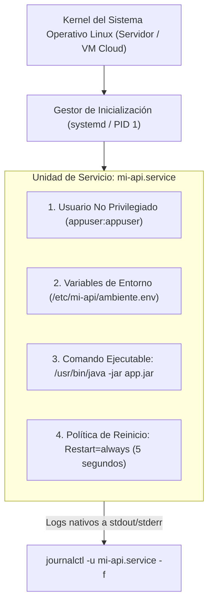

**UNIVERSIDAD DE COSTA RICA**  
**SEDE DEL ATLÁNTICO - RECINTO PARAÍSO**  
**CARRERA DE INFORMÁTICA EMPRESARIAL**  
**CURSO:** IF0009 - Desarrollo de Software IV  
**PROFESOR:** Mag. Jonathan Granados C.  
**SEMESTRE:** II-2026  

---

# Tema 7.1.4: Despliegue en Producción: Servicios del Sistema (systemd), Monitoreo y Plataformas Cloud PaaS

> [!NOTE]
> Este documento corresponde a la lectura técnica del **Subtema 7.1.4**. En esta unidad usted analizará las metodologías para ejecutar y administrar aplicaciones web backend de producción en servidores dedicados y en la nube sin requerir capas de contenerización. Estudiaremos la creación de servicios del sistema operativo con **`systemd`**, la inyección de variables de entorno, la observabilidad con `journalctl` y el despliegue administrado en plataformas **PaaS (Platform as a Service)** para **Spring Boot 3 en Java 25**.

---

## 1. Resumen Ejecutivo

Empaquetar una aplicación en un archivo `.jar` ejecutable es solo el primer paso; en un entorno de producción, la aplicación debe operar de manera continua, reiniciarse automáticamente si el proceso falla por una excepción de memoria o tras un reinicio del servidor físico, y registrar su telemetría en el sistema de eventos del sistema operativo. En este módulo, usted aprenderá a configurar servicios residentes de Linux de alta resiliencia utilizando el gestor de inicio `systemd`, aplicando principios de menor privilegio y explorando el despliegue administrado en plataformas de aplicación como servicio en la nube.

---

## 2. Concepto Principal (El "Qué"): Arquitectura de Servicios en Producción con systemd



### 2.1 ¿Por qué no ejecutar con `nohup java -jar ... &`?
Un antipatrón muy extendido entre desarrolladores principiantes consiste en conectarse al servidor por SSH y ejecutar `nohup java -jar app.jar &` en segundo plano. Esta práctica es inaceptable en entornos productivos porque:
* Si el proceso muere por una excepción o saturación de RAM, **nadie lo reinicia**.
* Si el servidor se reinicia por una actualización del kernel, la aplicación **no vuelve a encender**.
* No hay control de límites de recursos (memoria, descriptores de archivos).
* Los logs se acumulan en un archivo `nohup.out` no rotado que termina llenando el disco.

### 2.2 El Gestor de Sistema `systemd` (PID 1)
`systemd` es el estándar moderno de inicialización y control de procesos en sistemas operativos GNU/Linux (Ubuntu, Debian, Red Hat Enterprise Linux). Proporciona:
* **Supervisión de Vida:** Monitorea el PID del proceso de Java 25. Si termina abruptamente, `systemd` lo reinicia en cuestión de milisegundos (`Restart=always`).
* **Seguridad y Menor Privilegio:** Permite especificar qué usuario del sistema (`User=appuser`) ejecutará la aplicación, aislándola del usuario `root`.
* **Arranque en el Boot:** Garantiza que la API se inicie automáticamente tras el arranque de la red (`After=network.target`).

---

## 3. Analogía Didáctica (La Intuición)

* **Ejecutar con `nohup` manual:** Imagine que usted contrata a un guardia nocturno para cuidar su empresa, pero no le asigna un contrato formal ni un supervisor. Si el guardia se duerme, le da gripe o sale a comer (el proceso Java falla), el edificio queda completamente desprotegido durante toda la noche y nadie se entera hasta el día siguiente.
* **Servicio `systemd`:** Equivale a una central de monitoreo automatizada conectada a las constantes vitales del guardia. Si los sensores detectan que el guardia se desmaya, la central activa una sirena, llama a una ambulancia y envía a un nuevo guardia sustituto capacitado al edificio en menos de 5 segundos. Además, la central anota cada movimiento en una bitácora inalterable (`journalctl`).

---

## 4. Implementación Técnica (El "Cómo"): Servicio `systemd` para Java 25

Implementamos un archivo de unidad de servicio `/etc/systemd/system/api-ucr.service` para gestionar una aplicación Spring Boot 3 compilada con Java 25:

### 4.1 Archivo de Servicio `/etc/systemd/system/api-ucr.service`

```ini
[Unit]
Description=API RESTful IF0009 Spring Boot 3 (Java 25)
After=network.target syslog.target

[Service]
# Usuario dedicado sin privilegios de administración
User=appuser
Group=appuser

# Directorio de trabajo y archivo ejecutable
WorkingDirectory=/var/www/api-ucr
ExecStart=/usr/lib/jvm/jdk-25/bin/java \
    -server \
    -Xms512m \
    -Xmx2048m \
    -XX:+UseG1GC \
    -Dspring.profiles.active=prod \
    -jar /var/www/api-ucr/aplicacion-backend.jar

# Inyección de variables de entorno seguras desde archivo restringido
EnvironmentFile=/etc/api-ucr/produccion.env

# Políticas de resiliencia y reinicio automático
Restart=always
RestartSec=5
SuccessExitStatus=143

# Límites de seguridad del sistema operativo
LimitNOFILE=65536
TimeoutStopSec=30

[Install]
WantedBy=multi-user.target
```

### 4.2 Archivo de Entorno Restringido `/etc/api-ucr/produccion.env`

Este archivo contiene los secretos de base de datos con permisos estrictos de lectura (`chmod 600`):

```bash
SPRING_DATASOURCE_URL=jdbc:postgresql://db.ucr.ac.cr:5432/producciondb
SPRING_DATASOURCE_USERNAME=usr_app_prod
SPRING_DATASOURCE_PASSWORD=ClaveDeBaseDeDatosAltamenteSegura2026!
JWT_SECRET_KEY=ClaveCriptograficaDeFirmaJWT256BitsParaProduccion!
```

### 4.3 Comandos de Gestión y Monitoreo del Servicio

Para habilitar, arrancar e inspeccionar el estado del servicio:

```bash
# 1. Recarga la configuración del demonio systemd
sudo systemctl daemon-reload

# 2. Habilita el servicio para que inicie automáticamente en el boot
sudo systemctl enable api-ucr.service

# 3. Inicia el servicio
sudo systemctl start api-ucr.service

# 4. Verifica el estado y el uso de memoria en tiempo real
sudo systemctl status api-ucr.service

# 5. Inspecciona los logs en vivo (stdout / stderr) con journalctl
sudo journalctl -u api-ucr.service -f --output=short-iso
```

### 4.4 Alternativa Cloud PaaS (Platform as a Service)

En plataformas administradas en la nube (como Azure App Service, AWS Elastic Beanstalk o Render), no es necesario administrar la máquina virtual ni configurar `systemd`:
* El desarrollador conecta el repositorio de Git o sube directamente el artefacto `.jar`.
* La plataforma detecta automáticamente que es una aplicación Spring Boot basada en Java 25.
* Las variables de entorno se configuran mediante el panel web de la nube (*Application Settings*).
* La nube se encarga de aprovisionar el runtime de Java, aplicar parches de seguridad del sistema operativo y escalar vertical u horizontalmente ante aumentos de tráfico.

---

## 5. Trampas Comunes y Antipatrones

*   **Ejecutar el servicio como usuario `root`:** Dejar `User=root` en el archivo `.service`. Si la aplicación Java tiene una vulnerabilidad de deserialización o ejecución de comandos, el atacante tomará control de toda la máquina virtual.
*   **Permisos inseguros en el archivo `.env`:** Dejar el archivo de variables de entorno legible para cualquier usuario del sistema (`chmod 777`). Debe pertenecer a `root:appuser` con permisos `chmod 640` o `600`.
*   **No configurar `TimeoutStopSec`:** Forzar un apagado inmediato con `SIGKILL` al detener el servicio, impidiendo que Spring Boot cierre limpiamente sus conexiones a la base de datos (*Graceful Shutdown*).

---

## 6. Preguntas de Reflexión y Autoevaluación

1. ¿Por qué la directiva `Restart=always` combinada con `RestartSec=5` en `systemd` previene caídas prolongadas de servicio ante excepciones inesperadas de tipo `OutOfMemoryError`?
2. ¿Qué diferencias operacionales existen entre desplegar un Fat JAR en una máquina virtual propia configurando `systemd` frente a desplegarlo en un servicio Cloud PaaS completamente administrado?

