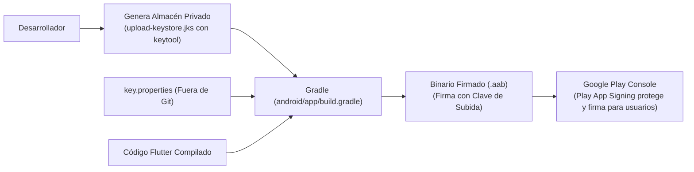

**UNIVERSIDAD DE COSTA RICA**  
**SEDE DEL ATLÁNTICO - RECINTO PARAÍSO**  
**CARRERA DE INFORMÁTICA EMPRESARIAL**  
**CURSO:** IF0009 - Desarrollo de Software IV  
**PROFESOR:** Mag. Jonathan Granados C.  
**SEMESTRE:** II-2026  

---

# Tema 7.2.1: Firma Digital y Gestión de Claves Criptográficas en Android: `keytool`, `key.properties` y Play App Signing

> [!NOTE]
> Este documento corresponde a la lectura técnica del **Subtema 7.2.1**. En esta lección usted aprenderá los fundamentos esenciales de la **Firma Digital Criptográfica** en Android para aplicaciones **Flutter 3**. Analizaremos la generación del almacén de claves (*Keystore*) con `keytool`, la configuración segura desacoplada en `key.properties` para no exponer secretos en Git, y el servicio oficial **Google Play App Signing**.

---

## 1. Resumen Ejecutivo

El sistema operativo Android rechaza de forma tajante la instalación o ejecución de cualquier paquete binario que no cuente con una firma criptográfica válida. La firma digital garantiza la autoría inmutable del desarrollador y asegura que ninguna actualización futura pueda ser suplantada por un tercero malicioso. En este módulo, usted dominará los pasos indispensables para crear un almacén de claves privado de larga vigencia, configurar el proceso de firmado en Gradle de forma segura y comprender la separación de responsabilidades que ofrece Google Play App Signing.

---

## 2. Concepto Principal (El "Qué"): Mecánica de la Firma Digital en Android



### 2.1 Principios Fundamentales
* **Identidad e Integridad:** La firma digital no cifra el código para ocultarlo; crea un sello criptográfico sobre el binario. Si un byte del archivo ejecutable es alterado, la firma queda invalidada y el dispositivo rechaza la instalación.
* **Cadena de Confianza en Actualizaciones:** Android utiliza la firma digital para autorizar actualizaciones de una aplicación ya instalada. Si intenta instalar una actualización firmada con un certificado distinto al original, el sistema aborta con el error `INSTALL_FAILED_UPDATE_INCOMPATIBLE`.
* **Google Play App Signing:** En el modelo moderno de Google Play, el desarrollador firma con una **Clave de Subida (*Upload Key*)**. Google verifica esa clave, retira la firma de subida y vuelve a firmar los binarios que se distribuyen a los usuarios finales con la **Clave Maestra de Firma (*App Signing Key*)**, la cual permanece resguardada en la infraestructura de seguridad blindada de Google.

---

## 3. Analogía Didáctica (La Intuición)

* **Firma Digital:** Piense en el sello lacrado en cera con el anillo heráldico de un rey medieval. La carta no está escondida (cualquiera puede leer el texto), pero el destinatario tiene la certeza absoluta de que fue escrita por el rey legítimo y que nadie abrió el pergamino en el camino para cambiar las palabras.
* **Play App Signing:** Es como si el rey tuviera una imprenta real protegida en su castillo (Google Play). El rey autoriza a sus mensajeros diplomáticos con una tarjeta de identificación de subida; la imprenta real verifica al mensajero y es la propia imprenta la que estampa el sello dorado supremo antes de repartir los decretos a los ciudadanos. Si el mensajero pierde su tarjeta en el bosque, el rey simplemente le emite una nueva sin perder el sello del reino.

---

## 4. Implementación Técnica (El "Cómo"): Proceso Paso a Paso de Firmado

### **1.** Generación del Keystore con `keytool`
En la consola de comandos (PowerShell o Terminal), ejecute la herramienta `keytool` incluida en el SDK de Java:

```bash
keytool -genkey -v \
  -keystore upload-keystore.jks \
  -keyalg RSA \
  -keysize 2048 \
  -validity 10000 \
  -alias upload
```
* **`-validity 10000`:** Establece una validez aproximada de 27 años (requisito mandatorio de Google Play para que el certificado no caduque durante la vida útil de la app).

### **2.** Ubicación y Archivo de Propiedades `key.properties`
Mueva el archivo `upload-keystore.jks` a la carpeta `android/app/`. Luego, cree el archivo `android/key.properties`:

```properties
storePassword=ContrasenaDelAlmacen2026!
keyPassword=ContrasenaDelAlias2026!
keyAlias=upload
storeFile=upload-keystore.jks
```

> [!IMPORTANT]
> Agregue de inmediato `android/key.properties` y `android/app/upload-keystore.jks` al archivo **`.gitignore`** de la raíz del proyecto para evitar subir contraseñas y certificados a GitHub.

### **3.** Configuración de Firma en `android/app/build.gradle`

Abra `android/app/build.gradle` e integre la lectura de las propiedades:

```groovy
import java.util.Properties

def keystoreProperties = new Properties()
def keystorePropertiesFile = rootProject.file('key.properties')
if (keystorePropertiesFile.exists()) {
    keystoreProperties.load(new FileInputStream(keystorePropertiesFile))
}

android {
    ...
    signingConfigs {
        release {
            keyAlias keystoreProperties['keyAlias']
            keyPassword keystoreProperties['keyPassword']
            storeFile keystoreProperties['storeFile'] ? 
                      file(keystoreProperties['storeFile']) : null
            storePassword keystoreProperties['storePassword']
        }
    }
    buildTypes {
        release {
            signingConfig signingConfigs.release
            minifyEnabled false
            shrinkResources false
        }
    }
}
```

---

## 5. Trampas Comunes y Antipatrones

*   **Pérdida irreversible del Keystore sin Play App Signing:** Si usted no activa Google Play App Signing y pierde el archivo `.jks` o su contraseña, **jamás podrá volver a actualizar su aplicación**. Tendrá que darla de baja y publicarla con un nuevo nombre de paquete perdiendo todos sus usuarios y reseñas.
*   **Subir `key.properties` a GitHub:** Exponer el archivo con las contraseñas en repositorios públicos.
*   **Utilizar el certificado de depuración (*Debug Keystore*) para producción:** Intentar subir a Google Play un binario firmado con el certificado por defecto `androiddebugkey`. La consola de Play rechazará el paquete de inmediato.

---

## 6. Preguntas de Reflexión y Autoevaluación

1. ¿Por qué el servicio *Google Play App Signing* representa una mejora crucial para los desarrolladores frente al esquema tradicional de firma autónoma local?
2. Si un atacante roba el archivo `upload-keystore.jks` pero la aplicación tiene activado *Play App Signing*, ¿cómo puede el propietario legítimo revocar esa clave y generar una nueva sin afectar a los usuarios existentes?

