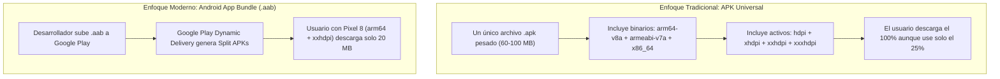

**UNIVERSIDAD DE COSTA RICA**  
**SEDE DEL ATLÁNTICO - RECINTO PARAÍSO**  
**CARRERA DE INFORMÁTICA EMPRESARIAL**  
**CURSO:** IF0009 - Desarrollo de Software IV  
**PROFESOR:** Mag. Jonathan Granados C.  
**SEMESTRE:** II-2026  

---

# Tema 7.2.2: Formatos de Distribución Móvil: APK Universal frente a Android App Bundle (AAB) y Optimización

> [!NOTE]
> Este documento corresponde a la lectura técnica del **Subtema 7.2.2**. En esta unidad usted analizará la evolución de los formatos de empaquetado y distribución en el ecosistema Android, contrastando los archivos **APK (*Android Package Kit*)** universales con el estándar de publicación moderno **AAB (*Android App Bundle*)**. Estudiaremos la entrega dinámica (*Dynamic Delivery / Split APKs*) y la compilación optimizada con ofuscación en **Flutter 3**.

---

## 1. Resumen Ejecutivo

Históricamente, los desarrolladores compilaban un archivo `.apk` monolítico que incluía todas las bibliotecas de lenguaje de máquina para procesadores ARM de 32 bits, ARM de 64 bits y x86, así como imágenes para todas las densidades de pantalla posibles. Este enfoque inflaba innecesariamente el tamaño de la aplicación, incrementando la tasa de abandono durante la descarga en conexiones celulares lentas. En este módulo, usted comprenderá cómo el formato **Android App Bundle (.aab)** revoluciona la entrega de software delegando la generación de binarios especializados a la tienda, y cómo compilar bundles de producción en Flutter aplicando técnicas de ofuscación de código.

---

## 2. Concepto Principal (El "Qué"): APK Monolítico vs. Android App Bundle (AAB)



### 2.1 Comparativa Técnica de Formatos

| Característica | APK Universal (`.apk`) | Android App Bundle (`.aab`) |
| :--- | :--- | :--- |
| **Instalabilidad Directa** | Se instala directamente en el dispositivo móvil con `adb install`. | No es instalable directamente; requiere compilar *Split APKs*. |
| **Estado en Google Play** | Deprecado para nuevas aplicaciones desde agosto de 2021. | **Obligatorio** como formato de subida en Google Play Console. |
| **Tamaño de Descarga** | Muy elevado (contiene todas las arquitecturas y recursos gráficos). | **Hasta 50% más liviano** para el usuario final. |
| **Entrega de Funcionalidades** | Todo el código se descarga de una sola vez. | Permite descarga modular bajo demanda (*Feature Delivery*). |

### 2.2 Entrega Dinámica mediante *Split APKs*
Cuando un usuario presiona "Instalar" en Google Play Store:
1. La tienda inspecciona las características del dispositivo del usuario: arquitectura de la CPU (ej. `arm64-v8a`), densidad de píxeles de la pantalla (ej. `xxhdpi`) y configuración de idioma (ej. español).
2. Google Play ensambla sobre la marcha un conjunto de **Split APKs**:
   * *Base APK:* Contiene la lógica común y el manifiesto.
   * *ABI Split APK:* Contiene únicamente los binarios C/C++ y Flutter para `arm64-v8a`.
   * *Density Split APK:* Contiene únicamente las imágenes escaladas para `xxhdpi`.
3. El teléfono instala la combinación óptima consumiendo el mínimo de almacenamiento flash.

---

## 3. Analogía Didáctica (La Intuición)

* **APK Universal:** Imagine comprar un televisor en una tienda de electrodomésticos y que la caja contenga cables de alimentación para enchufes europeos, americanos, británicos, australianos y japoneses, además de 15 manuales en diferentes idiomas. Usted solo necesita el enchufe y el manual de su país, pero tiene que cargar y pagar por una caja gigante con todo lo demás.
* **Android App Bundle (AAB):** Es un catálogo digital donde usted le dice a la tienda exactamente qué enchufe e idioma necesita antes de pagar: la tienda empaca en una pequeña caja únicamente el cable y el manual que usted utilizará en su hogar.

---

## 4. Implementación Técnica (El "Cómo"): Compilación en Flutter 3

### **1.** Compilación del App Bundle de Producción
En la raíz del proyecto Flutter, ejecute:

```bash
flutter build appbundle --release
```
El archivo resultante se generará en:
`build/app/outputs/bundle/release/app-release.aab`

### **2.** Compilación con Ofuscación y Extracción de Símbolos
Para proteger el código Dart contra ingeniería inversa y lectura desautorizada de nombres de clases y métodos, agregue las banderas de ofuscación:

```bash
flutter build appbundle --release \
  --obfuscate \
  --split-debug-info=./build/app/outputs/symbols
```
* **`--obfuscate`:** Reemplaza nombres de clases y funciones por identificadores cortos (`a`, `b`, `c`).
* **`--split-debug-info`:** Extrae la tabla de símbolos a una carpeta separada para que los desarrolladores puedan desofuscar (*symbolicate*) los reportes de caídas (*Crashlytics*) sin incluir los símbolos en el binario que descargan los usuarios.

### **3.** Inspección y Pruebas Locales con `bundletool`
Si desea generar e instalar los Split APKs de prueba en un teléfono conectado por USB:

```bash
# 1. Genera los APKs divididos a partir del bundle
java -jar bundletool.jar build-apks \
  --bundle=build/app/outputs/bundle/release/app-release.aab \
  --output=app.apks \
  --mode=default

# 2. Instala la combinación específica en el dispositivo conectado
java -jar bundletool.jar install-apks --apks=app.apks
```

---

## 5. Trampas Comunes y Antipatrones

*   **Intentar instalar un archivo `.aab` directamente con `adb install`:** El comando fallará arrojando un error de formato no reconocido. Los archivos `.aab` son contenedores de publicación para la tienda; no son paquetes ejecutables por el instalador del sistema operativo.
*   **Perder los archivos de símbolos (`symbols`):** No guardar los archivos generados por `--split-debug-info`. Si un usuario experimenta un error crítico, el stack trace en Crashlytics mostrará únicamente direcciones de memoria ilegibles sin posibilidad de saber en qué línea de código ocurrió el fallo.
*   **Compilar sin la bandera `--release`:** Compilar con `flutter build apk` a secas (modo Debug). Los binarios en modo debug contienen la máquina virtual JIT (*Just-In-Time*) de Dart, pesan el triple y son hasta 10 veces más lentos.

---

## 6. Preguntas de Reflexión y Autoevaluación

1. ¿Por qué la adopción de los *Split APKs* generados a partir de un Android App Bundle reduce la tasa de desinstalación de aplicaciones en teléfonos con almacenamiento limitado?
2. Si un desarrollador ofusca su aplicación en Flutter con `--obfuscate`, ¿qué herramienta o archivo debe cargar en la consola de Google Play para que las trazas de excepción de los usuarios sean legibles?

