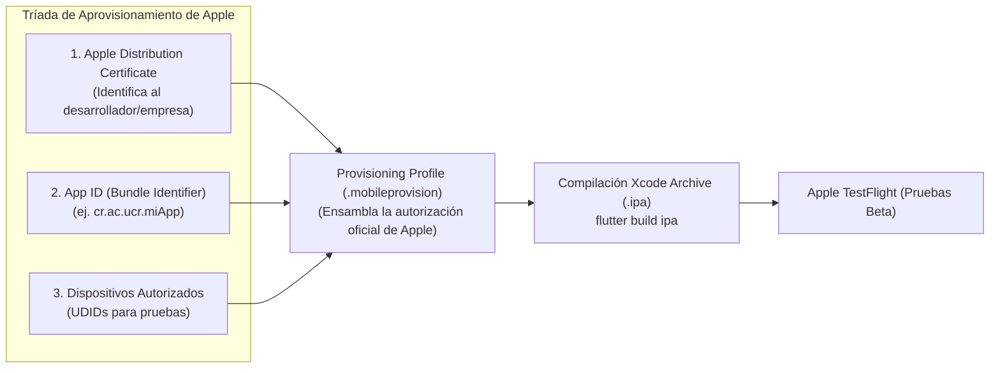

**UNIVERSIDAD DE COSTA RICA**  
**SEDE DEL ATLÁNTICO - RECINTO PARAÍSO**  
**CARRERA DE INFORMÁTICA EMPRESARIAL**  
**CURSO:** IF0009 - Desarrollo de Software IV  
**PROFESOR:** Mag. Jonathan Granados C.  
**SEMESTRE:** II-2026  

---

# Tema 7.2.3: Ecosistema Apple: Certificados de Distribución, Perfiles y Pruebas Beta con TestFlight

> [!NOTE]
> Este documento corresponde a la lectura técnica del **Subtema 7.2.3**. En esta lección usted aprenderá los elementos indispensables del flujo de distribución en el ecosistema **iOS / Apple**: la tríada de seguridad (**Certificados, Identificadores y Perfiles de Aprovisionamiento**), la generación de paquetes binarios **`.ipa`** y la distribución de versiones de prueba para control de calidad con **Apple TestFlight**.

---

## 1. Resumen Ejecutivo

El modelo de seguridad de Apple para dispositivos iOS (iPhone, iPad) es significativamente más cerrado y estricto que el de Android. Ningún binario puede instalarse en un dispositivo real sin estar firmado por un certificado emitido y validado criptográficamente por la infraestructura de Apple, vinculado a un identificador único de aplicación y a un perfil de aprovisionamiento autorizado. En este módulo, usted comprenderá la mecánica esencial de esta cadena de confianza y cómo utilizar TestFlight para recopilar retroalimentación antes de la publicación pública.

---

## 2. Concepto Principal (El "Qué"): La Tríada de Aprovisionamiento en iOS



### 2.1 Los Tres Componentes Indispensables
1. **Certificado de Distribución (*Distribution Certificate*):** Certificado digital X.509 emitido por el portal de desarrolladores de Apple que asocia la clave pública de su equipo con su cuenta del *Apple Developer Program*.
2. **Identificador de Aplicación (*App ID / Bundle Identifier*):** Cadena en notación de dominio inverso (ej. `cr.ac.ucr.incidencias`) que identifica de manera unívoca a la aplicación en todo el mundo.
3. **Perfil de Aprovisionamiento (*Provisioning Profile*):** Archivo criptográfico emitido por Apple que fusiona el Certificado, el App ID y los permisos especiales (*Entitlements* como Push Notifications o iCloud). Sin este perfil incrustado, iOS rechaza la apertura de la aplicación.

### 2.2 Distribución Beta con Apple TestFlight
**TestFlight** es la plataforma oficial de Apple para distribuir versiones de prueba sin necesidad de pasar por la revisión pública completa del App Store:
* **Pruebas Internas (*Internal Testing*):** Hasta 100 evaluadores que pertenecen a su equipo de desarrollo. No requiere revisión previa de Apple; las compilaciones están disponibles inmediatamente tras procesarse.
* **Pruebas Externas (*External Testing*):** Hasta 10.000 evaluadores mediante invitación por correo o enlace público. Requiere una revisión inicial rápida de cumplimiento por parte de Apple.

---

## 3. Analogía Didáctica (La Intuición)

* **El Ecosistema Apple:** Imagine un país con fronteras herméticas de máxima seguridad:
  * El **Certificado de Distribución** es su licencia oficial de comerciante emitida por el ministerio de economía (Apple).
  * El **App ID** es la marca registrada del producto que usted va a vender.
  * El **Provisioning Profile** es la visa especial sellada que autoriza a ese comerciante específico a vender ese producto exacto dentro de las fronteras del país. Si falta cualquiera de los tres sellos, la aduana (el sistema operativo iOS) confisca el cargamento de inmediato.
* **TestFlight:** Es una feria comercial privada dentro del puerto donde usted puede invitar a un grupo selecto de clientes para que prueben el producto antes de que sea colocado en los estantes de todos los supermercados nacionales.

---

## 4. Implementación Técnica (El "Cómo"): Compilación del Archivo `.ipa` en Flutter 3

Para compilar un paquete de distribución de iOS (requiere un entorno macOS con Xcode):

### **1.** Comando de Construcción del Archivo IPA
En la terminal del proyecto Flutter:

```bash
flutter build ipa --release
```
El proceso genera el archivo en:
`build/ios/archive/Runner.xcarchive` y el paquete exportado `.ipa` en `build/ios/ipa/`.

### **2.** Carga a App Store Connect
La carga hacia TestFlight puede realizarse directamente desde la línea de comandos con la herramienta oficial de Apple `altool`:

```bash
xcrun altool --upload-app \
  --type ios \
  -f build/ios/ipa/mi_app.ipa \
  --apiKey YOUR_API_KEY \
  --apiIssuer YOUR_ISSUER_UUID
```

Una vez procesada la compilación en **App Store Connect**, los evaluadores reciben una notificación automática en la aplicación TestFlight de sus iPhones para instalar la actualización con un solo toque.

---

## 5. Trampas Comunes y Antipatrones

*   **Expiración anual del Certificado de Distribución:** Los certificados de Apple expiran cada 12 meses. Si expira, las nuevas compilaciones fallarán hasta renovar el certificado en el portal de desarrolladores.
*   **Discrepancia en el Bundle Identifier:** Configurar un `bundleIdentifier` en Xcode diferente al `App ID` registrado en App Store Connect, impidiendo la subida del binario.
*   **Omitir descripciones de permisos en `Info.plist`:** Solicitar acceso a la cámara o ubicación sin definir las cadenas explicativas obligatorias (`NSCameraUsageDescription`, `NSLocationWhenInUseUsageDescription`). Si faltan, Apple rechaza el binario automáticamente durante la carga.

---

## 6. Preguntas de Reflexión y Autoevaluación

1. ¿Por qué es imposible instalar un archivo `.ipa` compilado para distribución mediante descarga directa desde un navegador en iOS sin utilizar perfiles empresariales o TestFlight?
2. ¿Qué ventaja ofrece TestFlight para la detección temprana de defectos antes de someter la aplicación a la revisión final del App Store?

